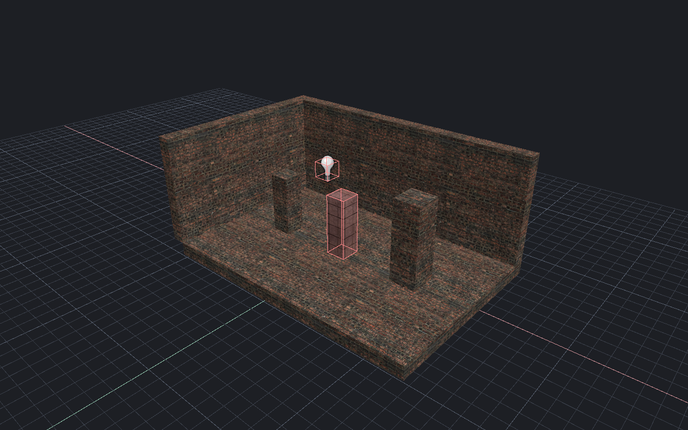

[← Manual](README.md)

# Compare external maps

Compare authored world brushes and whole entities with another VMF.
Objects match by kind and stored ID. Both maps stay intact.

1. Open **Compare external map…**.
2. Click **Choose VMF…**, choose the file, then click **Compare**.
3. Choose **All statuses**, **Identical**, **Changed**, **Current only**,
   **External only** or **Ambiguous**. Search displayed labels or IDs, then
   click **Refresh page**.
4. Use **Previous page** and **Next page** to inspect rows.
5. Choose **Replace**, **Add**, **Remove** or **Toggle**. Click
   **Select current matches**, or **Frame current matches**. Actions include
   every eligible match across pages.
6. Click **Cancel** to discard the comparison. **Close** also closes the window.
   Use **Review shared comparison** to take ownership of an idle comparison
   before you act on it.

## Limits

- **Identical** means equal typed stored data: IDs, hidden state, editor fields,
  ordered properties/connections, sides, child brushes and opaque blocks.
  VMF parsing/writing normalizes geometry-number spelling and signed zero;
  property strings keep their spelling. Whitespace and comments do not count.
  This does not prove geometric or complete semantic equivalence.
- Root object order, world properties, group definitions, map settings, cameras,
  expanded instances and unapplied drafts are excluded. All map data still
  counts against the input limit, including settings that are not compared.
- Duplicate scoped IDs produce **Ambiguous** rows. These and **External only**
  rows cannot select or frame current objects. The operation does not merge maps.
- Each request rechecks the original external file. Displayed rows are captured
  results. If either source changes, click **Compare** again; **Refresh page**
  cannot accept replacement data.
- Framing fails if any member lacks finite bounds or the camera moved during
  verification. Selection fails if the selection changed during verification.
  Finish geometry drafts and viewport gestures before either action.
- Limits: 8 MiB per file/input map, 8,192 root objects, 32,768 sides, 65,536
  parsed nodes, 131,072 value tokens, 64 nesting levels and one million work
  checkpoints. Nonfinite geometry and exceeded limits fail without partial rows.
- Pages have at most 64 rows. Search is limited to 512 bytes and displayed labels
  to 512 characters. Search covers those labels and IDs. Selection and framing
  preserve authored data and Undo history.
