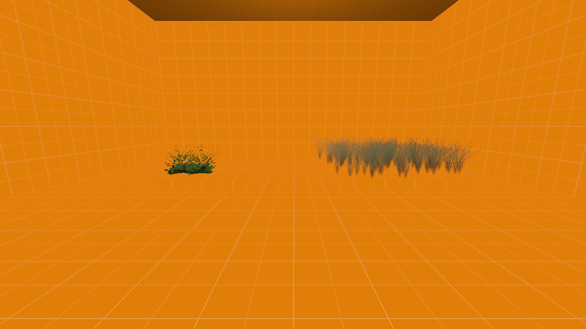
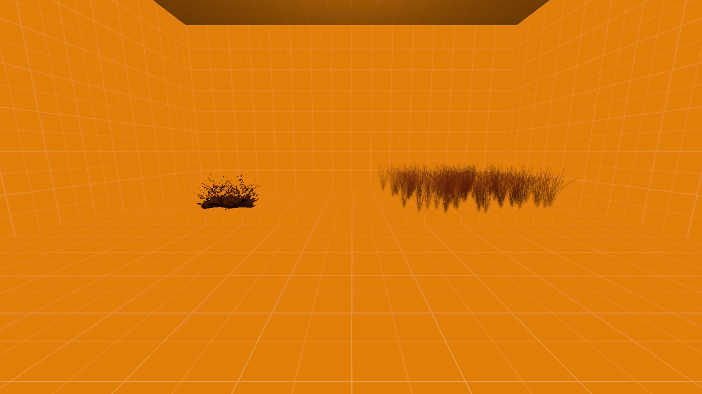
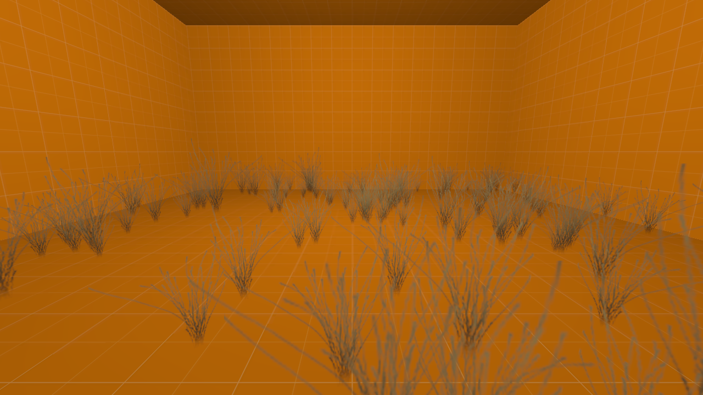
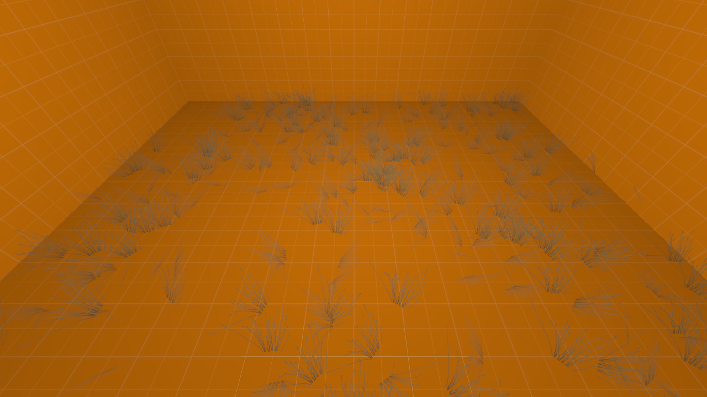
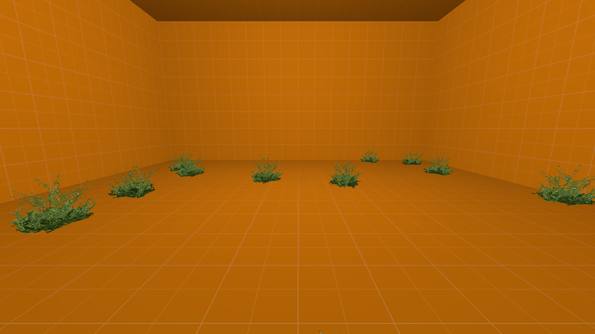

[← Manual](README.md)

# Material detail scattering

Materials can generate non-colliding client-only detail models, plain sprites
and fixed cross/tri shapes on exposed world and `func_detail` brush faces and terrain.
The compiler writes native model and sprite
records into the BSP's version-4 `dprp` game lump. The source map keeps its
original brushes and properties.

1. Put a detail dictionary in mounted game content. Its outer block
   contains named detail types; each type has a `density` and one or more groups.
   Groups contain `alpha` and named entries. Model entries need a `model` path;
   sprite entries use the atlas fields below. Models must be compiled with
   `$staticprop` and use supported `UnlitGeneric` materials.
2. Add `%detailtype` to the ground VMT, naming the dictionary type. Material
   patches resolve through the same mounted content as ordinary materials.
3. Open **World settings…**, set **Detail.vbsp file** (`detailvbsp`) to that
   game-relative `.vbsp` path, and click **Apply properties**. Leaving it empty
   uses `detail.vbsp`.
4. Paint the material onto the intended exposed faces using the normal material
   controls. Hidden brushes and hidden `func_detail` owners are excluded.
5. Open **Build settings…**, choose **Build lighting → Direct LDR**, then
   **Close** and **Compile**. **Build details…** reports **Detail props**,
   **Model assets** and **Sprite entries** together with explicit model detail
   props. Click **Run Map** to inspect the generated details.

A minimal dictionary using an installed CS:S detail model is:

```text
detail
{
    shrubs
    {
        density 64
        group
        {
            alpha 1
            shrub
            {
                model "models/props/de_inferno/bushgreensmall.mdl"
                amount 1
                upright 1
                minAngle 0
                maxAngle 0
            }
        }
    }
}
```

The corresponding VMT declares `%detailtype shrubs`. `density` gives sample
attempts per million square units. For ordinary brush faces, the compiler takes
the integer number of samples separately for each triangle of each final
clipped face. Small faces
can therefore generate no models. `amount` values above a combined total of
one are normalized; a smaller total leaves empty samples. Flat brush faces use
alpha one and select the group with the highest supported alpha.

Terrain takes its sample count from the whole base quad, so increasing grid
resolution does not remove samples. Samples spread uniformly over the base
grid for parallelogram bases. Convex planar skewed bases use the projected
areas of the final native base triangles, so samples spread uniformly over the
surface footprint rather than uniformly over a distorted grid chart. These
bases follow the authored start corner, including sloped quads and compatible
full/half-edge LOD snapping. Position and blend alpha interpolate from the native triangle vertices;
orientation follows its geometric normal. Neighboring dictionary alpha groups
are chosen probabilistically: an alpha halfway between two groups gives each
group half the samples on average. An empty selected group emits no model.

Remove the example's zero-degree angle limits to include sculpted slopes.
To control terrain distribution, paint the material onto a terrain face, open
**Edit terrain…**, and choose **Paint blend** or **Fill blend** under
**Operation**. **Blend value · 0 first texture, 255 second texture** also maps
to dictionary alpha 0–1. Click **Preview**, then **Apply**, and rebuild to see
the new distribution. The existing `preview_terrain_blend` and
`commit_face_preview` MCP calls provide the same edits.

`upright 1` keeps models vertical with a random yaw. With `upright 0`, models
follow the face normal. `minAngle` and `maxAngle` are degrees from world up:
placement is certain below the minimum, fades between the two limits, and stops
beyond the maximum. Both default to 180 degrees. A changed authored face ID or
final clipped polygon changes that face's deterministic seed. Rebuilding the
same map and mounted content produces the same records; placements are not
intended to match Valve VBSP byte for byte.

For an installed CS:S grass sprite, replace the example's model entry with:

```text
sprite "0 0 128 128 512"
spritesize "0.5 0 40 45"
spriterandomscale 0.2
detailOrientation 2
upright 1
```

`sprite` gives atlas X, Y, width, height and logical atlas size. Texture
coordinates use a half-texel inset in that logical size, independent of the
actual VTF resolution. CS:S's installed dictionary uses 512 for its 1024-pixel
atlas. `spritesize` gives horizontal anchor, vertical anchor, world width and
world height; anchors range from zero to one. The example centers a 40-unit
wide sprite on its bottom edge and makes it 45 units high. Omitting this field
uses width 20, height 20 and a centered bottom anchor. `spriterandomscale`
ranges from zero to one and specifies Gaussian standard deviation around one,
followed by absolute value. Zero keeps scale one. Sampling uses a bounded,
deterministic stream and rejects a collapsed native scale.

`detailOrientation` selects how the sprite faces the view:

| Value | Behavior |
| --- | --- |
| `0` (default) | Fixed card using its generated Source angles. `upright 1` keeps its up direction vertical; `upright 0` follows the surface normal. |
| `1` | Full billboard facing the camera, including its elevation. |
| `2` | Billboard facing the camera while remaining vertical. |

All three orientations accept the same Gaussian random scaling. Fixed and full
billboards use an older native path that truncates positive scale to half
precision; raw scales outside 2⁻²⁴–65504 reject before publication. The compiler retains
the emitted float scale for SDK lighting and checks its full extent: rotated
corners for fixed cards and a conservative sphere for full billboards. Native
half truncation can make the rendered card slightly smaller.

Procedural shapes reuse the same atlas rectangle and size:

```text
sprite "0 0 128 128 512"
spritesize "0.5 0 40 45"
sprite_shape tri
shape_angle 35
shape_size 0.5
detailOrientation 0
upright 1
```

`sprite_shape cross` produces two intersecting cards, drawn as four radial
half-cards. `sprite_shape tri` produces three cards, spaced 120 degrees apart.
Tri `shape_angle` is an integer from 0 to 255 degrees that fans each card;
`shape_size` ranges from zero to one and offsets each card by that fraction
of its full width. The compiler stores size as a truncated byte: `0.5` becomes
127, and the client decodes it as 127/255. Cross shapes require omitted or zero
angle and size, since the client ignores those parameters. Cross geometry
centers its horizontal branches regardless of the horizontal anchor; vertical
anchors still apply.

Shapes require fixed `detailOrientation 0`. They
accept the same `spriterandomscale` distribution, with raw scales outside 2⁻²⁴–65504
rejected for the native half-precision path. Their checked bounds cover every
static quad using the raw scale, stored angles and decoded shape parameters.
These bounds cover the shape at rest. Runtime sway and client-wide player
avoidance can move vertices beyond them; compilation does not produce an
animated bounds envelope or collision.

To enable sway for generated plain sprites or cross/tri shapes:

1. Add `sway 0.5` to the dictionary sprite entry. `sway` accepts finite values
   from 0 to 1 and defaults to 0. The SDK byte encoding truncates after converting
   to float: `0` stores `0`, `0.5` stores `127`, and `1` stores `255`.
2. Rebuild the map, then click **Run Map**.
3. In the CS:S console, enter `cl_detail_max_sway 8` to enable visible motion.
   The client default is `0`, which disables it. Enter `cl_detail_max_sway 0` to
   disable motion again. This is a global client control, not a saved map or
   compiler setting.

Generated plain sprites support sway at orientations 0, 1 and 2; cross/tri
shapes require orientation 0. Dictionary and explicit model details require
zero sway. [Explicit sprites](detail-sprites.md) accept authored sway directly.
A vertical billboard with an encoded nonzero sway byte uses
the native half-precision path even without styles, so raw scales below 2⁻²⁴
reject. Values that quantize to byte zero retain the existing fast path unless
styles require the half path. Lighting and checked rest geometry retain their
existing rules.

Sprites share one atlas: **World settings…** → **Detail material file**
(`detailmaterial`), or installed `detail/detailsprites` when left empty. A custom
atlas must be mounted game content with a complete static square VTF, at most
4096 pixels per side and 64 MiB. Its material must use `UnlitGeneric` with
`$translucent`, `$nocull`, `$vertexcolor` and `$vertexalpha` enabled and a
`$basetexture`; material effects and overrides reject. The compiler validates
the real material and texture before emitting a sprite dictionary entry.

The existing MCP operations use the same compiler: paint through `edit_faces`,
change `detailvbsp` and `detailmaterial` through the world property draft, then call `compile_map` or
`start_compile`. No separate scatter objects or authoring operation are needed.

To attenuate baked lighting on every generated model, card and shape in this map:

1. Open **World settings…**.
2. Enter `_generated_detail_lighting_tint` in **Custom property key**.
3. Enter three integer channels, such as `255 128 64`, in **Value**, then click
   **Stage value**. The property appears as **Generated detail lighting tint ·
   linear RGB**.
4. Click **Apply properties**, then **Compile** and **Run Map** to inspect the
   result. The edit supports Undo and save/reopen; the viewport does not preview
   compiled detail colors.

| White factors `255 255 255` | Warm factors `255 32 16` |
| --- | --- |
|  |  |

Each channel must be an integer from 0 to 255 and multiplies that channel's
linear lighting by its value divided by 255. These are attenuation factors,
not display sRGB values: `128` keeps approximately half the linear intensity.
Omission and `255 255 255` preserve the original compiled bytes. To reset,
select **Remove override** for this property, then **Apply properties**.
Malformed imported tint values and repeated tint keys stop the build.

The modifier applies once to each completed baked base and style contribution
in both lighting channels. Black retains contributing style slots and the
existing native precision rules. Dynamic lights and the client's
`mat_fullbright` override keep their engine behavior. Runtime tint, opacity and
`rendercolor` modulation are unsupported.

This world property affects generated details on flat surfaces and terrain.
Explicit [models](model-detail-props.md) and [cards/shapes](detail-sprites.md)
keep their independent `_detail_lighting_tint`. Dictionaries and materials stay
unchanged; per-entry dictionary tint remains unavailable. The same world edit
uses the existing `begin_property_edit`, `update_property_edit` and
`commit_property_edit` MCP operations.

**Fullbright** stores white or the authored tint as unbaked detail colors.
**Direct LDR** bakes each model and sprite's direct light and spherical ambient
from the final filtered world/terrain lightmaps and sky. Configured diffuse bounces contribute through
those maps. **Direct LDR + HDR** leaves the HDR pass's color in the single shared
detail base-color field, following Valve VRAD's LDR-then-HDR order. The native
format does not provide separate LDR and HDR base colors. Placement and leaf
assignment stay unchanged across these lighting modes.








Limits: model and sprite detail types on world and `func_detail` surfaces. Terrain
requires a valid convex planar base quad, including rectangles, sheared or
sloped parallelograms and skewed quads. Skewed charts require finite positive
corner Jacobians and a complete, consistently wound nonoverlapping native
base-triangle cover. Collapsed, folded, nonplanar, incomplete or inconsistent
charts reject without a substitute sampling plane. Sway on unsupported detail types,
runtime brush models, non-integer or unsupported sprite orientations
and fluid surfaces reject. Selected groups must contain supported
entries and finite values; an unsupported selected group rejects the
complete build before replacing its previous BSP. Unused groups do not reject
a build: flat faces can select an empty alpha-one group even when lower groups
contain unsupported entries, while terrain only accepts a lower group when it is supported.
Dictionaries are limited to 2 MiB, eight levels and 32,768 nodes. Each build
allows 65,536 sample attempts, 16,384 combined
explicit/generated instances, 1,024 distinct detail models and 4,096 sprite
dictionary entries. Models and atlases share a 512 MiB asset-read budget and
65,536 material lookup attempts. Terrain lookup
construction and sampling share a four-million-step work limit. Samples use a
small outward probe inset from face boundaries to choose an open visible BSP
leaf while the stored origin stays on its surface.

Lighting samples use each model's rotated hull midpoint, each plain sprite's
scaled anchor midpoint, or a cross/tri shape's stored origin, with the stored
local-up normal. Shape angle and size do not move that lighting receiver.
The receiver must remain in open visible world space. Animated and named switchable light styles also reach
detail objects. Use the light's existing **Light pattern**, name and
**Initially dark** controls, then rebuild. Style extras use Valve VRAD's native
0.5 encoding factor; an equivalent static and named light can look different.
The engine's current light-style pattern controls their runtime brightness.

Each receiver supports styles 1–63 with up to 63 extras. The LDR and HDR arrays
use one shared per-object style list, with zero entries where only the other
channel contributes. Their combined limit is 65,536 records; exceeding it
rejects the complete build before replacing the previous BSP. Styled vertical
billboards and vertical billboards with an encoded nonzero sway byte reject raw
scales outside 2⁻²⁴–65504 for their native half-float path. Unstyled vertical billboards
with encoded sway zero retain the existing positive-float scale rules.
Colors must remain finite when all authored style patterns reach their
maximum `z` brightness. Fullbright and maps without extra contributions emit no
style arrays.
[Explicit model detail props](model-detail-props.md#choose-a-lighting-origin)
can sample at a named `info_lighting` helper. Generated models, sprites and
shapes keep their existing sample points. Runtime render tint remains
unfinished. Detail objects do not cast new baked shadows.

[Explicit detail sprites](detail-sprites.md) place individual cards from the same
atlas without a scatter dictionary. They support exact authored positive
`scale`, fixed cross/tri shapes and `sway`, while random scale remains a dictionary
feature. They use the same inclusive authored-origin region selection as explicit
models; generated models, sprites and shapes retain this dictionary workflow.

Explicit model detail props are selected for a compile region by their authored
origin, including the box boundary; an absent origin means world zero. Outside
or hidden sources are omitted. Retained props still need valid assets, bounds,
open leaves and lighting receivers, and their geometry can extend past the box.
A boundary origin may fail the usual open-leaf check; it is never nudged inward.

Compile regions scatter only on the retained, clipped exposed surfaces. Region
clipping changes the count and seed; the source brush stays whole. Generated
origins stay inside the region and their open leaves, but model and sprite geometry can
extend past the boundary. Terrain must stay wholly inside the region, including its complete
base and displaced grid; crossing terrain rejects rather than being clipped.

Groups may be empty, including the alpha-zero groups in installed model detail
types. Flat faces selecting an empty group emit no models and produce an
informational diagnostic. Terrain samples selecting an empty group are
skipped. Neither path falls back to a different group.

**Detail material file** (`detailmaterial`) selects the runtime sprite atlas;
it does not select the model dictionary. Maps without exposed `%detailtype`
materials do not read the dictionary and retain their existing detail payload.
