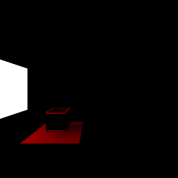
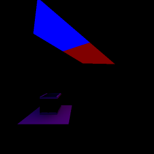
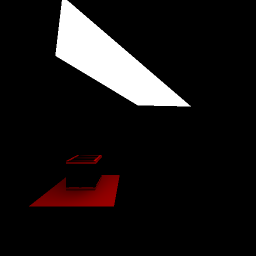

[← Manual](README.md)

# Material emission

Bake light from an opaque world, detail or stationary brush-model surface.

1. Create an ASCII file in mounted game content, for example `scripts/room.rad`.
2. Add one material, RGB color and brightness per line:

   ```text
   lights/panel 255 192 128 255
   ```

3. Open **World settings…**. Set **Emission file** to `scripts/room.rad` and press Enter.
4. Click **Apply properties**. **Cancel** discards the draft.
5. Open **Build settings…** and choose **Direct LDR** or **Direct LDR + HDR**.
6. Choose **Sampling quality**, then **Compile**.
7. Open **Build details…**. Check **Diagnostics** for the emitted face count and errors.



Blank text or **Remove override** turns emission off when **Native direct emission**
and **Exact emission visibility** are disabled. Disable both before clearing
the file, or change them together in one draft.
**Fullbright** checks the file and sources but does not bake emission.
Unused records are allowed;
no rendered source faces means no emission is baked.

Uniform records set brightness per surface area. Doubling area or brightness
doubles emitted power. Texture size, UV scale and source reflectivity do not
set power for uniform records.
RGB values are 0–255; brightness must be finite and nonnegative.

Use separate records for different channels:

```text
ldr: lights/panel 255 192 128 255
hdr: lights/panel 128 192 255 510
```

An unprefixed record supplies both channels. Blank lines and whole-line `//`
comments are accepted. Duplicate material/channel assignments reject.

## Use texture colours

1. Give the source a static opaque **LightmappedGeneric** or **UnlitGeneric**
   material with an explicit `$basetexture`.
2. Add `texture:` before its material name:

   ```text
   texture: lights/panel 255 255 255 255
   ```

3. Use the [face material controls](textures.md#edit-face-textures) to set UV scale and shift,
   then compile. These set the colour pattern and can change emitted power.

Each nearest mip0 texel multiplies the record colour. Both use the 2.2 RGB
conversion. VTF repeat and clamp flags apply. Black texels emit no light;
texture alpha and reflectivity do not set emission. This samples base RGB,
not the complete shader. Use one mode per material across LDR and HDR records.



## Use a stationary brush source

1. Select an unnamed, unparented `func_brush`.
2. Enable **Advanced properties** and set **Origin (X Y Z)**.
3. Set **Shadows** to **Yes**.
4. Set **Pitch Yaw Roll (Y Z X)** for an initial rotation, if needed.
5. Apply a declared emission material to its source faces, then compile.

For **Exact emission visibility**, the compiler must certify the native outward
triangle fan, each triangle's actual plane and the required texture coverage.
The source uses its compiled initial pose. Other solids in the same model
still block light. Supported child models use their assembled pose once.
See [stationary shadow sources](brush-texture-shadows.md#cast-from-a-stationary-root-brush-model)
for the shared admission rules.



## Native runtime direct lighting

Optionally add native direct-light descriptors for runtime receivers. This is a
centroid point approximation, with different selection and angular behavior from
the sampled finite-area bake.

1. Open **World settings…** and set a nonblank **Emission file**.
2. Enable **Native direct emission**.
3. Click **Apply properties**, then compile with **Direct LDR** or **Direct LDR + HDR**.
4. Check **Native emission surface lights** in **Build details…**.
5. Open **Inspect compiled lights…**, choose **Channel**, and select a row whose
   **Kind** is `surface`.
6. Read **Source association** for the captured original material and root face
   or instance route.
7. Click **Select source face** for a root source, or **Select containing reference**
   for an instance source.
8. Click **Frame light** to frame that triangle's native centroid. Selection stays unchanged.

The policy defaults off. Each constant-colour integration triangle supplies a
point at its actual centroid, using the retained posed source-plane normal and
area-scaled intensity.
Texture-driven sources retain their constant-colour integration pieces.
Several records can therefore refer to one authored face. Source associations
describe the successful build; stale builds or missing metadata cannot select
current sources.
The radius conservatively reaches the farthest corner of the stored world-model
bounds expanded by native cache extents of 32/32/128 units, rounded upward to
native precision. This covers compiled-world receiver/cache bounds, without an
automatic 2,000-unit cutoff or a coverage promise outside that world.
Baked maps, VHV and detail direct lighting remain, as does reflected ambient.
Only intrinsic direct emission is removed from indexed ambient and supplied by
native selected or folded direct lighting instead.

Native light slots, selection, angular response and ambient folding can change
the result. The native full-VHV path can also add static-cache lighting while
dynamic lights affect the prop, as it can for native point lights. This policy
does not promise finite-area fidelity or exact finite-source visibility.
The editor's static previews do not simulate native selection or folding.

Setting the policy to `0`, removing it or unchecking the control restores the
existing indexed-ambient policy. **Fullbright** validates the configuration but
does not emit native surface-light records. Child declarations cannot activate
the policy.

<a id="exact-brush-shadows"></a>

## Exact brush, terrain and prop shadows

Resolve opaque and binary-cutout brush, terrain and static prop shadows across the source area.

1. Open **World settings…** and set **Emission file**.
2. Enable **Exact emission visibility**, then click **Apply properties**.
3. Compile with **Direct LDR** or **Direct LDR + HDR**.
4. Open **Build details…**. **Emission visibility policy** should read
   **Exact opaque and cutout hulls and mesh triangles**. Check
   **Emission conversion bounds (dimensionless)**.

Exact mode supports uniquely owned world/detail and eligible stationary
**Shadows → Yes** `func_brush` emitting faces, at root or in supported assemblies.
The source must use an ordinary native outward triangle fan with a simple
convex projection. Eligible faces can be planar or nonplanar; this does not
admit arbitrary warped polygons. Primitive overrides and displacement sources
are unsupported. Each nondegenerate native triangle uses its actual plane for
facing, support, clipping and the finite-area kernel. All original source
coordinates stay unchanged. The retained brush plane keeps the original side
and hull identity and the normal used by native direct emission.
Every owning hull still blocks light, so real self-occlusion can darken a source.

The whole emitting BSP face excludes its own emission. Its fan triangles do not
light one another. Receiver grids stay unchanged; brush receivers keep their
retained-plane sampling.

Planar texture partitions at nonzero residual keep their exact face-coverage
proof. Nonplanar textures must prove exact coverage of each original native fan
triangle before colour groups combine. The fan and its pieces must cover the
actual surface once, including black groups, without gaps, interior overlaps or
a floating coverage allowance. Shared edges and vertices are allowed.

The proof checks the generated geometry. Colour selection still uses nearest
mip0 RGB and binary64 UV calculations. Exact real-arithmetic UV boundaries and
native filtering parity are not certified. The zero-residual texture path is
unchanged.

Converted binary64 kernel vertices must stay exactly on each actual source
triangle plane. All converted coverage must stay inside the exact visible region.
The compiler rejects faces that cannot meet these checks.
Opaque brush casters may have oblique planes when their final hull is certified
closed, bounded and convex. Every applicable original hull participates,
including invisible boundaries.
Eligible stationary brush models retain their existing global or same-model
shadow scope.

Terrain with a supported opaque or binary-cutout material casts from its actual
native triangles. Opaque materials require **LightmappedGeneric**,
**UnlitGeneric**, or a supported **Patch** chain. Cutouts require the supported
static **LightmappedGeneric** form and **Brush texture shadows**.
Terrain blend shaders are unsupported. Masked regions affect light transport;
they do not create physical holes. Collision settings do not disable shadows.

Eligible static props cast from actual triangles in body 0 and LOD 0, with
the selected skin at the compiled pose. Opaque materials require plain
**VertexLitGeneric** or supported **Patch** chains. Binary cutouts use supported
static **VertexLitGeneric** or **UnlitGeneric** materials and Patch chains;
the original model must request texture shadows with `$casttextureshadows`.
Supported referenced props use their assembled pose. See [prop shadow controls](static-props.md#cast-exact-emission-shadows).

To use cutout brush or terrain casters:

1. Apply a supported static alpha-test material described in [Brush texture shadows](brush-texture-shadows.md).
2. Open **Build settings…** and enable **Brush texture shadows**.
3. Keep **Exact emission visibility** enabled in **World settings…**, then compile.

The compiler borrows the original loaded alpha texture and cutoff. Masks use
nearest mip0 texels, the checked material transform and VTF clamp/repeat flags.
It resolves texel regions on the actual provider plane with half-open texel
ownership, including constant and rank-deficient UVs. No clipped caster geometry
is rounded to a substitute mesh. Settings are never enabled automatically.
Brush cutouts keep their full original hull: entry and exit events contribute,
exactly coincident boundary faces use maximum coverage, and only strict segment
interior events block. Mask enumeration uses certified bounds derived from the
final hull halfspaces. Ordinary sampled tracing keeps its separate near-tie
bands. Eligible brush models keep their global or same-model scope.
Fractional and colored transmission, animation and general shader effects remain
unsupported in exact mode; disable **Exact emission visibility** to use supported
sampled fractional or colored shadows.

Terrain and prop triangles block from both sides, including their edges.
Only contacts between the shadow segment endpoints block light. Exact mode
checks the original model and material inputs before gathering light.

Unsupported casters, source support or numeric bounds stop the build.
The previous BSP stays intact. The compiler does not switch to sampled shadows.
Receivers beside a panel use its finite hull; crossing the panel's extended
plane alone does not stop the build.
For larger bakes, open **Build settings…**, increase **Lighting work limit
(millions)**, then click **Apply work limit**. Numeric and memory limits still apply.

Clipping uses exact rational arithmetic. Exact mode removes redundant cuts
between visible regions when their exact union is convex. Shadow boundaries stay
fixed. Conversion uses bounded on-plane candidates. Narrow openings and complex
cuts can still exceed numeric limits.
Conversion to the floating lighting kernel includes the source surface-area
scale and, when needed, certified actual source-area Jacobian and source-incidence
cosine upper bounds.
Its reported bound is at most `1e-12` per source triangle and `1e-9` per
receiver, before source colour and brightness. This is not an RGB, BSP
quantization or native image error bound.
**Native direct emission** keeps its separate point approximation.
Disable **Exact emission visibility** to use the original sampled bake.

Exact mode rejects uncertified native fans or projections, primitive overrides,
displacement sources, failed required texture coverage, unrepresentable
on-plane fragment vertices, moving/parented/unrequested brush-model emitting
sources, sky/unknown materials, fractional or colored transmission, unsupported prop models, zero-area mesh
triangles and uncertified hulls. Checked arithmetic, fragment and conditioning
limits also apply.
**Fullbright** checks the setting and declarations without exact shadow admission.

## Limits

- Sources: drawn opaque brush faces from world, `func_detail` or eligible
  **Shadows → Yes** `func_brush` models. Moving, unrequested and MDL models,
  terrain, liquid, transparent and merged sources with multiple original
  contributors are unavailable. Sources are checked before compile-region filtering.
- Existing supported baked receivers and diffuse bounces receive emission.
  Dynamic models use indexed ambient by default; **Native direct emission** opts
  into the separately described runtime approximation. No shader glow is added.
- With the default policy, paired HDR requires a real authored point, spot or environment light.
  Zero brightness is allowed. The engine requires a nonempty HDR light table.
  In native mode, positive HDR surface records can provide that table.
- With exact visibility disabled, sampling can miss thin blockers or apertures. **Detailed**
  uses smaller cells and more work. Exceeded budgets and unconditioned
  source contacts stop the build; quality does not reduce automatically.
- At most 262,144 cells per receiver, 48 subdivisions, 65,536 source sides and
  262,144 source triangles.
- Native surface descriptors share the 8,192-record limit per channel with
  authored lights. Exceeded limits fail without dropping sources.
- File: 64 KiB, 4,096 records, 1,024 bytes per line. Path: 1,024 ASCII bytes,
  mounted and relative. Includes, traversal, implicit file searches and
  child-owned emission files are unavailable. Root declarations apply to
  supported assembled child world/detail and stationary brush-model faces.
- Texture sources require one static RGB frame, face and depth. HDR/data images,
  animation, conditional blocks, alternate base textures, seamless projection
  and texture transforms reject. No asset substitution or downsampling occurs.
- Texture limits: 4,096 pixels per edge, 64 MiB + 4,096 encoded bytes and
  65,536 constant-colour rectangles per image; 262,144 integration triangles
  per build. UV, work and memory bounds also apply.
- VRAD numeric brightness parity is unavailable.

See [MCP emission](mcp.md#material-emission) for the shared property workflow.
