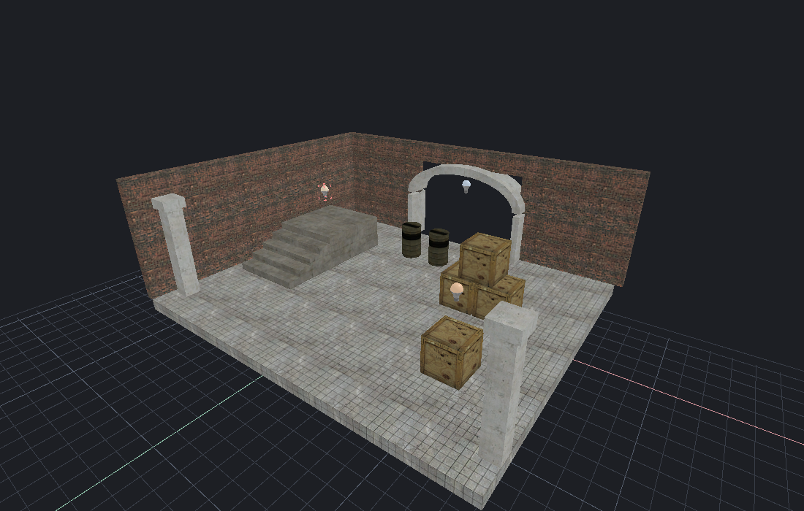
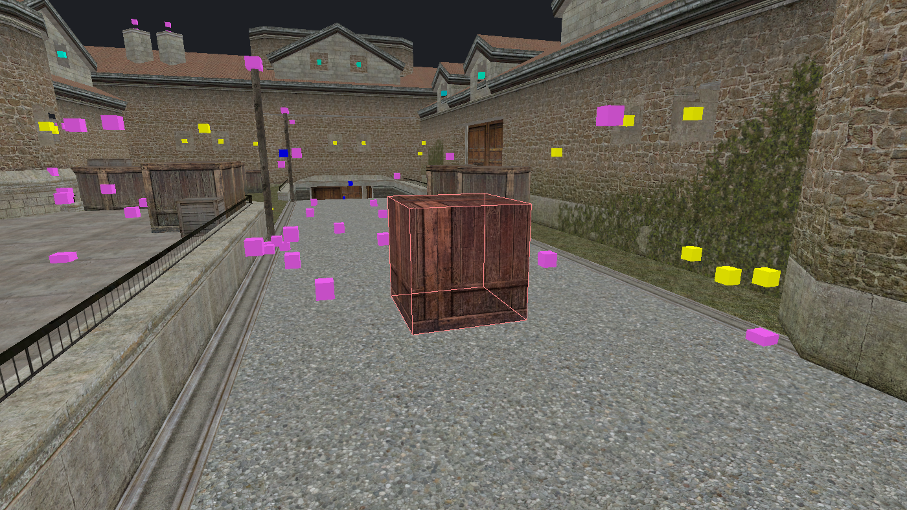

[← Manual](README.md)

# AI agents and MCP

HammeRR is built so that an AI agent can do anything a person can. Every editor feature has a matching [MCP](https://modelcontextprotocol.io) tool, and both run the same internal operations. So:

- the agent edits the map you have open, and you see each change live;
- agent edits go into the same undo history as yours;
- previews are shared: an agent can set one up for you to apply, or the other way around;
- the agent can render any view of the map to check its own work.

| Courtyard built by an agent | Agent close-up with one face selected |
| --- | --- |
|  |  |

## Connect

While the editor runs, it serves MCP over HTTP at `http://127.0.0.1:7377/mcp`. Add it to your MCP client:

```json
{
  "mcpServers": {
    "hammerr": {
      "url": "http://127.0.0.1:7377/mcp"
    }
  }
}
```

Use `--mcp-port <port>` to change the port, or `--no-mcp` to turn the server off.

### Without a window

`--headless` runs the editor without a window and serves MCP over stdin/stdout, giving the agent a private session. Rendering still works; graphics start on the first render.

```json
{
  "mcpServers": {
    "hammerr": {
      "command": "/path/to/hammerr/target/release/editor",
      "args": ["/path/to/map.vmf", "--headless"]
    }
  }
}
```

## What agents know

When an agent connects, the server tells it how HammeRR works, so you don't need to explain:

- **Units and axes**: Hammer units with Z up. A player is 32 × 32 × 72 units. Brushes stay within ±16,384.
- **IDs**: `solid:<id>` for world brushes and `entity:<id>` for entities. Tools act on the current selection when IDs are left out, and creation tools select what they create.
- **Materials**: paths under `materials/` without the extension, such as `tools/toolsnodraw`. `search_materials` finds more.
- **Previews**: most edit tools accept `preview: true` and return a `token`. Pass it to the matching commit or cancel tool, so a preview someone else replaced can't be applied by mistake.
- **Stale-state guards**: inspection tools return a `snapshot`, `stamp`, or `generation` and `revision`. Passing them back makes a call fail safely if the map changed in between.
- **Checking work**: `render_view` returns a PNG from any camera without moving yours, `pick_at_pixel` identifies the object and face at a pixel, and `raycast` finds the first surface along a ray.

Each tool's description lists its parameters.

## A first call

Place a warm light, then look at it:

```json
{
  "name": "create_entity",
  "arguments": {
    "classname": "light",
    "origin": [0, 0, 128],
    "properties": { "_light": "255 220 180 400" }
  }
}
```

```json
{ "name": "render_view", "arguments": {} }
```

To build the map, set the build options once, then compile:

```json
{ "name": "set_compile_settings", "arguments": { "lighting": "direct_ldr", "physics": "engine", "sky_quality": "balanced" } }
```

`start_compile` returns a job token right away; poll `get_compile_status` and stop with `cancel_compile`. `compile_map` and `run_map` wait for the build to finish. `launch_game` does the same as **Play built map**.

## Tools by task

| Task | Tools |
| --- | --- |
| Files and inspection | `new_map`, `open_map`, `save_map`, `get_map_info`, `get_map_statistics`, `find_objects`, `get_objects` |
| Selection and history | `select`, `get_selection`, `set_selection_mode`, `undo`, `redo` |
| Object edits | `move_objects`, `duplicate_objects`, `delete_objects` |
| Brush drawing and transforms | `set_spatial_settings`, `draw_block`, `cancel_block_preview`, `create_block`, `transform_objects` |
| Transform handles | `set_transform_tool`, `get_transform_handles`, `begin_transform_drag`, `update_transform_drag`, `commit_transform_preview`, `cancel_transform_preview` |
| Area selection | `set_area_selection_options`, `select_area`, `get_area_selection`, `commit_area_selection`, `cancel_area_selection` |
| Volume selection | `select_volume`, `get_volume_selection`, `commit_volume_selection`, `cancel_volume_selection`, `frame_volume_selection` |
| Paint selection | `set_paint_tool`, `begin_paint_selection`, `update_paint_selection`, `get_paint_selection`, `commit_paint_selection`, `cancel_paint_selection` |
| Brush shapes | `create_primitive`, `get_primitive_preview`, `frame_primitive_preview`, `commit_primitive_preview`, `cancel_primitive_preview` |
| Hollow | `preview_hollow`, `get_hollow_preview`, `look_inside_hollow`, `commit_hollow`, `cancel_hollow` |
| Carve | `get_carve_preview`, `preview_carve`, `preview_carve_many`, `commit_carve`, `cancel_carve` |
| Clip | `set_clip_tool`, `clip_brushes`, `get_clip_preview`, `set_clip_points`, `pick_clip_point`, `get_clip_handles`, `set_clip_handle_options`, `begin_clip_drag`, `update_clip_drag`, `finish_clip_drag`, `cancel_clip_drag`, `commit_clip_preview`, `cancel_clip_preview` |
| Vertices, edges and faces | `get_component_sources`, `update_component_scope`, `get_brush_components`, `set_component_picking`, `pick_brush_components`, `select_brush_components`, `preview_component_move`, `commit_component_move`, `cancel_component_move` |
| Component move handles | `get_component_handles`, `set_component_move_options`, `begin_component_drag`, `update_component_drag`, `commit_component_drag`, `cancel_component_drag` |
| Scale, rotate, weld, split, ridge | `preview_component_scale`, `preview_component_rotate`, `preview_component_weld`, `preview_component_split`, `preview_component_crease`, `commit_component_edit`, `cancel_component_edit` |
| Flat partitions | `preview_component_partition`, `update_component_partition_cut`, `update_component_partition_material`, `update_component_partition_texture`, `raise_component_partition`, `preview_partition_extrusion`, `select_component_partitions`, `frame_component_partitions`, `pick_component_partitions`, `commit_component_edit`, `cancel_component_edit` |
| Saved flat pieces | `get_saved_component_partitions`, `store_component_partition`, `resume_component_partitions`, `remove_saved_component_partitions` |
| Face textures | `select_faces`, `get_face_selection`, `set_material`, `edit_faces`, `sample_face_texture`, `get_surface_sample`, `paint_face_texture`, `propagate_face_texture`, `project_face_group`, `commit_face_preview`, `cancel_face_preview` |
| Texture paint strokes | `begin_texture_stroke`, `update_texture_stroke`, `get_texture_stroke`, `commit_texture_stroke`, `cancel_texture_stroke` |
| Material replacement | `find_material_faces`, `get_material_search`, `select_material_faces`, `replace_materials` |
| Material browsing | `search_materials`, `browse_materials`, `preview_material`, `set_material_favorite` |
| Entities | `create_entity`, `set_entity_properties`, `tie_to_entity`, `move_to_world` |
| Entity definitions and inspector | `search_entity_classes`, `get_entity_class`, `load_entity_definitions`, `get_entity_inspector`, `set_entity_color`, `set_entity_component` |
| Connections | `get_entity_connections`, `get_connection_choices`, `begin_connection_edit`, `update_connection_draft`, `commit_connection_edit`, `cancel_connection_edit`, `delete_entity_connection` |
| Safe renaming | `get_entity_references`, `begin_entity_rename`, `update_entity_rename`, `commit_entity_rename`, `cancel_entity_rename` |
| World settings and property batches | `get_property_inspector`, `begin_property_edit`, `update_property_edit`, `get_property_edit`, `commit_property_edit`, `cancel_property_edit` |
| Object report and visibility | `get_object_report`, `select_object_report`, `set_object_visibility` |
| Map checks | `run_map_checks`, `get_map_checks`, `select_map_issue`, `preview_map_fixes`, `apply_map_fixes`, `cancel_map_fixes` |
| Design notes | `get_context_state`, `list_context_notes`, `get_context_note`, `get_context`, `begin_context_edit`, `update_context_edit`, `apply_context_edit`, `cancel_context_edit`, `delete_context_note`, `set_context_view`, `focus_context` |
| Recovery | `get_recovery`, `set_recovery_settings`, `create_recovery_snapshot`, `restore_recovery_snapshot`, `delete_recovery_snapshot` |
| Camera and visual checks | `get_camera`, `set_camera`, `frame_selection`, `set_view`, `render_view`, `pick_at_pixel`, `raycast` |
| Saved camera views | `get_camera_views`, `save_camera_view`, `restore_camera_view`, `rename_camera_view`, `delete_camera_view` |
| Pointfiles | `load_pointfile`, `get_pointfile`, `navigate_pointfile`, `frame_pointfile`, `clear_pointfile` |
| Compile and play | `get_compile_settings`, `set_compile_settings`, `start_compile`, `get_compile_status`, `cancel_compile`, `compile_map`, `run_map`, `launch_game`, `game_log`, `stop_game` |

## Good to know

These details aren't obvious from the tool list.

**Transforms**

- `transform_objects` does move, rotation, positive scale, reflection and single-axis shear, with an optional `pivot` and `space: "world"` or `"local"`. Combined operations apply scale and reflection first, then shear, then rotation, then translation.
- `texture_lock` controls textures during movement and rotation. `texture_scale_lock` controls stretching, mirroring and shear. Leaving out `texture_scale_lock` makes it follow `texture_lock`.
- `get_transform_handles.state.preview.display` holds the same summary the inspector shows.

**Faces and textures**

- `edit_faces` sets material, texture placement, fitting, `lightmap_scale` and smoothing groups. `smoothing_groups` replaces memberships (`[]` clears them); `smoothing_add` and `smoothing_remove` keep the others.
- `set_view` and `render_view` accept `surface`: `textured`, `flat`, `wireframe`, `lightmap_density` or `smoothing_groups` (with `smoothing_group` from 1 to 32). On `render_view`, these options don't change your view.

**Vertices, edges and faces**

- Use the latest `snapshot` to select components or start a preview, and the preview's `token` to apply or cancel it.
- One side ID identifies a face, two identify an edge, three or more a vertex.
- Picking uses pixel coordinates from the top-left; a pixel's center is `column + 0.5, row + 0.5`. The radius is 1–32 pixels (default 10), and up to 64 candidates are returned.
- `preview_component_weld`: leave out the target for each brush's own average, or pass `target: [x, y, z]` or `target_corner: {solid, sides}`.
- `preview_component_crease` raises a roof ridge. It takes `pairs: [{solid, edges: [side, side]}]` and `rise`; `get_brush_components.crease_choices` lists valid pairs.

**Flat partitions**

- `get_brush_components.partition_choices` lists the edge pairs for each face, up to 28.
- `raise_component_partition` with `rise: 0` returns to flat; otherwise use 0.125–4096.
- `update_component_partition_cut` takes `edge_parameters: [first, second]`, each strictly between 0 and 1.
- `store_component_partition` keeps the pieces. `resume_component_partitions` and `remove_saved_component_partitions` take `sources: [{solid, side}]`.

**Carve, hollow and clip**

- Carving and hollowing need the `stamp` from `get_carve_preview` or `get_hollow_preview`. `preview_hollow` takes `open_faces` for openings.
- `clip_brushes` takes a normal and distance, three points, or a planar line. `finish_clip_drag` only ends handle positioning; `commit_clip_preview` applies the cut.

**Selection**

- A paint stroke accepts up to 256 points, 32,768 new samples and 1,048,576 pixel visits per update, and 262,144 samples in total.
- Pointfile point numbers start at 0 over MCP, and at 1 in the editor.

**Entities**

- In connection drafts, `delay` and `times` are strings, so half-typed values can be shared with the open dialog.
- During a rename, if the preview reports `requires_review`, send `accept_review: true` in a following update.
- `begin_property_edit` takes `world: true` or entity `ids`. Each entry in `changes` uses `action`: `set`, `remove`, `default`, `flag` or `component`.
- `get_object_report` filters by `query`, `classname`, `targetname`, `material`, `kind`, `hidden` and `within`.

**Compiling**

- `set_compile_settings` takes `lighting` (`fullbright` or `direct_ldr`), `physics` (`none` or `engine`), `visibility` (`fast` or `detailed`), `sky_quality` (`fast`, `balanced` or `detailed`), `bounces` (whole counts `0`–`4`) and `smoothing_angle` (whole degrees `0`–`90`). It changes only the fields you pass, and invalid combinations leave every setting unchanged.
- `get_compile_settings.visibility_choices` exposes **Fast (conservative)** and **Detailed (portal clipping)**, shown under **Visibility quality** in Build settings. `visibility` freezes in each job's captured settings and changing it stales prior output. Detailed refines PVS through bounded source/pass portal apertures; PAS includes the refined visible rows. Statistics expose `visibility_mode`, `visibility_work`, `visibility_removed_pairs` (directed PVS entries removed from the broad result) and `visibility_fallbacks`, plus `visibility_workers` for the largest actual worker count across the base and flow stages. Larger Fast and Detailed jobs parallelize independent base-facing portal rows on at most eight available CPUs; Detailed also parallelizes separator flow. Source portals for each cluster retain their order, and workers share one exact global work budget. Fallbacks retain conservative geometry; exceeded work/stack budgets preserve the previous output.
- `get_compile_settings` returns the current choices, including `sky_choices` with their labels and direction counts (32, 128 and 512). These tools work before the first build, like the toolbar's **Build settings…**. The UI calls `sky_quality` **Sampling quality**; it affects Direct LDR sky ambient, soft sun, model ambient and bounce rays.
- `get_compile_settings.bounce_choices` exposes **Direct only** (`bounces: 0`, default) and **One diffuse bounce**, **Two diffuse bounces**, **Three diffuse bounces** or **Four diffuse bounces** (`bounces: 1`–`4`), shown under **Indirect light**. It gathers reflected light per source style from immutable previous-pass world/detail/terrain lightmaps into world, terrain and brush-model receivers using 32/128/512 cosine-weighted rays per receiver per pass. Each pass rebuilds receivers from the original direct maps. Model rays check their own geometry before accepting a world hit; unrelated models stay separate. Source albedo must be between zero and one; sky/backfaces do not supply bounce energy. Stats expose actual `bounces`, `bounce_rays`, `bounce_samples` (final-pass receivers with positive indirect light) and `bounce_work`, within the shared lighting budget. Fullbright retains the setting and reports zero bounce work.
- `edit_faces` (including `preview: true`), `commit_face_preview` and `cancel_face_preview` drive the same authored brush smoothing as **Face lighting…**. Shared groups 1–24 blend; shared groups 25–32 keep hard edges and take priority. Direct LDR applies checked world/detail and brush-model corner normals, including eligible corners inside neighboring source edges. Original fan centers and source fans remain stable across lightmap subdivision. Stats expose `smoothed_faces`, `smoothed_corners` and `normal_work` (construction work; receiver interpolation also counts toward `lighting_work`). Unassigned faces stay flat at angle zero; terrain, world coordinates and each model's local coordinates remain separate. Source/corner limits and the shared lighting budget preserve prior output on rejection.
- `smoothing_angle` defaults to `0` (disabled). Positive values blend only two unassigned source faces within one world/model scope whose normal angle meets the threshold. Explicit smooth/hard masks retain precedence; terrain and individual model/world scopes stay separate. `get_compile_settings.smoothing_angle_range` reports bounds/unit. Each job captures the angle; changing it stales previous output. Actual stats expose `smoothing_angle` and the same `smoothed_faces`, `smoothed_corners` and `normal_work`. Fullbright retains the setting but reports zero actual angle/work; no VMF/history edits occur.
- `edit_faces` and object material edits select VMT `$surfaceprop` values for world brush and terrain collision. With `physics: engine`, native triangle mappings use a shared table of at most 127 names including default; missing properties retain default. `compile_map` and background results expose `physics_surface_properties`, shown as **Surface properties** in **Build details…**. Names use 1–127 ASCII letters, digits, underscores, dots or dashes; custom definitions must be available to the game. Invalid mappings/names/capacity reject before publication. Brush-model surfaces, material density and compiler-derived model masses remain unfinished.
- `create_entity` and `set_entity_properties` author point/spot `style` (Appearance `0`–`31`), `targetname`, `pattern` (up to 64 lowercase letters), and `spawnflags` bit `1` (Initially dark). Named groups get compiler-only IDs `32`–`63`; authored nonzero appearances become `defaultstyle`, and matching names share an initial pattern/state. `begin_connection_edit`, `update_connection_draft` and `commit_connection_edit` author relay outputs targeting `TurnOn`, `TurnOff`, `Toggle` or `SetPattern`. Both compile paths emit up to four face channels including Normal, with actual `switchable_light_groups`, `light_styles`, `styled_faces` and `light_style_maps` stats. Compilation keeps VMF/history fixed. Invalid fields, conflicting groups and exceeded limits preserve previous output. With `bounces: 1`–`4`, reflected light follows the same styles and can add a channel beyond direct reach; the four-style face limit still applies. Switching model-ambient cubes remain unfinished.
- `tie_to_entity` and `set_entity_properties` author rendered brush models and pivots. Direct LDR compiles model-local faces with world-space lighting positions, isolated self shadows, and the same point/spot style channels and sky sampling. Stats expose `lit_brush_models`, `model_lighting_faces`, `model_bounce_faces` (processed receiver faces) and `model_bounce_samples` (samples with positive reflected energy). Local geometry, UVs and collision stay fixed; direct and bounced lightmaps remain attached in game. Models do not cast permanent world shadows or supply reflected light. They can receive world bounce; dynamic relighting and independently rotated initial poses remain unfinished. Both compile paths share the checked emitted model-to-entity bindings and common budgets.
- `edit_faces` material/projection edits feed automatic directional lightmaps for lit VMTs declaring `$bumpmap`. Direct LDR emits base plus three direction maps per style on world/detail/model/terrain receivers, including the optional world-source bounce. Stats expose `bump_faces` and `bump_lightmaps` (auxiliary directional maps); `light_style_maps` includes base and directional maps. `lightmap_samples` counts receiver positions, while bytes/work include every map. Base averages, style IDs, geometric shadow bias and source/history remain shared. Material-only second normal maps, HDR, transparent shadows and baked prop maps remain unfinished; viewport previews stay diffuse.
- Settings cannot change while a build runs. Each job reports its captured `settings`; changing settings after a build makes that output out of date for launching.
- Direct LDR automatically culls point/spot candidates using each source's PVS and exact falloff endpoints, across world, terrain and pivot-aware model samples. Unknown/boundary clusters and cache overflow retain candidates; sky lighting stays eligible. Results expose `light_evaluations`, `light_pvs_skipped`, `light_range_skipped` and `light_culling_work` (row/cache/cluster lookup work within `lighting_work`). Both compile paths preserve emitter order and share the same bounded implementation; no extra setting is required.
- Create and edit baked lights with `create_entity` and `set_entity_properties`. For `light_environment`, `_light` is sunlight and `_ambient` is sky ambient; color values use `R G B brightness`. Set ambient brightness to zero with a value such as `255 255 255 0`. Set `SunSpreadAngle` from 0 to 90 degrees: zero keeps hard shadows, positive values soften them using the selected sky quality.
- `get_compile_status.launch` says whether the last build can be played, or why not.
- Build statistics include `ambient_samples` and `ambient_bytes`, shown as **Model ambient** in Build details. Direct LDR writes up to 1/4/8 safe, separated probes per open world leaf at Fast/Balanced/Detailed quality from filtered local world/terrain lightmaps and sky radiance; skipped leaves are reported in diagnostics. `sky_quality` controls probe density and the ray-cone footprint used to filter local detail. Probes remain more than 128 units apart; the bake caps total probes at 65,536 and retains the shared work limit.
- Terrain normal sewing is automatic for matching equal-power full edges in both compile paths and `render_view`; hidden patches do not contribute. `displacement_neighbor_pairs` counts the verified edge links used for sewing. Authored smoothing angles and mixed-power/partial-edge LOD remain unfinished.
- Create areaportals with `create_block` and `tie_to_entity` (`classname: "func_areaportal"`). `targetname` is the human **Name**, and `StartOpen` chooses the **Initial State**. Entity connections accept **Open**, **Close** and **Toggle**. Compilation assigns native keys without editing the VMF. Shared build statistics include `areas`, `areaportals` and `areaportal_vertices`; invalid boundaries preserve the previous output.
- `func_areaportalwindow` uses the same `create_block`, `tie_to_entity` and `set_entity_properties` operations. `target` is **Rendered Window**, `BackgroundBModel` is the optional **Foreground bmodel**, and `FadeStartDist`, `FadeDist`, `TranslucencyLimit` control fading. Render targets must be unique visible brush models with enclosing bounds; foreground and rendered models share a pivot. Connections can send `SetFadeStartDistance` and `SetFadeEndDistance`. `areaportal_windows` counts windows within the total `areaportals` count.
- `run_map` and `launch_game` always launch CS:S with `-insecure`.
- Hint helpers use `create_block` with `tools/toolsskip`, then `select_faces` and `edit_faces` to paint `tools/toolshint` onto the intended split faces. Keep them as world brushes. Both compile paths protect finite hint polygons during initial structural plane selection, then partition remaining filled open leaves. Helpers add no rendering/collision. Results expose `hint_surfaces`, `hint_splits`, `hint_priority_splits` (retained added initial planes, included in `hint_splits`) and cumulative `hint_work`. Skip sides bound the helper; mixed materials and unsupported ownership fail atomically. Hidden/coplanar/outside helpers need no new split. Initial selection runs in `world_tree`; remaining refinement runs in cancellable `hint_planes`.
- Imported `info_overlay` entities compile through `compile_map`, `start_compile` and `run_map`. `overlays` and `overlay_face_refs` count projections and their compiled surface bindings. Edit material, U/V ranges, render order and fades with `set_entity_properties`; imported basis/corner fields remain read-only. Compilation preserves VMF properties and history, resolves source sides to final world/detail/terrain faces and creates named runtime accessors. Invalid targets or exceeded budgets preserve the previous BSP. See [Overlays](overlays.md) for limits.
