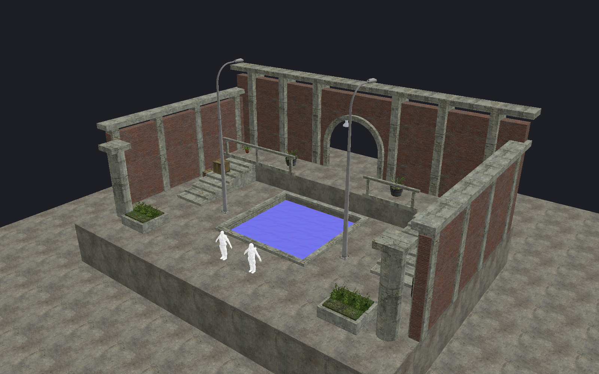

[← Manual](README.md)

# AI agents and MCP

Agents use the same map, operations, previews and Undo history as the editor.
On Linux, they can also work without a window.



## Connect to the editor

Add this entry to your MCP client:

```json
{
  "mcpServers": {
    "hammerr": { "url": "http://127.0.0.1:7377/mcp" }
  }
}
```

Start the editor before connecting.
The HTTP endpoint is available on Linux and Windows.
Use `--mcp-port <port>` to change the port.
Use `--no-mcp` to disable HTTP access.

The **Agent** panel in the editor shows each agent action with the tool that made it.
Agent transform previews appear in the viewport as **Agent preview**, with the same Apply and Cancel controls as your own.

## Without a window

This transport requires Linux. On Windows, use the desktop HTTP endpoint above.

1. Build the standalone server:

   ```sh
   cargo build --release -j8 -p editor-core --features mcp --bin hammerr-headless
   ```

2. Configure your client to launch it:

   ```json
   {
     "mcpServers": {
       "hammerr": {
         "command": "/absolute/path/target/release/hammerr-headless",
         "args": ["/absolute/path/map.vmf"]
       }
     }
   }
   ```

Omit the map argument for a new map.
Use `--game <gameinfo.txt>` and `--fgd <file.fgd>` for other content.
The standalone server uses stdio. It does not open a window or HTTP endpoint.
A render request starts graphics when needed.

## Workspace layout

1. Call `get_workspace_preferences` with `{}` to inspect current/saved/factory
   layouts, storage readiness/errors, `layout_serial`, `layout_snapshot` and
   the saved-default action `snapshot`.
2. Call `set_workspace_layout` with `snapshot` set to `layout_snapshot` and a
   complete `layout` object:

   | Field | Values | Factory |
   | --- | --- | --- |
   | `dock_visible` | Boolean | `true` |
   | `dock_width` | Integer, 240–640 logical pixels | `344` |
   | `agent_visible` | Boolean | `true` |
   | `agent_height` | Integer, 96–480 logical pixels | `250` |
   | `tool_rail_visible` | Boolean | `true` |

3. To manage saved defaults, pass the report's ordinary `snapshot` to
   `set_workspace_preferences` with `action`:

   | `action` | Effect |
   | --- | --- |
   | `save` | Save the applied current layout for future sessions. |
   | `apply` | Apply saved defaults to the current session without writing. |
   | `reload` | Read storage without applying it. |
   | `reset` | Write factory defaults without applying them. |

All layout fields are required. Sizes are preferences that fit the actual
window; hiding the dock also hides its Agent feed. Current layout changes
remain available when saved-default storage is unavailable. They preserve the
map, selection, Undo and camera, and cancel captured viewport gestures.
Headless sessions store the same layout state for an attached native UI.
Ordinary changes never save automatically. Unknown fields, invalid values and
stale snapshots reject; storage failures stay explicit. Inspect `ready`, errors
and `write_committed` after saved-default actions. See [Workspace layout](workspace-layout.md).

## Preview defaults

Call `get_preview_defaults` to inspect the current, saved and factory values
for these 13 settings:

| Setting | Values | Factory |
| --- | --- | --- |
| `selection_outlines` | Boolean | `true` |
| `selection_tint` | Boolean | `true` |
| `selection_bounds` | Boolean | `false` |
| `entity_images` | Boolean | `true` |
| `entity_model_guides` | Boolean | `true` |
| `authored_models` | Boolean | `true` |
| `sprite_resources` | Boolean | `true` |
| `entity_helpers` | Boolean | `true` |
| `rope_preview` | Boolean | `false` |
| `sky_preview` | Boolean | `false` |
| `surface` | `textured`, `flat`, `wireframe`, `lightmap_density`, `smoothing_groups` | `textured` |
| `tool_textures` | Boolean | `true` |
| `surface_shading` | Boolean | `false` |

Use `set_view` to change current values. Inspect `get_preview_defaults` again,
then pass its `snapshot` to `set_preview_defaults` with `action:"save"`, `"apply"`,
`"reload"` or `"reset"`. Only Save/Reset write; Reload/Reset do not apply values.
Apply requires finished previews, viewport tools and owned work. Ordinary viewport
changes and temporary `render_view` overrides never save automatically.

Older files that omit the new `surface`, `tool_textures` or `surface_shading`
fields use their factory values. Invalid or explicit `null` values reject and
the file stays preserved. Camera, fog and lighting/sky exposure remain separate.
See [Preview defaults](preview-defaults.md).

## Keyboard shortcuts

Call `get_keyboard_shortcuts` to inspect the 36-command catalog, `current` and
`factory_defaults` bindings, `logical_keys` and `physical_keys`, storage errors
and the preference `snapshot`. `find_editor_commands` searches labels, command
IDs, current/form bindings and factory bindings. Its optional complete `bindings`
object searches an unsaved form without activating it; saving validates it.

To save, copy the complete reported `current` object, edit its command entries,
then call `set_keyboard_shortcuts` with `action:"save"`, that object as `bindings`,
and the inspected `snapshot`. Each command has exactly two slots. A slot is
`null`, a single chord, or a two-stroke sequence. For example, this entry assigns
**Ctrl+G**, then **G**, to Show grid:

```json
{
  "show_grid": [
    {
      "sequence": [
        {"key":"G","control":true,"shift":false},
        {"key":"G","control":false,"shift":false}
      ]
    },
    null
  ]
}
```

Each chord requires `key`, `control` and `shift`. Optional `alt`, `meta` and
`physical` default to `false`, retaining the legacy single-chord format. Set
`physical:true` and use a reported physical key such as `KeyG` for a key position;
otherwise use a reported logical key such as `G`. Each stroke has its own exact
modifiers. Sequences contain exactly two chords. Camera direction bindings allow
one stroke and require `shift:false`; Shift independently boosts held movement.

Saving rejects invalid names, duplicate or ambiguous bindings, single strokes
that are also sequence prefixes, and reserved combinations. Escape and exact Ctrl+K stay reserved.
Arrows/PageUp/PageDown without Ctrl, Alt or Meta remain fixed nudging keys.
`action:"reload"` activates valid saved bindings; `action:"reset"` explicitly
writes and activates factory bindings. Failed operations preserve the current
bindings; inspect `ready`, `error` and `write_committed`. Ordinary configuration
changes do not write the map or Undo history.

Use `resolve_keyboard_shortcut` to resolve one or two typed key inputs without
executing them:

```json
{
  "inputs": [
    {"logical":"G","physical":"KeyG","control":true,"shift":false,"alt":false,"meta":false},
    {"logical":"G","physical":"KeyG","control":false,"shift":false,"alt":false,"meta":false}
  ]
}
```

Each input requires all four modifier booleans and at least one supported
`logical` or `physical` key name. Missing or invalid names reject. Results report
`status:"none"`, `"prefix"` or `"command"` and a nullable typed `command`.
Resolution is stateless: it holds no keys or timeout. Native input uses the same
resolver with a one-second sequence timeout and focus/modal cancellation.
Text fields and focused controls keep native handling before configured
commands. Resolving typed inputs does not inject keyboard events.

For bounded camera motion, call `step_camera_navigation`, for example
`{"commands":["camera_forward","camera_right"],"seconds":0.1,"fast":false}`.
Use the six `camera_forward`, `camera_backward`, `camera_left`, `camera_right`,
`camera_up` and `camera_down` IDs. Duration must be finite and between zero and
one second. Opposite directions cancel; planar views ignore up/down before
normalizing motion. The result reports actual position, projection and
`camera_changed` without map, history or preference edits.

`execute_editor_command` runs shared Session commands. File and clipboard
commands report the existing tools that need paths, IDs or transfer tokens;
they do not open native dialogs through MCP. See [Keyboard shortcuts](keyboard-shortcuts.md).

## Bulk entity edits

All tools use the same captured plans and Apply/Cancel operations as
[Bulk entity workflows](bulk-entities.md).

| Task | Capture and preview | Apply / Cancel |
| --- | --- | --- |
| Class changes | `preview_entity_class_change` with `ids` and `classname` | `apply_bulk_entities` / `cancel_bulk_entities` |
| Brush entities to world | `preview_move_entities_to_world` with `ids` | `apply_bulk_entities` / `cancel_bulk_entities` |
| Models, skins and bodygroups | `begin_model_choice` with `ids`, then `choose_model` or `choose_model_bodygroup` | `apply_model_choice` / `cancel_model_choice` |
| Connections | `get_connection_batch_state`, `begin_connection_batch`, `update_connection_batch` | `commit_connection_batch` / `cancel_connection_edit` |
| Sounds | `begin_sound_choice` with `ids`, optional `key`, then `choose_sound` | `apply_sound_choice` / `cancel_sound_choice` |
| Particle effects | `begin_particle_choice` with `ids`, then `choose_particle` | `apply_particle_choice` / `cancel_particle_choice` |
| Distinct names and references | `begin_entity_rename_batch`, `update_entity_rename_batch` | `commit_entity_rename_batch` / `cancel_entity_rename_batch` |

Class/world plans return an owned `token`; `get_bulk_entities` reports its
current validity. Optional `generation` and `revision` must be supplied together.
`definitions` can pin the loaded FGD serial.

Model capture accepts `id` or `ids`, never both. Omit both to capture the
complete entity selection. Reports include all source values, mixed fields and
`state`: `captured`, `preview`, `stale` or `closed`. Choose previews all visible
captured entities without changing the source map. Choose and Apply check
current MDL/VVD/VTX bytes and origins; cached inspection does not recheck disk.
Attachment guides report their `model_choice_token` and cannot survive a change
to that displayed choice.

Sound and particle capture accept `id` or `ids`, with the same whole-selection
rule. Mixed stored values stay explicit; no asset is chosen automatically.
Sound capture exposes `available_fields`; an omitted `key` uses a unique common
field or returns `state:"choose_field"`. Call `set_sound_choice_field` with a
listed key; changing it returns a new token and clears the pending asset.
`choice_sequence` identifies the reviewed sound inspection. Choose and Apply
check captured script/wave sources. Particle Apply rereads the current manifest
and PCF definition. No sound plays automatically; particle choice does not
render or animate the effect.

For connections, pass the capture's `snapshot` and `action:"add"`, `"edit"` or
`"remove"`. Add takes source `ids`. Edit/Remove take exact
`rows:[{source:"entity:2",identity:"…"}]` from the capture, with no `ids`.
`update_connection_batch` takes `patch`; omitted fields retain each row's value.
An explicit empty string clears a field when that field permits it. Inspect
`get_map_info.connection_draft` before Apply. Source-qualified identities prevent edits
to unrelated rows at equal indices.

Rename capture needs current `generation` and `revision`. Update takes every
captured `{entity,new_name}` pair once. A changed proposal returns a new token;
use it for the next preview, Apply or Cancel. `get_entity_rename_batch` reports
all changed reference fields and any blocking reason. Swaps and chains resolve
from the original graph; Apply commits the complete plan in one Undo step.

## Saved colors

1. Call `get_color_palette` with `source:"user"` (the default) or `source:"map"`.
2. Supply that report's `snapshot` and the same `source` to `set_color_palette`.
3. Use `action:"save"` with a new `name` and `color:{"space":"rgb1","channels":[0.1,0.2,0.3]}`. `replace` requires an existing name and color; `rename` requires an existing name and an unused `new_name`; `delete` requires an existing name. Names and colors use the same limits as the [color picker](entities.md#colors).
4. Use `action:"use"` to retrieve `{color,palette}` without changing a map or draft. Apply the returned normalized color separately with `set_entity_color_space` or the property draft operations.

Map writes are independent undoable metadata edits. `save_map` persists them in the VMF; `undo`/`redo` restores them, and new/replaced documents use their own palette. If a property draft exists, map writes require its current `property_token`. That matching draft keeps its token and pending edits while its revision advances. Missing, stale or replaced tokens refuse without changes. Other drafts and active geometry/viewport gestures also refuse map writes. User palette actions do not accept `property_token` and retain existing immediate shared-preference persistence and external-source checks.

`action:"reload"` refreshes user storage or current map metadata; it accepts no name, color, new name or property token. `use` also forbids a property token. Invalid map metadata reports `ready:false`, `entries:null` and an explicit `error`; it is preserved and blocks Use/writes. Cancelling a color/property draft does not undo explicit palette edits. Neither source stores brightness.

## Start a task

1. Call `list_documents` to identify the target map.
2. Call `get_map_info` for its current state.
3. Inspect the relevant objects, faces or tool state.
4. Call the operation with the returned token or snapshot when required.
5. Inspect the preview.
6. Apply or cancel the preview.
7. Call `render_view` to check the result.
8. Call `save_map` when the source is ready.

Object tools use the selection when `ids` is omitted. An explicit `ids: []`
rejects. Use `select` with `ids: []` to clear the selection.

Use `get_object_selection_mode` and `set_object_selection_mode` with
`mode:"groups"`, `"objects"` or `"solids"` for the shared click, overlap, area,
volume and paint rules. Type filters still classify each seed by its owning type.
`set_selection_mode` independently switches Objects/Faces.

For an exact brush selection, call `select_solids` with numeric `solids` and
optional `mode:"replace"`, `"add"`, `"remove"` or `"toggle"`. Entity reports from
`get_objects` list child solid IDs; selected brush reports include `owner` and
bounds. `get_objects` can also inspect a child directly as `solid:<n>`.
`frame_selection`, move, transform, material editing, clipping, duplicate and delete use
the shared selected brush IDs when `ids` is omitted and preserve owning entities through Undo.
Child duplicates stay in their original entity. Root-only operations such as
Copy/Cut, repeat, surface placement, instance extraction and editor hiding reject
child IDs before replacing drafts or writing. Existing `select` still accepts
world-brush/entity root IDs and expands groups only in **Groups** mode.
Explicit object-edit `ids` normally require root objects; use `select_solids`
then omit `ids` to edit selected children. `clip_brushes` also accepts child IDs
directly.
For a spatial child-brush query, choose Solids and call `select_volume` with
`preview:true`; `get_volume_selection` pages the exact brush IDs without changing
the selection. Resolve those IDs through `get_objects` for owners and bounds.

`render_view.preview_issues` identifies omitted brushes and invalid terrain
for owners included in the frame. Editor-excluded owners do not consume details;
whole-map checks still inspect them.
Each issue includes `brush`, optional `face`, and `message`.
At most 64 details are returned; `preview_issues_omitted` counts the rest.

## Entity-definition metadata

Call `get_entity_definitions` after `load_entity_definitions` to inspect
`available`, `serial`, `status_serial`, source files and load errors, alongside the loaded classes
and effective `map_size`. Catalog metadata includes:

| Field | Contents |
| --- | --- |
| `material_exclusions` | Literal directory `prefix`, `source` and `line` for each declaration. |
| `auto_visgroups` | `parent`, `name`, literal `classes` and declaration `sources` (`source`, `line`). |
| `versions` | Declared `value`, `source`, `line` and nullable freshness `diagnostic`. |
| `hammerplusplus_resource_version_reference` | Verified resource version `9`. |
| `version_policy` | The stated interpretation of version metadata. |

Missing `@version` remains valid, including for ordinary CS:S definitions.
Declared values are compared with resource version 9 for freshness; they do not
select a parser grammar or establish vendor/game compatibility. Unknown catalog
directives fail explicitly with source diagnostics. Reload the root FGD to
refresh included files. Metadata is bounded to 1,024 material prefixes, 256
groups, 256 classes and source declarations per group, and 256 version
declarations; names/prefixes allow at most 256 UTF-8 bytes.

## Static entity helpers

`get_entity_inspector` reports `helpers.static_guides` for wire boxes, cylinders
and implicit typed `origin`, `vecline` and `axis` property guides. Records include
declaration identity, resolved inputs with `value_source`, `state`, `error`,
`displayed`, `suppression_reason`, `segments` and separate `visual_bounds`.
`helpers.omitted_static_guides` and `kind: "omitted"` records identify omitted
declarations; `static_guide_limits` reports numeric caps and policy.
The Inspector displays the same shared status and unavailable reasons.

Select the source and set `entity_helpers: true` through `set_view` to display
its admitted guides. Edit bindings through `set_entity_properties` or the existing
property-draft operations. Declared lines and typed property guides can accompany
brush/model geometry; brush line endpoints use bounded brush centers. Typed
coordinate markers are fixed wire crosses edited through those same property
fields. Visual bounds never replace object bounds for picking or framing.
Wirebox vectors are offsets from the point origin or brush bounds center;
typed coordinates are absolute world positions. Each cylinder radius resolves
on its corresponding endpoint entity.

Line and cylinder target lookup requires a unique ASCII-case-insensitive literal
name. Wildcards, unsupported binding aliases, ambiguous targets and malformed
declarations stay explicitly unavailable. These are static editor guides, not
runtime beams, collision or animation.
Declared lines support up to 64 declarations per source and 128 displayed lines
per scene; the shared limits report exposes both caps.

Zero-argument `studio()`/`studioprop()` delegate to the existing authored-model
path: `helpers.model_guide` reports `source: "authored_model"` and
`material_policy: "authored_model"`.
They use `authored_models`, ordinary model bounds and picking, without adding a
second mesh or reading an FGD-default model. An unset optional model reports
`model_not_set`; asset/appearance/scale errors remain explicit. Authored model
fields, declared model properties and specialized helpers retain precedence over
fixed literal model guides; errors never trigger a fallback to another FGD asset.

## Point-entity gallery

Use `browse_entity_gallery` to page through all loaded FGD point classes, including
unavailable entries and their reasons. `preview_entity_gallery` takes the current
snapshot, 1–32 explicit class/property examples, an origin and optional columns/gap.
Actual helper/model/icon examples appear in the shared `render_view` scene without
changing source contents or history. `get_entity_gallery` reports each example's
properties, bounds and missing/unsupported visual diagnostics.

Use `frame_entity_gallery` for the complete arrangement or one example. Review
before calling `apply_entity_gallery`, which creates the entire owned batch in
one Undo step. `cancel_entity_gallery` discards it; `review_entity_gallery` takes
ownership with a replacement token. Save/compile/play refuse pending galleries.
See [Point-entity gallery](entity-gallery.md) for arrangement and resource limits.

## Compare an external VMF

Call `external_map_comparison` with `action: "compare"` and an explicit `.vmf`
`file`. The returned owner token guards `page`, `select`, `frame` and `cancel`;
`review` transfers an idle shared comparison to a new token. `background: true`
starts the same owned worker without waiting. `get_external_map_comparison`
returns cheap captured status and does not recheck external bytes.

`page` accepts `status`, `search` (displayed labels or IDs), `offset` and `limit` (1–64). Status values are
`all`, `identical`, `changed`, `current_only`, `external_only` and `ambiguous`.
`select` accepts the same filters and `mode` (`replace`, `add`, `remove`,
`toggle`); `frame` accepts the same filters and finite `aspect` (0.01–100).
Actions cover every eligible current object across all filtered pages. Every
explicit page or action checks the originally captured external identity off
lock; changed sources, current-map revisions or ownership reject stale results.
Framing preserves intervening camera movement and rejects any member without
finite bounds. Selection likewise preserves a selection changed while its
request was being checked. See [comparison scope and limits](map-comparison.md).

Use `tools/list` for exact parameters, enums, limits and tool descriptions.
Do not infer arguments from another tool's schema.
A failed operation returns an explicit error. Inspect it before retrying.

### A first edit

```json
{
  "name": "create_entity",
  "arguments": {
    "classname": "light",
    "origin": [0, 0, 128],
    "properties": { "_light": "255 220 180 400" }
  }
}
```

```json
{
  "name": "render_view",
  "arguments": { "width": 1600, "height": 1000 }
}
```

`render_view` returns an image, effective view state and diagnostics.
GPU copy or mapping failures return an error without an image.
Set `include_details:true` to include the policy and resource-limit catalogues.
Use `selection_tint:false` to remove highlights without clearing selection;
`selection_outlines` controls edges separately. Sky previews remain visible
when `tool_textures:false`.
Temporary render overrides do not change the shared camera or view settings.
Point lights use ordinary entity markers. Their marker is not an illumination preview.

## Working-region visibility

1. Call `get_working_region` to read the current `snapshot`, saved `mins`/`maxs`,
   `enabled`, `options`, `active`, effective bounds, `camera_position` and
   `camera_anchor`.
2. Pass that `snapshot` to `set_working_region` with one action:

   | `action` | Additional fields | Effect |
   | --- | --- | --- |
   | `set` | Required `mins`, `maxs`; optional `enabled`, `options` | Set the saved box. `enabled` defaults to `true`. Omitted/null `options` preserves current options; an options object replaces them atomically with the box. |
   | `selection_bounds` | Optional `enabled` | Capture current object/face selection bounds and preserve options. `enabled` defaults to `true`; empty selection rejects. |
   | `configure` | Required `options` | Replace all options and preserve saved box/enabled state. |
   | `clear` | None | Reset the box and all options. |

3. Inspect the result or call `render_view`. Use `get_working_region` with
   `offset` and `limit` (default 50, range 1–200) to page object/child-brush
   inclusion reasons and bounds sources. Counts cover all display filters.

`options` accepts `draw_distance` (a positive finite distance, or `null` to
disable), `follow_camera` (default `false`), `filter` (an object-report inclusion
filter, or `null` to disable) and `exclusions` (up to 32 object-report filters,
default `[]`). Omitted fields reset to their defaults when options are supplied.
For example:

```json
{
  "snapshot": "<get_working_region.snapshot>",
  "action": "configure",
  "options": {
    "draw_distance": 4096,
    "filter": { "classname": "prop_static", "exact_class": true }
  }
}
```

The enabled box, draw distance and inclusion filter combine with AND for whole
owners; an owner must also match none of the exclusion filters. Distance and
query filters can operate without an enabled box.
Distance uses the closest point on each owner's bounds. `camera_anchor` is the
perspective eye or orthographic view center; both spatial filters use it.
`follow_camera:true` centers the enabled box's saved dimensions on the camera;
`effective_mins`/`effective_maxs` report its current placement without changing
the saved corners. Query filters use the same rules as `get_object_report`:
case-insensitive substring `query`, `classname`, `targetname` and `material`;
`exact_class:true` makes classname matching exact; `kind` accepts `solid`,
`entity`, `point_entity` or `brush_entity`; `hidden` matches authored hidden
state; `within:[[min_x,min_y,min_z],[max_x,max_y,max_z]]` tests bounds
intersection. `classnames:["light","light_spot"]` adds an exact,
ASCII-case-insensitive OR set of literal complete entity classnames. It combines
with singular `classname` and every other constraint using AND, and never
matches world solids. `null`/omission disables this optional set; an empty array
rejects. Sets admit up to 256 names of 256 UTF-8 bytes each and reject empty,
whitespace-padded, control-containing or duplicate case-insensitive names.
`*` and `?` remain literal characters; inheritance and wildcard expansion do not
apply. The same field works in object reports, `find_objects`, exclusions and
saved visibility profiles. Unknown display bounds stay
visible to box/distance filters and report `unresolved_bounds`; `within` requires
known bounds. Exclusions report `outside_working_region`, `outside_draw_distance`,
`object_filter` or `excluded_rule`. Saved Hide, editor-hidden exclusions and tool-texture
filtering still apply independently.

Unknown fields, fields incompatible with the action, stale snapshots and
invalid values reject the whole request. Changes affect rendering and spatial
picking while preserving map source, selection, Undo, compile scope and owned
geometry/overlay drafts. Active spatial gestures are cancelled. `clear` remains
available when every object is excluded. See [Working region](working-region.md).

## Visibility categories and profiles

Call `get_visibility_categories` with optional `query` (default empty,
ASCII-case-insensitive substring of ID/label, at most 256 bytes), `offset`
(default 0) and `limit` (default 50, range 1–200). Category rows contain `id`,
`label`, `filter`, `total`, `excluded`, `source`, `available`,
`unavailable_reason` and optional `membership`. Stable authored IDs are `kind:solid`,
`kind:point_entity`, `kind:brush_entity` and `class:<ASCII-lowercase-class>`.
Class filters use `kind:"entity"` and `exact_class:true`. Empty authored categories
are omitted; at most 4,096 classes of 256 bytes each are admitted. Automatic
categories classify whole root owners using the shared object-report rules.
They are editor-only; native layers and saved Hide/Show affect compilation.

FGD rows use `source:"fgd"`, an opaque returned ID and labels such as
`FGD · Parent / Name`. Their `membership` reports `parent`, `name`, `class_count`,
the numeric count `matching_classes`, and declaration `sources`. Each valid
group produces one `classnames` filter and therefore one exclusion, even for
large sets. Groups with no current map matches remain listed. Empty or invalid
groups report `available:false`, a reason and `filter:null`; inspect them without
attempting to toggle them. The top-level `fgd` object reports availability,
`definitions_serial`, `definitions_status_serial`, group count and an unavailable
reason. Source changes and definition reload/failure epochs invalidate category
snapshots. Applied/saved class sets keep
their captured members until explicitly changed.

Use that report's `snapshot` with these calls:

| Tool | Additional fields | Effect |
| --- | --- | --- |
| `set_visibility_category` | `id`, `excluded` | `true` adds the canonical category exclusion; `false` removes only that exact rule. Inclusion and overlapping exclusions remain. |
| `exclude_visibility_filter` | `filter` | Add an exclusion once and clear the inclusion filter. Every rule uses the ObjectFilter fields described above. |
| `remove_visibility_exclusion` | `index` | Remove the exclusion at this zero-based index; other rules remain. Inspect applied rules in `get_working_region.options`. |

These calls preserve box, draw distance and camera following. Removing one
exclusion may leave owners hidden by overlapping rules or other display filters.
They change no source, selection, Undo history or compile scope. Use
`set_working_region` with `action:"clear"` to reset the box and all options.

Call `get_visibility_profiles` with `{}` to inspect the current map's `snapshot`,
`entries` (`name`, `rules`) and `limits`. Each `rules` object contains `filter`
and `exclusions`. Pass its snapshot to `set_visibility_profile`:

| `action` | Additional fields | Effect |
| --- | --- | --- |
| `save` | `name`; optional `replace` (default `false`) | Capture applied inclusion/exclusions. Existing names require `replace:true`. |
| `rename` | `name`, `new_name` | Rename a saved profile. |
| `delete` | `name` | Delete a saved profile. |
| `apply` | `name` | Replace session inclusion/exclusions, preserving box, distance and camera following. |

Save/Rename/Delete are undoable map metadata edits, persisted by `save_map` and
restored on reopen. Apply changes no source or history. Profiles store rules
only; they do not store spatial options or hidden root IDs. Limits are 64
profiles, 64 characters/256 UTF-8 bytes per name, Unicode-lowercase name
uniqueness/lookup and 256 KiB of encoded metadata. Each profile admits at most 32
exclusions. Malformed/unsupported metadata reports unavailable and stays
preserved. Unknown/incompatible fields, stale snapshots and invalid values
reject atomically.

## HDR scene display

1. Call `get_scene_display` to inspect the active pane and per-pane display state.
2. Call `set_scene_display` with `{"mode":"hdr","exposure_ev":0}`.
3. Select and prepare each required lighting, sky or fog source separately.
4. Call `render_view` and inspect `scene_display` and any error.

`mode` accepts `"legacy"` or `"hdr"`. Entering HDR from Legacy requires an
explicit finite `exposure_ev` from −8 to +8. Omitted fields preserve the current
setting; an EV-only update in Legacy rejects. `{"mode":"legacy"}` restores
component exposure. Enabled HDR fog requires HDR scene display; change fog to
`"ldr"` or disable it before returning to Legacy. Disabled fog may retain its
HDR channel. Scene display changes no content channel, preview enable state,
fog events, map bytes or Undo history.

HDR is active only for Perspective Textured panes. It uses one scene exposure
for all enabled contributors, after linear fog and translucency, then the
editor's `reinhard_per_channel` display curve. Helpers and selection outlines
follow this display pass; color correction stays last. Orthographic and diagnostic
panes retain their component exposures. Native adaptation and pixel parity
are outside this preview.
Surface and model `selection_tint` remains scene color and receives fog and
exposure.

Reports include `requested_mode`, `effective_mode`, `requested_active`, `active`,
`requested_exposure_ev`, `effective_exposure_ev`, `exposure_owner`,
`display_curve`, `ready`, `error`, `camera`, `surface` and `preview_only`.
Shared inspection also includes the zero-based `active_pane` and `panes`;
each pane has `index` and an `active_pane` flag. `requested_active` means the
requested HDR mode fits that camera and surface; `active` also requires current
readiness. `exposure_owner` is `"scene"` for active HDR or `"legacy_component"`
for an available Legacy pane. If the request is unavailable, `ready` and
`active` are false, `error` gives the reason, and effective mode, EV, owner and
curve are null. A ready report still requires a successful render: missing
requested HDR sources, excessive radiance and resource or GPU failures return
explicit errors. Frame metadata is returned only after the checked render
succeeds. LDR content does not replace a missing HDR source.

`set_view` accepts `scene_display` and `scene_exposure_ev` through the same
validation. `render_view` accepts these fields as temporary overrides and
reports the resolved render camera's state without changing shared settings.
For a matching `pick_at_pixel`, repeat the scene overrides with the same pane,
camera, surface and image dimensions.
Component exposure updates reject actual EV changes when their edit context
is HDR-active; use `set_scene_display` instead. Unchanged EVs remain valid in
complete baked-surface or detail lighting updates. Switching details from
`baked_radiance` to `baked_ldr` or `editor_shading` may reset their stored EV to
the required 0 without changing scene exposure.

See [HDR scene display](fog.md#use-hdr-scene-display) for UI steps and limits.

## Preview authored lighting

1. Call `get_view` to inspect shared viewport settings.
2. Call `set_view` with `lighting_preview:true` and `lighting_channel:"ldr"` or `"hdr"`.
3. Set `lighting_quality:"detail"` and optional `lighting_sky_ambient:true`.
   In Legacy display, set `lighting_exposure_ev` from −8 to 8. In an active HDR
   pane, use `set_scene_display` to set the shared `exposure_ev`.
4. Read `get_lighting_preview` for admitted lights, receivers and located exclusions.
5. Call `render_view` to inspect the result.

The default lighting channel is `"ldr"`. Inspection reports the selected channel even when the preview is off.
The channel, lighting exposure and other authored-light preview settings are temporary; they do not edit the map or saved preview defaults.
`render_view` accepts the same settings as temporary overrides without changing shared state.
`sky_channel` selects sky content independently. In Legacy display,
`sky_exposure_ev` controls sky exposure; active HDR panes use scene exposure.
HDR fields, gains and absent or supported sentinel inheritance follow the compiler.
Malformed requested HDR inputs exclude the source with its entity ID and reason; they do not select LDR.
The preview uses the editor's manual exposure and Reinhard display policy, with no native brightness match.
See [authored lighting preview](lighting-preview.md) for supported sources, receivers and limits.

## Documents

- Pass the opaque string `document_id` when two documents are open.
- Omitting it is valid only with one live document. Desktop focus does not route requests.
- `new_document` and `open_document` add a map. The limit is two maps.
- `new_map` and `open_map` replace the target document's buffer.
- MCP-created and restored maps stay hidden. `show_document` selects a persistent tab explicitly. Set `focus:false` for **Select silently** in an already visible workspace window; it does not request desktop focus. Finish pointer gestures, text composition and menus before switching.
- Result metadata identifies the routed document.

For replacement, use the current `replacement_review` from `get_map_info`.
Set `discard_changes:true` only when you intend to discard that reviewed state.
Changed state requires a new review.

### Save all named maps

Call `save_all_named_maps {}` without a document selector.
Inspect every document result.
`complete:false` means at least one map needs attention; successful peer saves remain saved.
Unnamed dirty maps need `save_map` with a destination.
Pending previews must be applied or cancelled first.

`find_objects` accepts `classname` and `exact_class` at the top level.
Class filters in `get_object_report` and `select_object_report` match substrings
by default. Use `filter:{"classname":"light","exact_class":true}` to select
point lights without matching `light_environment` or `light_spot`.

### Save and restore a workspace

1. Save every map with `save_map` and resolve pending drafts or work.
2. Call `save_workspace {}`. It saves paths and per-document content, build, camera and layout context, without writing map files.
3. Call `get_saved_workspace {}` to inspect that record.
4. Call `get_workspace_restore_review {}`. Review the saved paths and current document disposition.
5. Pass its exact `review_token` to `restore_workspace`.
6. Use `show_document` explicitly to select a restored tab.

These calls take no document selector. Restore opens current files at the recorded paths; the review does not pin their future contents.
Only the still-pristine startup map can retire. Other maps remain open and need free capacity.
Preparation failures publish no saved subset. After publication, a cleanup failure returns `restored:true`, `complete:false` and `isError:true`, retaining the complete restored set and the failed old entry.
Save can return `saved:true`, `complete:false` if the file was written but its new identity could not be verified. Inspect before retrying.
Missing saved data is `saved:false`; malformed data remains an explicit error.

### Close a document

`list_documents` and `get_map_info.document_close.admission` report active
requests and workers by name. A Close refusal names the current blockers.
The review request excludes itself; the review token still guards document state.

1. Read `get_map_info.document_close`.
2. Review unsaved changes, drafts and owned work.
3. Pass its exact `review_token` to `close_document`.

Set `discard_changes:true` only to discard the reviewed changes.
Stale or busy requests leave the document open.
Accepted Close stops owned game/audio and drains owned work.
Closing the final document exits its process after response-output checks.
Cleanup or transport failures remain errors.

### Quit all documents

1. Call `get_quit_review {}` without a document selector.
2. Review every returned map, including hidden maps and drafts.
3. Pass the combined `review_token` and explicit `discard_changes` to `quit_all`.

Use `discard_changes:true` only to discard the reviewed changes. Changed state
or active requests reject before any map closes. Accepted cleanup continues
after client disconnection. `complete:false` and `isError:true` report retained
cleanup failures. Service shutdown follows the local response-output check;
this does not prove that the remote client read the response.

### Recent maps

`get_recent_maps` reports a shared `serial`, saved source paths, availability
errors and each entry's `content` and `context_mode`.
`open_recent_map` needs the exact listed `path` and `serial`. Pass
`expected_review` from `get_map_info.replacement_review` to guard the current
buffer; `discard_changes:true` authorizes discarding only that reviewed state.
Full saved content restores atomically with the map. Invalid sources or changed
intent reject without substituting the current configuration.

`relocate_recent_map` needs `old_path`, an explicit existing `new_path` and
`serial`. It preserves saved context and rejects duplicate physical destinations.
It does not move files or open the map. `cancel_recent_map` takes the exact
`worker_token` from inspection. Cancellation drains before another request starts.
Legacy entries retain their declared compatible, idle-build restoration behavior.
See [Recent maps](recent-maps.md).

### Content profiles

`get_content_profiles` reports the shared saved list, current configuration,
active profile, storage errors, worker status, `revision` and document `intent`.
Use `save_content_profile` with `name` and `revision`; omit `config` to capture
the current settings. An explicit `config` contains `gameinfo`, optional `fgd`,
`engine_root` and `steam_root`, and `build`. Set `replace_id` to update an entry.

For detached mods, `engine_root` selects the installed CS:S physics and reflection
runtime. It does not replace the mod's asset mounts. Physics-only profiles check
the supported physics libraries without requiring capture graphics or Steam paths.

`apply_content_profile` needs `id`, `revision` and `intent` from the same document.
It validates mounts, definitions and runtime paths before adopting them together.
Changed sources, stale guards and active work reject. Map data and history stay
intact. Old compiled output and content previews retire.

`remove_content_profile` needs `id` and `revision`; applied content stays active.
`reload_content_profiles` needs `revision` and explicitly rereads storage.
See [Content profiles](content-profiles.md) for path requirements and limits.

### Changed content

1. Call `get_content_refresh {}` for the current `intent`, reload readiness and blocker, refresh status, watch coverage/errors and pending changes.
2. Optionally call `set_content_watch {"enabled":true}` to enable native change notifications for the current mounts and effective FGD sources.
3. Call `reload_content` with the returned `intent` to prepare and adopt the current configuration again.
4. To cancel an active reload, pass the exact decimal string `pending.token` to `cancel_content_refresh {"token":"…"}`, then inspect until the worker retires.

Reload rebuilds mounts and FGD includes, invalidates dependent asset caches and
stale content plans, and preserves map data, history, selection, cameras and
requested build/launch settings. `retained_old` and `error` identify failed,
cancelled or stale preparation that kept the previous content.
Running managed builds/games and conflicting drafts retain their refusal guards.

Watching starts off, is document-local and is not saved. Notifications never
replace content automatically. Native watching supports Linux and Windows;
errors, overflow and incomplete coverage stay explicit, without a polling fallback.
Successful reload registers the new sources. A running game's caches remain
process-owned; stop the managed game before reload, then use `run_map` to rebuild
and play with the new content.
See [Reload mounted content and definitions](textures.md#reload-mounted-content-and-definitions).

### History navigation

Use `get_history` and `navigate_history` with the same `document_id`. History
snapshots are opaque and Session-bound; do not construct or share them between
documents. A foreign snapshot rejects before navigation.

### Block batches and cut materials

`create_blocks` accepts the [block-batch JSON](brushes.md#import-a-block-batch)
inline and creates one Undo step. `create_block` also accepts `rotation`,
`texture_scale` and `lightmap_scale`. Creation results include
`faces:[{solid,side,normal}]` for direct face edits.
Every creation must produce valid brush geometry. Creation and spatial edits
refuse nonfinite derived texture coordinates before committing. Refusal preserves
source, selection, IDs and Undo history. Authored UV vectors and scales stay
independent; no replacement projection is invented.

`preview_carve` and `preview_carve_many` accept `cut_material`:
`{"policy":"cutter"}`, `{"policy":"target"}`, or
`{"policy":"material","material":"BRICK/WALL"}`.
The default is cutter settings. Target mode requires unique corresponding
original target faces. Results keep geometric source IDs and add
`surface_source_solid`/`surface_source_side` for inherited settings.

### Clip an existing terrain grid

1. Call `clip_brushes` with the brush `ids`, `plane`, `keep` and `preview:true`.
2. Inspect `get_clip_preview` and `render_view`.
3. Call `commit_clip_preview` or `cancel_clip_preview`.

World and `func_detail` terrain at power 3 or 4 can split along a complete
existing middle row or column. `keep:"both"` produces four native patches;
`"front"` or `"back"` produces two. Grid spacing, alpha samples, UV placement
and physical triangle tags remain unchanged. Child power is one lower.
Power 4 also permits complete quarter-grid lines: row or column 4 or 12.
Both sides produces ten patches; the short side has four power-2 patches,
and the long side has six power-2/3 patches.
Connected borders must retain complete native full/half links, sample spacing
and active LOD. The combined candidate preserves unchanged neighbor grids and
each retained original triangle. Quarter links, LOD coarsening, overlapping or
unmatched contacts, arbitrary cuts, unresolved instances and unsupported bindings
or metadata refuse before changing the map. Carrier-face material does not create
a physical wall beneath the cut.

Results include `terrain` source/output faces and powers, `side_mapping` and
`terrain_work` counts and limits. The preview also reports `cubemap_bindings`.
Each terrain result includes `verified_neighbors` and `preserved_links`.
`output_power` is the common child power, or `null` for mixed output.
Only mixed output adds `face_powers:[{solid,side,power}]`, in `faces` order.
Pass `solid:n` to clip an individual child, or `entity:n` for all children.
A whole owner takes precedence over redundant child targets; duplicates clip once.
The entity and unselected siblings remain. `objects` reports resulting child IDs
for child targets, or the owning entity for whole-owner targets. `cuts.solids` and
`terrain.faces` retain actual child IDs. Runtime brush-model terrain rejects.
The request checks at most 128 neighboring faces.
Manual face bindings use the checked replacement faces; removing every manual
face refuses rather than changing the helper to automatic binding.

### Exact terrain positions

Read `get_terrain_vertices` with `preview:false`, then copy its `source` guard
into `preview_terrain_vertex_set`. Supply `targets:[{face:{solid,side},vertices}]`;
each vertex has its native `vertex` ID and exactly one of `z` or
`position:[x,y,z]`. Preview queries return `source:null` and cannot supply a
committed-source guard. Explicit targets preserve visible highlights.
Inspect the preview, then use the existing `commit_face_preview` or
`cancel_face_preview` with its token. Limits match the [terrain controls](terrain.md#set-exact-vertex-heights).

### Subdivide connected terrain

`preview_terrain_subdivision` uses the selected terrain faces or explicit
`faces: [{solid, side}]`, up to 16 base quad cages. Four refinement rounds replace
sculpted positions while preserving powers, start corners, blend values, flags,
triangle tags, materials and mapping. Unmatched outer base edges stay fixed.

Coherent full/full and whole/half chains can span several cage densities within
the checked work budget. The response includes a shared `summary` and structured
`work` report. Inconsistent densities, ambiguous contacts, other fractional spans,
corner-only networks and excessive work reject while retaining the previous preview.

Inspect `get_terrain_grids` with `preview: true` or use `render_view`, then pass
`state.preview_token` to `commit_face_preview` or `cancel_face_preview`.

### Asset source filters

`browse_materials`, `search_materials` and `browse_models` accept `source`:
`all`, `directory`, `vpk`, `unavailable`, or an exact ID from `sources`.
Entries include `source_id` and `source`; filters select the current winning
asset. Material calls also accept `exclude_generated_map_materials:true`,
which excludes every `maps/` path. Model pages contain 1–100 entries;
material pages contain 1–200.
`inspect_model.sources` records the three model-file origins at cache load.
Material preview pixels have no physical-source provenance; catalog provenance
describes the current VMT lookup separately.

Material calls accept `exclude_fgd_materials:true` to apply loaded
`@MaterialExclusion` directory prefixes; the default is `false`. It composes
with name, generated-map, source, shader and category filters. Matching uses an
ASCII-case-insensitive literal prefix of the relative material directory,
without wildcard or component-boundary expansion: `debug` also matches
`debugger/...`, but a root-level `debug.vmt` has no matching directory.
The directory candidate has no trailing slash: prefix `debug/` matches
`debug/sub/foo` but does not match direct child `debug/foo`.

`fgd_material_exclusions` reports `requested`, `applied`, `ready`, `prefix_count`,
`excluded_candidates`, `definitions_serial`, `definitions_tool`, `policy` and
`candidate_scope`. Prefix counts describe loaded rules even when the option is
off. Excluded-candidate counts cover matches after name/generated/source filters,
before shader/category filtering and paging. A requested filter with no valid
FGD catalog fails before asset reads. Set the flag to `false` to override it;
use `get_entity_definitions` for complete rule provenance and load diagnostics.
Neither filtering nor browsing edits source, history, camera or compilation.

### Material matching and image layers

Material calls accept `match_mode:"substring"`, `"prefix"` or `"regex"`, plus
an exact case-insensitive `shader`. Repeat the same request until
`shader_scan.complete`; counts include confirmed matches so far. Check
`matches_complete` and reported classification failures before treating the
result as exhaustive. Reload material assets after external VMT/include edits.

`preview_material` accepts `layer:1|2` and `channel:"color"|"alpha"`.
Layer 1 is the captured editor display image. Layer 2 is the actual
WorldVertexTransition `$basetexture2`, with its own dimensions and source metadata.
Absent or unsupported Layer 2 fails; it never substitutes Layer 1.

### Reference images

Read `get_reference_images`, then pass its snapshot to `add_reference_image`,
`update_reference_image`, `reload_reference_image` or `delete_reference_image`.
`frame_reference_image` uses the saved plane bounds. These operations edit only
map-local editor metadata. See [Reference images](reference-images.md) for
settings, PNG limits and external-source handling.

### Magnetic movement and selection guides

Read `get_magnetic_snap_sources`, choose a `source_corner`, then call
`set_magnetic_snapping` with its snapshot, `enabled` and world-unit `radius`.
`preview_magnetic_translation` takes a proposed translation, target ray and
current snapshot. Inspect its captured/outside-radius/no-surface result; use
its exact token with `commit_magnetic_translation` or `cancel_magnetic_translation`.
Pointer Move handles use the same planner. See [Magnetic translation](placement.md#magnetic-translation).

`set_view` and `render_view` accept `authored_models`, `sprite_resources`,
`entity_helpers` and `selection_bounds`. `get_selection_presentation` reports
complete counts and bounds; `get_helper_presentation` reports category state and
relevant cached errors. Display switches preserve source, selection and picking.

## Preview ownership

Tokens identify one specific draft. Snapshots identify the state that was inspected.
Use returned values exactly; they are not interchangeable.
Changes to sources or relevant settings can invalidate a draft.
An old Cancel cannot discard another actor's replacement draft.
Applying a map edit creates one Undo step. Cancel leaves the source unchanged.
Saving does not apply a preview.

For [grid snapping](brushes.md#snap-objects-to-grid), `preview_snap_to_grid` uses
`mode:"selection"` by default, preserving relative positions.
Set `mode:"each_object"` to align each whole object's bounds minimum independently.
Groups contribute separate objects; brush entities retain their child brushes.
Inspect `grid_snap.objects` for each canonical ID, original/snapped bounds minimum
and delta, then use `commit_transform_preview` or `cancel_transform_preview`.
IDs default to the current selection. The entire batch must validate before
replacing a draft; Apply creates one Undo step.

For [atlas fitting](atlas-texturing.md), pass the snapshot from `inspect_material_atlas` to `preview_atlas_fit`.
Its optional integer `padding` defaults to `0` and insets all four rectangle edges in original source image pixels.
Nonzero padding returns `padding` and `usable_rectangle`; `uv_bounds` describes the usable area.
The default `mode:"per_face"` fits each face independently.
Set `mode:"together"` and `reference:{solid,side}` to fit same-facing coplanar faces continuously using that selected face's projection frame.
Together drafts additionally return `mode` and `reference`; their `uv_bounds` describes the combined usable target, including gaps between faces.
Together requires a reference from the targets. Other modes reject a reference parameter.
Set `mode:"pack"` with `packing:{"scale":1,"padding":2}` for automatic face-island packing.
Scale multiplies current texel spans while preserving aspect, skew and mirroring.
Island padding and outer region padding use source-image pixels; the preview reports each allocation and actual UV bounds.
The outer rectangle must fit the actual image, and padding must leave positive width and height.
Invalid updates preserve the current draft. Apply or cancel with its exact token through `commit_face_preview` or `cancel_face_preview`.

Use `list_atlas_regions` for saved map-local regions and the catalog snapshot.
Pass it as `catalog_snapshot`, plus the inspected atlas `snapshot`, to `save_atlas_region` or `choose_atlas_region`.
Save also needs `name`, `material`, `rectangle` and optional `padding`; Choose needs `id` and `material`.
Use `rename_atlas_region` or `delete_atlas_region` with the latest catalog snapshot and region ID.
Choose restores fit inputs without editing faces. Preview and apply the fit separately. Changed image identities reject reuse.

For [overlay fitting](overlays.md), `preview_overlay.source` supplies the quad that sets the projection axes.
Optional `additional_sources` adds same-facing coplanar flat or isolated planar terrain faces from world or `func_detail`, up to 64 sources in total.
The projection spans their bounds and clips to the exact bound sides. Unbound gaps stay clear.
Omit `additional_sources` for a single-face fit.
For multi-face `preview_overlay_refit`, pass `reference: {solid, side}` for an eligible quad in the existing bindings. Its current edges set the new projection axes.
Refit retains the overlay ID, exact side list and settings.
For `preview_overlay_rebind`, pass an explicit target quad in `source` and optional coplanar `additional_sources` to replace the bindings with a different set of up to 64 faces.
Multi-face rebind drafts report `previous_sources`/`previous_source_count` and new `sources`/`source_count`. Apply preserves the same entity and raw settings in one Undo step.
Unchanged binding sets require Refit. Invalid updates retain the current draft.
`preview_overlay_corners` and `overlay_corner_handles` accept the complete coplanar binding set and use the stored projection axes. No reference parameter is needed.
Corner drafts report `sources` and `source_count`; applying changes only `uv0` through `uv3` in one Undo step.
The same tools accept multiple isolated planar displacements and mixed flat targets. Use displaced faces, not cage faces.
Every prepared and native sample must lie on the common projection plane, with straight quad borders. Each terrain base must be separate from every other terrain base. Touching or overlapping bounds and visible instance references reject.
The fit follows actual displaced coordinates. Refit after moving the plane; rebind can switch between eligible flat and terrain sources.

## Preview instance props

1. Call `set_instance_contents` with `action: "refresh"` to check saved child VMFs.
2. Call `set_view` or `render_view` with `instance_contents: true` to display supported child static props.
3. Read `static_prop_preview` in `inspect_instance_contents` or the render's `instance_contents` report.
4. Use `set_instance_contents` with `action: "frame"` and the current token to frame content bounds.

Refresh does not read models. Display, picking and framing use the shared model cache.
Repeated and nested props retain their selected skins and outer-reference selection.
`model_unavailable` reports model read, pose or budget failures and hides the reference layer.
Use `reload_model_assets` or `reload_material_assets` after changing those files.
See [instance contents](instance-contents.md) for limits.

## Extract an assembly

Call `set_instance_extraction` with `action:"prepare"`, a new relative VMF
`file`, and optional `pivot`. Omit it for World origin, use
`{"kind":"selection_centre"}`, or supply
`{"kind":"custom","position":[12.375,-6.625,2.125]}`.
Read the frozen point with `get_instance_extraction`. Use the owned `token`
with `action:"extract"`, or cancel and prepare again to change it.
Geometry and native texture/lightmap projections must remain unchanged.
See [Extract an assembly](instance-extraction.md) for bounds and file rules.

## Collapse references

1. Call `get_instance_collapse`.
2. Call `set_instance_collapse` with `action:"prepare"` and its `snapshot`.
   Omit `scope` for `all_visible_references`, or use `selected_references` for
   any nonempty selection of complete visible root references.
3. Inspect the counts, fresh object IDs and source routes.
4. Use `action:"apply"` with the owned `token`, or `action:"cancel"`.

The old `selected_leading_references` spelling accepts the same selected scope;
responses use `selected_references`. Mixed or hidden selections refuse.
Unselected references and child files stay unchanged. Scope and selection are
frozen. `action:"review"` transfers an idle draft to a fresh token. Prepare and
Apply accept `background:true`; poll the getter for completion.

| ID map | Contents |
| --- | --- |
| `entity_id_map` | Emitted runtime entities. |
| `compiler_helper_id_map` | Compiler-handled helpers and detail owners. |
| `helper_id_map` | Cubemap helpers; retained for compatibility. |
| `static_prop_id_map` | Native static props. |

Each map pairs `expanded` with fresh `authored` IDs. Helpers and props gain no
runtime `hammerid`. Emitted entities gain the new authored `hammerid`.
`entity_provenance` and face provenance show up to 64 rows, with totals and
ordered `{helper,file}` occurrence routes. IDs belong to their authored file.
`provenance_error` marks unavailable response copies; counts and complete ID
maps remain available. Apply retains the reviewed report in `captured_preview`.

Collapse uses the [compiled assembly catalog](instances.md#supported-contents),
including scoped lighting origins, stationary models, overlays and visibility
helpers. Overlay and manual cubemap `sides` follow the fresh side IDs. Automatic
cubemap samples keep that field absent. Complete detail owners retain their
brushes and settings. Unsupported content or unpreservable metadata refuses the
whole batch.

Apply checks original parent/dependency bytes and captured model/material
sources before one Undo edit. A changed **Brush texture shadows** policy makes
the preview stale. Shared saved ordering retains relative compilation order
through Save/Open, later collapse and nested reuse. Malformed or stale ordering
fails explicitly; private metadata is excluded from HammeRR BSP output.
Origin volumes retain their geometry and prepared placement pivot. Editing the
volume or `origin` retires that saved pivot; body and display edits retain it.

## Selection defaults

Selection defaults use `get_selection_defaults` and `set_selection_defaults`.
Save records the current object-selection mode and type filters; Apply affects only the selected document. Reload and Reset do not apply rules. Reset saves Groups with all types enabled.

Use `get_selection_profiles` to list named profiles and their stable IDs.
Call `set_selection_profile` with the latest snapshot and `operation:{action:"save",name:"Props"}` to save the current mode and filters.
Use a profile ID for `replace`, `apply`, `rename` or `delete`; `rename` also needs `name`.
Only `apply` changes current rules. Profile edits leave startup defaults unchanged; default Save/Reset retain profiles. Version 1/2 files remain readable with Groups mode; explicit saves publish version 3 through the same authority and conflict guards.

## Pick or attach a transform pivot

Call `transform_pivot_pick` with `action:"inspect"`, then `action:"begin"` with
its `snapshot`, `width`, `height` and optional `camera`. The boolean
`attach_vertex` defaults to `false`; `null` rejects. `false` sets a fixed world
surface point through **Pick pivot…**. `true` arms **Attach vertex…** using the
same owned token and subsequent `ray`, `pixel` or `cancel` actions.

`ray` supplies `ray_origin` and `ray_direction`; `pixel` supplies continuous
`x`, `y` and the captured viewport dimensions. Vertex mode chooses the nearest
corner of the first hit brush face polygon, or the nearest vertex of the first
hit terrain/model triangle, with selected objects allowed.
It uses editor query visibility, not rendered-pixel occlusion. Pending picks
report `kind:"world_point"` or `"attach_vertex"` and `attach_vertex`. Failed or
stale picks preserve the existing binding and pending ownership; cancel leaves
the pivot unchanged.

Vertex completion returns `attachment` with its shared typed `source`. The
source families are `brush_corner`, `terrain_vertex` and `model_vertex`:

- Brush sources retain owner, solid and side/corner topology identity.
- Terrain sources retain face, vertex index, grid size and ordered base
  identity. Positions use prepared terrain, including shared neighbor/LOD
  adjustments.
- Model sources retain model path, body/mesh vertex identity, cached original
  MDL/VVD/VTX SHA256 and reload generation. Current pose and scale still apply.
  There is no per-frame disk reread; **Reload models** invalidates the binding
  even when the bytes are identical.

Changed topology, grids, bodies or unavailable assets produce explicit errors.
Saved-hidden vertex owners are unavailable; editor display filters affect
picking without invalidating existing bindings. No cached-point fallback or
arbitrary barycentric surface attachment is provided.

## Numeric reflection and shear

Use `transform_objects` with `reflection:[true,false,false]` or
`shear:{"axis":"z","reference":"x","factor":0.125}`. These use the selected
world/local frame and pivot. Set `preview:true` to inspect a draft, then call
`commit_transform_preview` or `cancel_transform_preview`.
Both operations support ordinary brushes and power-2/3/4 terrain. Terrain grids,
alpha weights, source-row triangle tags and allowed-vertex masks follow the edit.
Odd reflection rejects unknown payloads that need an unverified index remap.
Public terrain triangle IDs remain in their existing inspection order; VMF and
native tag arrays use row-major cell pairs.

Supported unparented point classes:

| Classes | Placement rule |
| --- | --- |
| `info_null`, `info_lighting`, `env_cubemap`, `light` | Affine origins; fixed helper size and light radius. Explicit rotation keeps its existing angle behavior. |
| Untargeted `light_spot`, `light_environment` | Affine origins and transformed light directions. |
| `info_target`, `info_landmark`, `info_player_start`, `info_player_deathmatch`, `info_player_teamspawn`, `info_player_terrorist`, `info_player_counterterrorist` | Proper Source frames only: even mirror parity and zero shear. |
| `prop_static`, `prop_detail`, `detail_prop`, `prop_dynamic`, `prop_dynamic_override`, `prop_physics`, `prop_physics_override`, `prop_physics_multiplayer`, `func_instance` | Same proper-frame rule. Props require a valid MDL reference and scale. Instance fields must match the compiler's supported catalog. |

Positive scale changes point spacing, without changing orientation or intrinsic
model/instance size. Unknown fields/classes, duplicate keys, unsupported targets
and invalid geometry reject atomically. Full-frame legacy negative `angle` values
must be exactly −1 or −2; use explicit `angles` for other negative orientations.
Use `select_solids` and omit transform IDs to operate on selected child brushes.
Invalid requests retain the previous draft, map and history.

## Ridge texture attachment

`preview_component_crease` accepts independent `roof_texture_lock` and
`neighbor_texture_lock` flags. Both default to `false`.
`raise_component_partition` accepts the same flags; omission retains the draft.

Neighbor attachment creates convex brush pieces with real triangular exterior
faces. Inspect `preview.crease.output_brushes`, `added_brushes` and `fragments`
before `commit_component_edit`. The fragment report identifies source faces and
output projections. `cancel_component_edit` discards the draft.
`topology_space:"immutable_source"` identifies the original inspection geometry;
`source_state` gives its generation/revision. The fragment report describes the
displayed result.

`preview.crease.cubemap_bindings` reports changed `helpers`, summed
`source_sides`/`exterior_sides` reference counts and exact `writes` with helper
IDs, original key spelling, before/after values and source/output side IDs.
Supported world/detail `env_cubemap.sides` bindings follow both roof faces without
fragmentation, or all replacement exterior triangles with neighbor attachment.
Apply replays these writes with the geometry in one Undo
step. Retained instance-order world-brush slots expand in place.
Existing cubemap-binding and ordering budgets still apply.

Neighbor fragmentation permits 256 fragments. Overlays and other unsupported
face bindings, materials, attached measurements, brush notes, origin-volume
custody and unknown metadata reject that conversion before Apply.
Terrain edits keep native base-grid UVs; arbitrary
nonlinear projection onto displaced world positions is not a native UV mode.

## Free face cuts and piece textures

1. Select one ordinary face per brush with `select_brush_components`.
2. Call `preview_component_face_cuts` with the current component `snapshot` and
   `cuts:[{solid,side,vertices:[[x,y,z],...],edges:[[index,index],...]}]`.
3. Inspect `preview.partition`: requested/resolved endpoints, authored/boundary
   edges, generated diagonals, triangle `loops` and actual fragment costs.
4. Use the existing piece selection, material, texture, Fit and framing tools.
5. Call `commit_component_edit` to materialize, `store_component_partition` to
   keep editor intent, or `cancel_component_edit` to discard it.

`append_component_face_cut` adds `segment:[[x,y,z],[x,y,z]]` to a current draft's
`solid`/`side`. Clear that source's material and texture overrides first.
Invalid changes retain the previous token and plan. Open segments are not
extended. Keep/resume/remove use the existing saved-partition tools.

`update_component_partition_texture.texture.axes` optionally supplies
`[[ux,uy,uz],[vx,vy,vz]]`. Vectors are world-space native directions; `rotation`
is metadata and does not rotate explicit vectors again. Omission uses the source
directions and scalar rotation. Effective reports include resolved axes.
Fit, justification, transforms, Duplicate, arrays and clipboard transfer retain
valid projection plans. Pass `texture:null` to restore source placement.

Free cuts permit 16 source faces, 32 authored segments and 64 final vertices per
source, 120 triangle pieces per source and 256 output fragments in total.
Boundary and free plans share 64 saved faces, 64 KiB and 4096 metadata nodes.
Distinct nearby endpoints reject; `max_endpoint_correction` and
`numeric_tolerance` disclose permitted floating-point corrections.
Materialization shares ridge material/reference guards, cubemap rebinding and
instance-order preservation. Unsupported geometry, metadata and bindings refuse.
See [Flat partitions](partitions.md).

## Precise VMF brush geometry

`open_map` accepts complete `vertices_plus` face rings on supported convex
brushes. `get_brush_components` reports these authoritative coordinates.
Shared transforms, component edits, clipping, CSG and Save keep the rings and
plane points consistent. No separate editing API is required.

The profile permits 4–64 sides, 3–64 vertices per face and coordinates within
±65536 units. Partial, malformed, nonplanar, open or ambiguous data rejects.
Unknown scalar fields survive Open/Save but prevent geometry changes. Identity
copies retain them. Instance and clipboard placement require the known schema.
See [precision and other editors](brushes.md#precision-and-other-editors) for
Hammer++ rounding and option limits.

## Attached transform pivots

Call `transform_pivot_attachment` with `action:"inspect"` to read the current
attachment, resolved world point or resolution error, and action snapshot.
Attachment modes include `attached_origin`, `attached_local` and
`attached_vertex`; identity is bound to its document generation. Vertex bindings
report `attachment.kind:"vertex"` and their shared typed `attachment.source`.

| Action | Fields | Result |
| --- | --- | --- |
| `attach_origin` | `snapshot`, optional `object:"entity:<id>"` | Follow the entity origin. |
| `attach_local` | `snapshot`, optional `object` | Capture the current resolved world point in the entity's orientation frame. |
| `detach` | `snapshot` | Keep the resolved point fixed in world space. |
| `world_point` | `point:[x,y,z]` | Explicitly replace the pivot and attachment, including recovery from an unavailable anchor. |

An omitted object requires exactly one selected valid point entity. Local
offsets follow later entity translation and orientation. Unknown or incompatible
action fields reject. An unavailable anchor never falls back to a cached point
or selection center; supply an explicit `world_point` to recover. These actions
change no geometry, history, camera or saved defaults.
Point-entity local frames use authored origin/orientation, without model scale,
parenting or FGD orientation adjustments. Undo can restore a deleted anchor.
New/Open clear the attachment, retaining its resolved world point or using
selection-center mode if it was unavailable.

`transform_objects` accepts `pivot_source:"selection_center"`,
`"current_transform_pivot"` or `"custom_world_point"`. Current-transform-pivot
uses the shared resolver, including attachments. Custom source requires `pivot`;
the other explicit sources reject coordinates. Omitted source and pivot retain
the legacy selection-center behavior; an explicit legacy `pivot` selects a
custom world point. `set_transform_tool` keeps an attachment when only unrelated
controls change; explicit pivot controls replace it.
Shared transform state includes `pivot_attachment`; `settings.pivot` contains
the current fixed/attached point or null, with `settings.pivot_error` when an
attachment cannot resolve. Selection-center mode keeps `settings.pivot:null`.

## Pivot grid snapping

Call `transform_pivot_grid` with `action:"inspect"` for the current pivot, snapped point, grid and snapshot.
Call it with `action:"snap"` and that `snapshot` to set a fixed custom pivot.
An attached pivot resolves first, then detaches at the snapped world point.
This explicit action uses the grid even with snapping off. It changes no map data, history or saved defaults.
Finish active previews and gestures first. Coordinates must stay within ±65,536 units.

## Pivot defaults

Use `get_transform_pivot_defaults` to inspect current and saved pivots, storage errors and the action snapshot.
Pass that snapshot to `set_transform_pivot_defaults` with `action:"save"`, `"apply"`, `"reload"` or `"reset"`.
Save records the current pivot for new document Sessions. Apply changes only the selected document's pivot.
Reload and Reset do not apply a pivot. New/Open within an existing Session retain
unattached pivots and clear attached bindings.
Surface picks save only fixed coordinates when explicitly requested.
Attached pivots must be detached before Save current as defaults.

## Repeated placement

Call `get_repeat_array`, then `preview_repeat_array` with its `snapshot` and
`count`. `pivot_source` uses the same three values and coordinate rules as
`transform_objects`. A preview captures the resolved world pivot once, separately
from its requested pivot intent. `space:"local"` captures fresh source-local
axes once for all copies. Inspect the preview, then use `apply_repeat_array` or
`cancel_repeat_array` with its token.

Positive XYZ scale factors apply to brushes and plain point origins. Authored
MDL point entities require uniform factors; each result must keep native
`modelscale` within 1/64–64. Static/detail model resizing, nonuniform model
deformation and non-MDL model scaling refuse before replacing the current draft.

Both placement tools accept `policies` with these omission defaults:

```json
{
  "naming": {
    "style": "source_suffix",
    "prefix": "",
    "suffix": "_copy",
    "start_index": 1
  },
  "internal": "remap",
  "external": "keep"
}
```

`source_suffix` forms `prefix + source name + suffix + index`.
`indexed_prefix` forms `prefix + index + "_" + source name + suffix`.
Existing-name collisions receive a checked suffix. Prefix/suffix each fit
32 UTF-8 bytes; generated names fit 128 bytes and indices stay within
1–1,000,000. Invalid names and names that acquire existing references refuse.
`internal:"remap"` links each copy's exact internal references to that copy;
`"keep_original"` retains their original targets. `external:"keep"` retains
declared named links outside the assembly and `"reject"` refuses them.
Procedural `!` targets keep their intrinsic behavior. Ambiguous internal links
and unsupported scripted or numeric references still refuse.

`get_repeat_array.last_settings` is null until an array is successfully applied.
It then reports `count`, `translation`, `rotation`, `scale`, `space`,
`texture_lock`, `policies`, `pivot_source` and a custom `pivot` or null. It stores no old
source IDs or captured frame. `preview_last_repeat_array` requires only a fresh
`snapshot` and creates a preview for the current selection, resolving its center,
current transform pivot and local frame again. It does not apply geometry.
Preview, failure and cancellation leave the remembered settings unchanged.

For surface scatter, call `preview_surface_scatter` with explicit `sources`,
authored `faces:[{"solid":42,"side":47}]`, `count`, `seed`, and the latest
`get_repeat_array.snapshot`. Pass the `document_generation` recorded when
capturing those IDs as `source_generation`; recapture them after map replacement.
Each copy repeats the whole source assembly. Targets are actual brush-face or
prepared terrain triangles, sampled by surface area. Model and instanced
surfaces are unsupported.

Optional `align_normal` defaults to `false`; `heading:[min,max]` defaults to
`[0,0]`, `scale:[min,max]` to `[1,1]`, `normal_offset` to `0` and `texture_lock`
to `true`. Heading is in degrees within ±360; scale factors are positive.
Alignment maps the first stable source's captured local +Z to the sampled normal.
Heading rotates around that normal when aligned and world Z otherwise. The
offset follows the sampled normal. A lone point source uses its origin as the default pivot; other
assemblies use their bounds center. Explicit `pivot_source`/`pivot` use the
array rules.

The same admitted inputs and seed reproduce the poses. Inspect the preview's
kind, actual poses and sampled face/triangle/point/normal with `get_repeat_array`,
then render and Apply or Cancel using the existing token operations. Scatter
does not update `last_settings`. Both workflows allow at most 16 sources,
64 copies, 256 generated objects including owned brushes and 8192 generated
sides. Scatter accepts at most 32 target faces; `limits.scatter` reports the
surface-preparation work bounds. There is no overlap avoidance,
physics settling or live attachment to the targets. Stale or invalid requests
preserve the previous draft. Unknown fields and policy values refuse.

## Linked paths and trains

`get_linked_path` returns the current snapshot and owned preview.
Use `set_linked_path` with these actions:

| Action | Required input |
| --- | --- |
| `inspect` | One node `id`; returns the whole chain and associated trains. |
| `topology` | `seed`, `classname`, `closed`, `snapshot`; optional ordered `points`. |
| `train` | `seed`, `train`, `speed`, `start_on`, `snapshot`. |
| `duplicate` | `seed`, optional associated `train`, `offset`, `policies`, `snapshot`. |
| `begin_handles` | Preview `token`, zero-based `row`, `width`, `height`, `snapshot=pick_snapshot`; optional camera. |
| `begin_drag` | Current `token`, `handle`: `x`, `y`, `z`, `xy`, `xz`, `yz` or `view`; optional pointer. |
| `update_drag` | Current `token` and exactly one pointer or total `amount:[u,v]`. |
| `finish_drag`, `cancel_drag`, `cancel_handles` | Current `token`. |
| `apply`, `cancel` | Current owned preview `token`. |

Changes return a new token. Apply is blocked during viewport positioning.
Duplication uses the [array policies](#repeated-placement); internal references must use `remap`.
Class conversion rejects incompatible behavior. Train setup reports explicit startup helpers.

`get_linked_path_observation` returns its snapshot, running token, errors and last receipt.
Set `include_samples:true` to include the complete sample stream.
`start_linked_path_observation` requires `train` and that snapshot.
Optional `stationary:true` sends Stop only; otherwise the observer sends Stop/Start/Stop/Start.
Tracktrains use StartForward. Defaults are 200 ms and eight samples per phase.
Use 100–1000 ms, 3–64 samples per phase and at most 60 seconds of requested sampling.

The observer waits 500 ms for map startup before its first control; receipts record `startup_settle_ms`.
Later authored inputs can still invalidate a stopped phase.
Start returns an accepted job, not a completed result. Poll the status; check `last.status`,
`last.current`, native activity and cleanup. Receipts contain source/BSP hashes,
actual absolute origins, game times, control inputs and artifact paths.
Cancel with `cancel_linked_path_observation` and the exact token.
Linux CS:S, Steam and a current saved build are required. The private observer
uses `-insecure` and `sv_lan 1` and preserves the document.
See [Linked paths](path-authoring.md) for supported paths and trains.

## 3D sky preview

1. Call `get_3d_sky_preview` and choose an explicit root `sky_camera` ID.
2. Call `set_3d_sky_preview` with `action:"settings"`, `enabled:true` and
   `camera:"entity:<id>"`.
3. Call it with `action:"prepare"`. Optional `background:true` starts owned
   work; otherwise the request waits outside the Session lock.
4. Inspect again for readiness and issues. Use `action:"cancel"` to cancel
   preparation. Source, material or visibility changes require preparation again.

In Perspective Textured views, an enabled ready miniature automatically uses
its camera's static fog when `fogenable` is true. World fog enable,
controller selection, channel, input events, time and `farz` remain independent.
The shared `initial_radial_context` applies even when world fog is disabled;
change it with `control_fog_preview` settings. No new sky-fog control or temporary
context override is required. `render_view.sky3d_preview` retains its temporary
display override without changing shared settings.

An active HDR pane uses scene exposure for the miniature and its independent
fog, including when world fog is disabled. Standard `Sky` backgrounds remain
fog-free. Scene display does not enable or prepare the miniature.

Inspect `fog.authored`, `fog.initial` and `fog.effective` for source, initialized
and scaled profiles. `fog.initial_radial_context`, `fog.defaults`,
`fog.inert_keys` and `fog.received_origin` retain the context and received origin.
Profiles keep `direction` and `received_direction`; `selected_camera.origin`
keeps the source origin. `fog.applied`, `fog.ready` and
`fog.issue` explain the current view. `prepared` identifies retained geometry;
`ready` also requires an admitted combined sky/fog configuration. An incompatible
2D background reports `suppression_reason:"unsupported_sky_fog"`.
Directions and sky-camera origins use native 1/32 coordinate conversion with
integer wrapping; reports retain the source and received values separately.

Sky ranges divide by the positive miniature scale once. Standard `Sky`
backgrounds keep their colors; with miniature fog active, an `UnlitGeneric`
background needs explicit `$nofog 1`. Parented sky cameras refuse. See
[Sky previews](sky.md#preview-miniature-fog) for source keys and limits.

## Fog preview

1. Call `get_fog_preview` to inspect controller choices, effective settings,
   readiness, input choices and limits.
2. Call `control_fog_preview` with the report's `snapshot` as
   `expected_snapshot` and an `action` from the table below.
3. Inspect again after a control and use the current snapshot for the next one.

| `action` | Additional fields | Effect |
| --- | --- | --- |
| `settings` | Complete `settings` object | Apply shared preview choices. |
| `prepare_environment` | Optional `background` | Prepare the selected environment context. |
| `input` | `controller`, `input`, optional `value` and `background` | Send one registered input to that controller in the preview. |
| `switch_player_controller` | `controller`, optional `background` | Switch player fog to a named controller profile. |
| `record_render_pass` | `pass` | Capture a declared `reset`, `world` or `sky` fog setup at the current preview time. |
| `trigger_touch` | `trigger`, `touch` | Record an explicit `enter` or `leave` for the virtual player. |
| `play`, `pause` | None | Start or stop the shared preview clock. |
| `seek` | `time_seconds`, optional `background` | Pause and inspect a requested preview time, preserving the event sequence. |
| `advance` | `seconds`, optional `background` | Advance preview time explicitly by 0–60 seconds. |
| `reset` | Optional `background` | Clear the event sequence, return to time 0 and restore the selected rule's initial values. |
| `cancel` | None | Stop pending work and playback, retaining the published state and event sequence. |
| `clear` | None | Disable preview and clear controller, environment, events and time. |

The complete `settings` object contains `enabled`, `controller` (an
`entity:<id>` or `null`), `selection` (`explicit` or `environment`) and `channel`
(`ldr` or `hdr`). Enabled `hdr` fog requires explicit HDR scene display and
does not enable it automatically. The stored
`configured_controller` and effective `controller` are reported separately.
Optional `settings.initial_radial_context` accepts `authored` or
`css_official_map`; omission or `null` preserves the current choice. The legacy
`set_fog_preview` operation also preserves it.
Optional `settings.water_radial_context` accepts `controller_preview` or
`recorded_passes`; omission preserves the current choice. Changing it clears all
preview events and time, pauses playback and retains the prepared environment.
`water_radial_context` reports the current mode; `water_radial_contexts` lists
the choices.

`authored` keeps authored radial values. `css_official_map` applies radial
initialization once to every controller, including disabled and non-Master
controllers; later `SetRadial` inputs override it. Changing context pauses and
clears preview events and time, retaining the prepared environment. Reset restores
the selected context's baseline. This explicit setting does not inspect source
or private output names and does not detect the running game's map. Render and
pick overrides use the current context without a temporary context field.
Inspect `controllers[].initial_settings`, `current.initial_radial` and
`current.profile.radial` to distinguish initialization from later evaluated inputs.
The same context initializes independent static sky-camera fog; world
controller inputs and transitions do not change that profile.

Each controller's `parent_chain` lists its accepted fixed parent entity IDs.
With `use_angles`, exact named `info_target` chains support up to 16 parents;
the controller retains its authored world angles. Missing, ambiguous, hidden,
cyclic, attachment or other parent bindings refuse.
Fields for another action and unknown fields reject. `background` defaults to
`false`; requests wait outside the Session lock when work is needed. With
`true`, inspect pending status until the operation completes.

Preview time is 0–3600 seconds, with at most 128 combined authored input, switch,
touch and render-pass events, 128 generated trigger actions and 128 participating
controllers. Use `seek` with
`time_seconds:0` to rewind and retain those events. Reset preserves settings
and a current prepared environment; Clear removes them. Events append in time
order; Reset before inserting one earlier than the last event. Source/content
changes invalidate the baseline, environment and event sequence.
Play uses one clock in desktop and headless sessions. Pause before matching a
rendered frame and pixel pick at one exact preview time.

Environment selection uses the initial first-controller/last-Master policy and
prepared camera-water context. Call `prepare_environment` after source or
content changes. With `water_radial_context:"controller_preview"`, underwater
fog requires a world controller for its radial context, even if disabled.
With `recorded_passes`, it requires a known captured radial value and can use
it without a world controller. Unsupported or ambiguous environment sources
report unavailable.

For `input`, pass an exact native input name from the shared catalogue and its
raw string `value`; omit `value` for parameterless inputs. The shared parser
validates the parameter. Choose a ready `input_targets[].id` as `controller`;
each choice reports `label`, `ready` and `issue`. The target can be a controller
other than the initial or current player controller and does not need a name.
Sending an input preserves those selections. Inspect
`can_send_controller_input` and `controller_input_issue` for admission. These
are preview inputs, with no game I/O execution or changes to VMF properties.
Preview controls preserve the map and Undo history.
See [Fog preview](fog.md) for the supported environment and rendering limits.

For `switch_player_controller`, choose a ready `switch_targets[].id` and pass
it as `controller`. The destination must have a unique, nonempty literal
`targetname`; `switch_targets[].name` and `player_switches[].name` retain the
actual native input string. Inspect `can_switch_player_controller` and
`player_switch_issue` before sending a request. This is a player operation,
separate from the controller input catalogue.

Controller inputs, player switches, trigger touches and render-pass captures
share one ordered `events` sequence. Input and switch events report `kind`
(`input` or `switch_player_controller`), `controller` and `time_seconds`; input
events also report `input` and `value`.
`player_switches` retains the filtered switch list. Times before the first
recorded manual switch or trigger touch retain continuous controller
interpolation, `replay_mode:"controller_inputs"` and `player:null`. At and after
that first player operation, `replay_mode` is `mixed_player` for manual switch
history or `trigger_player` for derived trigger history. Player frames use the
declared schedule, including when all touch actions are delayed.
Same-player-controller and earlier append requests refuse. Use Reset to
insert an earlier event.

An input immediately delivers only its target controller's raw fields. Due
controller transition commits deliver before equal-time inputs and switches.
A switch copies the destination's latest delivered raw state and uses its
`foglerptime`; zero duration switches immediately. Only primary RGB/start/end
blend. Other fields copy immediately. An interruption captures the last
primary RGB/start/end written by the player, without first advancing the old
blend to the switch time. Later controller changes do not update the player's
copy during the blend; copied transition targets remain in use. Later inputs
still change the controller.
Completion does not recopy it in the same update; the next scheduled update can
copy the newly delivered state.

Player updates run at 50 Hz, at `k/50` seconds from time 0, with a separate
delivery callback for each switch. Equal-time events run in recorded order
before the scheduled update. Each scheduled tick delivers ordinary player data,
then runs one player update. Controller-only delivery does not refresh the
player's previous handle or add a player update. No prediction updates are
inserted. Reports expose
`player_update_hz` and `player_update_interval_seconds` even before a switch.
Inspection and Seek reconstruct this schedule without adding updates or
changing future events. Seek, Advance and Play use the shared clock.

`controller_states` reports each participating initial or input/switch
controller. Ready entries include `controller`, `server`, `received`, `changed`
and `pending_think_time_seconds`; unavailable entries report `issue`.
`server` is the controller state after its
input and transition-commit rules; `received` is its latest delivered state.
Each raw state contains `profile`, `color_to`, `color2_to`, `start_to`, `end_to`
and `lerp_end_time_seconds`.

`player.current_raw` is the player's copied state after player blending.
`player.old_cache` and `player.new_cache` contain `color`, `start` and `end`;
they retain the last-written source and delivered destination values for the
switch. `player.old_controller` is the handle saved by the latest player data
delivery; the next scheduled tick makes it current.
`player.switch_start_time_seconds` identifies an active blend. Inactive
`switch_start_time_seconds`, `lerp_end_time_seconds` and
`pending_think_time_seconds` values are `null`.
`time_seconds` is the requested preview time. `player.sample_time_seconds` is
the latest nominal player update or switch callback, even if fields were
unchanged. `player.render_time_seconds` is the time used to evaluate the copied
controller's own transition. `player.update_hz` is 50. Controller transitions
are evaluated after the player's sampled base blend.

`player` is null without player history or before its first recorded player
operation. Its `phase` is `initial`, `blending` or `settled`; `progress` is 0–1
and `transitioning` identifies an active blend.
`initial_controller` and `initial_profile` retain the baseline;
`current_controller` identifies the target. `configured_controller` retains
the settings choice; top-level `controller` reports the effective selection.
Changing settings controller, selection mode or initial rule clears all events,
resets time and pauses. Reset, Clear and source retirement also clear the
sequence. Identical settings and enable-only changes retain it;
disabling pauses playback. Reset retains the prepared environment and initial
rule. Automatic volume selection, camera/physics trigger contacts and general
game I/O are unavailable. This fixed schedule does not reproduce native packet
delivery, prediction, physics or rendering rates.

`render_view` and `pick_at_pixel` accept temporary `fog_preview`,
`fog_controller`, `fog_selection`, `fog_channel`, `scene_display`,
`scene_exposure_ev` and `surface` overrides.
An explicit `fog_controller` forces explicit selection. Overrides preserve
shared settings, events and time; environment selection needs its prepared
context. Combining a controller override with `fog_selection:"environment"`
rejects. While a manual switch or trigger touch is recorded, temporary
`fog_controller` and `fog_selection` overrides reject; `fog_preview` visibility
remains available.
Fog color uses Perspective Textured views. Far clipping applies in
all Perspective surface modes and to the matching pixel pick. Overlap choices
use the current shared camera's far plane; arbitrary `raycast` remains a
geometric query.

`set_fog_preview` remains available for manual initial-controller selection. Pass
`enabled`, `controller` and the latest `get_fog_preview.snapshot` as `snapshot`.
Enabling requires an `env_fog_controller` entity ID. A current snapshot is also
required when disabling.

### Authored trigger history

1. Choose a ready `trigger_choices[].id` with `can_enter:true` from
   `get_fog_preview`.
2. Call `control_fog_preview` with `action:"trigger_touch"`, that ID as
   `trigger`, `touch:"enter"` and the current `expected_snapshot`.
3. Inspect again. Use `touch:"leave"` to record the corresponding departure.
   Use the latest snapshot for each request.

`trigger_touch` accepts no `background` or fields for another action. It requires
an enabled preview with a ready initial controller. Its actor is one declared
alive virtual player, initially outside every admitted trigger.
Camera movement and physics contacts do not create touches. Duplicate Enter
and Leave while outside refuse. Each `trigger_choices` row reports `ready`,
`issue`, `inside`, `can_enter`, `enter_issue`, `can_leave`, `leave_issue` and
source `detail`.

Admitted sources are static, initially enabled, unparented brush
`trigger_multiple` entities with exactly `spawnflags:1`, empty `filtername` and
finite `wait` at least zero. Every connection must use `OnStartTouch`,
`OnStartTouchAll`, `OnEndTouch` or `OnEndTouchAll`, target exactly `!activator`,
input `SetFogController` and a qualified unique literal controller name.
The parameter must match the actual qualified `targetname` byte for byte;
aliases refuse.
Unsupported rows make that complete source unavailable; other eligible sources
remain usable. No unsupported rows are skipped.

Enter emits `OnStartTouch` before `OnStartTouchAll`; Leave emits `OnEndTouch`
before `OnEndTouchAll`. Each output traverses its stored rows in reverse order.
Equal logical delivery times retain FIFO enqueue order. Due queued actions run
before an equal-time authored event; new immediate actions run after their
touch and before the next authored event. Delays must be finite and
nonnegative, with logical due times within 0–3600 seconds.

Native time and its delay addition use float32 arithmetic. If the native
deadline does not advance that clock, delivery uses the producer's logical
time, including zero and tiny positive delays. Otherwise logical delivery uses
the later of the producer's time and converted native deadline. This is part
of the declared preview schedule.

Counts belong to individual connection rows and are consumed when queued.
`-1` and `0` are unlimited; positive counts decrease to zero. Exhaustion prevents
future queues without canceling already queued actions. Leave also preserves
delayed actions. A generated action targeting the current controller is a
delivered no-change: it consumes its count and preserves player blend timing.
Manual same-controller switch requests retain their refusal.

Canonical `events` entries use `kind:"trigger_touch"`, `trigger`, `touch`,
`time_seconds` and global `order`. `trigger_history.actor` is
`one_alive_virtual_player`. Its `membership` entries contain `trigger` and
`inside`; `action_counts` entries contain `trigger`, `connection_index` and
`remaining` (`null` for unlimited).

`trigger_history.generated_actions` includes only actions enqueued by the
requested time. Each entry retains `trigger`, `connection_index`, `output`,
`source_order`, `enqueue_order`, `enqueue_time_seconds`, `delay_seconds`,
`native_due_time_seconds`, logical `due_time_seconds`, destination `controller`,
`delivered`, `switched` and `remaining_after_enqueue`. Pending actions have
`switched:null`; delivered actions report `true` for a controller change or
`false` for a no-change. A null remaining count means unlimited.
`generated_event_count`, `pending_count` and `fired_count` describe the current
prefix. `total_generated_event_count` covers the complete expanded history;
`generated_event_limit` is 128. `detail` describes the latest delivery or queue
state. `first_player_operation` identifies its global `order`, `time_seconds`,
`kind` and source `controller` or `trigger`; `player_operation_active` reports
whether the requested time has reached it.

The authored event limit is 128 across all kinds. A separate limit of 128 covers
all generated actions, including delayed future and no-change deliveries.
Admission validates the complete candidate before publishing it. Later authored
operations rebuild future queue decisions while preserving captured pass values.
Query and Seek reconstruct the prefix at the requested time without adding
touches, consuming more counts or modifying captures. Reset, Clear, relevant
settings changes and source retirement clear the trigger history. Cancel
preserves it.

### Recorded water radial context

1. Apply `settings.enabled:true`, `settings.selection:"environment"` and
   `settings.water_radial_context:"recorded_passes"` through
   `control_fog_preview`, preserving the other settings.
2. Prepare the environment if needed.
3. Call `control_fog_preview` with `action:"record_render_pass"`,
   `pass:"reset"` and the current `expected_snapshot` to establish axial water.
4. Inspect `pass_history`, then record `pass:"world"` or `pass:"sky"` to
   capture another setup. Use the latest snapshot for each request.

`record_render_pass` accepts no `background`, time, controller, input, value or
settings fields. It requires `recorded_passes` mode and captures at the current
preview time. Choose a ready `pass_choices[].id`; each choice reports `ready`,
`issue` and source `detail`. `can_record_render_pass` remains independent of
wet-view readiness so a known writer can be recorded while water reports
unknown radial context.

`reset` writes radial `false`. Enabled `world` writes the current world/player
fog's radial bit; disabled or absent world fog preserves the prior value.
Enabled `sky` writes the qualified selected sky camera's radial bit; disabled
sky fog preserves the prior value. An unavailable sky source refuses recording.
The selected camera must match the current source; display preparation is
optional. `world` requires `settings.enabled:true`.
`fogenable` controls writing, so enabled setups still write when maximum density
is zero. Water consumes the result without changing it. The current world
controller's far clip remains independent; sky records never supply world far
clipping.

`pass_events` retains immutable captures with global `order`, `time_seconds`,
`pass`, source `controller` or `camera` when present, `radial_write` and sampled
`source` metadata. Their entries in `events` use `kind:"record_render_pass"`
and `pass:"reset"`, `"world"` or `"sky"`.
World source metadata retains `kind:"selected_world_fog"`, `selection`,
`selection_reason`, the actual `profile` or `null`, `player_sample_time_seconds`
and `source_snapshot`. Sky metadata retains `kind:"selected_sky_camera"`, its
`identity`, `selection_serial`, `initial_radial_context` and `profile`.
Reset metadata is `kind:"shader_default_state"` with `radial:false`.

`pass_history` reports `radial` (`true`, `false` or `null`),
`known`, `last_writer`, `active_event_count`, `total_event_count` and
`origin:"explicit_preview_history"`. The last writer retains its event time,
global order, setup kind and captured source metadata when present.
`radial_write:null` records a setup that preserves the prior value. The active
count covers setup records through the requested time; the total count covers
all setup records. Top-level `event_count` counts all inputs, switches, touches
and setup records together. `null` radial means Unknown and refuses the wet
consuming draw. A recorded reset or enabled
World/Sky setup can establish a value without a world controller.

Captures keep append order alongside inputs and switches, including at equal
times. Earlier append requests refuse. Later controller changes do not
resample previous captures. Query, Seek, rendering and camera movement do not
append records. Reset, Clear, source retirement and controller/selection/initial
rule changes clear the history back to Unknown. Cancel preserves it.
Preparation alone does not establish a radial value. The captures supply a
declared setup schedule. Native render-pass execution and arbitrary automatic
pass-order discovery are unavailable.

## Rope preview

1. Call `set_view` with `rope_preview:true` to show the prepared pose.
2. Call `get_rope_preview` to inspect shared settings, the published pose,
   pending work and issues. Inspection does not start preparation or playback.
3. Call `set_rope_preview` with `action:"prepare"` and `expected_snapshot`
   copied from the latest inspection.
4. Inspect again after each control. Pass the current snapshot to the next
   `set_rope_preview` request.

| `action` | Additional fields | Effect |
| --- | --- | --- |
| `settings` | `gravity` and/or `wind:[x,y,z]` | Set editor acceleration, pause and invalidate the prepared pose. |
| `prepare` | Optional `background` | Prepare the current map at the retained requested time. |
| `play` | None | Start playback from the published pose. |
| `pause` | None | Stop automatic playback; current work finishes. |
| `seek` | Required `time_seconds`; optional `background` | Pause and replay to a finite time from 0 through 60 seconds with fixed-step interpolation. |
| `advance` | Required `seconds`; optional `background` | Advance a prepared pose by 0–1 seconds, including while paused. |
| `reset` | Optional `background` | Pause and return to the initial pose. |
| `cancel` | None | Cancel pending work and clear the prepared pose. |

Fields for another action and unknown fields reject. `background` defaults to
`false`: the call waits for owned work outside the Session lock. With `true`,
inspect until that work finishes. `published` identifies a current complete
pose; `ready` also requires a resumable solver and no active worker.
`published_time_seconds` and `requested_time_seconds` distinguish the displayed
pose from a pending target. Play uses one shared runtime clock in desktop and
headless sessions. For explicit stepping, pause and call `advance`.
Inactive desktop documents require activation for Play; explicit Seek and Advance remain available.
Pause before rendering and picking when matching one exact pose.
Pause and Cancel accept the current snapshot from either actor.
Pause allows a running request to publish its result; inspect until `busy`
is false before matching a stopped pose.
Cancel requires preparation again. A stale source, failed preparation or
exhausted limit clears readiness for the complete requested preview.

Gravity is 0–3000 units/s²; wind components are finite within ±1000 units/s².
Defaults are gravity 1500 and wind `[0,0,0]`. These preview settings do not edit
entity fields or saved startup defaults, and do not evaluate `env_wind`.
Preview controls preserve map bytes, selection, camera and Undo history.
See [Rope preview](ropes.md) for supported anchors, materials, contact and limits.

With `rope_preview:true`, framing, `get_objects`, `get_selection` and area/volume
selection use the published pose and width. Bounds are conservative
axis-aligned boxes. **Contained** requires the entire span and source helper;
incoming spans do not enlarge their target. Changing displayed rope state
expires area/volume reviews. Temporary `render_view` and `pick_at_pixel` rope
overrides use the prepared pose and also affect camera `focus`; they do not
start playback. Authored pivots, transforms, placement, paint and raw map
summaries keep source bounds.

## Color correction

1. Call `load_color_correction_lut` with an explicit physical `path` to a Source `.raw` LUT. A successful load turns preview off.
2. Inspect `get_color_correction_preview`. It reports the source, admitted `identity`, SHA256, requested enable/weight, source readiness and errors without initializing graphics.
3. Call `set_color_correction_preview` with `enabled:true`, a finite `weight` from `0` to `1`, and optional `expected_identity` from inspection. A different loaded identity refuses that reviewed enable request.
4. Call `render_view`. Its `color_correction.applied` is true only after the requested frame succeeds. Source or GPU failure returns an error instead of a successful ungraded image.

Use `enabled:false` to disable the preview. `clear_color_correction_lut` disables it
and clears its admitted source and error. Changed or missing input invalidates
the LUT until an explicit successful load; no previous or identity table is substituted.

The file must contain exactly 98,304 packed RGB8 bytes: 32 cubed entries, red
index fastest, then green, then blue. Trilinear lookup applies once to the
complete viewport's sRGB display colors, including helpers and background.
The preview does not evaluate entities, volumes, multiple LUTs or native HDR
composition. It does not change the map or saved preferences.
See [Color correction](color-correction.md) for target and resource limits.

## Compile and play

1. Call `get_compile_settings`.
2. Call `set_compile_settings` with the required changes.
3. Call `start_compile`.
4. Poll `get_compile_status`.
5. Inspect diagnostics before calling `launch_game`.

Engine physics uses the current content profile's explicit `engine_root`, or
the content's engine directory when that optional path is absent. An invalid
explicit root fails; it does not switch to another installation. Compile status
reports the captured path in `job.native_runtime.physics_engine_root`.

Set `postprocess_order:"lighting_then_physics"` (the default) or
`"physics_then_lighting"` through `set_compile_settings` to choose the actual
lighting/physics execution order. Omitting the field or passing `null` keeps
the applied order; unknown values reject the update atomically.
`get_compile_settings` reports `postprocess_order`, shared
`postprocess_order_choices` and the effective `postprocess_plan`, including
skipped-stage reasons. Geometry and visibility remain first; packing,
reflection capture and publication keep their fixed order afterward.
The plan includes `requested_order`, enabled-only `effective_stages`, two
ordered `steps` (`stage`, `enabled`, `skip_reason`), `fixed_before`, `fixed_after`
and a shared human-readable `summary`.

With `pack_sky_assets:true`, `sky_assets` / **Checking sky assets** validates
the requested sky before either postprocess pass. Final packing still checks
the completed archive; a failure does not publish output.

Recipes and per-map settings retain the applied order. Older saved settings
without the field use lighting before physics. Active jobs block settings and
recipe edits and retain their captured order and plan in `get_compile_status`.
Read `job.settings.postprocess_order` and `job.postprocess_plan` for that job;
current settings do not replace its captured values.
Finished results include `stats.postprocess.plan` and entered
`stats.postprocess.stages` with each pass’s completed, failed or cancelled status.
Skipped passes stay in the plan with reasons and do not appear as executed.
External commands and arbitrary compiler-stage ordering are unavailable.

`compile_map` waits for the build. `run_map` builds and launches through the same job system.
All three accept `path` for the BSP destination and optional `expected_generation`;
use `document_id` to select a map. Unknown argument names are errors. Omitting
`path` uses the current map filename with a `.bsp` extension.
Use `cancel_compile` to stop owned build work.

For [visibility clusters](visclusters.md), use `tie_to_entity` with
`classname:"func_viscluster"` and 1–16 visible convex brushes. Their union counts
overlapping volume once. Its checked intersection must exceed 10% of a leaf's
volume. Uncertain membership or a leaf claimed by two
helpers stops the build. Dry, wet and portal leaves can share a group across visibility
areas. Each leaf retains its area, water data, collision and ambient samples.
PVS/PAS can expand; solver work is unchanged. Read `stats.viscluster_helpers`,
`stats.viscluster_groups`, `stats.viscluster_grouped_leaves` and
`stats.visibility_solved_clusters` in the finished compile result.
Active compile regions must contain every visible helper brush; crossing helpers
refuse and disjoint helpers are omitted. Root and child helpers share the same
source bounds: 64 sides per brush, 256 combined sides and 8192 source hull points.

For `func_areaportalwindow`, set `target` and optional `BackgroundBModel` through
`set_entity_properties`. Nonzero initial rotation requires `func_brush` models.
Set matching `angles` triples on the controller and each bound model, in pitch,
yaw, roll order (rotation about Y, Z, X), with each component between −360 and 360.
Keep them unparented. Rendered and foreground models must share `origin`; their
posed bounds must enclose the complete portal and rendered model respectively.
Literal names must resolve unambiguously, including native character aliases.
The ordinary compile operations check these constraints. `FadeStartDist`,
`FadeDist` and `TranslucencyLimit` control the rendered model's fade; the optional
foreground does not fade. Runtime model movement is unsupported.

Plain and window portals share a limit of 191 retained controllers per build,
with generated control keys 1–191. The separate BSP directed-record table permits
1024 entries, including reserved entry 0. Exceeded control capacity fails the
ordinary compile operations before publication.
A controller can own multiple convex brushes and disconnected openings. Every
connected volume must separate the same two open areas, with one interface plane
and orientation per controller. Original convex interface fragments remain separate;
the compiler does not fill gaps. Touching controllers keep independent keys and
must separate the same two areas. Overlapping controllers and serial touching
volumes are unsupported. Use `tie_to_entity` to bind the brushes and
`set_entity_properties` to set their controls.
Each native fragment supports at most 32 corners. The source limit is 4096 visible
brushes per controller; native record, vertex and work limits can be reached first.

For [occluders](occluders.md), use `tie_to_entity` with `classname:"func_occluder"`
and set `StartActive:"0"` or `"1"` through `set_entity_properties`.
The ordinary compile tools build one exterior boundary across all admitted helpers.
Each helper keeps its generated control index, activation state and runtime fields.
Valid duplicate or buried helpers can retain empty native records.
Helpers without contributing faces can also keep empty records. Later helpers are not renumbered.
Read `stats.occluders`, `stats.occluder_polygons`,
`stats.occluder_vertex_refs` and `diagnostics` in the finished result.
The helper count includes empty records; polygon and vertex counts include only retained geometry.
Root `Activate`, `Deactivate` and `Toggle` connections affect retained polygons;
they do not restore removed faces. Oblique edge/point contacts, shared faces and
shallow overlaps use checked source/native boundary certificates. Native conversion
must preserve gaps, contact features and generated positive fragments; collapsed
slivers, nonplanar stored rings and arithmetic or shared-budget exhaustion fail
before publication. No empty record substitutes for invalid geometry.

`compile_map` returns its captured `job_token`; async builds expose it as
`get_compile_status.job.token`. Diagnostic rows have a stable `index`,
`position_space`, `frame_available` and `frame_unavailable_reason`.
When framing is available, call `frame_build_diagnostic` with that exact
`job_token` and `index`; optional `aspect` defaults to 1 and accepts 0.01–100.
The result gives `recorded_position`, `captured_snapshot` and `framed_bounds`.

Only the latest finished job's first 100 rows can be framed. Coordinates can
belong to an older map state; this does not resolve a current authored object.
Lighting receiver errors, including material-emission failures, missing-probe
cell references, entity inside-solid warnings and point/spot source diagnostics
with valid world origins are certified.
Unclassified, model-local, invalid or absent positions remain unavailable. Active viewport
gestures block framing. Map edits, selection, history and other drafts stay intact.
Channel-independent unreachable/unsupported-light warnings appear once in the
LDR pass, including Direct LDR + HDR builds.

Missing ambient-probe diagnostics give the channel, native leaf/cluster and first
rejection counts for the tested candidates. Up to eight located rows are returned
per channel, followed by the total and omitted-location count when needed.
Their recorded world position is a cell reference, not an accepted probe.

Probe placement automatically extends an empty original candidate pool with
two boundary-grid shells: up to 152 attempts with byte fractions 16/240, then
up to 296 more with fractions 1/254 (513 total maximum). Each shell runs only
when earlier searches found no accepted point. It stops at the first accepted
extra point and leaves a nonempty earlier pool unchanged.
The same geometry and work limits apply; malformed inputs and provider errors
still fail. This needs no new setting and runs in Fast, Balanced and Detailed.
`refine_ambient_probes` keeps its separate gather/count/spacing policy.

A candidate below terrain is accepted only if the same upward ray first meets
a fully blocking, non-sky world-brush entry under the selected texture-shadow
settings. Enabled texture shadows reject partial coverage. Sky, requested
brush-model casters and terrain-first hits do not certify cover. Existing cell,
brush and prop-bound checks still apply; the optical query shares the checked
lighting-work budget. This is automatic and adds no setting.

Set `bake_static_prop_vertices:true` with a lit mode to store the static style-0
VHV base alongside supported runtime point/spot styles. Effective nonzero styles
remain in native WorldLight records and are excluded from VHV.
`prop_vertex_lighting.limits.light_styles` remains `[0]` for stored colors;
`prop_vertex_lighting.limits.light_styles_scope` and
`prop_vertex_lighting.limits.runtime_direct` describe the separation.
The editor's VHV preview shows the stored base. Switched indirect ambient and
animated VHV remain unsupported.

Set `reflect_static_props:true` in `set_compile_settings`, together with
`bake_static_prop_vertices:true` and `lighting:"direct_ldr"` or `"direct_ldr_hdr"`,
to use eligible opaque or strict-cutout VHV props as reflected style-0 sources.
It defaults false. Missing prerequisites reject atomically without enabling
them; disable the flag in the same request when disabling a prerequisite.
`static_prop_reflection` reports availability and source limits. Existing recipes,
per-map settings and job settings retain the flag; older recipes default false.
Sources use actual root-LOD triangles and selected skins/UVs. The shared
`bounces:0` through `4` depth advances maps and vertices together; ambient/details
sample final output. Runtime direct styles remain separate, and switched
indirect ambient remains unsupported. `stats.prop_vertex_lighting` reports
`reflected_source_props`, `reflected_source_triangles` and
`reflected_source_vertices` (unique used root-LOD vertices), counted once per admitted occurrence.

Compile diagnostics retain shared object/position references. Split failures
include plane-source candidates; visibility limits include work/input counts;
repeated material warnings include affected brush/side totals.
Set `brush_texture_shadows:true` for [cutout or partial-transparency texture shadows](brush-texture-shadows.md) from supported world/detail brushes and terrain. Use a lit build mode. Static `LightmappedGeneric` base-texture alpha supplies coverage; terrain paint alpha does not. Coverage adds across blocker families up to full blocking and applies to direct/sky, bounces, probes, detail/prop vertex receivers and material-emission transport.
Set `colored_texture_shadows:true` in the same `set_compile_settings` call, with `lighting:"direct_ldr"` or `"direct_ldr_hdr"` and `brush_texture_shadows:true`, for [colored transport](brush-texture-shadows.md#colored-texture-shadows). It defaults false. Missing prerequisites reject atomically without enabling them. Base RGB uses gamma 2.2 and saturated byte coverage per channel; white preserves scalar coverage, alpha 0 stays clear, alpha 255 stays opaque and binary cutouts are unchanged. `get_compile_settings.colored_texture_shadowing` reports availability and the declared policy. Recipes, per-map preferences and captured jobs retain the option. Disable it in the same request when disabling a prerequisite. Native VRAD and physical absorption parity are not claimed.
After compiling, use `set_baked_surfaces` with `action:"prepare"`, inspect the returned token, then use `action:"show"` with that token. Supported plain alpha materials remain displayable with their receivers. The preview uses mip-0 nearest clamp/repeat sampling, checked cutout thresholds or depth-ordered fractional alpha; intersecting translucent batches can sort differently from the game.
For an eligible stationary root or child `func_brush`, set `vrad_brush_cast_shadows:"1"` through `set_entity_properties` to cast supported cutouts or partial transparency globally. This uses the same **Shadows → Yes** property and lit build option as the UI. Child origins and initial poses lower before containing transforms. Without this request, supported root and child texture shadows stay within their own lit receivers. Absent or zero requests do not affect world or other-model lighting.
The same eligible stationary request also makes the model's baked maps reflected-light sources. `set_compile_settings` keeps the existing `bounces:0` through `4` depth for world/model maps and opted-in VHV; ambient/details keep filtered final-map reception. Supported source materials include existing opaque and enabled cutout/fractional/colored forms, with checked reflectivity providers. `get_compile_settings.brush_model_shadowing` reports this brush scope. Moving, parented and unrequested brush-model sources remain unavailable. Eligible VHV static-prop sources instead require `reflect_static_props`; other MDL source families remain unsupported. No intrinsic emission or native VRAD parity is implied.
Game launches use `-insecure` and private validation uses `sv_lan 1`.
Reflection capture also needs a ready `get_native_capture_runtime` result.

With `generate_reflections:true`, capture checks final compiled detail model
assets and the World's `detailmaterial` atlas, defaulting to
`detail/detailsprites`. The atlas is required even for model-only scenes or
when no details are emitted. Detail model materials require supported static
`UnlitGeneric` with an explicit static base texture; animated inputs, proxies
and other runtime effects reject. Original assets remain mounted. Missing or
unsupported inputs stop before lighting or capture; changed consumed assets
stop publication. The supported static atlas needs one square 2D texture no
larger than 4096 pixels per side; procedural, render-target and animated inputs
reject. See [material detail scattering](material-detail-scattering.md#capture-details-in-reflections).

For `env_cubemap`, set `cubemapsize` to `"9"` for **Cubemap Size → 256x256**; `"0"` keeps the 128×128 default. Generated LDR and paired LDR/HDR captures support all authored sizes from 1×1 through 256×256.
See [Compile and play](compile-and-play.md).

`get_cubemap_bindings` lists root-authored faces with sample choices from the complete assembled map. Child choices use `helper:null` and a source-qualified `helper_source` occurrence.
Use `set_cubemap_bindings` to preview and apply root-face bindings to root helpers. Save maps with visible references first. Changed referenced files or consumed materials invalidate drafts. Inspection follows `brush_texture_shadows`; `state.brush_texture_shadows` reports its value. Changing it invalidates reports and drafts, including when restored. Refresh and preview again.

For [baked surfaces](baked-surfaces.md), call `set_baked_surfaces` with
`action:"prepare"`; set `background:true` for a worker. Read readiness and bounded
face pages with `inspect_baked_surfaces`. Pass its `token` to `show`, `hide`,
`clear`, `cancel`, `frame` and nonzero inspection pages. Frame also needs the
selected channel's `face` ordinal; optional `aspect` is finite 0.01–100.
Set `compiled_static_props:true` and `draw_lod:0` through `7` on Prepare to
include generated static-prop vertex lighting. Defaults are false and 0.
An unavailable LOD or required input fails preparation without substitution.
Show also checks combined display capacity for prepared static props. A compiled-mesh
failure retires the requested layer and preserves its diagnostic in inspection/frame state.
Use `record_kind:"static_props"` on inspection and `prop` instead of `face`
on Frame. Change LOD through a new preparation. Prop ordinals identify this
preparation; exact stored colours remain in `inspect_baked_prop_vertices`.

Call `inspect_baked_prop_samples` with the preparation `token`, native `prop`
ordinal and optional `offset`/`limit` to page exact hardware occurrences in the
current Draw LOD, with 1–64 rows per page. Rows retain `section`, section-local `vertex`, all-section
`hardware_index`, world `position`/`normal`, `used_by_triangles` and the existing
channel/EV color decode. Repeated and unused vertices are not collapsed.

Use `set_baked_surfaces` with `action:"frame_prop_sample"`, the same `token`,
`prop`, `section` and `vertex`; optional `aspect` is finite 0.01–100.
`action:"show_prop_sample_guide"` takes the same identity without `aspect`;
`action:"clear_prop_sample_guide"` takes `token`. Closing **Baked prop samples**
leaves an explicitly requested guide in place. These operations reuse the
prepared source/material/output guards; unavailable or stale samples reject
without moving the camera or changing map/history/selection.
One guide is allowed. It requires a shown Baked surfaces layer, **Authored models**
and a prop inside the working region. Hide/context suppression retain the request;
preparation retirement clears it.
Raw `inspect_baked_prop_vertices` remains available independently of preparation.

Send channel, exposure and stored-ID gains as one atomic update:

```json
{"action":"lighting","token":"…","channel":"hdr","exposure_ev":1,"style_gains":[{"style":0,"gain":0.5},{"style":2,"gain":1}]}
```

Gains affect faces and are finite 0–2 for distinct available stored IDs 0–63. Omitted style 0
means 1; other omitted IDs mean 0. EV is −8 to +8. An absent channel or style
refuses without changing the previous options. Prepare and Clear reset options;
Hide retains them. Static props keep baked weight 1; channel and EV apply to both
in Legacy display. In an active HDR pane, scene EV controls faces and props.
The required `exposure_ev` in a complete lighting update may retain its stored
value, but an actual component EV change refuses. Use `set_scene_display`
for scene EV.
`render_view.baked_surfaces` reports the actual layer state,
sampling and material policy. The layer uses current owned output and separately
guarded display assets; editing contexts can suppress it. Authored picking,
hiding and history remain separate from native face ordinals.
Baked surfaces and compiled details can be shown together. Keep their preparation
tokens, channels and style gains separate; active HDR panes share scene exposure.

For [generated detail lighting tint](material-detail-scattering.md#generated-lighting-tint),
use the shared World property draft:

1. Call `begin_property_edit {"world":true}`.
2. Pass its token to `update_property_edit` with
   `changes:[{"action":"set","key":"_generated_detail_lighting_tint","value":"255 128 64"}]`.
3. Call `commit_property_edit` with the same token, then compile again.

The three integer linear channels range from 0 to 255; white preserves baked
lighting. Action `remove` restores white, and `cancel_property_edit` discards
the draft. The World tint multiplies dictionary-entry tint on generated models,
cards and shapes; explicit detail entities use their own `_detail_lighting_tint`.

For [final detail placements](compiled-details.md), call `set_compiled_details`
with `action:"prepare"`. Set `background:true` to read the owned BSP in a worker.
Use `inspect_compiled_details` to check readiness and page native records.
Pass the returned `token` to `show`, `hide`, `clear` or `cancel` actions, and to
inspection pages after offset zero. Show loads the complete supported asset set;
compiler freshness and additional preview-asset observations remain separate.
The layer does not edit or select authored objects.
Use `lighting:"baked_ldr"` for static base colours, or `editor_shading` for the
default preview. Records with runtime styles refuse Baked LDR and preserve the previous mode.
For radiance, send one complete update:

```json
{"action":"lighting","token":"…","lighting":"baked_radiance","channel":"hdr","exposure_ev":0,"style_gains":[{"style":1,"gain":0},{"style":2,"gain":1}]}
```

All three radiance fields are required. Unlisted runtime styles are off; gains are 0–2
for distinct available styles 1–63. EV is −8 to +8. Legacy modes reject these
extra fields. Static style 0 stays at unity and does not accept a gain.
New dual builds retain separate static LDR/HDR colours when they differ.
Inspection reports options, available channels, raw extras, effective linear
colour and exposed colour. Exposed values use the resolved pane's scene EV in
HDR, or the stored layer EV in Legacy. A complete radiance update can retain
its stored EV in an HDR pane; an actual EV change refuses. Use
`set_scene_display` for scene EV. Each row's `lighting.static_contribution` identifies
its shared base and selected-channel style 0. Such builds report
`base_policy:"per_record_static_contributions"`; older shared-base builds keep
`base_policy:"shared_native_base"`. Missing selected tables reject styled
records; valid zero-style builds need no tables.

To compare raw static channels, apply Baked radiance with `channel:"ldr"`,
`exposure_ev:0` and `style_gains:[]`, inspect using the preparation token, then
repeat with `channel:"hdr"`. Read `lighting.static_contribution.style_zero`
and `lighting.style_extras` for native RGB bytes and exponents. A row's
`lighting.rgb` is only the shared base and can be zero when static light is
stored separately for each channel.

Native detail rendering uses a quantized gamma lookup; sprites use 8-bit vertex
colours. These stored values and the editor's linear preview do not establish
floating-point native precision or editor/game colour parity.

Inspection pages accept `limit:1` through `64`, with at most 64 stored style
records per prop (4,096 per page).
`render_view.compiled_details` binds the actual layer state and lighting policy
to its image. Prepare and Clear reset options; Hide preserves them.
HDR scene display does not make `baked_ldr` or `editor_shading` HDR sources.
Unavailable raw radiance or excessive values refuse the affected HDR frame
without substituting LDR content or invalidating an otherwise valid Legacy pane.

`get_compile_status` marks a completed job stale when consumed material, detail or physics-definition inputs change. `job.material_source_issue` gives the cause; unused runtime assets remain outside this check.

Use `begin_property_edit` with `world:true`, then `update_property_edit` and
`commit_property_edit` for map-wide liquid physics. The stored keys are
`_hammerr_water_current_velocity` and `_hammerr_water_damping`. These controls
apply to supported water and slime. The shared property fields are
**Liquid current · world units/s** and **Liquid pressure damping**. Compile with
engine physics. Complete structural-world liquid volumes can remain inside a
compile region. See [Water and slime](water.md) for material and volume limits.
Set `pack_water_assets:true` for **Pack liquid assets**, including supported static slime materials, including named envmaps with matching LDR/HDR cubemap files. Settings, recipes and build results retain the `pack_water_assets` and `water_assets` field names. Unsupported closures stop the build.
For supported static Water surfaces or opaque slime with an explicit `$envmap env_cubemap`, combine `pack_water_assets:true`, `generate_reflections:true` and `lighting:"direct_ldr_hdr"`. The existing sample bindings select generated LDR/HDR pairs; incomplete captures or changed original inputs stop publication. Water bottom and underwater-overlay graphs still require explicit named static LDR/HDR envmaps. Omitted Water envmaps, runtime dependencies below the surface root and material cycles refuse. Water runtime envmap frames must be absent or zero; scalar Patch chains cannot edit the same key in multiple materials. All original declared resources remain packed, including overridden references.
Liquid dependency reports use `incomplete_mip_chain` when a sampled texture lacks required mip levels. Correct the VTF before packing; see [native texture files](textures.md#native-texture-files).

For [stationary child walls](instances.md#include-a-stationary-wall), use `tie_to_entity` with `classname:"func_wall"`, then set canonical `origin` through `set_entity_properties` or property-edit tools, or include one resolved origin brush. Keep source `angles` absent or zero, neutral render defaults and empty names; save the child and compile its parent through the ordinary compile tools. References can translate and rotate the whole wall. Body materials must be ordinary opaque SOLID; cutouts, `_minlight`, brush-only controls and `vrad_brush_cast_shadows:"1"` reject. Reference inspection counts these models but provides no model mesh or fabricated bounds.

For [stationary child `func_brush` rotation](instances.md#rotate-a-stationary-child-brush), set canonical `angles` through `set_entity_properties` or property-edit tools.
Save the child, then compile its parent. Compilation lowers the initial pose into body geometry and emits zero angles.
`brush_model_preview.deferred_checks` includes `initial_pose`; reference inspection still provides no child model mesh.

In the `get_compile_settings` response, use `light_value_bindings.class_properties` for each light class.
Its `properties` list contains only fields valid for every listed class; specialized lists give distance, attenuation-coefficient, sun-spread, spotlight-shape and signed-pitch scope.

For [light colors per reference](instances.md#light-colors-per-reference), set a child light's `_light` or `_lightHDR` to `$name`.
Child `light_environment` also supports `_ambient` and `_ambientHDR`.
Bind `_lightscaleHDR` on point/spot/sun lights or `_AmbientScaleHDR` on sun lights to one finite, nonnegative scalar literal.
For point/spot [falloff bindings](instance-authoring.md#bind-light-falloff-distances), bind `_fifty_percent_distance` and `_zero_percent_distance` to finite, nonnegative literals. Their effective pair uses the normal falloff rules; zero near-zero distance selects the automatic value.
For legacy falloff, bind `_constant_attn`, `_linear_attn` and `_quadratic_attn` with whole-value tokens. Use `attenuation_coefficient_properties` and `attenuation_coefficient_classes` for discovery. Active coefficients must be finite, nonnegative and fit native floats without nonzero underflow. An all-zero triple keeps ordinary constant falloff. Positive percentage-distance falloff takes precedence.
Point/spot `_distance` and `_hardfalloff` also accept whole-value tokens. Read their field/class lists in `light_value_bindings`. Hard values are `0` or `1`. Active radius must preserve a finite nonzero native float, or be `0` for unlimited range. Positive percentage distance ignores radius. Hard falloff `1` requires positive 50% distance. Both fields keep integer FGD metadata and raw tokens.
For [sun spread](instance-authoring.md#bind-sun-spread), bind `SunSpreadAngle` on child `light_environment` to one finite literal from 0 to 90 degrees.
For [spotlight shape](instance-authoring.md#bind-spotlight-cones-and-focus), bind `_inner_cone`, `_cone` and `_exponent` on child `light_spot`.
Use class-specific discovery for angle/focus scope and ordinary cone rules. Unresolved integer rows retain text tokens without an evaluated value.
For [spotlight pitch](instance-authoring.md#bind-spotlight-pitch), use `spotlight_pitch_properties`, `spotlight_pitch_classes` and `spotlight_pitch_degrees`. Bind `pitch` to one finite signed value from −90 to 90. A value of `0` requires the first `angles` component to be `0`, including targeted and point-mode child lights. Other scalar ranges stay unchanged.
Child spotlights can also reference one visible local `info_target`; use explicit Prefix names on every containing helper.
Reference refresh reports `spotlight_targets` and an unavailable `spotlight_target_preview`. Keep lamp and endpoint inside a lit compile region.
Environment falloff and other unsupported scalar fields remain literal.
Use `create_entity`, `set_entity_properties` or the property-edit tools.
Set a root helper's `replace01` through `replace10` to `$name literal`.
A nested helper can use `$Local $Outer` to copy one whole value from its immediate parent scope.
Names are case-insensitive; same-name forwarding is valid. Declare every hop within four helper levels.
Sibling-slot lookup, implicit ancestor search and recursive or embedded substitution reject.
The reference form preserves template text; standalone refresh and compile need a containing scope.
Use at most ten slots; each effective field must fit 512 bytes. `nested_forwarding` and `root_literal_only` report this scope.
Save the child, refresh contents, then compile the parent. Missing, duplicate and unused bindings fail explicitly.
Unresolved standalone templates fail in every build mode and are excluded from authored-lighting preview, including distance, sun spread, HDR color or gain tokens with sky ambient off.
The reference form preserves bindings. Extraction with parameters and general replacements remain unsupported.

Static-prop packing accepts up to eight Patch include edges with one basetexture edit per Patch.
All original materials and declared textures stay packed. Deeper edits win within each type; replacements apply after all inserts.
Cutout vertex-lighting receivers accept the same bounded nested basetexture edits; their receiver-only textures stay unread unless casting, packing or enabled reflected-source preparation needs them.

Static child `env_fog_controller` entities use ordinary create/property/save operations. Set literal primary RGB, start/end, density and enable values; keep blend, radial, `use_angles` and transition time at `0`, HDR/zoom gains at `1` and far-Z nonpositive. Names, I/O and Master/DX flags are unavailable. Refresh reports `fog_controllers` and unavailable parent fog preview. Multiple controllers keep ordinary order; compile regions select their transformed origins.

Valid editor-only atlas catalogs can stay in child maps. Their metadata is checked and excluded from expanded geometry and BSPs. Unknown top-level metadata and invalid catalogs reject.

Use `frame_compiled_face` with the current `build_token`, explicit `channel`,
native `face` ordinal and optional `aspect` from `0.01` through `100`.
It frames final world/detail, terrain and initial-pose brush-model geometry
using the owned BSP vertices and emitted model binding. It preserves projection,
selection, history and drafts. Stale output, invalid geometry and active viewport
work refuse atomically.
Several authored contributors do not prevent valid native face framing.

Use `set_compiled_prop_leaf_bounds` with `build_token` and native `prop` to show
its complete native leaf membership bounds. Call `get_compiled_prop_leaf_bounds`
to read exact ordinals, bounds and displayed state. Omit both arguments to clear.
The purple guide is independent of the cyan visibility guide and needs no baked
vertex colors. Sets above 512 leaves or 256 KiB refuse without replacing the
previous guide. Stale guides are suppressed. These boxes do not show exact mesh
clipping, convex leaf cells or runtime visibility.

`frame_compiled_prop_origin` requires the current `build_token` and native
`prop` ordinal from `inspect_baked_prop_vertices`. Optional `aspect` defaults to
1 and must be finite from 0.01 through 100. It returns the exact native `record`,
`build`, `framed_bounds`, `point_half_extent:16`, `aspect` and `camera`. The
32-unit point frame preserves projection, selection, map/history/settings and
ordinary drafts; it reports no model bounds or source-object resolution.
Disabled/non-baked props and unavailable source associations can still frame
valid native origins. Stale, missing, replaced or out-of-range owned data and
active viewport work refuse before camera mutation.

`select_compiled_prop_source` requires `build_token` and native `prop` ordinal.
`select_compiled_world_light_source` requires `build_token`, explicit `channel`
(`ldr`/`hdr`) and native `ordinal`. Both re-run current owned inspection and require
an available verified captured source. They replace selection with exactly one
root entity, or only the captured outer containing reference for an instance,
in Objects mode. A root surface light instead selects its exact authored face
in Faces mode. Groups do not expand; objects are not unhidden and child files
are not opened. The camera, map, Undo history and ordinary property drafts stay
unchanged. Active viewport work and geometry drafts refuse before selection.
Historical, changed, missing and invalid data or metadata refuses atomically.
Results contain `target` (`entity:<id>`), `source_kind` (`root_entity` or
`containing_reference`), `mode:"objects"` and `selected_count:1`.
A root surface result instead has `target:{solid,side}`, `source_kind:"root_face"`
and `mode:"faces"`, with `selected_count:1`.
Unavailable source metadata does not change native framing availability.

`inspect_baked_prop_vertices` returns captured authored source addresses in each
`props.rows[].source_association` and in `selected_prop.source_association`,
including disabled props without color files. Available associations contain
`status:"available"`, `origin`, a compact `label` and a full `description`.
Root origins are `{kind:"root",entity}`. Instance origins retain
`{kind:"instance",instance,file,entity,expanded_entity,occurrence}`; `occurrence`
is the complete ordered `{helper,file}` route, with IDs scoped to each authored
file. Top-level `source_associations` reports availability and diagnostics;
unavailable rows contain `status:"unavailable"` and `reason`. Missing or
unverified metadata leaves valid native/color inspection available. Addresses
remain captured and historical after source changes; selection uses only a current
verified capture. Source copies cap at 128 KiB per report, within the
256 KiB report cap. Reduce the existing `prop_limit` (1–32) after a page-budget
refusal; the desktop uses **Props per page** for the same operation.

`inspect_baked_lightmaps` previews follow the native rectangular grid, not the actual bake sampling points. The BSP does not store those positions. Builds use [covered boundary sampling and checked contact origins](compile-and-play.md#lightmap-boundary-sampling), and remove [whole matching internal detail caps](compile-and-play.md#world-geometry-and-visibility). These use the existing compile operations without a new setting; geometry, clearance and resource failures remain errors.

`inspect_baked_lightmaps` instance contributors include the complete `occurrence` helper/file route and a readable `occurrence_label`. An instance `source` selector may supply that ordered route to match only the captured occurrence (its first helper must equal `instance` and its last file must equal `file`); omitting it preserves grouped matches across repeated leaf faces with the same legacy instance/file/solid/side identity. Contributor clicks in the human inspector supply the exact captured route. Paths remain historical after source changes. The existing 8 MiB face metadata cap includes actual shared route storage; contributor response copies cap at 512 KiB per page and report unavailable on overflow.

`inspect_compiled_world_lights` rows include `source_association`. Available point/spot and known sun/sky sources keep `status:"available"` and the existing entity `origin`: a captured root `entity`, or an instance's outer `instance` helper, leaf `file`, original `entity`, build-local `expanded_entity` and complete `occurrence` route. Generated surface lights instead include `face` (compiled face ordinal), `material` (original canonical material) and a face `origin`. Root face origins contain `kind:"root"`, `entity`, `solid` and `side`; instance face origins contain `kind:"instance"`, `instance`, `file`, `solid`, `side` and `occurrence`. No authored light entity is invented for a surface record.

Occurrence routes contain ordered `{helper,file}` steps from root to leaf (up to four levels). Helper IDs belong to their containing map; full routes distinguish repeated uses of the same source. Historical addresses remain attached to the captured snapshot. Associations are checked against each channel's exact table count and digest. Missing or inconsistent metadata and ambiguous, generated or unresolved face sources report `status:"unavailable"` with a reason while intact native rows remain readable. Inspection does not select or open source files. Page copies and serialized routes remain bounded by the returned limits. Framing returns the same enriched record.

For an emitting face, call `inspect_baked_lightmaps` with a typed `source`: `{kind:"root",solid,side}` or `{kind:"instance",instance,file,solid,side,occurrence}` from its captured address. Include the complete occurrence for an exact instance match. Pass a returned compiled face to `frame_compiled_face` when you need face bounds rather than the native light centroid.

To [frame a compiled light](compiled-lights.md), inspect the owned records first, then call `frame_compiled_world_light` with explicit `build_token`, `channel` and native `ordinal`. Point/spot origins and finite surface centroids are supported; surface records remain emitting-triangle point approximations. Optional `aspect` defaults to `1` and accepts `0.01`–`100`. The result includes exact build/record provenance, `framed_bounds` and camera state. Current output and an available channel are required; stale, directional sky, unknown or out-of-world records reject before camera movement. Select an available sun/sky source, then use `frame_selection` to frame its authored source. Active viewport gestures and block previews also reject without cancellation. Ordinary drafts, map selection, history and settings survive.

For [compiler-owned visibility](visibility.md), call `inspect_compiled_visibility` without arguments for a fresh summary. Retain its opaque `build_token` for explicit `target` objects: `{"kind":"leaf","ordinal":N}`, `cluster`, or `portal`. Summary pages world leaves; leaf queries page incident portals; cluster queries page member leaves; portal queries return the exact bounded ring and its two native endpoints. `kind` selects `pvs` or `pas`; `offset` and `visibility_offset` page records and destination clusters independently, with `limit` from 1 to 64. Ordinals belong to that build, and portal slots can have gaps. Native leaf bounds are not exact convex cells. Internal portals remain visible after cluster coarsening.

The same inspection accepts `target: {"kind":"position","source":{"kind":"position","position":[x,y,z]}}` or `target: {"kind":"position","source":{"kind":"camera"}}`, always with the retained token. Camera source samples the current Perspective camera and refuses orthographic views; explicit world coordinates work in every view. One owned BSP read/seal supplies Model 0's actual plane/node walk. The returned `position` reports requested/effective f32 coordinates, native leaf/cluster/contents, classification and the declared f32 arithmetic/tie policy. Inputs narrow to f32; classification uses `((nx*x + ny*y) + nz*z) - dist`, with negative distance choosing child 1 and zero child 0. Nonfinite values, arithmetic overflow and malformed/cyclic routes refuse; engine boundary bit parity is not claimed. Cluster -1 has no PVS/PAS row, and reserved leaf 0 gets no invented bounds. Use the returned resolved Leaf `target` for later pages, framing or showing a guide. Intact historical builds remain explicitly historical; camera/position lookup changes no view, draft, selection or history.

Leaf rows and `position` also expose `area` and `water_data` as signed
16-bit integers from the same native leaf record. `water_data:-1` means no liquid region;
`0` is a valid native region index. These IDs belong to the captured build. A
shared cluster does not imply a shared area or liquid region. The fields describe
captured BSP data, not live player state or active portal/occluder culling.

To inspect a native light's source visibility, use the retained `build_token` and `target: {"kind":"world_light","channel":"ldr","ordinal":N}`; `channel` can also be `"hdr"`. POINT, SPOT and SURFACE records use their stored source cluster from the same owned BSP, without a position lookup. `target` retains the requested identity; `world_light` reports `channel`, `ordinal` and `cluster`, and `selection` describes that cluster. Directional sky, unknown kinds, unbaked channels, invalid ordinals and invalid source clusters reject. Historical intact output remains readable. The human action is **Inspect source visibility** in **Inspect compiled lights…**. PVS/PAS is potential visibility/audibility, not native direct-light winners, falloff, ray occlusion or exact finite-area visibility.

`frame_compiled_visibility` takes an explicit token, leaf/portal target and optional `aspect` (default 1). `set_compiled_visibility_overlay` defaults to `mode: {"kind":"selected"}` for one selected leaf box or portal ring. With `mode: {"kind":"destinations","visibility":"pvs"}` or `"pas"`, pass a clustered leaf, cluster or `world_light` target to show every native world-leaf bounds box joined to that complete native destination row. A light guide retains the requested target and reports its `world_light` identity and `source_cluster`. Camera/position sources first resolve through inspection; use the returned Leaf target. Guide membership is independent of report pages. The response includes mode, source cluster, destination cluster count, leaf count, exact bounded `native_leaves`, retained bytes, line vertices and caps. Complete sets above 512 leaves or the 256 KiB bounds/renderer allowance refuse without replacing the previous guide; ordinary inspection still works. Potential destination bounds are not rendered faces, exact cells or current game occlusion. Omit/null `target` to clear either guide. Both require current owned data when showing or framing, preserve ordinary drafts and refuse active viewport gestures. Stale guides are suppressed during scene updates. Historical intact inspection stays read-only; missing, changed or unverifiable output clears rows/totals. These tools accept no file path. Freshness covers committed map/settings and consumed compiler-source guards, not an entire runtime asset closure.

`inspect_entity_graph` takes explicit authored root IDs, `direction` (`outgoing`, `incoming`, `both`) and `depth` (1–16, default 2). Choose `scope: "authored"` (default) or `"expanded"`. Expanded instance roots include their prepared child entities; virtual IDs retain file, child ID and occurrence provenance. Unsupported preparation fails explicitly.

`context` accepts optional source-scoped `activator` and `caller` IDs. An omitted caller uses each output owner; `caller_unbound:true` requests no caller and cannot accompany a caller ID. `!self` and `!caller` resolve to that caller; `!activator` needs its supplied identity. Native name matches take priority over class matches, using installed byte/wildcard rules. Player, picker and unknown live identities remain unresolved. This is lookup inspection, not game execution.

The report returns a `snapshot`, full traversal counts and separate node, relationship and unresolved pages. Pages hold at most 64 rows; nonzero offsets require the snapshot. Unresolved rows cover the complete admitted source scope. `search` filters displayed rows only. Saved-hidden entities and unapplied drafts are excluded. Returned `limits` describe count, work, byte and storage bounds; exhaustion fails the complete request.

Pass the same roots, direction, depth, scope, context and snapshot to:

- `select_entity_graph`: `mode` is `replace`, `add`, `remove` or `toggle`. Optional `nodes` chooses exact diagram IDs; omission selects every reached node. Virtual nodes select their authored helper owners.
- `frame_entity_graph`: optional `nodes` chooses exact nodes; omission frames the whole traversal. `aspect` is 0.01–100, default 1. Missing or deferred prepared bounds fail the complete action. Selection stays unchanged.
- `inspect_entity_graph_diagram`: read every admitted node, directed edge, position and shared `view: {pan:[x,y],zoom}`. The response also includes `layout`, `customized` and `presentation_serial`.
- `layout_entity_graph`: choose `layout: "layered"` or `"grid"`. Clears custom positions and preserves the view.
- `update_entity_graph_diagram`: supply `positions:[{id,position:[x,y]}]` and/or `view`. Coordinates must be finite within ±1,000,000; zoom is 0.1–4. IDs must belong to the traversal. Updates are atomic.
- `reset_entity_graph_diagram`: restore Layered, no custom positions, pan `[24,24]` and zoom `1`.

Diagram changes are session-local and do not edit the map, selection, camera or Undo history. Stale map, context or dependency snapshots and active geometry work refuse actions. A diagram response is capped at 1 MiB. The desktop canvas admits 512 nodes/2,048 relationships; larger admitted traversals use the list and MCP diagram without a partial desktop canvas.

### Material emission

1. Call `begin_property_edit {"world":true}`.
2. Pass its draft token to `update_property_edit` with
   `changes:[{"action":"set","key":"_hammerr_emission_file","value":"scripts/room.rad"}]`.
3. Call `commit_property_edit` with the same token, then compile normally.

Use `cancel_property_edit` to discard. To remove the emission file, disable both
emission policies first or in the same draft. File paths use shared validation;
compilation checks the mounted file and materials.
`get_compile_settings.material_emission_description`
describes the capability. Build results report actual counts, area, per-channel
power and sampling work under `stats.material_emission`. Empty source counts
do not establish illumination. See [Material emission](material-emission.md)
for source, sampling and native HDR limits.

The default-off **Native direct emission** World policy uses the same draft:
set `_hammerr_emission_native_direct` to the string `"1"` alongside a nonblank
`_hammerr_emission_file`, then commit. The file and policies may appear in either
order in one change list. Clearing the file while leaving either policy enabled
rejects the complete update. Both policy keys require their canonical spelling
and exactly `"0"` or `"1"`; absent keys default false. Use `"0"`, `default` or
`remove` to disable a policy.
There is no new compile option or recipe field; save the World properties normally.
`get_compile_settings.material_emission_native_direct` reports the World key,
effective value or validation error, and approximation limits.

The policy emits per-constant-RGB integration-triangle centroid point
approximations for native selected/folded runtime direct lighting. It replaces
only intrinsic direct emission in indexed probes; baked maps, VHV, detail
direct and reflected ambient remain. Native light slots and angular/folding
behavior are approximate. Full-VHV props affected by dynamic lights can also
receive inherited static-cache lighting. Static previews do not simulate this
runtime selection. Native direct emission remains a centroid approximation
independent of the baked emission visibility policy.
`stats.material_emission.native_surface_lights` gives actual LDR/HDR record
counts; `native_policy` identifies the chosen policy. Native `surface` records
remain readable through `inspect_compiled_world_lights`, with point/spot source
associations and selection unchanged.

The default-off [**Exact emission visibility**](material-emission.md#exact-brush-shadows)
World policy uses the same draft: set `_hammerr_emission_exact_visibility` to
`"1"` alongside the file, then commit. It is not a compile option or recipe
field. `get_compile_settings.material_emission_exact_visibility` reports the
effective value or validation error, source and shadow scope, and refusal policy.
It supports uniquely owned world/detail or eligible stationary Shadows Yes
`func_brush` emitting faces, at root or assembled-child scope. Sources use the
ordinary native fan anchored at the first native surface corner, without
primitive overrides or displacement. Its projection must be simple and convex,
with unique projected corners. Each nondegenerate original native triangle must
have positive projected area and point outward relative to the retained brush
plane. These checks admit eligible planar and nonplanar fans, not arbitrary
nonplanar polygons. Each triangle uses its actual plane for facing, support,
clipping and the finite-area kernel. All original coordinates remain intact.
The retained posed brush plane keeps
original side/hull custody and native direct-emission semantics;
all applicable owning hulls still block light, including real self-occlusion.

Planar nonzero-residual texture partitions keep their exact face-coverage proof.
For nonplanar textures, exact subcoverage is proved separately against each
original native fan triangle before RGB groups merge. The parent fan covers the
surface once; each subcoverage must cover its original native triangle once.
Each generated binary64
triangle must have exact support on its coverage target's plane, positive outward
area, target containment, pairwise disjoint interiors and total projected area
exactly equal to that target.
Shared edges and vertices are allowed. The proof includes every RGB group,
including black, before radiance shortcuts. No floating coverage allowance is
accepted. `texture_partition_certificate` reports this scope and its requirements.
The planar zero-residual texture path is unchanged.

`receiver_policy` reports the existing whole-emitting-BSP-face exclusion: its fan
triangles do not exchange that face's emission. Receiver grids stay unchanged;
brush receivers keep retained-plane sampling. Other receivers retain all original
owning-hull shadows.

Colour selection keeps nearest mip0 RGB and binary64 UV semantics. The coverage
proof does not certify real-arithmetic UV boundaries or native filtering parity.
`source_support_certificate` reports face requirements and scopes.
`integral_representation` reports a method selected from the original source
triangle plane before integration. Axial planes keep the existing native analytic
kernel. Their converted binary64 fragments must lie exactly on the original
source plane and inside their exact constant-transmission regions;
`fragment_conversion`, `fragment_conversion_candidates` and
`fragment_conversion_bound_policy` now describe that native axial path only.

Oblique planes keep exact rational source-chart domains, with exact receiver
horizon clipping for normal reception. Bounded analytic edge integrals use
certified arithmetic and angular enclosures, including verified square roots,
byte transmission and summation. The existing angular factor for receivers that
ignore normals is retained. Source geometry, kernel and shadow points stay
unchanged; failures never select another integration method. No new setting is
required. Arithmetic, numerical-enclosure or resource failures stop the build.

Every applicable opaque, cutout or admitted fractional brush hull must be
certified closed, bounded and convex from its final planes, including oblique casters. Original materials and
existing global/model shadow scopes still apply.

Terrain and eligible static props cast from their actual two-sided triangles,
including edges. Props use body 0, LOD 0, selected skin and the compiled
pose, including supported assembled placements. Opaque prop materials require
plain `VertexLitGeneric` or supported `Patch` chains. Texture-alpha masks also admit
the current static `VertexLitGeneric`/`UnlitGeneric` alpha sampler and supported
Patch chains, with checked transform, cutout cutoff and nearest mip0 clamp/repeat.
The original MDL `CAST_TEXTURE_SHADOWS` flag is required for prop texture alpha.
Brush and terrain texture alpha requires `brush_texture_shadows:true` through
`set_compile_settings`; no prerequisite is enabled automatically. Exact mode checks original model and
material inputs before gathering light.

`cutout_shadow_contract` retains its field name for compatibility and reports
the extended cutout and scalar/RGB fractional coverage scope. Exact masks reuse
the prepared sampler, gamma 2.2 RGB conversion, checked transform and nearest
mip0 clamp/repeat. Their affine UV regions retain half-open texel ownership,
including constant and rank-deficient UVs. Enable `colored_texture_shadows:true`
with its existing lit-mode and `brush_texture_shadows:true` prerequisites for
RGB transmission; otherwise fractional coverage stays scalar.

Coverage bytes add with saturation per channel across independent crossings.
Actual hull entry and exit contribute separately. Exactly tied projected
segment events within one hull use componentwise maximum. Remaining visibility
is `(255 - coverage) / 255` per channel. Sampled near-tie bands remain separate.
Native terrain shared-feature ownership counts a crossing once; unrelated
coincident surfaces and separate prop primitives stay independent. Terrain masks
do not change collision.

Only contacts between the shadow segment endpoints block light. Collision
settings do not disable terrain shadows. A prop's `disableshadows:1` removes
its shadow geometry. Receiver `disableselfshadowing:1` omits only that prop's
own triangles; other providers still block light. Terrain and MDL emission
sources remain unavailable.

Exact mode refuses uncertified positive-area nonbinary masked overlaps when the
patch, shadow origin and source triangle are fully coplanar. It also refuses
positive-area shared native terrain-edge events in coplanar shadow charts whose
crossing ownership cannot be certified. Ordinary shared boundaries of zero
source area remain supported.

Uncertified native fans or projections, primitive overrides, displacement
sources, failed required texture coverage, unrepresentable native axial on-plane
fragments, failed rational enclosures, moving/parented/unrequested brush-model
emitting sources, sky, unknown or
missing materials, unsupported prop models, zero-area mesh triangles,
uncertified hulls, the coplanar cases above and exhausted numeric/resource bounds
reject without sampled fallback or replacement of the previous BSP. Fullbright validates the policy,
file and declarations without admitting exact geometry. Existing source, clipping,
work, texture, memory and error limits remain unchanged: 32 million work units
per source triangle, 262144 integration cells per receiver and 512 MiB shared
lighting storage. Rational floating work uses raw units in
the same budget; checked 1024-bit geometry keeps its existing eightfold charge.

Under `stats.material_emission`, `visibility_policy` identifies the selected
policy. The existing `maximum_visibility_conversion_error` and
`total_visibility_conversion_error` cover native axial fragment conversion only;
the total sums both channels. New arrays use `[LDR, HDR]` order:

| Fields | Meaning |
| --- | --- |
| `channel_native_integration_cells`, `channel_rational_integration_cells` | Native fragments and rational source-domain integration cells. |
| `channel_rational_numeric_work` | Raw numerical work units charged once to the shared budget, including new per-source RGB sum accounting. |
| `channel_maximum_rational_integral_error`, `channel_total_rational_integral_error` | Rational numerical enclosure and new per-source sum-rounding bounds, maximum per receiver and total. |
| `channel_maximum_visibility_integral_error`, `channel_total_visibility_integral_error` | Combined native conversion and rational numerical bounds, maximum per receiver and total. |

`visibility_conversion_error_scope`, `visibility_integral_error_scope`,
`rational_integration_policy` and `numeric_work_policy` report these scopes.
Admission remains at most `1e-12` per source triangle and `1e-9` combined per
receiver, before source RGB, brightness and lightmap scaling. Bounds exclude
legacy native angular arithmetic, native prefix sums before the first rational
contribution and final lighting scaling. They are not full RGB, BSP quantization
or native image error bounds.
In **Build details…**, **Emission visibility policy** reads **Exact byte coverage ·
native axial / rational oblique integration**. The separate rows are
**Native fragment conversion bound (dimensionless)**,
**Rational numerical enclosure bound, before radiance** and
**Conversion + rational enclosure bound, before radiance**. **Native axial
integration cells**, **Rational oblique integration cells** and **Rational
numeric work units** show the per-channel work.

Use `[ldr:|hdr:] texture: material R G B brightness` for nearest mip0
base-RGB emission. The same file and property operations apply. Results include
`textured_materials`, `decoded_texture_texels`, `texture_rectangles`,
`textured_source_faces` and `integration_triangles`. Original source counts and
area remain separate from the clipped integration pieces. Texture failures
reject; no average colour or substitute asset is used.

An eligible stationary `func_brush` can emit from its initial pose. Set its
finite `origin` and `vrad_brush_cast_shadows:"1"` through `set_entity_properties`,
then use the same World emission file. Supported child poses are assembled once.
Moving, parented or unrequested model sources reject.

## Coordinated views

`get_view_layout` reports all four pane cameras, visibility, the active pane,
linking, blockers and a scoped snapshot. Optional `width` and `height` return
exact pixel rectangles, including odd-sized splits.

Use `set_view_layout` with one action:

- `update`: set `layout` to `single`, `two_columns`, `two_rows` or `quad`, and/or set `linked_orthographic`.
- `activate`: choose a visible zero-based `pane`.
- `camera`: set a pane's `camera`, with optional `aspect`.
- `projection`: set `pane` and `projection`.
- `frame`: frame all visible panes; supply four `aspects` for their image sizes.

Pass `snapshot` to reject changed layout/cameras. Invalid requests preserve state.
Captured picks/drags block pane/layout replacement; independent owned previews remain.
Existing camera operations address the active pane. Linked orthographic pan/zoom
keeps perspective cameras independent. Field of view retains its finite 10–150°
clamp; orthographic height must be 1–131072 units.

`render_view` and `pick_at_pixel` accept an optional zero-based `pane`. They use
that pane's camera without activating it. Match pane, image size and any camera
override when picking. Working-region filtering stays common and follows the
active camera. New/Open keeps the layout, active index and linking, reseeds
cameras and retires old snapshots.

## Clipboard

`get_clipboard` reports the detached payload, external links, preview and a
Session-scoped `snapshot`. Pass that snapshot to `copy_objects`, `cut_objects`,
`import_clipboard` and `preview_paste`. Copy and Cut accept whole selected objects
or explicit root-object IDs. Saved face partitions, native groups/layers and
object notes transfer with the geometry. Cut publishes successfully before
deleting sources.

`preview_paste` accepts `rotation: [x, y, z]` in world XYZ degrees, positive
`scale: [x, y, z]` and an optional source-world `pivot: [x, y, z]`. The default
pivot is the copied bounds center. Scale and rotation use world XYZ axes around
that pivot, with scale first, then the final world `offset: [x, y, z]`. Defaults
are zero rotation and offset, and unit scale. MDL models require uniform scale;
static/detail resizing is unsupported. Stale or opaque partition plans and invalid
transformed projections reject and retain the previous preview. Valid skewed
projections use explicit native axes.

Review names and links before `apply_paste`; use `cancel_paste` to discard the
owned preview. Both take its `token`. External links require
`keep_external_links: true`; `restore_cut_names: true` requires an unchanged
same-map Cut.

`export_clipboard` takes the exact `payload.content_revision`. Its default
`destination: "response"` returns UTF-8 VMF text for `import_clipboard` in another
session; `destination: "system"` publishes that text to the computer clipboard.
Import accepts explicit `text` or `system: true`. Hammer/Hammer++ uses an
in-process object clipboard, so ordinary VMF text does not provide native object
paste there. Use VMF files for handoff between editors.

## Prefab library

Use `get_prefabs` to inspect entries and obtain a mutation snapshot. `query` searches
names, categories and tags. `category` matches exactly without regard to case;
omit it for all categories, or use `""` for Uncategorized. `tags` requires every
listed tag. Pass the same filters to `render_prefab_gallery`.

`save_prefab` creates a new entry. `replace_prefab` replaces its content with the
committed selection or explicit IDs and retains its organization. `organize_prefab`
takes `organization: {category, tags}`. Use `rename_prefab` and `delete_prefab` for
file management. These operations leave placed copies and map history unchanged.

Malformed metadata reports `organization: null` and `organization_error`.
Name browsing and Delete remain available. `complete`, `catalog_complete` and
`filter_warning` disclose incomplete metadata or matches.

`preview_prefab` supports XYZ origin scaling for plain points. Authored MDL models
require uniform factors and compose their native-float `modelscale` in the
1/64–64 range. Static/detail resizing, nonuniform model deformation and non-MDL
model scaling refuse. Inspect the owned Paste preview, then use `apply_paste` or
`cancel_paste` with its token.

## Spatial guides

Use `get_measurements` for ruler state, attachment availability and fresh snapshots.
With `set_measurement`, preview a ruler, `begin_pick` in `surface` mode, then
`pick_ray` or `pick_pixel`. Use `attach_surface` for the picked endpoint before
`apply`. Brush and terrain references persist in the VMF. Incompatible targets
report unavailable; `detach` requires a resolvable point, while `world_endpoint`
explicitly replaces any attachment.

Use `get_workplane` and `set_workplane` to configure a session-local reference
plane. Set numeric axes with `update`, capture a fixed pose with `from_face` or
`from_ray`, or use `reset`. Pass the returned `snapshot` to reject stale settings.
`intersect_workplane` returns a checked forward intersection and optional snapping
in plane coordinates. Ruler `begin_pick` with `mode: "plane"` uses this same policy.
The plane clears on New/Open and does not edit the map, history or camera.

## Design context

Use `get_context_state` for limits, storage usage and the current shared draft.
`list_context_notes` searches map, object and region summaries;
`get_context_note` returns full text, authorship and source-change status.

Start `begin_context_edit` with `scope: "map"`, `"selection"`, an explicit
`solid:<id>` / `entity:<id>` / `region:<id>`, or `"new_region"`. Use its
`draft.token` with `update_context_edit`, then `apply_context_edit` or
`cancel_context_edit`. Updates change only the draft. Apply creates one Undo
step and records agent authorship and the current source state. A replaced
token or changed map rejects the write.

Context uses a checked, segmented VMF world-property envelope. Valid legacy
root notes migrate on ordinary Open/Save. Property order can change; missing,
duplicate, malformed or conflicting copies reject before document replacement.
Unknown supported-schema fields survive. World-property reports omit the reserved
fields, and direct property edits reject. HammeRR excludes them from BSP output;
external compilers may retain them.

Each scope has one note: a summary of 1–200 characters and at most 4,096 UTF-8
bytes of combined summary/body text. The shared map text budget is 1 MiB,
including copied notes. Up to 256 editor-only regions have finite positive
extents within ±1,000,000 units. Draft feedback reports validation errors and
the resulting text usage; invalid drafts cannot be applied.

`get_context` accepts one object, point or bounds query and includes the map
brief by default. Object queries include notes on owned brushes; overlapping
regions appear smallest first. Responses default to 8 KiB of serialized JSON,
with `max_bytes` from 2–64 KiB. Follow `next_cursor` for the same unchanged
query/map. Fetch a `body_omitted` note through `get_context_note`.

`delete_context_note` requires the current `generation` and `revision` from a
fresh read. Object deletion removes attached notes; Undo restores both.
Duplicates retain copied text/authorship but mark the copied observation
changed. Orphaned notes remain readable and deletable, while editing and
focusing require an unambiguous existing attachment. `set_context_view` changes
region-guide visibility; `focus_context` frames the attachment without adding
game geometry. Region change status conservatively observes the whole map and
region bounds. Note edits and saving alone do not stale other observations.

## Tool reference

The server publishes the complete parameter schema for every tool.
These groups locate the available operations.

| Area | Tools |
| --- | --- |
| Documents and workspace | `list_documents`, `new_document`, `open_document`, `save_all_named_maps`, `show_document`, `get_saved_workspace`, `save_workspace`, `get_workspace_restore_review`, `restore_workspace`, `get_quit_review`, `quit_all` |
| [Models, sounds and assets](models.md) | `apply_model_choice`, `apply_sound_choice`, `begin_model_choice`, `begin_sound_choice`, `browse_models`, `browse_sounds`, `cancel_model_choice`, `cancel_sound_choice`, `choose_model`, `choose_model_bodygroup`, `choose_sound`, `clear_model_attachment`, `frame_model_attachment`, `get_model_attachment_guide`, `get_model_choice`, `get_sound_choice`, `get_sound_preview`, `inspect_entity_model`, `inspect_model`, `inspect_sound`, `play_sound_preview`, `reload_model_assets`, `reload_sound_assets`, `render_model_preview`, `render_sound_preview`, `set_sound_choice_field`, `set_sound_preview_volume`, `show_model_attachment`, `stop_sound_preview` |
| [Atlas texturing](atlas-texturing.md) | `inspect_material_atlas`, `preview_atlas_fit`, `list_atlas_regions`, `save_atlas_region`, `choose_atlas_region`, `rename_atlas_region`, `delete_atlas_region` |
| [Build and play](compile-and-play.md) | `apply_build_recipe`, `apply_compile_region`, `cancel_compile`, `cancel_compile_region`, `compile_map`, `delete_build_recipe`, `frame_build_diagnostic`, `frame_compile_region`, `game_log`, `get_build_recipes`, `get_compile_region`, `get_compile_settings`, `get_compile_status`, `get_native_capture_runtime`, `launch_game`, `preview_compile_region`, `reload_build_recipes`, `rename_build_recipe`, `run_map`, `run_map_checks`, `save_build_recipe`, `set_compile_settings`, `set_native_capture_runtime`, `start_compile`, `stop_game` |
| [Map checks and reports](map-tools.md) | `apply_map_fixes`, `cancel_map_fixes`, `get_map_checks`, `get_object_report`, `preview_map_fixes`, `select_map_issue`, `select_object_report`, `set_object_visibility` |
| [Clipboard and prefabs](clipboard.md) | `apply_paste`, `cancel_paste`, `copy_objects`, `cut_objects`, `delete_prefab`, `export_clipboard`, `get_clipboard`, `get_prefabs`, `import_clipboard`, `inspect_prefab_thumbnail`, `organize_prefab`, `preview_paste`, `preview_prefab`, `rename_prefab`, `replace_prefab`, `render_prefab_gallery`, `render_prefab_thumbnail`, `save_prefab` |
| [Color palette](entities.md) | `get_color_palette`, `set_color_palette` |
| [Brush components](components.md) | `begin_component_drag`, `cancel_component_drag`, `cancel_component_edit`, `cancel_component_move`, `commit_component_drag`, `commit_component_edit`, `commit_component_move`, `get_brush_components`, `get_component_handles`, `get_component_sources`, `pick_brush_components`, `preview_component_crease`, `preview_component_move`, `preview_component_rotate`, `preview_component_scale`, `preview_component_split`, `preview_component_weld`, `select_brush_components`, `set_component_move_options`, `set_component_picking`, `set_entity_component`, `update_component_drag`, `update_component_scope` |
| [Map design notes](map-tools.md) | `apply_context_edit`, `begin_context_edit`, `cancel_context_edit`, `delete_context_note`, `focus_context`, `get_context`, `get_context_note`, `get_context_state`, `list_context_notes`, `set_context_view`, `update_context_edit` |
| [Reflection bindings](cubemap-faces.md) | `get_cubemap_bindings`, `set_cubemap_bindings` |
| [Entity properties and connections](entities.md) | `begin_connection_edit`, `begin_entity_rename`, `begin_property_edit`, `cancel_connection_edit`, `cancel_entity_rename`, `cancel_property_edit`, `commit_connection_edit`, `commit_entity_rename`, `commit_property_edit`, `convert_color`, `create_entity`, `delete_entity_connection`, `get_connection_choices`, `get_entity_class`, `get_entity_connections`, `inspect_entity_graph`, `inspect_entity_graph_diagram`, `layout_entity_graph`, `update_entity_graph_diagram`, `reset_entity_graph_diagram`, `select_entity_graph`, `frame_entity_graph`, `get_entity_definitions`, `get_entity_inspector`, `get_entity_references`, `get_property_edit`, `get_property_inspector`, `load_entity_definitions`, `move_to_world`, `search_entity_classes`, `set_entity_color`, `set_entity_color_space`, `set_entity_properties`, `tie_to_entity`, `update_connection_draft`, `update_entity_rename`, `update_property_edit` |
| [Bulk entity workflows](bulk-entities.md) | `apply_bulk_entities`, `begin_connection_batch`, `begin_entity_rename_batch`, `cancel_bulk_entities`, `cancel_entity_rename_batch`, `commit_connection_batch`, `commit_entity_rename_batch`, `get_bulk_entities`, `get_connection_batch_state`, `get_entity_rename_batch`, `preview_entity_class_change`, `preview_move_entities_to_world`, `update_connection_batch`, `update_entity_rename_batch` |
| [Entity placement](entities.md) | `apply_entity_placement`, `begin_entity_placement`, `cancel_entity_placement`, `get_entity_placement`, `pick_entity_placement`, `review_entity_placement` |
| [Map files](getting-started.md) | `clear_recent_maps`, `close_document`, `find_objects`, `get_map_info`, `get_map_statistics`, `get_objects`, `get_recent_maps`, `new_map`, `open_map`, `open_recent_map`, `relocate_recent_map`, `cancel_recent_map`, `redo`, `reload_recent_maps`, `remove_recent_map`, `save_map`, `undo` |
| [Reference images](reference-images.md) | `add_reference_image`, `delete_reference_image`, `frame_reference_image`, `get_reference_images`, `reload_reference_image`, `update_reference_image` |
| [Magnetic movement](placement.md#magnetic-translation) | `cancel_magnetic_translation`, `commit_magnetic_translation`, `get_magnetic_snap_sources`, `get_magnetic_snapping`, `preview_magnetic_translation`, `set_magnetic_snapping` |
| [Helpers and selection](selection-presentation.md) | `get_helper_presentation`, `get_selection_presentation` |
| [External map comparison](map-comparison.md) | `external_map_comparison`, `get_external_map_comparison` |
| [Brush geometry and transforms](brushes.md) | `begin_clip_drag`, `cancel_block_preview`, `cancel_carve`, `cancel_clip_drag`, `cancel_clip_preview`, `cancel_hollow`, `cancel_merge`, `cancel_primitive_preview`, `clip_brushes`, `commit_carve`, `commit_clip_preview`, `commit_hollow`, `commit_merge`, `commit_primitive_preview`, `create_block`, `create_blocks`, `create_polygon_brush`, `create_primitive`, `draw_block`, `finish_clip_drag`, `frame_primitive_preview`, `get_carve_preview`, `get_clip_handles`, `get_clip_preview`, `get_hollow_preview`, `get_merge_preview`, `get_primitive_preview`, `look_inside_hollow`, `pick_clip_point`, `preview_carve`, `preview_carve_many`, `preview_hollow`, `preview_merge`, `set_clip_handle_options`, `set_clip_points`, `set_clip_tool`, `set_spatial_settings`, `update_clip_drag` |
| [Grid defaults](basics.md) | `get_grid_defaults`, `set_grid_defaults` |
| [Groups and layers](groups.md) | `add_object_group_selection`, `apply_layer_edit`, `apply_object_group_edit`, `begin_layer_edit`, `begin_object_group_edit`, `cancel_layer_edit`, `cancel_object_group_edit`, `get_layers`, `get_object_groups`, `select_layer_members`, `select_object_group`, `select_object_group_member`, `set_group_selection_bypass`, `set_layer_visibility`, `update_layer_edit`, `update_object_group_edit` |
| [History](history.md) | `get_history`, `navigate_history` |
| [Instance contents](instance-contents.md) | `inspect_instance_contents`, `set_instance_contents` |
| [Instance extraction](instance-extraction.md) | `get_instance_extraction`, `set_instance_extraction` |
| [Instance authoring](instance-authoring.md) | `get_instance_reference`, `set_instance_reference` |
| [Collapse references](instances.md#collapse-references-into-editable-geometry) | `get_instance_collapse`, `set_instance_collapse` |
| [Linked paths](path-authoring.md) | `get_linked_path`, `set_linked_path`, `get_linked_path_observation`, `start_linked_path_observation`, `cancel_linked_path_observation` |
| [Materials and face textures](textures.md) | `apply_surface_placement`, `begin_surface_placement_pick`, `begin_texture_stroke`, `browse_materials`, `cancel_face_preview`, `cancel_surface_placement`, `cancel_texture_stroke`, `commit_face_preview`, `commit_texture_stroke`, `edit_faces`, `find_material_faces`, `get_face_selection`, `get_material_search`, `get_material_source`, `get_surface_placement`, `get_surface_placement_sources`, `get_surface_sample`, `get_texture_stroke`, `paint_face_texture`, `pick_surface_placement`, `preview_material`, `preview_surface_placement`, `project_face_group`, `propagate_face_texture`, `reload_material_assets`, `reload_material_favorites`, `replace_materials`, `sample_face_texture`, `search_materials`, `select_faces`, `select_material_faces`, `set_material`, `set_material_favorite`, `update_texture_stroke`, `vary_face_uv` |
| [Changed content](textures.md#reload-mounted-content-and-definitions) | `cancel_content_refresh`, `get_content_refresh`, `reload_content`, `set_content_watch` |
| [Spatial guides](measurements.md) | `get_measurements`, `set_measurement`, `get_workplane`, `set_workplane`, `intersect_workplane` |
| [Navigation defaults](navigation-defaults.md) | `get_navigation_settings`, `set_navigation_defaults`, `set_navigation_settings` |
| [Overlays](overlays.md) | `apply_overlay`, `browse_overlay_targets`, `cancel_overlay`, `get_overlay_state`, `overlay_corner_handles`, `preview_overlay`, `preview_overlay_corners`, `preview_overlay_rebind`, `preview_overlay_refit`, `review_overlay` |
| [Particles](particles.md) | `apply_particle_choice`, `begin_particle_choice`, `browse_particles`, `cancel_particle_choice`, `choose_particle`, `get_particle_choice`, `inspect_particle`, `reload_particle_assets` |
| [Face partitions](partitions.md) | `append_component_face_cut`, `frame_component_partitions`, `get_saved_component_partitions`, `pick_component_partitions`, `place_component_partition_texture`, `preview_component_face_cuts`, `preview_component_partition`, `preview_partition_extrusion`, `raise_component_partition`, `remove_saved_component_partitions`, `resume_component_partitions`, `select_component_partitions`, `store_component_partition`, `update_component_partition_cut`, `update_component_partition_material`, `update_component_partition_texture` |
| [Repeated placement](repeated-placement.md) | `apply_repeat_array`, `cancel_repeat_array`, `get_repeat_array`, `preview_last_repeat_array`, `preview_repeat_array`, `preview_surface_scatter` |
| [Preview defaults](preview-defaults.md) | `get_preview_defaults`, `set_preview_defaults` |
| [Workspace layout](workspace-layout.md) | `get_workspace_preferences`, `set_workspace_layout`, `set_workspace_preferences` |
| [Recovery](map-tools.md) | `create_recovery_snapshot`, `delete_recovery_snapshot`, `get_recovery`, `reload_recovery_settings`, `restore_recovery_snapshot`, `set_recovery_settings` |
| [Selection](selection.md) | `begin_paint_selection`, `begin_transform_drag`, `cancel_area_selection`, `cancel_paint_selection`, `cancel_transform_preview`, `cancel_volume_selection`, `commit_area_selection`, `commit_paint_selection`, `commit_transform_preview`, `commit_volume_selection`, `delete_objects`, `duplicate_objects`, `frame_selection`, `frame_volume_selection`, `get_area_selection`, `get_object_selection_mode`, `get_paint_selection`, `get_selection`, `get_selection_defaults`, `get_selection_filters`, `get_selection_profiles`, `get_transform_handles`, `get_volume_selection`, `move_objects`, `preview_snap_to_grid`, `select`, `select_area`, `select_solids`, `select_volume`, `set_area_selection_options`, `set_object_selection_mode`, `set_paint_tool`, `set_selection_defaults`, `set_selection_filters`, `set_selection_profile`, `set_selection_mode`, `set_transform_tool`, `transform_objects`, `update_paint_selection`, `update_transform_drag` |
| [Keyboard shortcuts](keyboard-shortcuts.md) | `execute_editor_command`, `find_editor_commands`, `get_keyboard_shortcuts`, `resolve_keyboard_shortcut`, `set_keyboard_shortcuts`, `step_camera_navigation` |
| [3D sky preview](sky.md) | `get_3d_sky_preview`, `set_3d_sky_preview` |
| [Color correction](color-correction.md) | `get_color_correction_preview`, `load_color_correction_lut`, `set_color_correction_preview`, `clear_color_correction_lut` |
| [HDR scene display](fog.md#use-hdr-scene-display) | `get_scene_display`, `set_scene_display` |
| [Terrain](terrain.md) | `begin_terrain_move_drag`, `begin_terrain_stroke`, `break_terrain_stroke`, `cancel_terrain_move_handles`, `cancel_terrain_stroke`, `clear_terrain_triangle_highlight`, `create_terrain`, `enable_terrain_move_handles`, `finish_terrain_move_drag`, `finish_terrain_stroke`, `frame_terrain_triangles`, `frame_terrain_vertices`, `get_terrain_creation`, `get_terrain_grids`, `get_terrain_move_handles`, `get_terrain_stroke`, `get_terrain_triangle_highlight`, `get_terrain_triangles`, `get_terrain_vertex_mask`, `get_terrain_vertices`, `get_terrain_volume_triangles`, `get_terrain_volume_vertices`, `highlight_terrain_triangles`, `highlight_terrain_vertices`, `pick_terrain_triangle`, `pick_terrain_vertex`, `preview_terrain_blend`, `preview_terrain_collision`, `preview_terrain_resolution`, `preview_terrain_sculpt`, `preview_terrain_sew`, `preview_terrain_smoothing`, `preview_terrain_subdivision`, `preview_terrain_triangle_tags`, `preview_terrain_vertex_move`, `preview_terrain_vertex_set`, `remove_terrain`, `select_terrain_triangles_in_volume`, `select_terrain_vertices_in_volume`, `update_terrain_move_drag`, `update_terrain_stroke` |
| [Transform pivots](brushes.md) | `transform_pivot_attachment`, `transform_pivot_pick`, `transform_pivot_grid` |
| [Cameras, rendering and inspection](basics.md) | `clear_pointfile`, `control_fog_preview`, `cycle_object_hit`, `delete_camera_view`, `frame_compiled_face`, `frame_compiled_prop_origin`, `frame_compiled_world_light`, `frame_pointfile`, `get_camera`, `get_view_layout`, `get_camera_views`, `get_fog_preview`, `get_lighting_preview`, `get_normal_map_preview`, `get_object_hit_candidates`, `get_pointfile`, `get_rope_preview`, `get_view`, `inspect_baked_lightmaps`, `inspect_baked_surfaces`, `inspect_baked_prop_vertices`, `inspect_baked_prop_samples`, `inspect_compiled_world_lights`, `inspect_sky_assets`, `load_pointfile`, `navigate_pointfile`, `pick_at_pixel`, `raycast`, `rename_camera_view`, `render_view`, `restore_camera_view`, `select_compiled_prop_source`, `select_compiled_world_light_source`, `save_camera_view`, `set_baked_surfaces`, `set_camera`, `set_view_layout`, `set_fog_preview`, `set_rope_preview`, `set_view` |
| [Working region](working-region.md) | `exclude_visibility_filter`, `get_editor_visibility`, `get_visibility_categories`, `get_visibility_profiles`, `get_working_region`, `remove_visibility_exclusion`, `set_editor_visibility`, `set_visibility_category`, `set_visibility_profile`, `set_working_region` |
| [Prop leaf bounds](baked-prop-vertices.md) | `get_compiled_prop_leaf_bounds`, `set_compiled_prop_leaf_bounds` |
| [Compiled visibility](visibility.md) | `frame_compiled_visibility`, `inspect_compiled_visibility`, `set_compiled_visibility_overlay` |

## Limits

- UI and MCP operations share validation. An agent cannot bypass unsupported geometry or asset rules.
- Model, sprite and lighting previews have explicit limits. Read the returned diagnostics.
- Baked-output inspectors describe an owned successful build; stale output is identified.
- Maps, selection and drafts are document-local. Content catalogs and saved preferences can be shared.
- Stdio requires pipes or redirected regular files, not terminal or device descriptors.
- Use a trusted local MCP client. The desktop endpoint is bound to loopback.

<!-- page-nav -->

---

[← Editor basics and saved views](basics.md) · [Manual](README.md) · [Selection →](selection.md)
