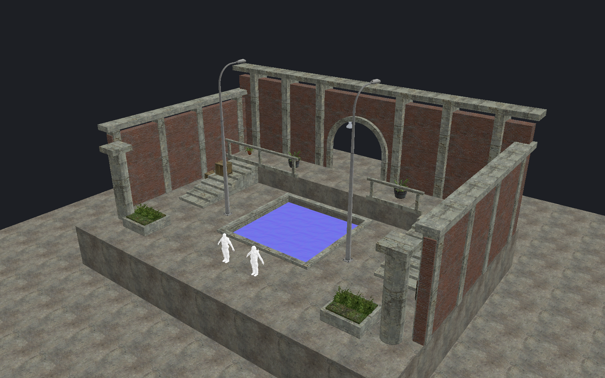

[← Manual](README.md)

# AI agents and MCP

Agents use the same map, operations, previews and Undo history as the editor.
They can also work without a window.



## Connect to the editor

Add this entry to your MCP client:

```json
{
  "mcpServers": {
    "hammerr": { "url": "http://127.0.0.1:7377/mcp" }
  }
}
```

Start the editor before connecting.
Use `--mcp-port <port>` to change the port.
Use `--no-mcp` to disable HTTP access.

## Without a window

1. Build the standalone server:

   ```sh
   cargo build --release -j8 -p editor-core --features mcp --bin hammerr-headless
   ```

2. Configure your client to launch it:

   ```json
   {
     "mcpServers": {
       "hammerr": {
         "command": "/absolute/path/target/release/hammerr-headless",
         "args": ["/absolute/path/map.vmf"]
       }
     }
   }
   ```

Omit the map argument for a new map.
Use `--game <gameinfo.txt>` and `--fgd <file.fgd>` for other content.
The standalone server uses stdio. It does not open a window or HTTP endpoint.
A render request starts graphics when needed.

## Start a task

1. Call `list_documents` to identify the target map.
2. Call `get_map_info` for its current state.
3. Inspect the relevant objects, faces or tool state.
4. Call the operation with the returned token or snapshot when required.
5. Inspect the preview.
6. Apply or cancel the preview.
7. Call `render_view` to check the result.
8. Call `save_map` when the source is ready.

## Compare an external VMF

Call `external_map_comparison` with `action: "compare"` and an explicit `.vmf`
`file`. The returned owner token guards `page`, `select`, `frame` and `cancel`;
`review` transfers an idle shared comparison to a new token. `background: true`
starts the same owned worker without waiting. `get_external_map_comparison`
returns cheap captured status and does not recheck external bytes.

`page` accepts `status`, `search` (displayed labels or IDs), `offset` and `limit` (1–64). Status values are
`all`, `identical`, `changed`, `current_only`, `external_only` and `ambiguous`.
`select` accepts the same filters and `mode` (`replace`, `add`, `remove`,
`toggle`); `frame` accepts the same filters and finite `aspect` (0.01–100).
Actions cover every eligible current object across all filtered pages. Every
explicit page or action checks the originally captured external identity off
lock; changed sources, current-map revisions or ownership reject stale results.
Framing preserves intervening camera movement and rejects any member without
finite bounds. Selection likewise preserves a selection changed while its
request was being checked. See [comparison scope and limits](map-comparison.md).

Use `tools/list` for exact parameters, enums, limits and tool descriptions.
Do not infer arguments from another tool's schema.
A failed operation returns an explicit error. Inspect it before retrying.

### A first edit

```json
{
  "name": "create_entity",
  "arguments": {
    "classname": "light",
    "origin": [0, 0, 128],
    "properties": { "_light": "255 220 180 400" }
  }
}
```

```json
{
  "name": "render_view",
  "arguments": { "width": 1600, "height": 1000 }
}
```

`render_view` returns an image, effective view state and diagnostics.
Set `include_details:true` to include the policy and resource-limit catalogues.
Use `selection_tint:false` to remove highlights without clearing selection;
`selection_outlines` controls edges separately. Sky previews remain visible
when `tool_textures:false`.
Temporary render overrides do not change the shared camera or view settings.
Point lights use ordinary entity markers. Their marker is not an illumination preview.

## Documents

- Pass the opaque string `document_id` when two documents are open.
- Omitting it is valid only with one live document. Desktop focus does not route requests.
- `new_document` and `open_document` add a map. The limit is two maps.
- `new_map` and `open_map` replace the target document's buffer.
- Desktop-created maps can remain hidden. `show_document` presents them explicitly. Set `focus:false` for **Show silently** on Hyprland with Lua window rules; unsupported display admission fails before opening the window.
- Result metadata identifies the routed document.

For replacement, use the current `replacement_review` from `get_map_info`.
Set `discard_changes:true` only when you intend to discard that reviewed state.
Changed state requires a new review.

### Save all named maps

Call `save_all_named_maps {}` without a document selector.
Inspect every document result.
`complete:false` means at least one map needs attention; successful peer saves remain saved.
Unnamed dirty maps need `save_map` with a destination.
Pending previews must be applied or cancelled first.

`find_objects` accepts `classname` and `exact_class` at the top level.
Class filters in `get_object_report` and `select_object_report` match substrings
by default. Use `filter:{"classname":"light","exact_class":true}` to select
point lights without matching `light_environment` or `light_spot`.

### Close a document

`list_documents` and `get_map_info.document_close.admission` report active
requests and workers by name. A Close refusal names the current blockers.
The review request excludes itself; the review token still guards document state.

1. Read `get_map_info.document_close`.
2. Review unsaved changes, drafts and owned work.
3. Pass its exact `review_token` to `close_document`.

Set `discard_changes:true` only to discard the reviewed changes.
Stale or busy requests leave the document open.
Accepted Close stops owned game/audio and drains owned work.
Closing the final document exits its process after response-output checks.
Cleanup or transport failures remain errors.

## Preview ownership

Tokens identify one specific draft. Snapshots identify the state that was inspected.
Use returned values exactly; they are not interchangeable.
Changes to sources or relevant settings can invalidate a draft.
An old Cancel cannot discard another actor's replacement draft.
Applying a map edit creates one Undo step. Cancel leaves the source unchanged.
Saving does not apply a preview.

For [grid snapping](brushes.md#snap-objects-to-grid), `preview_snap_to_grid` uses
`mode:"selection"` by default, preserving relative positions.
Set `mode:"each_object"` to align each whole object's bounds minimum independently.
Groups contribute separate objects; brush entities retain their child brushes.
Inspect `grid_snap.objects` for each canonical ID, original/snapped bounds minimum
and delta, then use `commit_transform_preview` or `cancel_transform_preview`.
IDs default to the current selection. The entire batch must validate before
replacing a draft; Apply creates one Undo step.

For [atlas fitting](atlas-texturing.md), pass the snapshot from `inspect_material_atlas` to `preview_atlas_fit`.
Its optional integer `padding` defaults to `0` and insets all four rectangle edges in original source image pixels.
Nonzero padding returns `padding` and `usable_rectangle`; `uv_bounds` describes the usable area.
The default `mode:"per_face"` fits each face independently.
Set `mode:"together"` and `reference:{solid,side}` to fit same-facing coplanar faces continuously using that selected face's projection frame.
Together drafts additionally return `mode` and `reference`; their `uv_bounds` describes the combined usable target, including gaps between faces.
Together requires a reference from the targets. Per-face mode rejects a reference parameter.
The outer rectangle must fit the actual image, and padding must leave positive width and height.
Invalid updates preserve the current draft. Apply or cancel with its exact token through `commit_face_preview` or `cancel_face_preview`.

Use `list_atlas_regions` for saved map-local regions and the catalog snapshot.
Pass it as `catalog_snapshot`, plus the inspected atlas `snapshot`, to `save_atlas_region` or `choose_atlas_region`.
Save also needs `name`, `material`, `rectangle` and optional `padding`; Choose needs `id` and `material`.
Use `rename_atlas_region` or `delete_atlas_region` with the latest catalog snapshot and region ID.
Choose restores fit inputs without editing faces. Preview and apply the fit separately. Changed image identities reject reuse.

For [overlay fitting](overlays.md), `preview_overlay.source` supplies the quad that sets the projection axes.
Optional `additional_sources` adds same-facing coplanar flat or isolated planar terrain faces from world or `func_detail`, up to 64 sources in total.
The projection spans their bounds and clips to the exact bound sides. Unbound gaps stay clear.
Omit `additional_sources` for a single-face fit.
For multi-face `preview_overlay_refit`, pass `reference: {solid, side}` for an eligible quad in the existing bindings. Its current edges set the new projection axes.
Refit retains the overlay ID, exact side list and settings.
For `preview_overlay_rebind`, pass an explicit target quad in `source` and optional coplanar `additional_sources` to replace the bindings with a different set of up to 64 faces.
Multi-face rebind drafts report `previous_sources`/`previous_source_count` and new `sources`/`source_count`. Apply preserves the same entity and raw settings in one Undo step.
Unchanged binding sets require Refit. Invalid updates retain the current draft.
`preview_overlay_corners` and `overlay_corner_handles` accept the complete coplanar binding set and use the stored projection axes. No reference parameter is needed.
Corner drafts report `sources` and `source_count`; applying changes only `uv0` through `uv3` in one Undo step.
The same tools accept multiple isolated planar displacements and mixed flat targets. Use displaced faces, not cage faces.
Every prepared and native sample must lie on the common projection plane, with straight quad borders. Each terrain base must be separate from every other terrain base. Touching or overlapping bounds and visible instance references reject.
The fit follows actual displaced coordinates. Refit after moving the plane; rebind can switch between eligible flat and terrain sources.

## Preview instance props

1. Call `set_instance_contents` with `action: "refresh"` to check saved child VMFs.
2. Call `set_view` or `render_view` with `instance_contents: true` to display supported child static props.
3. Read `static_prop_preview` in `inspect_instance_contents` or the render's `instance_contents` report.
4. Use `set_instance_contents` with `action: "frame"` and the current token to frame content bounds.

Refresh does not read models. Display, picking and framing use the shared model cache.
Repeated and nested props retain their selected skins and outer-reference selection.
`model_unavailable` reports model read, pose or budget failures and hides the reference layer.
Use `reload_model_assets` or `reload_material_assets` after changing those files.
See [instance contents](instance-contents.md) for limits.

## Extract an assembly

Call `set_instance_extraction` with `action:"prepare"`, a new relative VMF
`file`, and optional `pivot`. Omit it for World origin, use
`{"kind":"selection_centre"}`, or supply
`{"kind":"custom","position":[12.375,-6.625,2.125]}`.
Read the frozen point with `get_instance_extraction`. Use the owned `token`
with `action:"extract"`, or cancel and prepare again to change it.
Geometry and native texture/lightmap projections must remain unchanged.
See [Extract an assembly](instance-extraction.md) for bounds and file rules.

## Collapse all visible references

Call `get_instance_collapse`, then `set_instance_collapse` with
`action:"prepare"` and its `snapshot`. This recursively converts every visible
root reference in one batch; there is no selected-only mode.
Inspect counts and fresh object IDs. The complete `entity_id_map` pairs
`expanded` compiler entity IDs with fresh `authored` emitted light/target IDs.
The separate complete `helper_id_map` pairs newly materialized cubemap helper IDs.
`static_prop_id_map` pairs expanded prop IDs with fresh authored prop IDs.
Neither gains an emitted runtime `hammerid`. `entity_provenance` includes
`emitted` and `compiler_handled` flags and reports up to 64 original root/file/entity rows with
`entity_provenance_total` for the full count. Face provenance remains bounded.
These mappings are retained in Apply's `captured_preview`.
Face and entity provenance also include `occurrence`, ordered `{helper,file}`
steps from the root reference through the leaf source, and `occurrence_label`.
IDs belong to each containing authored file. Repeated same-file/ID occurrences
remain distinct. Counts and ID maps remain available if the bounded provenance
copy reports `provenance_error`.
Use `action:"apply"` with the owned `token`, or `action:"cancel"` to discard it.
`action:"review"` transfers an idle draft to a fresh token.
Prepare and Apply accept optional `background:true`; poll the getter for completion.
Apply rechecks the original saved parent and dependency bytes before one Undo edit.
Reference markers and their validated color/layout are consumed; child object
editor fields stay attached. Supported content includes world/detail brushes,
terrain, supported static props with empty `lightingorigin`, checked static
point/spot lights with local `info_target` helpers, and cubemap samples.
Collapse retains the original MDL guard and checks every intermediate model pose.
Changed models expire the plan. `info_lighting` helpers remain unsupported.
Meshes, PHY files and materials keep their separate Compile checks.
Manual cubemap `sides` remap through the reviewed fresh
side IDs; automatic samples preserve absence of that field. Light scope includes
existing HDR values, literal bindings and scoped target names. Fresh emitted
entity IDs intentionally change their compiled `hammerid` values; other entity
fields/order and native light payloads retain shared preparation. Other child
entities and unsupported metadata refuse the whole batch.

## Selection defaults

Selection defaults use `get_selection_defaults` and `set_selection_defaults`.
Save records current filters; Apply affects only the selected document. Reload and Reset do not apply filters.

Use `get_selection_profiles` to list named profiles and their stable IDs.
Call `set_selection_profile` with the latest snapshot and `operation:{action:"save",name:"Props"}` to save current filters.
Use a profile ID for `replace`, `apply`, `rename` or `delete`; `rename` also needs `name`.
Only `apply` changes current filters. Profile edits leave startup defaults unchanged; default Save/Reset retain profiles.

## Pivot grid snapping

Call `transform_pivot_grid` with `action:"inspect"` for the current pivot, snapped point, grid and snapshot.
Call it with `action:"snap"` and that `snapshot` to set a fixed custom pivot.
This explicit action uses the grid even with snapping off. It changes no map data, history or saved defaults.
Finish active previews and gestures first. Coordinates must stay within ±65,536 units.

## Pivot defaults

Use `get_transform_pivot_defaults` to inspect current and saved pivots, storage errors and the action snapshot.
Pass that snapshot to `set_transform_pivot_defaults` with `action:"save"`, `"apply"`, `"reload"` or `"reset"`.
Save records the current pivot for new document Sessions. Apply changes only the selected document's pivot.
Reload and Reset do not apply a pivot. New/Open within an existing Session retain its current pivot.
Surface picks save only fixed coordinates when explicitly requested.

## Rope bounds

Set `rope_preview:true` with `set_view` to include admitted spans in source-helper bounds.
Framing, `get_objects`, `get_selection` and area/volume selection use the same sag and width.
Bounds are conservative axis-aligned boxes. **Contained** requires the entire span and helper.
Incoming spans do not enlarge their target. Changing the toggle expires area/volume reviews.
Temporary `render_view` and `pick_at_pixel` rope overrides also affect camera `focus`.
Authored pivots, transforms, placement, paint and raw map summaries keep source bounds.

## Color correction

1. Call `load_color_correction_lut` with an explicit physical `path` to a Source `.raw` LUT. A successful load turns preview off.
2. Inspect `get_color_correction_preview`. It reports the source, admitted `identity`, SHA256, requested enable/weight, source readiness and errors without initializing graphics.
3. Call `set_color_correction_preview` with `enabled:true`, a finite `weight` from `0` to `1`, and optional `expected_identity` from inspection. A different loaded identity refuses that reviewed enable request.
4. Call `render_view`. Its `color_correction.applied` is true only after the requested frame succeeds. Source or GPU failure returns an error instead of a successful ungraded image.

Use `enabled:false` to disable the preview. `clear_color_correction_lut` disables it
and clears its admitted source and error. Changed or missing input invalidates
the LUT until an explicit successful load; no previous or identity table is substituted.

The file must contain exactly 98,304 packed RGB8 bytes: 32 cubed entries, red
index fastest, then green, then blue. Trilinear lookup applies once to the
complete viewport's sRGB display colors, including helpers and background.
The preview does not evaluate entities, volumes, multiple LUTs or native HDR
composition. It does not change the map or saved preferences.
See [Color correction](color-correction.md) for target and resource limits.

## Compile and play

1. Call `get_compile_settings`.
2. Call `set_compile_settings` with the required changes.
3. Call `start_compile`.
4. Poll `get_compile_status`.
5. Inspect diagnostics before calling `launch_game`.

`compile_map` waits for the build. `run_map` builds and launches through the same job system.
Use `cancel_compile` to stop owned build work.
Set `brush_texture_shadows:true` for [brush cutout shadows](brush-texture-shadows.md).
For an eligible stationary root or child `func_brush`, set `vrad_brush_cast_shadows:"1"` through `set_entity_properties` to cast supported binary cutouts globally. This uses the same **Shadows → Yes** property and lit build option as the UI. Child origins and initial poses lower before containing transforms. Without this request, supported root and child cutouts stay within their own lit receivers. Absent or zero requests do not affect world or other-model lighting.
Game launches use `-insecure` and private validation uses `sv_lan 1`.
Reflection capture also needs a ready `get_native_capture_runtime` result.
See [Compile and play](compile-and-play.md).

`get_compile_status` marks a completed job stale when consumed material, detail or physics-definition inputs change. `job.material_source_issue` gives the cause; unused runtime assets remain outside this check.

For [stationary child brush rotation](instances.md#rotate-a-stationary-child-brush), set canonical `angles` through `set_entity_properties` or property-edit tools.
Save the child, then compile its parent. Compilation lowers the initial pose into body geometry and emits zero angles.
`brush_model_preview.deferred_checks` includes `initial_pose`; reference inspection still provides no child model mesh.

In the `get_compile_settings` response, use `light_value_bindings.class_properties` for each light class.
Its `properties` list contains only fields valid for every listed class; specialized lists give distance, attenuation-coefficient, sun-spread, spotlight-shape and signed-pitch scope.

For [light colors per reference](instances.md#light-colors-per-reference), set a child light's `_light` or `_lightHDR` to `$name`.
Child `light_environment` also supports `_ambient` and `_ambientHDR`.
Bind `_lightscaleHDR` on point/spot/sun lights or `_AmbientScaleHDR` on sun lights to one finite, nonnegative scalar literal.
For point/spot [falloff bindings](instance-authoring.md#bind-light-falloff-distances), bind `_fifty_percent_distance` and `_zero_percent_distance` to finite, nonnegative literals. Their effective pair uses the normal falloff rules; zero near-zero distance selects the automatic value.
For legacy falloff, bind `_constant_attn`, `_linear_attn` and `_quadratic_attn` with whole-value tokens. Use `attenuation_coefficient_properties` and `attenuation_coefficient_classes` for discovery. Active coefficients must be finite, nonnegative and fit native floats without nonzero underflow. An all-zero triple keeps ordinary constant falloff. Positive percentage-distance falloff takes precedence.
Point/spot `_distance` and `_hardfalloff` also accept whole-value tokens. Read their field/class lists in `light_value_bindings`. Hard values are `0` or `1`. Active radius must preserve a finite nonzero native float, or be `0` for unlimited range. Positive percentage distance ignores radius. Hard falloff `1` requires positive 50% distance. Both fields keep integer FGD metadata and raw tokens.
For [sun spread](instance-authoring.md#bind-sun-spread), bind `SunSpreadAngle` on child `light_environment` to one finite literal from 0 to 90 degrees.
For [spotlight shape](instance-authoring.md#bind-spotlight-cones-and-focus), bind `_inner_cone`, `_cone` and `_exponent` on child `light_spot`.
Use class-specific discovery for angle/focus scope and ordinary cone rules. Unresolved integer rows retain text tokens without an evaluated value.
For [spotlight pitch](instance-authoring.md#bind-spotlight-pitch), use `spotlight_pitch_properties`, `spotlight_pitch_classes` and `spotlight_pitch_degrees`. Bind `pitch` to one finite signed value from −90 to 90. A value of `0` requires the first `angles` component to be `0`, including targeted and point-mode child lights. Other scalar ranges stay unchanged.
Child spotlights can also reference one visible local `info_target`; use explicit Prefix names on every containing helper.
Reference refresh reports `spotlight_targets` and an unavailable `spotlight_target_preview`. Keep lamp and endpoint inside a lit compile region.
Environment falloff and other unsupported scalar fields remain literal.
Use `create_entity`, `set_entity_properties` or the property-edit tools.
Set a root helper's `replace01` through `replace10` to `$name literal`.
A nested helper can use `$Local $Outer` to copy one whole value from its immediate parent scope.
Names are case-insensitive; same-name forwarding is valid. Declare every hop within four helper levels.
Sibling-slot lookup, implicit ancestor search and recursive or embedded substitution reject.
The reference form preserves template text; standalone refresh and compile need a containing scope.
Use at most ten slots; each effective field must fit 512 bytes. `nested_forwarding` and `root_literal_only` report this scope.
Save the child, refresh contents, then compile the parent. Missing, duplicate and unused bindings fail explicitly.
Unresolved standalone templates fail in every build mode and are excluded from authored-lighting preview, including distance, sun spread, HDR color or gain tokens with sky ambient off.
The reference form preserves bindings. Extraction with parameters and general replacements remain unsupported.

Static-prop packing accepts up to eight Patch include edges with one basetexture edit per Patch.
All original materials and declared textures stay packed. Deeper edits win within each type; replacements apply after all inserts.
Cutout vertex-lighting receivers accept the same bounded nested basetexture edits; their receiver-only textures stay unread unless casting or packing needs them.

Static child `env_fog_controller` entities use ordinary create/property/save operations. Set literal primary RGB, start/end, density and enable values; keep blend, radial, `use_angles` and transition time at `0`, HDR/zoom gains at `1` and far-Z nonpositive. Names, I/O and Master/DX flags are unavailable. Refresh reports `fog_controllers` and unavailable parent fog preview. Multiple controllers keep ordinary order; compile regions select their transformed origins.

Valid editor-only atlas catalogs can stay in child maps. Their metadata is checked and excluded from expanded geometry and BSPs. Unknown top-level metadata and invalid catalogs reject.

Use `frame_compiled_face` with the current `build_token`, explicit `channel`,
native `face` ordinal and optional `aspect` from `0.01` through `100`.
It frames flat Model0 world/detail geometry using the owned BSP vertices.
It preserves projection, selection, history and drafts. Stale output, terrain,
model-local faces, invalid geometry and active viewport work refuse atomically.
Several authored contributors do not prevent valid native face framing.

Use `set_compiled_prop_leaf_bounds` with `build_token` and native `prop` to show
its complete native leaf membership bounds. Call `get_compiled_prop_leaf_bounds`
to read exact ordinals, bounds and displayed state. Omit both arguments to clear.
The purple guide is independent of the cyan visibility guide and needs no baked
vertex colors. Sets above 512 leaves or 256 KiB refuse without replacing the
previous guide. Stale guides are suppressed. These boxes do not show exact mesh
clipping, convex leaf cells or runtime visibility.

`frame_compiled_prop_origin` requires the current `build_token` and native
`prop` ordinal from `inspect_baked_prop_vertices`. Optional `aspect` defaults to
1 and must be finite from 0.01 through 100. It returns the exact native `record`,
`build`, `framed_bounds`, `point_half_extent:16`, `aspect` and `camera`. The
32-unit point frame preserves projection, selection, map/history/settings and
ordinary drafts; it reports no model bounds or source-object resolution.
Disabled/non-baked props and unavailable source associations can still frame
valid native origins. Stale, missing, replaced or out-of-range owned data and
active viewport work refuse before camera mutation.

`select_compiled_prop_source` requires `build_token` and native `prop` ordinal.
`select_compiled_world_light_source` requires `build_token`, explicit `channel`
(`ldr`/`hdr`) and native `ordinal`. Both re-run current owned inspection and require
an available verified captured source. They replace selection with exactly one
root entity, or only the captured outer containing reference for an instance,
in Objects mode. Groups do not expand; objects are not unhidden and child files
are not opened. The camera, map, Undo history and ordinary property drafts stay
unchanged. Active viewport work and geometry drafts refuse before selection.
Historical, changed, missing and invalid data or metadata refuses atomically.
Results contain `target` (`entity:<id>`), `source_kind` (`root_entity` or
`containing_reference`), `mode:"objects"` and `selected_count:1`.
Unavailable source metadata does not change native framing availability.

`inspect_baked_prop_vertices` returns captured authored source addresses in each
`props.rows[].source_association` and in `selected_prop.source_association`,
including disabled props without color files. Available associations contain
`status:"available"`, `origin`, a compact `label` and a full `description`.
Root origins are `{kind:"root",entity}`. Instance origins retain
`{kind:"instance",instance,file,entity,expanded_entity,occurrence}`; `occurrence`
is the complete ordered `{helper,file}` route, with IDs scoped to each authored
file. Top-level `source_associations` reports availability and diagnostics;
unavailable rows contain `status:"unavailable"` and `reason`. Missing or
unverified metadata leaves valid native/color inspection available. Addresses
remain captured and historical after source changes; selection uses only a current
verified capture. Source copies cap at 128 KiB per report, within the
256 KiB report cap. Reduce the existing `prop_limit` (1–32) after a page-budget
refusal; the desktop uses **Props per page** for the same operation.

`inspect_baked_lightmaps` instance contributors include the complete `occurrence` helper/file route and a readable `occurrence_label`. An instance `source` selector may supply that ordered route to match only the captured occurrence (its first helper must equal `instance` and its last file must equal `file`); omitting it preserves grouped matches across repeated leaf faces with the same legacy instance/file/solid/side identity. Contributor clicks in the human inspector supply the exact captured route. Paths remain historical after source changes. The existing 8 MiB face metadata cap includes actual shared route storage; contributor response copies cap at 512 KiB per page and report unavailable on overflow.

`inspect_compiled_world_lights` rows include `source_association`. Available point/spot origins identify a captured root `entity`, or an instance's outer `instance` helper, leaf `file`, original `entity` and build-local `expanded_entity`. Instance origins also include `occurrence`, an ordered array of `{helper, file}` steps from the root helper through every referenced source to the leaf (up to four levels). Helper IDs are authored in the containing map. Different routes distinguish repeated occurrences of the same leaf entity. Historical IDs and routes remain attached to their captured source snapshot. Missing or inconsistent metadata and other native kinds return `status: "unavailable"` with a reason while intact native rows remain readable. Associations are checked against each channel's exact table count and digest. Inspection does not select or open current source files. Complete occurrence routes are retained once per occurrence and shared across its lights/channels; page copies and serialized routes remain bounded by the returned limits. The existing framing result carries the same enriched record.

To [frame a compiled point or spot light](compiled-lights.md), inspect the owned records first, then call `frame_compiled_world_light` with explicit `build_token`, `channel` and native `ordinal`. Optional `aspect` defaults to `1` and accepts `0.01`–`100`. The result includes exact build/record provenance, `framed_bounds` and camera state. Current output and an available channel are required; stale, global, unknown or out-of-world records reject before camera movement. Active viewport gestures and block previews also reject without cancellation. Ordinary drafts, map selection, history and settings survive.

For [compiler-owned visibility](visibility.md), call `inspect_compiled_visibility` without arguments for a fresh summary. Retain its opaque `build_token` for explicit `target` objects: `{"kind":"leaf","ordinal":N}`, `cluster`, or `portal`. Summary pages world leaves; leaf queries page incident portals; cluster queries page member leaves; portal queries return the exact bounded ring and its two native endpoints. `kind` selects `pvs` or `pas`; `offset` and `visibility_offset` page records and destination clusters independently, with `limit` from 1 to 64. Ordinals belong to that build, and portal slots can have gaps. Native leaf bounds are not exact convex cells. Internal portals remain visible after cluster coarsening.

The same inspection accepts `target: {"kind":"position","source":{"kind":"position","position":[x,y,z]}}` or `target: {"kind":"position","source":{"kind":"camera"}}`, always with the retained token. Camera source samples the current Perspective camera and refuses orthographic views; explicit world coordinates work in every view. One owned BSP read/seal supplies Model 0's actual plane/node walk. The returned `position` reports requested/effective f32 coordinates, native leaf/cluster/contents, classification and the declared f32 arithmetic/tie policy. Inputs narrow to f32; classification uses `((nx*x + ny*y) + nz*z) - dist`, with negative distance choosing child 1 and zero child 0. Nonfinite values, arithmetic overflow and malformed/cyclic routes refuse; engine boundary bit parity is not claimed. Cluster -1 has no PVS/PAS row, and reserved leaf 0 gets no invented bounds. Use the returned resolved Leaf `target` for later pages, framing or showing a guide. Intact historical builds remain explicitly historical; camera/position lookup changes no view, draft, selection or history.

`frame_compiled_visibility` takes an explicit token, leaf/portal target and optional `aspect` (default 1). `set_compiled_visibility_overlay` defaults to `mode: {"kind":"selected"}` for one selected leaf box or portal ring. With `mode: {"kind":"destinations","visibility":"pvs"}` or `"pas"`, pass a clustered leaf or cluster target to show every native world-leaf bounds box joined to that complete native destination row. Camera/position sources first resolve through inspection; use the returned Leaf target. Guide membership is independent of report pages. The response includes mode, source cluster, destination cluster count, leaf count, exact bounded `native_leaves`, retained bytes, line vertices and caps. Complete sets above 512 leaves or the 256 KiB bounds/renderer allowance refuse without replacing the previous guide; ordinary inspection still works. Potential destination bounds are not rendered faces, exact cells or current game occlusion. Omit/null `target` to clear either guide. Both require current owned data when showing or framing, preserve ordinary drafts and refuse active viewport gestures. Stale guides are suppressed during scene updates. Historical intact inspection stays read-only; missing, changed or unverifiable output clears rows/totals. These tools accept no file path. Freshness covers committed map/settings and consumed compiler-source guards, not an entire runtime asset closure.

`inspect_entity_graph` accepts explicit root entity IDs and `direction` (`outgoing`, `incoming`, `both`), with `depth` defaulting to 2 (1–16). It returns authored nodes, concrete exact-name fan-out/`!self` edges, explicit unresolved records and an owned `snapshot`. Node, edge and unresolved pages have independent offsets and at most 64 rows; nonzero offsets require the returned snapshot. Unresolved pages cover the admitted whole map. Optional `search` filters displayed rows only.

Use the same roots/direction/depth and snapshot with `select_entity_graph` (`mode`: `replace`, `add`, `remove`, `toggle`) or `frame_entity_graph` (optional `aspect`: 0.01–100, default 1). Both recompute all reached nodes within the depth, including roots, independently of search and pages. Stale/foreign snapshots and active geometry work refuse before mutation. Framing preserves selection. Saved-hidden entities, expanded instances and unapplied drafts are excluded. Wildcard-prefix, missing, malformed and class/runtime-dependent references never become guessed concrete links. Count, work, field-byte, page and storage ceilings are returned in `limits`; exceeding them refuses the complete request.

## Tool reference

The server publishes the complete parameter schema for every tool.
These groups locate the available operations.

| Area | Tools |
| --- | --- |
| Documents and workspace | `list_documents`, `new_document`, `open_document`, `save_all_named_maps`, `show_document` |
| [Models, sounds and assets](models.md) | `apply_model_choice`, `apply_sound_choice`, `begin_model_choice`, `begin_sound_choice`, `browse_models`, `browse_sounds`, `cancel_model_choice`, `cancel_sound_choice`, `choose_model`, `choose_model_bodygroup`, `choose_sound`, `clear_model_attachment`, `frame_model_attachment`, `get_model_attachment_guide`, `get_model_choice`, `get_sound_choice`, `get_sound_preview`, `inspect_entity_model`, `inspect_model`, `inspect_sound`, `play_sound_preview`, `reload_model_assets`, `reload_sound_assets`, `render_model_preview`, `render_sound_preview`, `set_sound_preview_volume`, `show_model_attachment`, `stop_sound_preview` |
| [Atlas texturing](atlas-texturing.md) | `inspect_material_atlas`, `preview_atlas_fit`, `list_atlas_regions`, `save_atlas_region`, `choose_atlas_region`, `rename_atlas_region`, `delete_atlas_region` |
| [Build and play](compile-and-play.md) | `apply_build_recipe`, `apply_compile_region`, `cancel_compile`, `cancel_compile_region`, `compile_map`, `delete_build_recipe`, `frame_compile_region`, `game_log`, `get_build_recipes`, `get_compile_region`, `get_compile_settings`, `get_compile_status`, `get_native_capture_runtime`, `launch_game`, `preview_compile_region`, `reload_build_recipes`, `rename_build_recipe`, `run_map`, `run_map_checks`, `save_build_recipe`, `set_compile_settings`, `set_native_capture_runtime`, `start_compile`, `stop_game` |
| [Map checks and reports](map-tools.md) | `apply_map_fixes`, `cancel_map_fixes`, `get_map_checks`, `get_object_report`, `preview_map_fixes`, `select_map_issue`, `select_object_report`, `set_object_visibility` |
| [Clipboard and prefabs](clipboard.md) | `apply_paste`, `cancel_paste`, `copy_objects`, `cut_objects`, `delete_prefab`, `export_clipboard`, `get_clipboard`, `get_prefabs`, `import_clipboard`, `inspect_prefab_thumbnail`, `preview_paste`, `preview_prefab`, `rename_prefab`, `render_prefab_gallery`, `render_prefab_thumbnail`, `save_prefab` |
| [Color palette](entities.md) | `get_color_palette`, `set_color_palette` |
| [Brush components](components.md) | `begin_component_drag`, `cancel_component_drag`, `cancel_component_edit`, `cancel_component_move`, `commit_component_drag`, `commit_component_edit`, `commit_component_move`, `get_brush_components`, `get_component_handles`, `get_component_sources`, `pick_brush_components`, `preview_component_crease`, `preview_component_move`, `preview_component_rotate`, `preview_component_scale`, `preview_component_split`, `preview_component_weld`, `select_brush_components`, `set_component_move_options`, `set_component_picking`, `set_entity_component`, `update_component_drag`, `update_component_scope` |
| [Map design notes](map-tools.md) | `apply_context_edit`, `begin_context_edit`, `cancel_context_edit`, `delete_context_note`, `focus_context`, `get_context`, `get_context_note`, `get_context_state`, `list_context_notes`, `set_context_view`, `update_context_edit` |
| [Reflection bindings](cubemap-faces.md) | `get_cubemap_bindings`, `set_cubemap_bindings` |
| [Entity properties and connections](entities.md) | `begin_connection_edit`, `begin_entity_rename`, `begin_property_edit`, `cancel_connection_edit`, `cancel_entity_rename`, `cancel_property_edit`, `commit_connection_edit`, `commit_entity_rename`, `commit_property_edit`, `convert_color`, `create_entity`, `delete_entity_connection`, `get_connection_choices`, `get_entity_class`, `get_entity_connections`, `inspect_entity_graph`, `select_entity_graph`, `frame_entity_graph`, `get_entity_definitions`, `get_entity_inspector`, `get_entity_references`, `get_property_edit`, `get_property_inspector`, `load_entity_definitions`, `move_to_world`, `search_entity_classes`, `set_entity_color`, `set_entity_color_space`, `set_entity_properties`, `tie_to_entity`, `update_connection_draft`, `update_entity_rename`, `update_property_edit` |
| [Entity placement](entities.md) | `apply_entity_placement`, `begin_entity_placement`, `cancel_entity_placement`, `get_entity_placement`, `pick_entity_placement`, `review_entity_placement` |
| [Map files](getting-started.md) | `clear_recent_maps`, `close_document`, `find_objects`, `get_map_info`, `get_map_statistics`, `get_objects`, `get_recent_maps`, `new_map`, `open_map`, `open_recent_map`, `redo`, `reload_recent_maps`, `remove_recent_map`, `save_map`, `undo` |
| [External map comparison](map-comparison.md) | `external_map_comparison`, `get_external_map_comparison` |
| [Brush geometry and transforms](brushes.md) | `begin_clip_drag`, `cancel_block_preview`, `cancel_carve`, `cancel_clip_drag`, `cancel_clip_preview`, `cancel_hollow`, `cancel_merge`, `cancel_primitive_preview`, `clip_brushes`, `commit_carve`, `commit_clip_preview`, `commit_hollow`, `commit_merge`, `commit_primitive_preview`, `create_block`, `create_polygon_brush`, `create_primitive`, `draw_block`, `finish_clip_drag`, `frame_primitive_preview`, `get_carve_preview`, `get_clip_handles`, `get_clip_preview`, `get_hollow_preview`, `get_merge_preview`, `get_primitive_preview`, `look_inside_hollow`, `pick_clip_point`, `preview_carve`, `preview_carve_many`, `preview_hollow`, `preview_merge`, `set_clip_handle_options`, `set_clip_points`, `set_clip_tool`, `set_spatial_settings`, `update_clip_drag` |
| [Grid defaults](basics.md) | `get_grid_defaults`, `set_grid_defaults` |
| [Groups and layers](groups.md) | `add_object_group_selection`, `apply_layer_edit`, `apply_object_group_edit`, `begin_layer_edit`, `begin_object_group_edit`, `cancel_layer_edit`, `cancel_object_group_edit`, `get_layers`, `get_object_groups`, `select_layer_members`, `select_object_group`, `select_object_group_member`, `set_group_selection_bypass`, `set_layer_visibility`, `update_layer_edit`, `update_object_group_edit` |
| [History](history.md) | `get_history`, `navigate_history` |
| [Instance contents](instance-contents.md) | `inspect_instance_contents`, `set_instance_contents` |
| [Instance extraction](instance-extraction.md) | `get_instance_extraction`, `set_instance_extraction` |
| [Instance authoring](instance-authoring.md) | `get_instance_reference`, `set_instance_reference` |
| [Collapse references](instances.md#collapse-references-into-editable-geometry) | `get_instance_collapse`, `set_instance_collapse` |
| [Linked paths](path-authoring.md) | `get_linked_path`, `set_linked_path` |
| [Materials and face textures](textures.md) | `apply_surface_placement`, `begin_surface_placement_pick`, `begin_texture_stroke`, `browse_materials`, `cancel_face_preview`, `cancel_surface_placement`, `cancel_texture_stroke`, `commit_face_preview`, `commit_texture_stroke`, `edit_faces`, `find_material_faces`, `get_face_selection`, `get_material_search`, `get_material_source`, `get_surface_placement`, `get_surface_placement_sources`, `get_surface_sample`, `get_texture_stroke`, `paint_face_texture`, `pick_surface_placement`, `preview_material`, `preview_surface_placement`, `project_face_group`, `propagate_face_texture`, `reload_material_assets`, `reload_material_favorites`, `replace_materials`, `sample_face_texture`, `search_materials`, `select_faces`, `select_material_faces`, `set_material`, `set_material_favorite`, `update_texture_stroke`, `vary_face_uv` |
| [Measurements](measurements.md) | `get_measurements`, `set_measurement` |
| [Navigation defaults](navigation-defaults.md) | `get_navigation_settings`, `set_navigation_defaults`, `set_navigation_settings` |
| [Overlays](overlays.md) | `apply_overlay`, `browse_overlay_targets`, `cancel_overlay`, `get_overlay_state`, `overlay_corner_handles`, `preview_overlay`, `preview_overlay_corners`, `preview_overlay_rebind`, `preview_overlay_refit`, `review_overlay` |
| [Particles](particles.md) | `apply_particle_choice`, `begin_particle_choice`, `browse_particles`, `cancel_particle_choice`, `choose_particle`, `get_particle_choice`, `inspect_particle`, `reload_particle_assets` |
| [Face partitions](partitions.md) | `frame_component_partitions`, `get_saved_component_partitions`, `pick_component_partitions`, `place_component_partition_texture`, `preview_component_partition`, `preview_partition_extrusion`, `raise_component_partition`, `remove_saved_component_partitions`, `resume_component_partitions`, `select_component_partitions`, `store_component_partition`, `update_component_partition_cut`, `update_component_partition_material`, `update_component_partition_texture` |
| [Surface placement](placement.md) | `apply_repeat_array`, `cancel_repeat_array`, `get_repeat_array`, `preview_repeat_array` |
| [Preview defaults](preview-defaults.md) | `get_preview_defaults`, `set_preview_defaults` |
| [Recovery](map-tools.md) | `create_recovery_snapshot`, `delete_recovery_snapshot`, `get_recovery`, `reload_recovery_settings`, `restore_recovery_snapshot`, `set_recovery_settings` |
| [Selection](selection.md) | `begin_paint_selection`, `begin_transform_drag`, `cancel_area_selection`, `cancel_paint_selection`, `cancel_transform_preview`, `cancel_volume_selection`, `commit_area_selection`, `commit_paint_selection`, `commit_transform_preview`, `commit_volume_selection`, `delete_objects`, `duplicate_objects`, `frame_selection`, `frame_volume_selection`, `get_area_selection`, `get_paint_selection`, `get_selection`, `get_selection_defaults`, `get_selection_filters`, `get_selection_profiles`, `get_transform_handles`, `get_volume_selection`, `move_objects`, `preview_snap_to_grid`, `select`, `select_area`, `select_volume`, `set_area_selection_options`, `set_paint_tool`, `set_selection_defaults`, `set_selection_filters`, `set_selection_profile`, `set_selection_mode`, `set_transform_tool`, `transform_objects`, `update_paint_selection`, `update_transform_drag` |
| [Keyboard shortcuts](keyboard-shortcuts.md) | `execute_editor_command`, `find_editor_commands`, `get_keyboard_shortcuts`, `set_keyboard_shortcuts` |
| [3D sky preview](sky.md) | `get_3d_sky_preview`, `set_3d_sky_preview` |
| [Color correction](color-correction.md) | `get_color_correction_preview`, `load_color_correction_lut`, `set_color_correction_preview`, `clear_color_correction_lut` |
| [Terrain](terrain.md) | `begin_terrain_move_drag`, `begin_terrain_stroke`, `break_terrain_stroke`, `cancel_terrain_move_handles`, `cancel_terrain_stroke`, `clear_terrain_triangle_highlight`, `create_terrain`, `enable_terrain_move_handles`, `finish_terrain_move_drag`, `finish_terrain_stroke`, `frame_terrain_triangles`, `frame_terrain_vertices`, `get_terrain_creation`, `get_terrain_grids`, `get_terrain_move_handles`, `get_terrain_stroke`, `get_terrain_triangle_highlight`, `get_terrain_triangles`, `get_terrain_vertex_mask`, `get_terrain_vertices`, `get_terrain_volume_triangles`, `get_terrain_volume_vertices`, `highlight_terrain_triangles`, `highlight_terrain_vertices`, `pick_terrain_triangle`, `pick_terrain_vertex`, `preview_terrain_blend`, `preview_terrain_collision`, `preview_terrain_resolution`, `preview_terrain_sculpt`, `preview_terrain_sew`, `preview_terrain_smoothing`, `preview_terrain_subdivision`, `preview_terrain_triangle_tags`, `preview_terrain_vertex_move`, `remove_terrain`, `select_terrain_triangles_in_volume`, `select_terrain_vertices_in_volume`, `update_terrain_move_drag`, `update_terrain_stroke` |
| [Transform pivots](brushes.md) | `transform_pivot_pick`, `transform_pivot_grid` |
| [Cameras, rendering and inspection](basics.md) | `clear_pointfile`, `cycle_object_hit`, `delete_camera_view`, `frame_compiled_face`, `frame_compiled_prop_origin`, `frame_compiled_world_light`, `frame_pointfile`, `get_camera`, `get_camera_views`, `get_fog_preview`, `get_lighting_preview`, `get_normal_map_preview`, `get_object_hit_candidates`, `get_pointfile`, `get_rope_preview`, `inspect_baked_lightmaps`, `inspect_baked_prop_vertices`, `inspect_compiled_world_lights`, `inspect_sky_assets`, `load_pointfile`, `navigate_pointfile`, `pick_at_pixel`, `raycast`, `rename_camera_view`, `render_view`, `restore_camera_view`, `select_compiled_prop_source`, `select_compiled_world_light_source`, `save_camera_view`, `set_camera`, `set_fog_preview`, `set_view` |
| [Working region](working-region.md) | `get_editor_visibility`, `get_working_region`, `set_editor_visibility`, `set_working_region` |
| [Prop leaf bounds](baked-prop-vertices.md) | `get_compiled_prop_leaf_bounds`, `set_compiled_prop_leaf_bounds` |
| [Compiled visibility](visibility.md) | `frame_compiled_visibility`, `inspect_compiled_visibility`, `set_compiled_visibility_overlay` |

## Limits

- UI and MCP operations share validation. An agent cannot bypass unsupported geometry or asset rules.
- Model, sprite and lighting previews have explicit limits. Read the returned diagnostics.
- Baked-output inspectors describe an owned successful build; stale output is identified.
- Maps, selection and drafts are document-local. Content catalogs and saved preferences can be shared.
- Stdio requires pipes or redirected regular files, not terminal or device descriptors.
- Use a trusted local MCP client. The desktop endpoint is bound to loopback.
