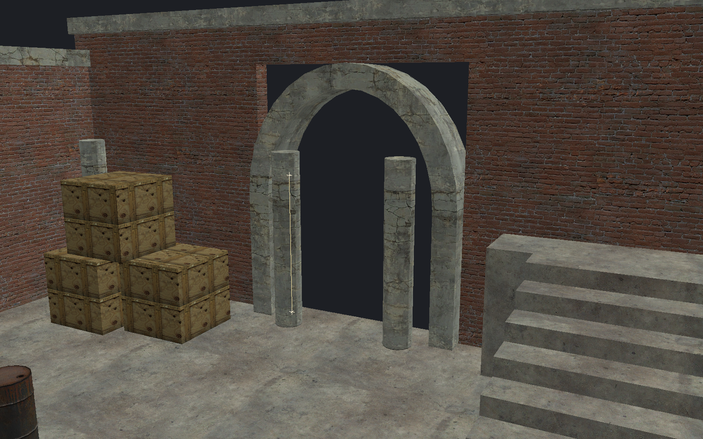
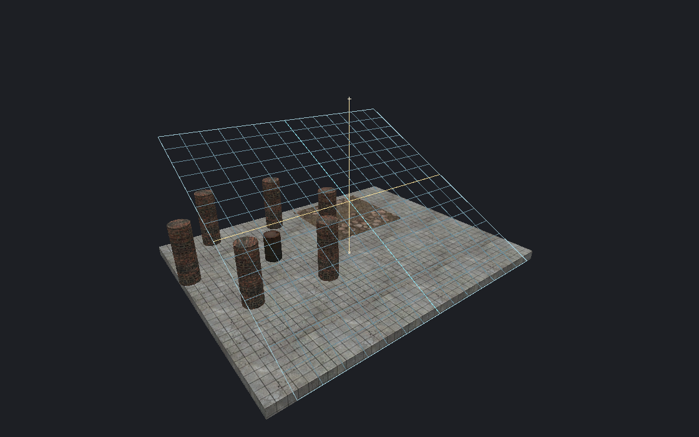

[← Manual](README.md)

# Spatial guides

Save named rulers for clearances, heights and distances.

1. Open **Measurements…**.
2. Enter **Name**, **Start** and **End** coordinates.
3. Click **Preview**.
4. Use **Pick start** or **Pick end** to choose a visible surface point.
5. Click **Frame** to inspect the ruler.
6. Click **Apply** to save it.

The gold line is the distance. Red, green and blue segments show signed X, Y and Z components.
Use **New measurement**, **Delete** and **Show guides** to manage rulers.

## Follow an entity

1. Preview a ruler.
2. Enter `entity:<id>` beside **Attach start origin** or **Attach end origin**.
3. Click that attachment control, then **Apply**.

Use **Attach start local** or **Attach end local** to retain an offset in the entity's rigid local frame.
**Detach start** or **Detach end** freezes a resolvable point.
**Use start world** or **Use end world** explicitly replaces an unavailable attachment with stored coordinates.

## Follow a brush or terrain surface

1. Preview a ruler.
2. Click **Pick start** or **Pick end**, then pick the surface point.
3. Click **Attach start surface** or **Attach end surface**.
4. Click **Apply**.

The endpoint follows compatible moves, rotations and surface edits. It retains the picked point, including points between vertices.

## Use a reference plane

1. Expand **REFERENCE PLANE**.
2. Choose **Orientation**, or enter **Origin**, **Normal** and **Grid X axis**.
3. Set **Grid spacing** and **Half extent**. The grid X axis must be perpendicular to the normal.
4. Select **Enable plane**, **Show plane grid** and, if needed, **Snap plane picks**.
5. Click **Apply plane**.
6. Preview a ruler. Use **Pick start on plane** or **Pick end on plane**.

The grid draws over geometry. Snapping uses the plane axes. **Half extent** sets the displayed area; picks can extend beyond it.
**Reset plane** restores the disabled default. **Reload plane** replaces the form with current settings.

## Limits

- Rulers and their attachments persist in the VMF. Visibility and the reference plane are session-local. New/Open clears the plane.
- Surface picks remain world points until you attach them. Model mesh points cannot become surface attachments.
- Brush attachments require stable face and vertex identities. Terrain attachments require the same grid, triangle and cage identities.
- Local attachments follow origin and rotation, not model scale, parenting or animated bones.
- Missing or ambiguous targets show unavailable measurements rather than invented distances.
- Reference planes guide ruler picks. They do not change brush drawing or object transforms.
- Up to 128 measurements; names are limited to 80 characters.
- **Cancel** discards only the owned preview. Applied edits remain undoable.
