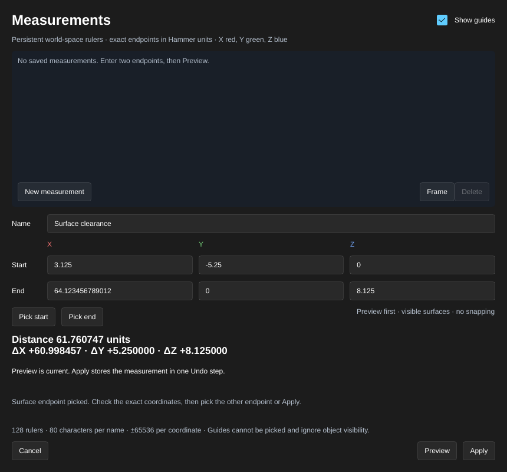
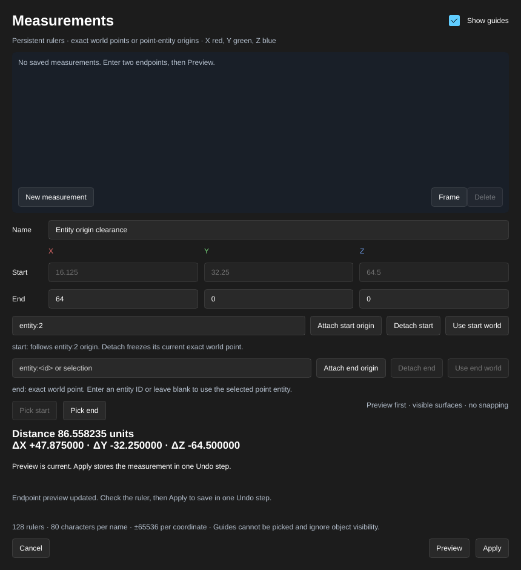

[← Manual](README.md)

# Measurement guides

Store named world-space rulers to check clearances, heights and distances. Each
ruler reports its Euclidean distance and signed X, Y and Z components in Hammer
units. Saved rulers persist in the VMF and appear in the desktop viewport and
MCP renders.

1. Click **Measurements…** beside **Saved views…**.
2. Enter a **Name** and exact **Start** and **End** coordinates under **X**, **Y**
   and **Z**. The readout shows the distance and signed components.
3. Click **Preview**. The gold line joins the endpoints; the red, green and blue
   segments show the X, Y and Z components. Endpoint crosses identify both ends.
4. To place an endpoint on geometry, click **Pick start** or **Pick end** after
   **Preview**. The window hides. Click a visible brush face, terrain triangle or
   supported model mesh in the viewport. The window reopens with the picked
   exact world coordinates and updated distance. A miss leaves the endpoint
   unchanged. Escape or **Cancel picking** stops picking and keeps the preview.
5. Click **Frame** to center the ruler in the current projection. Inspect the
   ruler, then click **Apply** to save it in one Undo step. Save the VMF to retain
   it on disk.
6. Select a saved ruler to change its name or endpoints, then click **Preview**
   and **Apply**. **Delete** removes the selected saved ruler; Undo restores it.
7. Click **New measurement** to enter another ruler. **Show guides** controls
   their visibility for the current session.
8. **Cancel**, window close or Escape without an active endpoint pick discards
   only the preview this window owns
   and leaves applied edits in Undo history. **Review preview** loads an MCP
   preview and explicitly takes ownership before editing, applying or cancelling
   it.

## Attach an endpoint to an entity origin

Keep a ruler endpoint at a point entity's authored origin as that entity moves.

1. Open or create a measurement and click **Preview**. For an agent's draft,
   click **Review preview** first.
2. Enter `entity:<id>` beside **Attach start origin** or **Attach end origin**.
   Leave it empty to use the single selected point entity.
3. Click **Attach start origin** or **Attach end origin**. The endpoint fields
   become read-only and the status identifies the target. Inspect the resolved
   distance, then click **Apply**.
4. Move the target entity. The saved ruler follows its origin. Undo restores
   both the entity position and the ruler's resolved position.
5. To retain its current position without following the entity, preview the
   ruler and click **Detach start** or **Detach end**, then **Apply**.
6. If a target is missing or invalid, **Use start world** or **Use end world**
   explicitly replaces that attachment with the displayed stored coordinates.
   Edit the now-unlocked fields, click **Preview**, then **Apply** to repair it.
   **Cancel** preserves the saved reference.

## Attach an endpoint in an entity's local frame

Keep a clearance point at a fixed offset from a point entity as its authored
origin and orientation change.

1. Enter or surface-pick the desired world endpoint, then click **Preview**.
   For an agent's draft, click **Review preview** first.
2. Enter `entity:<id>` beside **Attach start local** or **Attach end local**.
   Leave it empty to use the single selected point entity.
3. Click **Attach start local** or **Attach end local**. The current point is
   captured in the entity's rigid local frame. The world position stays the
   same, within double-precision roundoff; the status shows its local offset.
4. Click **Apply**, then move or rotate the entity. The ruler follows the
   authored origin and Source orientation. A transform preview moves the guide;
   inspection continues to report committed coordinates until Apply.
5. Use **Detach start** or **Detach end** to freeze the resolved world point.
   If the target or orientation is unavailable, use **Use start world** or
   **Use end world** to explicitly replace the attachment with the stored
   coordinates. Edit and preview those coordinates before attaching again.

MCP uses `get_measurements` and `set_measurement`. The latter supports `preview`,
`review`, `apply`, `cancel`, `delete`, `frame`, `view`, `begin_pick`, `pick_ray`,
`pick_pixel`, `cancel_pick`, `attach_origin`, `attach_local`, `detach_origin` and `world_endpoint`;
inspection provides the snapshot and ownership token needed for guarded actions. UI and MCP use the same
Session operations and rendered guide mesh.

`attach_local` takes the owned `token`, `endpoint` (`start` or `end`) and
`object` (`entity:<id>`). It captures the endpoint already in the draft;
`attachments` reports `kind: "entity_local"` and `local_offset` alongside the
retained object ID, availability and error. `detach_origin` detaches either
kind of entity attachment. Every attachment action returns a new token.

For MCP surface picks, preview first, then pass the owned token, `endpoint`
(`start` or `end`), `width`, `height` and latest `pick_snapshot` to `begin_pick`.
An optional `camera` matches `render_view` without moving the desktop camera.
Use the returned token for `pick_ray` with `ray_origin`/`ray_direction`, or
`pick_pixel` with integer `x`/`y` and the captured dimensions. Pixel picks use
the pixel center. A successful pick returns a new token and `last_pick` with
the target, brush/side IDs when available, world point and surface normal.
`cancel_pick` returns another token while retaining the endpoints. Apply uses
the latest token after picking ends.

Limits:

- A map supports 128 rulers. Names contain 1–80 characters and are unique without
  regard to case after trimming. Control characters are rejected.
- Both endpoints must be distinct and finite, within ±65536 on each axis.
  Endpoint coordinates retain double precision; rendered lines use the
  renderer's single precision. Readouts display six decimal places.
- Numeric and surface-picked endpoints retain unsnapped world coordinates and
  do not follow geometry. Explicit origin attachments follow point-entity
  origins independently of angles. Local attachments use unit axes and follow
  authored Source pitch/yaw/roll and translation. They do not follow model scale,
  runtime parenting or mesh vertices. Brush/surface attachments, dimension
  labels and configurable 3D workplanes remain absent.
- Local X/Y/Z use the right-handed entity frame: at zero angles, X is forward,
  Y is left and Z is up. `angles` takes precedence over scalar `angle`; scalar
  `-1` and `-2` point up and down. Authored `pitch` retains the editor's existing
  light-spot/environment convention. Absent angles default to zero. Malformed,
  nonfinite or duplicate active orientation properties make a local attachment
  unavailable. Local offsets need finite values; the ±65536 bound applies to
  the origin and resolved world point, rather than to each local component.
- Missing, duplicate or invalid origin targets retain their reference and show
  an unavailable ruler with no line or distance. Detach requires a resolvable
  point; explicit world replacement can repair an unavailable reference.
  Hidden point entities remain valid origin targets. Duplicating a target
  leaves the ruler attached to the original ID.
- Surface picks follow authored visibility, tool filters and the working
  region. Point-entity helpers and unavailable model meshes supply no target.
  Empty space has no plane fallback. Coincident endpoints reject. Camera, scene
  or viewport changes require another **Pick start** or **Pick end**; cancellation
  still works for an owned stale pick. MCP dimensions range from 1 to 8192.
- Guides cannot be picked. They remain visible through geometry and independently
  of object visibility, tool textures and working-region filtering. Hide them
  with **Show guides**. Framing changes only the camera.
- **Frame** preserves the current projection. Rulers exceeding a planar camera's
  supported view height return an error; switch to **Perspective** or use a wider
  viewport. MCP framing accepts aspect ratios from 0.01 to 100.
- Apply or cancel geometry previews before changing rulers. Changed maps,
  replaced tokens and foreign ownership reject stale actions. Saved measurements
  remain unchanged until **Apply**; edits to the numeric form require another
  **Preview**.
- Rulers use the editor-only `hammerr_measurements` VMF block and never become
  BSP geometry or entities. World/origin rulers retain version-1 metadata until
  a local attachment is applied. Local attachments upgrade that block to
  version 2, which older builds preserve with measurement editing disabled.
  Cancel leaves the original block unchanged; Undo restores the exact previous
  version and fields. Removing local attachments retains version 2. Unknown
  extension fields are retained. Unsupported
  versions, malformed records, duplicate IDs/names and excessive imported counts
  produce an explicit error in the window and MCP inspection; original metadata
  is preserved and measurement edits are disabled. Other-editor round trips
  remain unverified.
