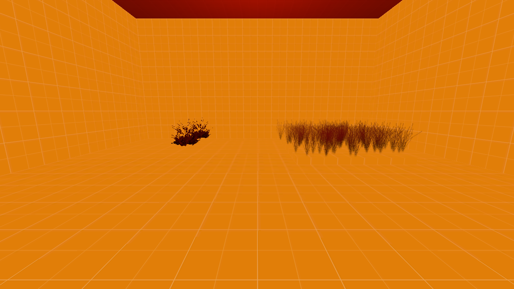

[← Manual](README.md)

# Model detail props

Place decorative models at explicit positions. Compilation stores them as detail props, removes their source entities from the runtime entity list, and gives them no collision.

1. Open a sealed map with a player spawn. Click **Entity…**, choose `prop_detail` (**Detail Prop**), then **Place entity**.
2. Click **Browse…** beside **World model**. Choose a static-prop model using `UnlitGeneric` materials, such as `models/props/de_inferno/bushgreensmall.mdl`. Keep **Skin** at **0** and its default bodygroups, then click **Use model**. You can also enter its mounted `models/…mdl` path directly.
3. Set **Position** in the inspector. To set a rotation, use **Advanced properties** to add `angles` as pitch, yaw and roll, for example `0 45 0`. Each point must lie inside an open area of the sealed map.
4. Open **Build settings…**, choose **Direct LDR** under **Build lighting**, and click **Close**. Click **Compile**. **Build details…** reports **Detail props**, **Model assets**, **Baked LDR lighting** and **No collision**.
5. Click **Run Map** to inspect them in CS:S. Detail-prop visibility follows the engine's detail settings; `r_drawdetailprops 0` hides them and `r_drawdetailprops 1` restores them.

## Choose a lighting origin

By default, each model samples light at its rotated hull midpoint. To sample at
another point while keeping the model in place:

1. Click **Entity…**, choose `info_lighting`, then **Place entity**.
2. Set its **Position** to the sampling point and its **Name** to a unique name,
   such as `detail_light_sample`.
3. Select the `prop_detail` or `detail_prop` model and enable **Advanced
   properties**. Enter `lightingorigin` in **Property key** and the helper's exact
   name in **Value**, then press Enter.
4. Choose **Build settings… → Build lighting → Direct LDR**, then **Close** and
   **Compile**. Read **Diagnostics** in **Build details…** if the reference or
   sampling point is invalid. Move the helper or correct its name and rebuild.

The helper changes only the sampled point, rounded to native float precision.
The model keeps its position, angles, visibility leaf and stored local-up
lighting normal. Clear `lightingorigin` to return to the hull midpoint.

Limits: this workflow places models explicitly. [Explicit detail sprites](detail-sprites.md) place individual atlas cards; [material-driven scattering](material-detail-scattering.md) uses a separate dictionary workflow for models, plain sprites and fixed cross/tri shapes. `detail_prop` is accepted as an imported alias. Hidden source entities are omitted.

Models must have the static-prop flag and use only `UnlitGeneric` materials. Vertex-lit models are refused because the engine replaces them with an error model. Use skin/body **0**, scale **1**, normal orientation, white color, full opacity and default render/fade settings. Nondefault rendering overrides, parenting, scripts, runtime links, connections, missing models and unsupported model forms reject the build before replacing its previous output. Origins and both rotated declared and displayed-mesh bounds must fit within ±16384 units; origins must resolve to open BSP leaves. The writer allows up to 1024 distinct models and 16384 placed detail props, with model paths shorter than 128 bytes.

Lighting-origin names match exactly, including case. A missing or hidden-only
helper, multiple visible helpers with that name, or a referenced helper without
finite coordinates within ±16384 units rejects the build. Duplicate helpers
remain ambiguous even at the same position. An absent, empty or whitespace-only
`lightingorigin` keeps the default hull midpoint. **Fullbright** validates named
references and coordinates while retaining white colors; it adds no open-leaf
requirement for the helper. Lit builds require the sampled point to lie in open
visible compiled world space. Compile regions retain visible `info_lighting`
helpers outside the box, but an exterior helper may fail that lit receiver check;
enlarge or disable the region. Generated models, sprites and shapes keep their
existing sample points.

[Compile regions](compile-regions.md#include-model-details) include visible `prop_detail` and `detail_prop` models when their authored origin is inside or exactly on the box. An omitted origin uses `(0, 0, 0)` for selection. Outside and hidden models are omitted; included records retain their source properties. Model geometry may extend past the box and is never clipped. Included models still need valid assets, supported rendering, Source-coordinate bounds and an open BSP leaf. An origin on the sealing boundary is selected but may fail that open-leaf check; the compiler does not move it inward. Visible malformed or out-of-range origins reject before selection.

**Fullbright** keeps white unbaked base colors without style extras. **Direct LDR** bakes static direct light and spherical ambient from filtered world/terrain lightmaps and sky; configured diffuse bounces contribute through those maps. **Direct LDR + HDR** retains the HDR pass's final color in the native format's single shared detail base field, with separate LDR/HDR style extras. Detail records do not contain separate LDR and HDR base colors.

Named and animated light styles 1–63 contribute alongside the static base. Use the existing light **Name**, **Light pattern**, **Initially dark** and [Connections](compile-and-play.md#switchable-lights-and-appearances) controls. Following the SDK, each extra stores half its direct-plus-ambient color; the client multiplies it by the current style value without restoring a factor of two. A switched light therefore need not match the same light baked into the static base. Each receiver supports up to 63 extras, with 65,536 records across the build's LDR and HDR arrays combined. Dual-channel builds share a sorted style layout, allowing at most 32,768 entries per channel.

Invalid references, style layouts and exceeded budgets reject the build before replacing previous output. Compilation preserves the source map and Undo history. Authored tint remains unsupported. Detail props do not cast new baked shadows or provide collision. [Material-driven model and sprite scattering](material-detail-scattering.md) uses the same lighting path. Use supported `prop_static` scenery when collision is needed.
