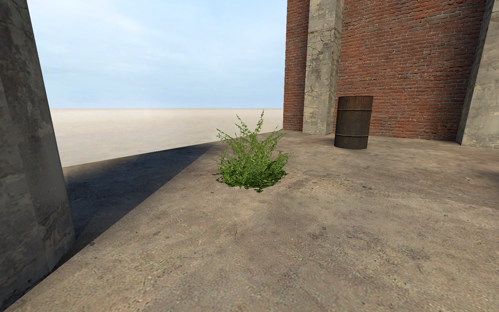

[← Manual](README.md)

# Model detail props

Compile decorative models without collision or runtime entities.

1. Use **Entity…** to place `prop_detail` (**Detail Prop**).
2. Choose a compatible static model through **World model → Browse…**.
3. Keep **Skin** at 0 and the default bodygroups.
4. Set **Position** and, if required, `angles` under **Advanced properties**.
5. Choose **Build lighting → Direct LDR** in **Build settings…**.
6. Compile and inspect **Detail props**, **Model assets** and **Diagnostics**.
7. Play the built map to inspect the decoration.

For example, the installed `models/props/de_inferno/bushgreensmall.mdl` uses the supported decorative model path.
Use **Baked lighting tint · linear RGB** for admitted lighting attenuation.

## Choose a lighting origin

Set the supported named lighting-origin reference in **Advanced properties**.
The target must resolve uniquely; missing or ambiguous references fail explicitly.

## Limits

- Static-prop models with supported `UnlitGeneric` materials, skin 0 and default bodygroups only.
- No collision. Detail records are client decoration, not ordinary runtime props.
- Tint attenuates baked lighting; it does not add a new material effect.
- LDR+HDR uses one shared HDR base color, with separate channel style extras. It does not store two base colors.
- Unsupported assets, transforms or lighting controls stop the build.
