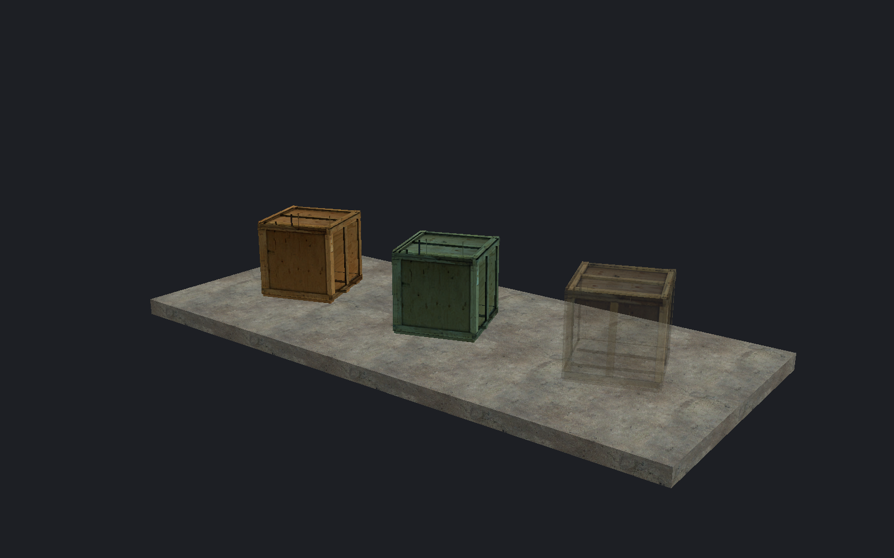

[← Manual](README.md)

# Models

Place Source model meshes with their materials, skins and reference poses.

## Choose a model

1. Use **Entity…** to place `prop_static` or `prop_dynamic`.
2. Click **Browse…** beside **World Model**.
3. Search by model name or folder.
4. Select a result to inspect its mesh.
5. Choose **Skin** and named bodygroups, if available.
6. Click **Use model**.

**Cancel** leaves the entity unchanged. **Reference pose** means animation is not playing.
Use [surface placement](placement.md) to put the model on a floor or slope.

## Scale and tint

1. Select a supported dynamic model entity.
2. Set **Model scale** from 0.015625 to 64.
3. Open **Tint** and choose a color.
4. Click **Apply color** to keep the color, or **Cancel** to discard it.

White tint preserves the original texture colors. Scale is uniform about the entity origin.
`prop_static` retains its unit-scale and white-tint restrictions.

## Preview opacity

1. Select a dynamic model.
2. Set **Render mode** to **Texture · opacity**.
3. Set **Opacity** from 0 to 255.
4. Use **Render FX → None**.

**Normal** render mode ignores Opacity. Transparent meshes keep their selection bounds.

## Inspect attachments

1. Open **Model details…**.
2. Choose an **Attachment**.
3. Enable **Show attachment axes**.
4. Click **Frame attachment** to inspect it.

X is red, Y is green and Z is blue. Positions follow the displayed reference pose.

## Preview authored lighting

1. Choose **Textured** and enable **Unshadowed authored lighting**.
2. Choose **Detail · per-fragment lighting** or **Fast · vertex lighting**.
3. Adjust **Lighting exposure (EV)**.
4. Check which models receive preview lighting.

Supported opaque, single-base `VertexLitGeneric` meshes receive light.
One unsupported selected material excludes the complete model and reports a reason.

## Reload changed assets

Use **Reload material assets** for changed VMT/VTF files.
Use **Reload models** for changed geometry or model material directories.
Reloading geometry ends affected placement and selection reviews; start them again.

## Limits

- MDL 44/48, VVD 4, DX90 VTX 7 and LOD 0 only.
- Missing or unsupported geometry retains a selectable helper with a diagnostic.
- No animation, flexes, procedural/IK poses or runtime physics preview.
- Attachment parenting and attachment placement are unavailable.
- Opacity uses batch sorting, not triangle sorting. Intersecting transparent geometry can sort incorrectly.
- Authored lighting excludes bump, blend, reflection, Phong, proxy and other unsupported model materials.
- Static-prop output has separate [compiler limits](static-props.md).
- Editor budgets: 64 MiB per companion file, 128 cached models, one million scene vertices and six million indices.
