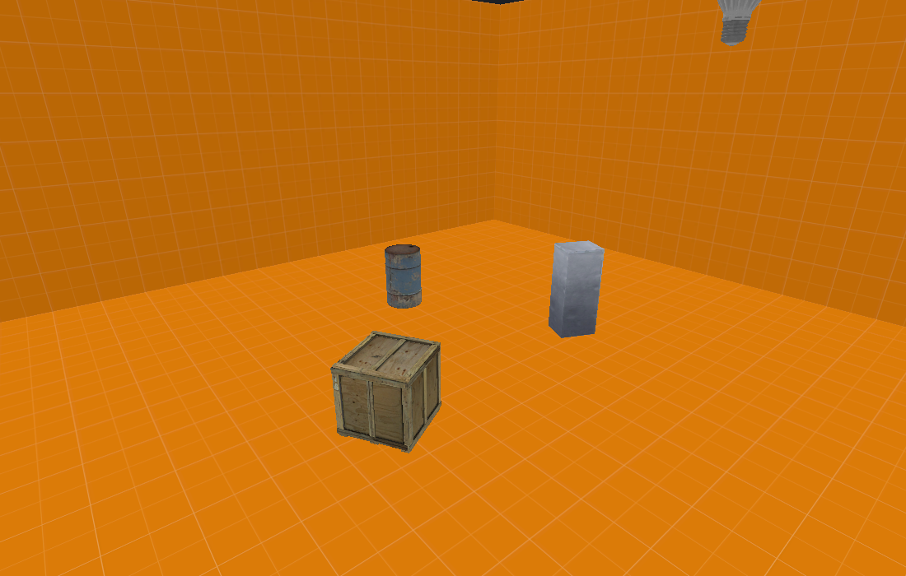
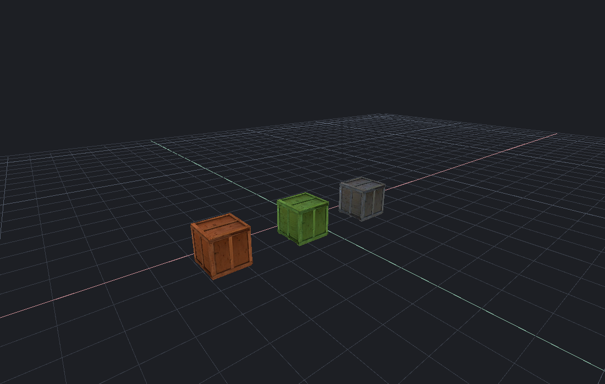
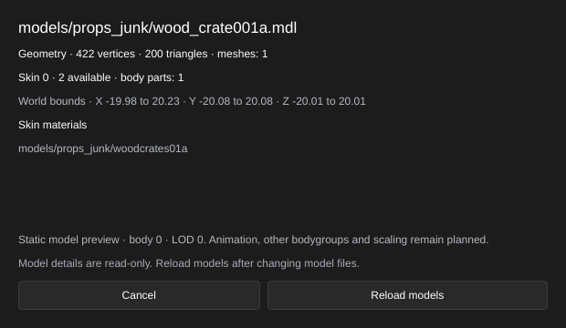
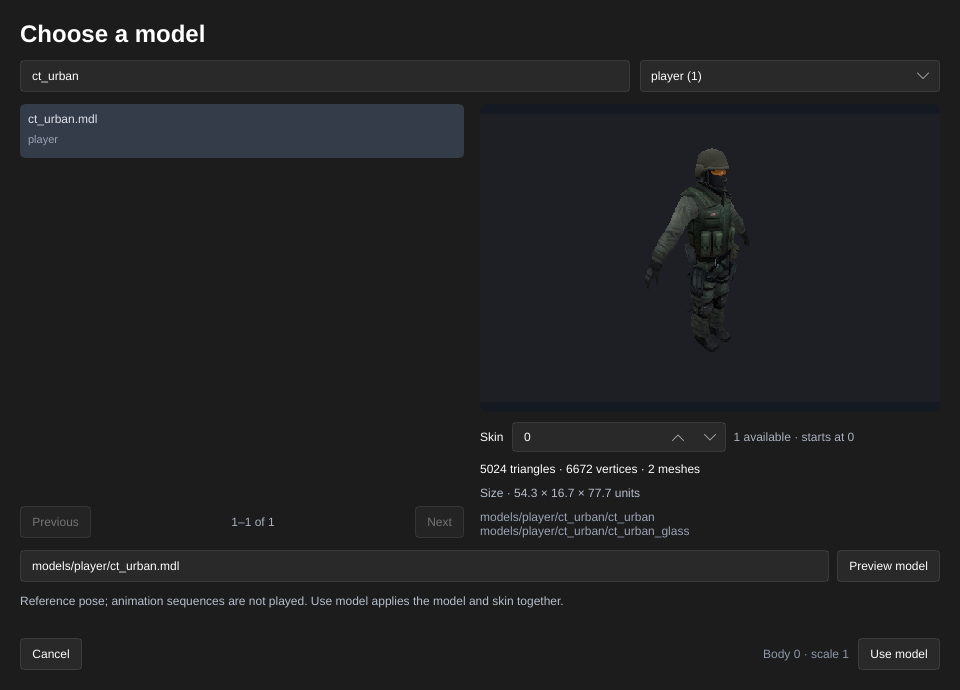
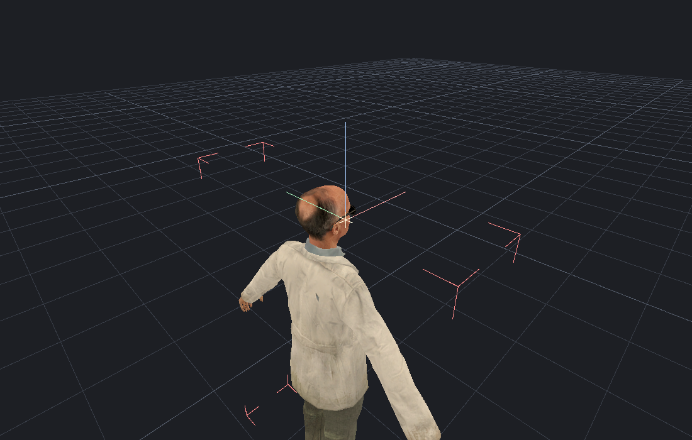

[← Manual](README.md)

# Models

View Source model meshes and checked reference poses with their materials and skins, inspect their bounds, and pick them in the map.

1. Click **Entity…**, choose `prop_static` for static scenery or `prop_dynamic` for skeletal/weapon models or bodygroup changes, then **Place entity**.
2. Click **Browse…** beside **World Model**. Search by model name or folder, then choose **All models**, **Used in this map** or a folder from the group menu. **Previous** and **Next** move through the results.
3. Select a model to see its isolated preview, size and triangle count. Click **Show materials** to expand its material paths. Skeletal models show **Reference pose**; animation sequences are not played. Change **Skin** to inspect another texture variant; numbers start at **0**. If the model has bodygroups, use their named dropdowns; **None** hides that group’s mesh. You can also enter a mounted model path and click **Preview model**.
4. Click **Use model** to apply its path, skin and bodygroups together. **Cancel** or **Escape** closes the browser without changing the entity. The map and camera stay unchanged while browsing. Reopening the same entity’s browser resumes a valid pending choice, including one prepared by an agent.
5. The mesh appears automatically when its MDL, VVD and DX90 VTX files are supported. You can still type a path directly into **World Model**.
6. Set **Position**, **Rotation** and **Skin** in the inspector. Skin numbers start at **0**. For a dynamic model, use **Tint** and its color picker to multiply the model textures by an RGB color; white keeps their original colors. **Cancel** abandons the picker, while **Apply** writes one Undo step. Source origins, angles and tints drive the same mesh in the editor and agent renders.
7. Click the visible mesh to select it. Area/volume rules test its model bounds. Click **Frame · F** to inspect its full bounds. Hidden model entities stay hidden.
8. Click **Model details…** for geometry counts, the active skin’s materials, bodygroup choices and transformed bounds.
9. If the model has attachment points, choose a name under **Attachment**. Its **Position** is shown in world coordinates for the displayed reference pose.
10. Turn on **Show attachment axes** to mark that point in the viewport: X is red, Y green and Z blue.
11. Click **Frame attachment** to focus the viewport on it. Inspection and guides leave the map and Undo history unchanged; framing moves the camera.
12. **Reload models** rereads model files after external changes. **Cancel**, **Escape** or closing the window clears its own attachment guide and closes the window. An agent’s replacement guide is preserved.

Use [Surface placement](placement.md) to drop models onto floors or ceilings, or align them against a picked surface using their displayed mesh vertices.

Limits: MDL versions 44/48 with VVD4 and DX90 VTX7 companions, LOD 0 and scale 1. Unsupported, missing or malformed assets retain a helper; inspection reports the reason. Attachment positions follow default local bone poses; animated, procedural/IK and included-model virtual attachment results are not evaluated. Attachment parenting and placement tools remain planned. Animation playback, procedural/IK poses, flexes, scaling, entity opacity/render modes and baked prop lighting remain planned. Tint preview supports integer RGB channels from 0 to 255; an authored fourth component is preserved when editing RGB, with no opacity preview. Nonwhite static-prop tints are rejected by the current compiler output and retain a helper; this is a writer limit. `prop_static` requires a model built as a static prop and body 0; use a compatible dynamic entity for reference poses or other bodygroup selections. Entirely blank choices show an editor helper, which remains selectable. Bodygroup choices change displayed geometry; collision still comes from the model’s physics data. Marquee and volume selection use loaded models’ transformed asset bounds; point picking intersects triangles. Hidden models are excluded from region matching. Unsupported assets retain their existing helper bounds. Reload refreshes model geometry and material search paths; changed VMT/VTF contents retain the existing texture cache.

HammeRR limits each companion file to 64 MiB, the model cache to 128 entries and 256 MiB, and a scene to one million model vertices and six million model indices. Reference pose decoding supports up to 256 bones and three weights per vertex. Entities beyond those budgets retain helpers. These are editor resource limits. Inspection and rendering preserve map properties and Undo history.

The browser edits a single point entity’s **World Model**, **Skin** and bodygroups. Other model-reference fields and batch-property drafts retain text entry. Finish geometry previews before browsing. If the map, selection, definitions or a geometry preview changes, cancel and reopen the browser. Folder searches list mounted paths, including unsupported assets; selecting one explains why it cannot be previewed. Catalog pages contain at most 100 models. Isolated images are limited to 64–1024 pixels per side.
