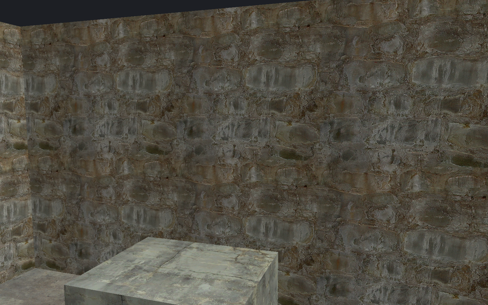

[← Manual](README.md)

# Normal-map preview

Show small surface detail without adding geometry.

1. Apply a supported normal-mapped material to a flat brush face.
2. Set **Viewport** to **Textured**.
3. Enable **Normal map preview**.
4. Check the status for unavailable materials.
5. Move the camera to inspect the surface.

| Ordinary shading | Normal-map preview |
| --- | --- |
|  |  |

For authored lights, select **Detail · per-fragment lighting**. Fast lighting cannot use normal maps.
Use **Reload material assets** after changing material files.

## Limits

- Flat `LightmappedGeneric` brush faces only; terrain and models are excluded.
- One static LDR normal texture; no SSBump, signed textures, proxies or second normal map.
- Base transforms must be identity. Bump transforms support positive scale and translation, with zero rotation.
- No specular, reflections, animation or game brightness match.
- Unsupported faces keep their base image and report why the effect is unavailable.
