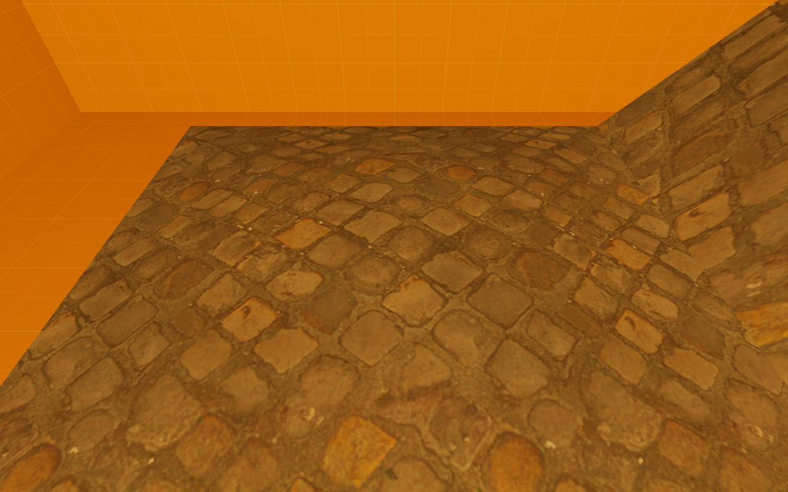
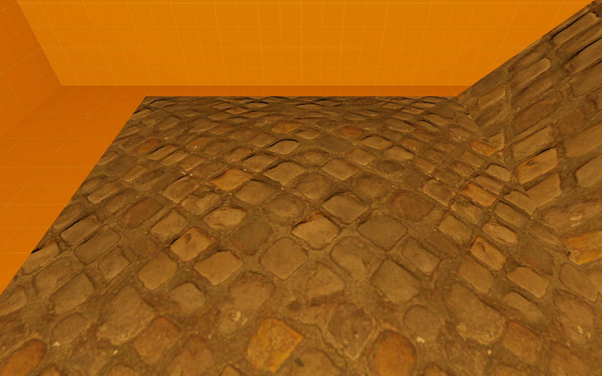

[← Manual](README.md)

# Normal-map preview

Show small surface detail without adding geometry.

1. Apply a supported normal-mapped material, such as `shadertest/diffusebump`, to a flat brush or terrain face.
2. Choose **Textured** in the viewport header.
3. Enable **Normal map preview**.
4. Check the status for unavailable materials.
5. Move the camera to inspect the surface.

| Ordinary shading | Normal-map preview |
| --- | --- |
|  |  |

For authored lights, set **Overlays → Lighting → Quality** to **Detail · per-fragment**. Fast lighting cannot use normal maps.
Use **Reload material assets** after changing material files.

## Limits

- Flat `LightmappedGeneric` brush faces and world or `func_detail` terrain. Models remain excluded.
- Terrain uses its curved geometry and prepared border normals. Rotated and mirrored face mapping is supported. Singular UVs and unsafe tangent frames are excluded.
- One static LDR normal texture; no SSBump, signed textures, proxies or second normal map.
- Base transforms must be identity. Bump transforms support positive scale and translation, with zero rotation.
- At most 1,048,576 expanded terrain triangle vertices per prepared scene. Other terrain stays explicitly unavailable for this effect.
- No specular, reflections, animation or game brightness match.
- Unsupported faces keep their base image and report why the effect is unavailable.

<!-- page-nav -->

---

[← Atlas-region texturing](atlas-texturing.md) · [Manual](README.md) · [Authored lighting preview →](lighting-preview.md)
