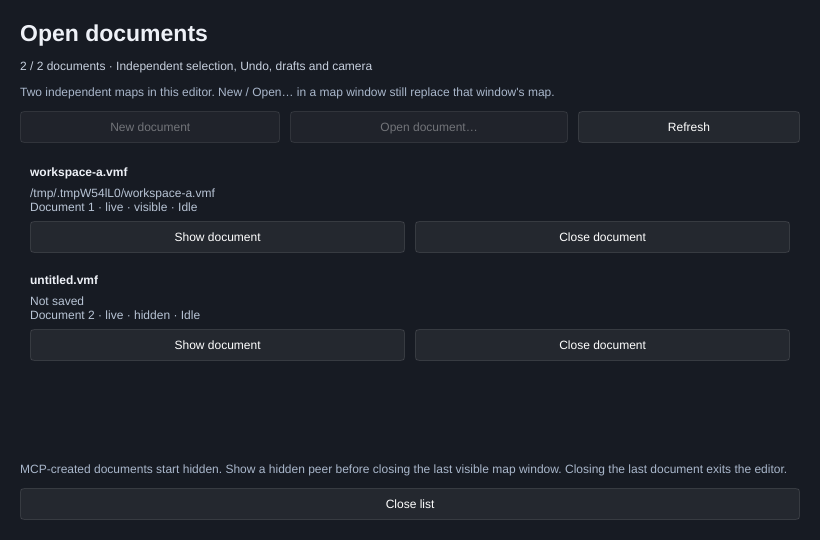

[← Manual](README.md)

# Open documents

Keep two maps open in one editor process. Each document has its own window,
selection, camera, drafts, Undo history, build settings and recovery state.

1. Click **Open documents…** in a map window's toolbar.
2. Click **New document**, or **Open document…** and choose a VMF file. These
   actions create another map window. The existing **New**, **Open…**, Recent
   maps and recovery actions still replace the map in their original window.
3. Use **Show document** to present an open map. The list shows its path,
   unsaved state, visibility, lifecycle and cached work status.
4. Click **Close document**, or close that map window. Review any unsaved map
   changes and drafts before choosing whether to discard them. Closing one map
   leaves its peer available; closing the last document exits the editor.

Desktop MCP-created documents start with an actual hidden window. Use **Show document**
or MCP `show_document` to present them. Show a hidden peer before closing the
last visible map window; Close otherwise refuses and leaves the map open.

The first release allows two documents using one mounted content environment.
An already claimed source or conflicting output is rejected. Successfully
closing a document releases its source/output claims so it can be opened again,
even if an external client retains its closed handle. A failed cleanup stays in
the list with its error, retains capacity and claims, and rejects further edits.
Final process shutdown reports retained cleanup errors.

Shared saved settings and catalogs remain shared. Current editor state and
render caches belong to their fixed documents. Two documents are an admission
limit, not a promise about total memory use. This release has separate windows;
there are no tabs, bulk Quit, workspace restore, or different mounted
content profiles in the same process.

## Save all named maps

Save committed changes in the open maps that already have filenames, and see
which documents need further attention.

1. Click **Open documents…** in a map window's toolbar, then **Save all named
   maps**. The action saves the fixed admitted documents in the background using
   each map's existing filename; it does not show or focus their windows.
2. Read the summary and **Last Save all result** under each map. **Saved** means
   that map was written once. **Unchanged; no file written** means its clean
   source identity was verified without rewriting the file or creating a backup.
3. For **Needs Save as…**, use **Save as…** in that map's window to choose its
   filename, then retry. An unnamed map with no committed changes needs no write
   and is reported separately.
4. For **Pending review**, apply or cancel that map's property, geometry or other
   active reviews, then retry. Save all preserves reviews and does not write the
   affected map. Other eligible documents can still be saved.
5. For **Save failed**, repair the reported file or source-identity problem before
   retrying. **Map changed; retry**, **Busy; retry** and **Closing** identify maps
   whose accepted snapshot could not be saved. A partial result says **not
   complete** and lists each affected document; successful writes remain saved.

MCP `save_all_named_maps {}` performs the same operation without a document
selector. It returns every fixed document's result and marks partial completion
as an error while retaining successful results. Each document is attempted at
most once. Clean named maps keep their source bytes, file timestamp and history;
a successful dirty save uses ordinary Save behavior, including map version,
backup, recent-map and dirty-state updates. A changed external file is reported
as an error even when the in-memory map is clean.

Save all is a sequence of independent per-document results, not one atomic
workspace snapshot. A new edit after a map's attempt can make it dirty again;
the list continues to show its current unsaved state alongside the last result.
Source or filename changes before a captured attempt produce a stale result.
There is no rollback of a peer's successful write, automatic retry, invented
filename, modal Save As sequence or combined Save All and Quit workflow.

MCP uses `list_documents`, `new_document`, `open_document`, `show_document` and
`close_document`; `save_all_named_maps` handles the fixed workspace set. Pass the opaque `document_id` from the list to document tools.
Omitting it works only when exactly one live document remains; focus and
last-used document never choose an MCP target. Close uses the exact
`get_map_info.document_close.review_token` and explicit discard consent for
reviewed unsaved loss. Closing one of two live documents keeps the shared
transport available; final Close retains its exact output and process-exit
ordering.
