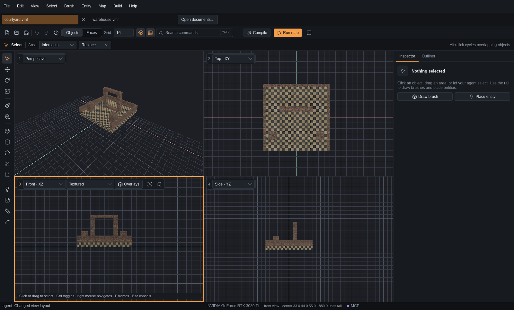

[← Manual](README.md)

# Open documents

Keep two maps in one window. Each tab has its own selection, views, drafts and Undo history.

1. Click **Open documents…**.
2. Click **New document** or **Open document…**.
3. Click a tab or a document row to select its map.
4. Click **Close active document** on the selected tab, or **Close document** in the list, to close that map.

Use **Select silently** to select a tab without requesting desktop focus. The workspace window must already be visible.
MCP-created and restored maps stay hidden until selected.
The ordinary **New map** and **Open…** controls replace only the current tab's map.
Successful replacement clears pending terrain strokes. A failed Open keeps the
current map and stroke.

## Save and restore a workspace

1. Save every map with **Save as…**. Apply or cancel pending drafts.
2. Open **Open documents…** and click **Save workspace**.
3. In a later session, click **Restore workspace…**.
4. Review the saved paths. Click **Restore reviewed workspace**, or **Cancel restore**.
5. Select a restored tab to display its map.

The workspace stores map paths, content and entity-definition paths, build settings, all four pane cameras, view layout and dock layout.
Restore opens the current files at those paths. It does not write map files.
Only the unchanged, empty startup map can be replaced. Other open maps stay intact and need enough free capacity.

## Save all named maps

1. Open **Open documents…**.
2. Click **Save all named maps**.
3. Inspect every document result.

Clean maps have their sources checked without a write. A dirty unnamed map needs **Save as…**.
Pending drafts need Apply or Cancel. A failed save does not undo successful peer saves.

## Quit all maps

1. Open **Open documents…** and click **Quit all…**.
2. Review every map, including hidden maps and pending drafts.
3. Click **Quit all reviewed documents**, or **Discard reviewed changes and quit all** if discarding is required.

**Cancel quit** keeps all maps open. Closing the workspace window opens this review. Closing one tab keeps its peers accessible.
Changed or busy maps require a fresh review. A Close refusal lists active requests or workers under **Active**.
Closing the final document exits the editor.

## Limits

- At most two live maps. Each keeps its own content, build settings, jobs and recovery state; preference catalogs are shared.
- Save workspace requires clean, named maps with valid content and FGD paths, and no active work.
- Restore is explicit. Missing or changed sources, invalid saved data and insufficient capacity produce errors. Failed cleanup retains its error and file claims.
- Finish pointer gestures, text composition and menus before switching tabs.
- Conflicting source/output files and aliases cannot be reserved twice.
- MCP calls need the opaque `document_id` when two maps are open. Desktop focus does not route calls.

See [MCP documents](mcp.md#documents) for routing and Close tokens.

<!-- page-nav -->

---

[← Workspace layout](workspace-layout.md) · [Manual](README.md) · [History →](history.md)
