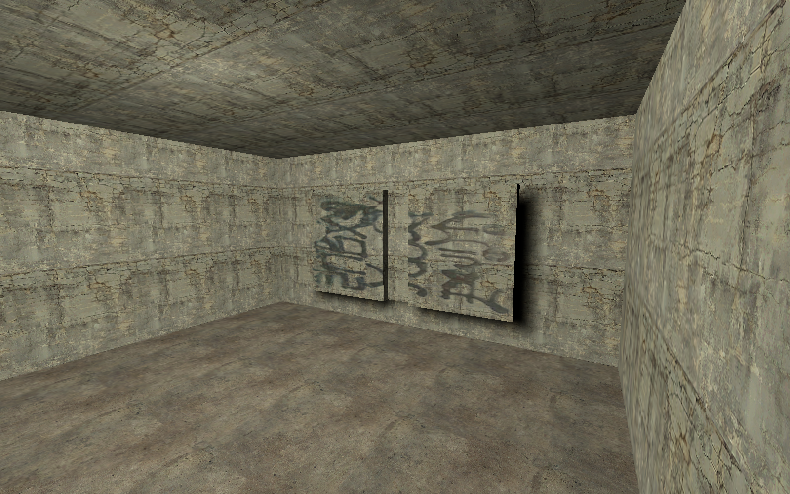

[← Manual](README.md)

# Overlays

Project a material across selected map faces. Use a [decal](#place-a-decal) for a mark from one point in CS:S.

## Create an overlay

1. In face mode, select up to 64 world or `func_detail` faces. Include a quad to set the projection axes.
2. Open **Overlay…**, then choose **Material** and an optional **Name**.
3. Set **Render order**, texture ranges and fade distances.
4. Click **Fit / Preview**. Check the projection and face count.
5. Click **Apply overlay**. Use **Cancel** to discard the draft.

Select coplanar faces that face the same direction. Joined or sculpted terrain can share an overlay when the base quads have a common plane. On sculpted terrain, the fit uses the base plane and the projection follows the displaced surface.

In **Textured** view, supported materials appear on the bound faces. Unbound gaps stay clear. Preview errors appear in the viewport status. Compile and play to check the game result.

## Refit or rebind

To fit the same faces again:

1. Select one overlay and open **Overlay…**.
2. For multiple bound faces, choose a quad under **Reference face**.
3. Click **Refit selected overlay**, then **Apply refit**.

To use different faces:

1. Select the destination faces and open **Overlay…**.
2. Choose an overlay from the rebind list.
3. Click **Preview rebind**. Check the old and new face counts.
4. Click **Apply rebind**.

Both operations keep the overlay identity, settings and connections. Use **Undo** to restore the prior fit.

**Clip**, **Carve** and terrain triangle removal carry the bindings to surviving source fragments within the projection. New cut faces do not inherit the overlay. An edit that removes all projected coverage fails. Refit after moving the bound faces.

## Edit corners

1. Select one overlay and open **Overlay… → Edit selected corners**.
2. Edit **Corner 0** through **Corner 3** in local U/V coordinates.
3. Click **Preview corners**. To drag a cyan corner, click **Viewport handles**.
4. Click **Apply corners**. **Cancel handles** restores the draft from before the drag.

Corner edits keep the bindings and projection axes. Crossed or collapsed corners fail.

## Place a water transition

1. Select the receiver faces, such as a bank beside a pool.
2. Open **Overlay…** and set **Type** to **Water transition**.
3. Choose **Material** and set the **Texture** U and V ranges.
4. Click **Fit / Preview**, then **Apply water transition**.
5. Compile and play to check the transition.

Each new helper stores one projection. Use the same refit, rebind and corner
controls as for a regular overlay. Clip, carve and terrain triangle removal
retain the projected bindings. Imported helpers with several projections
compile with all their records and need a separate tool to edit their layout.

## Place a decal

1. Open **Entity…** and choose `infodecal`.
2. Click **Pick surface…**. Enter a **Material**, for example `decals/arrow_left`,
   or click **Browse materials…**.
3. Click **Pick surface** and select a solid world or `func_detail` brush face.
4. Check the point, then click **Apply decal**.
5. Compile and play to see the decal.

The point is the decal's origin. CS:S chooses nearby receivers and can project onto more than one face. A named decal needs activation through entity I/O. Custom materials must be mounted when you play or included in a [portable VMF](portable-maps.md).

## Limits

- Fit uses root world and detail faces. A terrain target uses its displaced face. Folded or overlapping terrain and visible saved instance references block terrain fitting.
- The editor projects plain LightmappedGeneric and UnlitGeneric textures onto opaque authored surfaces. Terrain preview requires a parallelogram base. Use the game for fades, decal projection, and installed shader effects.
- Water transitions use the selected faces and fixed render order. They have no runtime name or distance fades. Older shoreline helpers with legacy side lists keep their original data.
- Compile regions must retain the complete overlay and its targets. Compile reports bound sides that are fully buried and requires a surviving projection.
- Stock CS:S draws overlays on world, detail and terrain surfaces. Brush-model overlays require client support.
- Decal placement uses planar brush faces and supports static LightmappedGeneric, UnlitGeneric and DecalModulate decal assets.

<!-- page-nav -->

---

[← Linked paths](path-authoring.md) · [Manual](README.md) · [Prefab library →](prefabs.md)
