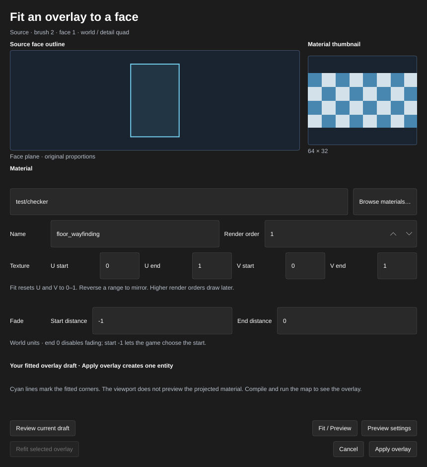

[← Manual](README.md)

# Overlays

Overlays project a material onto world surfaces for markings, graffiti and signs without adding brush geometry. Fit a new overlay to one quad face, refit an existing overlay to its bound face, or compile an `info_overlay` imported from a VMF.

## Create a fitted overlay

1. Set **Selection** to **Faces · materials & textures** and select exactly one visible quad face on a world brush or `func_detail` brush. Tilted and trapezoid faces are supported.
2. In the inspector, click **Overlay…** above **Replace materials…**.
3. Enter **Material** or click **Browse materials…**. The dialog shows the existing material browser's thumbnail and the source face outline in its own plane.
4. Optionally enter a **Name** and choose **Render order** (0–3). Set **U start**, **U end**, **V start**, **V end**, and fade **Start distance** and **End distance** as needed.
5. Click **Fit / Preview** to fit the full 0–1 texture range to the face. Click **Preview settings** to preserve your U/V ranges. Cyan lines in the viewport mark the fitted corners; the projected material is shown after compiling and running the map.
6. Click **Apply overlay** to create and select the overlay in one Undo step. **Cancel**, Escape, and closing the dialog discard only the draft this dialog owns.

**Overlay…** is also available without a face selection. **Review current draft** loads a shared preview and transfers its ownership to you, including a preview created through MCP with an explicit source face. Review before applying or cancelling that preview; keep the selection unchanged until applying it. Changing the map, source selection or shared draft requires another review or reopening **Overlay…**. Invalid fields preserve the previous valid draft and keep **Apply overlay** disabled.

## Refit an existing overlay

1. Select exactly one existing visible `info_overlay`, for example through **Object report…**. Its existing binding must contain one visible quad on a world or `func_detail` brush.
2. Open **Overlay…** and click **Refit selected overlay**. The cyan outline previews the current full bound face, including geometry moved or reshaped since the overlay was created. Preview leaves the map and history unchanged.
3. Check the target entity and outline. The dialog says **Refit existing overlay**; material, name, texture ranges, render order and fade fields are read-only for this operation.
4. Click **Apply refit** to update that same entity's projection and origin in one Undo step. Its ID, raw setting strings, connections and other metadata are preserved. **Cancel** discards the owned preview.

**Review current draft** can load an MCP refit preview and transfers ownership before **Apply refit**. Refit keeps the existing face binding; it does not choose a different face. Multiside, hidden, missing, terrain, brush-model and nonquad bindings are rejected. After another source edit, preview refit again.

## Build an imported overlay

1. Open a VMF that already contains an overlay, sealed world geometry and a player spawn.
2. Open **Object report…**, search for `info_overlay`, and select the overlay to inspect its properties.
3. Choose **Material**, **Render Order** (0–3), **U Start**, **U End**, **V Start** and **V End** as needed. Higher render orders draw after lower ones; reversed U/V ranges mirror the texture.
4. Set **Start Fade Dist** and **End Fade Dist**. An end distance of `0` disables distance fading. A negative start distance delegates the fade start to the game.
5. Click **Compile**. Open **Build details…** in the bar below the toolbar to inspect **Overlays**, **Surface references** and any **Diagnostics**.
6. Click **Run Map** to see the projection in CS:S.

Brush-face bindings follow compiled face splitting and lightmap subdivision. Adjacent faces with different overlay memberships remain separate. World brushes, `func_detail` surfaces and imported displacements are supported. Named overlays receive a runtime accessor with the compiled overlay ID; the VMF keeps its original entity and properties.

[Compile regions](compile-regions.md#include-overlays-and-visibility-helpers)
keep the complete imported projection independently of its marker position.
Include every target surface; an omitted or buried target stops the build
without replacing the previous BSP.

## Limits

- New overlay fitting supports one visible planar world or `func_detail` quad. Terrain, brush models and faces with other corner counts cannot be used for new fitting. Imported overlays retain their broader compile support.
- Refit supports only one existing bound world or `func_detail` quad. Corner handles, viewport material projection, new-face rebinding and automatic refitting after geometry edits are not available yet. The imported **Overlay Basis** and **Overlay Point** fields remain read-only outside the explicit refit operation.
- Targets must be visible, exposed world, detail or terrain faces. Hidden, absent, non-rendering and brush-model targets fail compilation. Hidden overlays are omitted.
- Budgets: 1,024 overlays, 64 source sides and 64 compiled surface references per overlay, and 65,536 total source or face bindings. Subdivision can increase the compiled face count; use fewer targets or a larger lightmap scale if it exceeds the budget. These are bounded compiler budgets, not a claim about every engine limit.
- Basis axes must be finite perpendicular unit vectors. Projection corners must form a convex quadrilateral within the compile coordinate bounds. Invalid material paths, projections or fade distances keep the previous BSP.
- Water overlay transitions, brush-model overlays and `infodecal` compilation remain unfinished.
