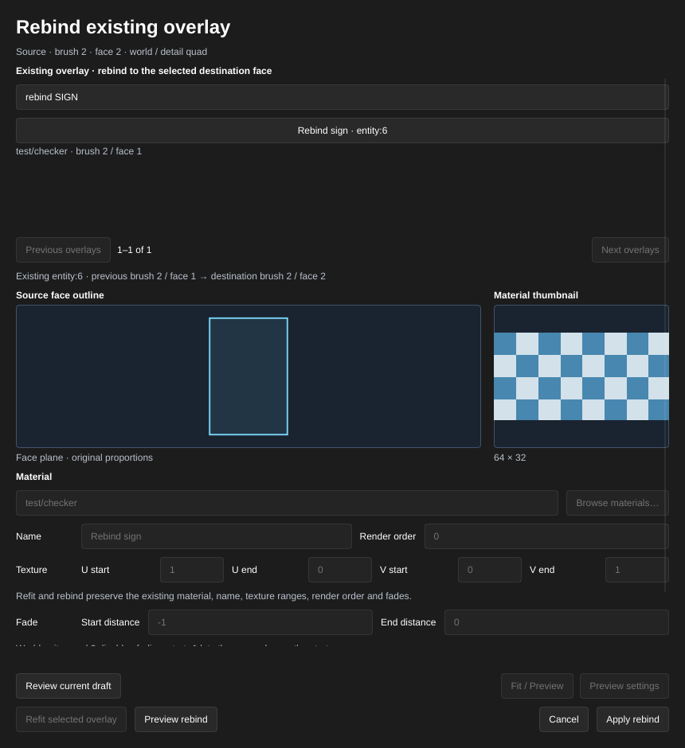
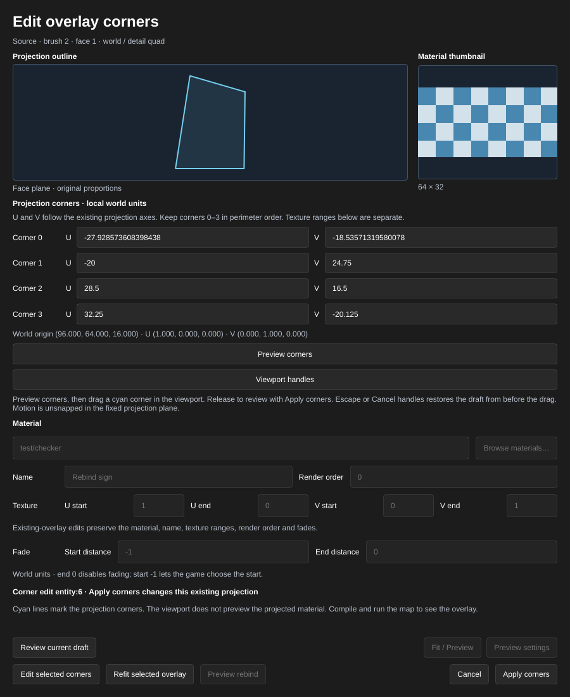

[← Manual](README.md)

# Overlays

Overlays project a material onto world surfaces for markings, graffiti and signs without adding brush geometry. Fit a new overlay to one quad face, refit an existing overlay to its bound face, explicitly rebind it to a different face, edit its projection corners, or compile an `info_overlay` imported from a VMF.

## Create a fitted overlay

1. Set **Selection** to **Faces · materials & textures** and select exactly one visible quad face on a world brush or `func_detail` brush. Tilted and trapezoid faces are supported.
2. In the inspector, click **Overlay…** above **Replace materials…**.
3. Enter **Material** or click **Browse materials…**. The dialog shows the existing material browser's thumbnail and the source face outline in its own plane.
4. Optionally enter a **Name** and choose **Render order** (0–3). Set **U start**, **U end**, **V start**, **V end**, and fade **Start distance** and **End distance** as needed.
5. Click **Fit / Preview** to fit the full 0–1 texture range to the face. Click **Preview settings** to preserve your U/V ranges. Cyan lines in the viewport mark the fitted corners; the projected material is shown after compiling and running the map.
6. Click **Apply overlay** to create and select the overlay in one Undo step. **Cancel**, Escape, and closing the dialog discard only the draft this dialog owns.

**Overlay…** is also available without a face selection. **Review current draft** loads a shared preview and transfers its ownership to you, including a preview created through MCP with an explicit source face. Review before applying or cancelling that preview; keep the selection unchanged until applying it. Changing the map, source selection or shared draft requires another review or reopening **Overlay…**. Invalid fields preserve the previous valid draft and keep **Apply overlay** disabled.

## Refit an existing overlay

1. Select exactly one existing visible `info_overlay`, for example through **Object report…**. Its existing binding must contain one visible quad on a world or `func_detail` brush.
2. Open **Overlay…** and click **Refit selected overlay**. The cyan outline previews the current full bound face, including geometry moved or reshaped since the overlay was created. Preview leaves the map and history unchanged.
3. Check the target entity and outline. The dialog says **Refit existing overlay**; material, name, texture ranges, render order and fade fields are read-only for this operation.
4. Click **Apply refit** to update that same entity's projection and origin in one Undo step. Its ID, raw setting strings, connections and other metadata are preserved. **Cancel** discards the owned preview.

**Review current draft** can load an MCP refit preview and transfers ownership before **Apply refit**. Refit keeps the existing face binding; it does not choose a different face. Multiside, hidden, missing, terrain, brush-model and nonquad bindings are rejected. After another source edit, preview refit again.

## Rebind an existing overlay to a different face

1. Set **Selection** to **Faces · materials & textures** and select one visible destination quad on a world or `func_detail` brush.
2. Open **Overlay…**. Under **Existing overlay · rebind to the selected destination face**, search for the overlay's name or material. Use **Previous overlays** and **Next overlays** to browse more matches. Each choice shows its name, entity identity, material and current bound face; unsupported bindings show an **Unavailable** reason.
3. Click the existing overlay's named choice. The destination face stays selected. Material, name, texture ranges, render order and fades become read-only and will be preserved.
4. Click **Preview rebind**. Check the destination outline and the previous/destination binding readout. The dialog says **Rebind existing overlay**; the map and Undo history remain unchanged.
5. Click **Apply rebind** to update that same overlay in one Undo step. Its ID, raw setting strings, connections and other metadata remain intact. **Cancel**, Escape and closing the dialog discard only the preview this dialog owns.

**Review current draft** can load an MCP rebind preview and transfers ownership before **Apply rebind**. The destination must differ from the current binding. The existing overlay must already have one visible eligible world/detail quad binding; this bounded operation cannot repair missing, hidden, terrain or multiside bindings. Rebind never follows geometry changes automatically.

## Edit existing projection corners

1. Select one visible `info_overlay` and open **Overlay…**. Its binding must contain one visible world or `func_detail` quad, and its current projection must lie on that face plane.
2. Click **Edit selected corners**. **Projection corners · local world units** loads the four current corner positions without fitting the face or changing the map.
3. Edit **Corner 0** through **Corner 3**, using **U** and **V** in the existing projection frame. The world origin and axis readout identifies that frame. Keep the four corners in perimeter order; these world-unit positions are separate from the material’s texture ranges.
4. Click **Preview corners** and inspect the **Projection outline** and cyan viewport guide. Invalid, crossed, collapsed or out-of-bounds corners preserve the last valid draft and disable Apply.
5. Click **Apply corners** to update the same entity in one Undo step. The binding, raw basis/origin/settings, connections and other metadata stay intact. **Cancel**, Escape and closing the dialog discard only the preview this dialog owns.

**Review current draft** loads a corner preview created through MCP and transfers ownership before Apply or Cancel. Changes to a field require **Preview corners** again. Changing the map or selection invalidates the draft; an owned stale draft can still be cancelled. If the source moved away from the projection plane, use **Refit selected overlay** explicitly before editing its corners.

Corners can extend past the bound face perimeter; native rendering clips them to that existing surface. Editing does not bind additional surfaces or change the basis frame. The viewport shows the outline; compile and run the map to inspect its material projection.

## Build an imported overlay

1. Open a VMF that already contains an overlay, sealed world geometry and a player spawn.
2. Open **Object report…**, search for `info_overlay`, and select the overlay to inspect its properties.
3. Choose **Material**, **Render Order** (0–3), **U Start**, **U End**, **V Start** and **V End** as needed. Higher render orders draw after lower ones; reversed U/V ranges mirror the texture.
4. Set **Start Fade Dist** and **End Fade Dist**. An end distance of `0` disables distance fading. A negative start distance delegates the fade start to the game.
5. Click **Compile**. Open **Build details…** in the bar below the toolbar to inspect **Overlays**, **Surface references** and any **Diagnostics**.
6. Click **Run Map** to see the projection in CS:S.

Brush-face bindings follow compiled face splitting and lightmap subdivision. Adjacent faces with different overlay memberships remain separate. World brushes, `func_detail` surfaces and imported displacements are supported. Named overlays receive a runtime accessor with the compiled overlay ID; the VMF keeps its original entity and properties.

[Compile regions](compile-regions.md#include-overlays-and-visibility-helpers)
keep the complete imported projection independently of its marker position.
Include every target surface; an omitted or buried target stops the build
without replacing the previous BSP.

## Overlays in referenced assemblies

Use ordinary unnamed overlays on direct visible world/detail brushes in a
saved [child assembly](instances.md). Their projections compile with the
transformed target surfaces; parent reference inspection shows the target
brushes without the projected overlay.

1. Open the child VMF as a normal map. Select an ordinary world/detail quad in
   **Faces · materials & textures**, open **Overlay…** and choose **Material**.
2. Keep **Name** empty. Set the ordinary render order, texture ranges and fades,
   then click **Fit / Preview → Apply overlay**. Existing **Review current
   draft**, refit, rebind and corner operations remain available within their
   usual single-quad limits while the child is open normally.
3. Save the child and return to its parent. Use **Instance contents… → Refresh
   instance contents**, then **Compile**. **Overlay helpers:** counts expanded
   child helpers before compile-region filtering; **Overlays** and **Surface
   references** describe the emitted root and child output.

Child imported bindings allow 1–64 distinct positive side IDs from visible
ordinary world or `func_detail` brushes directly in that same occurrence.
Authored and rewritten lists each fit 512 bytes. Terrain-bearing solids,
runtime-model/helper sides and parent/descendant/sibling/repeated/root/generated
IDs cannot supply a missing local target. Child transitions are unsupported.
The assembled map shares the ordinary regular-overlay and binding limits below.

Keep the shared writer's canonical fields, including `BasisOrigin`,
`BasisNormal`, `BasisU`, `BasisV`, `uv0`–`uv3`, `RenderOrder`,
`StartU`, `EndU`, `StartV`, `EndV`, `fademindist` and `fademaxdist`.
Optional `angles` must be `0 0 0`; `angle`, `spawnflags`, `mindxlevel`
and `maxdxlevel` must be zero. `targetname`, `target`, `parentname`,
`name`, `globalname`, `killtarget` and `lightingorigin` must be absent
or exactly empty; whitespace rejects. Unknown keys, duplicate case aliases,
connections and opaque blocks reject.

The projection frame and optional marker origin validate at the source and
every nested pose within the ordinary finite/native bounds and ±16384 units.
An absent marker origin stays absent. Containing references translate/rotate
`BasisOrigin` and the marker, rotate the basis axes, and preserve local corner
coordinates, texture ranges, material, render order and fades. Regions keep
the complete projection independently of its marker; omitted or buried targets
stop compilation. Individual child errors identify the containing root
reference, true leaf file and original helper.

**Instance contents…** reports child projections/icons and overlay-specific
bounds, picking, framing and editing drafts as unavailable. The target brushes
keep their actual reference mesh, owner bounds, picking and **Frame instance
contents** behavior. Existing root-face overlay drafts stay available in the
parent. Open the child as a normal map to edit its overlay; a ready reference
does not certify retained target emission, material availability or final
surface budgets.

## Build imported water transitions

Imported `info_overlay_transition` helpers describe explicit material projections
in nested `overlaytransition` / `overlaydata` blocks. Compilation preserves
their authored world, `func_detail` and terrain surface references as those
surfaces split into native faces.

1. Open the VMF with **Open…**. It must already contain the transition projection
   blocks, sealed geometry and a player spawn.
2. Open **Object report…** and search for `info_overlay_transition` to find its
   marker. Keep every referenced surface visible and included in the build.
3. Click **Compile**, then **Build details…**. **Overlays** and **Surface references**
   include regular overlays and imported water transitions. **Diagnostics**
   identify malformed blocks or unavailable target surfaces.
4. Click **Run Map** to inspect the compiled projection in CS:S.

Transition helpers are consumed by compilation and receive no runtime accessor.
The original VMF blocks remain unchanged. Generated water underside faces do
not inherit the authored top surface's transition references. Compile regions
keep the complete imported projection independently of its marker position;
omitting any referenced surface stops publication of the new BSP.

## Drag projection corners

1. Select an eligible existing overlay, open **Overlay…**, then click
   **Edit selected corners** and **Preview corners**.
2. Click **Viewport handles**. The dialog hides and four cyan corner handles
   appear in the viewport. Drag a corner in the existing projection plane.
   Motion is unsnapped; invalid corners preserve the last valid preview.
3. Release the mouse button to return to the corner dialog. Inspect the
   updated outline and numbers, then click **Apply corners** for one Undo step.
4. Escape during your current interaction or **Cancel handles** restores the
   draft from before the gesture. The explicit button also clears your stale
   gesture after a camera or viewport change. **Cancel** in the dialog discards
   its owned overlay draft.
5. To take over a current agent draft, click **Review current draft** first.
   Foreign or stale gestures show a notice and leave ordinary viewport input
   available. After a source change, preview again before applying.

## Limits

- New overlay fitting supports one visible planar world or `func_detail` quad. Terrain, brush models and faces with other corner counts cannot be used for new fitting. Imported overlays retain their broader compile support.
- Refit supports only one existing bound world or `func_detail` quad. Explicit rebind supports a different visible world/detail quad and requires one eligible existing binding. Numeric and viewport corner editing use the existing single bound quad and projection plane. Multiface/terrain/model creation, material projection and automatic refitting after geometry edits are unavailable. The imported **Overlay Basis** and **Overlay Point** fields remain read-only outside the explicit overlay operations.
- Targets must be visible, exposed world, detail or terrain faces. Hidden, absent, non-rendering and brush-model targets fail compilation. Hidden overlays are omitted.
- Budgets: 1,024 regular overlays, 64 source sides and 64 compiled surface references per regular overlay, and 65,536 total source or face bindings. Subdivision can increase the compiled face count; use fewer targets or a larger lightmap scale if it exceeds the budget. These are bounded compiler budgets, not a claim about every engine limit.
- Imported water transitions have a separate 1,024-record budget, at most 64
  authored source sides and 256 compiled surface references per record. Both
  overlay families share the 65,536 source, binding and emitted-reference
  budgets. Each imported record accepts at most 32 string fields of 4,096 bytes
  each. Hidden helpers are omitted; missing, hidden, buried or brush-model
  targets fail the build.
- Basis axes must be finite perpendicular unit vectors. Projection corners must form a convex quadrilateral within the compile coordinate bounds. Invalid material paths, projections or fade distances keep the previous BSP.
- Water transitions support imported explicit projections only. **Overlay…**
  creates and edits regular overlays; it does not author transition blocks.
  Transition render-order, fade and accessor fields are unsupported and reject
  instead of being silently discarded. Regular overlay fade entries remain
  separate. Water shading remains subject to the material and volume limits
  in [Water](water.md).
- Brush-model overlays and `infodecal` compilation remain unfinished.
