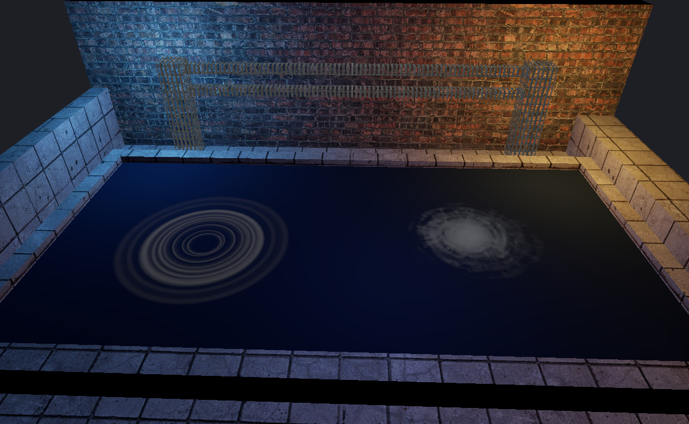

[← Manual](README.md)

# Particle effects

Assign a named particle system to an entity and preview supported effects.

1. Select one or more `info_particle_system` entities.
2. Click **Browse…** beside **Particle System Name**, or open **Entity → Choose particles…**.
3. Search by system, particle file or material.
4. Select a result to inspect its definition and child systems.
5. Click **Apply** to assign the effect to every captured entity in one Undo
   step, or **Cancel** to discard the choice.

The browser lists each captured source value. Mixed values do not select an
asset automatically.

Use **Reload particles** after changing assets. Reopen the browser afterward.

## Preview in the viewport

1. Choose **Perspective** and **Textured**. Use **Legacy** [display mode](fog.md#use-hdr-scene-display) and clear **Enable fog preview**.
2. Open **Overlays**. Under **Particles**, choose **Selected** or **All**.
3. Move the **Particle time** slider or enter a value from 0 to 20 seconds.
4. Choose **Off** to hide the preview.

Change the time to step through the effect. This does not change **Start Active** or the map.

## Limits

- Up to 64 compatible whole entities per captured choice. Apply rechecks the current manifest and PCF definition before writing any entity.
- The viewport previews up to 16 visible, unparented sources for supported world-aligned effects. Examples include `water_trail_medium_b`, `water_splash_01_surface4` and `water_splash_02_froth`.
- The timeline plays from the start at each selected time. It applies the effect's draw distance. Runtime events and visibility do not pause it. Tinted particles use Source's standalone lighting state.
- In-game lighting, child systems, sprite sheets and runtime control points are unavailable.
- Discovery uses the active `particles/particles_manifest.txt` and mounted content order.
- Supported PCFs use DMX binary 2, format pcf 1.
- Map-specific manifests, unlisted files, include/base directives and external references are unsupported.
- Missing, corrupt or over-budget active data fails explicitly. Ambiguous system names cannot be chosen.
- Limits: 128 manifest files, 16 MiB per PCF, 64 MiB total and 16,384 systems.

<!-- page-nav -->

---

[← Sprite guides](sprite-guides.md) · [Manual](README.md) · [Material source →](material-source.md)
