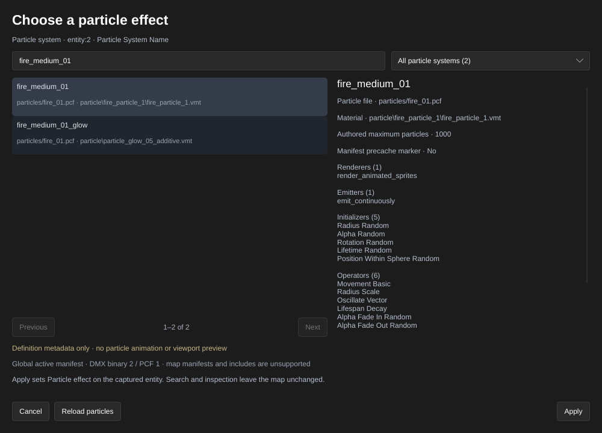

[← Manual](README.md)

# Particle effects

Browse named particle systems from the mounted game's active particle manifest,
inspect their definitions, and choose an effect for an `info_particle_system`
entity without guessing a name.

1. Select one **Particle system** (`info_particle_system`) point entity.
2. In the entity inspector, use **Browse…** beside **Particle System Name**
   (`effect_name`; custom FGDs may give this field another label).
3. Search by system name, particle file or material. Use **All particle systems**,
   **Used in this map**, a **Folder** or a particle file group to narrow the list.
   **Previous** and **Next** move between pages.
4. Select a system. Review its source file, material, authored maximum particle
   count, precache status, function names and child systems.
5. Select **Apply** to set the captured entity's `effect_name`. **Cancel**, Escape,
   or closing the browser discards the choice. Apply creates one undoable edit.

Search and inspection preserve the map, selection, camera and undo history.
Human and MCP choices share the same draft. A changed choice is presented for
review before the human Apply control commits it. Map, selection, FGD, geometry
preview or particle reload changes invalidate the captured choice. A stale
Cancel cannot close a replacement choice.

Use **Reload particles** after editing mounted particle assets, then Cancel and
reopen the choice. The next search or inspection reads the active files again.
Apply also rechecks the active manifest and definitions before changing source.

The equivalent MCP operations are `browse_particles`, `inspect_particle`,
`begin_particle_choice`, `choose_particle`, `get_particle_choice`,
`apply_particle_choice`, `cancel_particle_choice` and `reload_particle_assets`.

## Limits

- Definition metadata only. There is no particle animation, time control,
  viewport rendering or validation of the visible effect in the game.
- Discovery uses `particles/particles_manifest.txt` through the game's content
  mount order. Unlisted PCFs, map-specific manifests, BSP-packed overrides and
  include/base directives are outside this workflow. Manifests require balanced
  blocks and support `//` line comments; block comments are unsupported.
- Supported files use DMX **binary 2**, format **pcf 1**, matching the installed
  CS:S active assets. Other encodings/versions, external element references and
  element-id attributes fail with an explicit error.
- Missing, corrupt, unsupported or over-budget active data fails the catalog
  load. Such failures are retried on the next request; they are never cached as
  successful empty lists. Duplicate system names are listed but cannot be
  inspected or chosen until the ambiguity is resolved.
- HammeRR budgets: 128 manifest files, 16 MiB per PCF, 64 MiB total PCF bytes,
  16,384 systems, and 16 MiB catalog metadata. Each PCF has checked limits for
  elements, attributes, array values, string lengths and metadata. These are
  editor budgets rather than engine limits.
