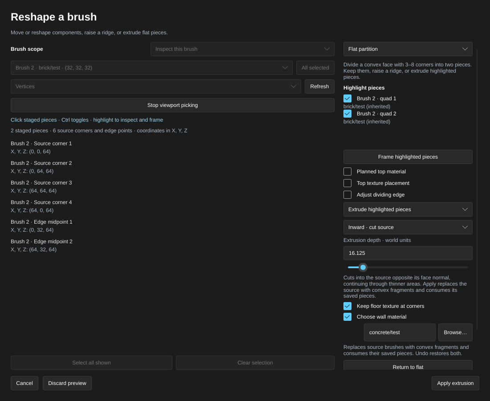

[← Manual](README.md)

# Flat partitions

A flat partition draws a dividing line across a brush face and splits it into two **pieces**, without changing the brush yet. Once a face is divided, you can:

- **raise** the line into a roof ridge;
- **extrude** one or both pieces outward into new brushes or inward to cut pockets;
- plan a different **top material** or **texture placement** for each piece;
- **keep** the division in the map and come back to it later.

| Pieces staged on a flat face | Pieces raised into a ridge |
| --- | --- |
|  |  |

## Divide a face

1. Open **Reshape brushes…**, choose **Faces** and select one face per brush. The face must be convex with 3–8 corners.
2. Choose the **Flat partition** operation.
3. Pick the two edges the line connects, or **Trim corner** to cut off a corner. A four-cornered face offers two straight-across directions and four corner trims.
4. Click **Stage flat partition**. The line appears and the brush stays unchanged.

To inspect the pieces, use **Highlight pieces** and **Frame highlighted pieces**, or click a piece in the viewport. Ctrl+click toggles a highlight and clicking empty space clears them.

| Corner trim controls | Triangle and pentagon pieces, extruded |
| --- | --- |
|  |  |

| Dividing an eight-sided face | Two prisms above the octagon |
| --- | --- |
|  |  |

## Move the dividing line

Enable **Adjust dividing edge** and move the two endpoints with the percentage fields or sliders, then click **Preview cut**. This makes unequal or diagonal pieces. **Reset cut to midpoint** puts the line back in the middle.

| Cut controls | Pieces from a diagonal cut, extruded |
| --- | --- |
|  |  |

## Raise a ridge

When both pieces have four corners, enter the **Shared ridge height** and click **Preview ridge**. **Return to flat** goes back to the flat pieces. **Apply raised partition** commits the ridge.

- A moved dividing line works too, as long as both roof slopes stay flat and convex. Otherwise the ridge is refused and the flat preview stays.
- **Keep roof texture at corners** carries the flat texture onto both slopes.

| Ridge on a moved line | Roof slopes of different widths |
| --- | --- |
|  |  |

## Extrude pieces

**Extrude highlighted pieces** adds outward volumes or cuts inward from one or both pieces.

1. Highlight the pieces to extrude.
2. Choose **Outward · add brushes** or **Inward · cut source**.
3. Enter a positive **Extrusion depth** between 0.125 and 4096 world units. Optionally enable **Choose wall material** and **Keep top texture at corners** (outward) or **Keep floor texture at corners** (inward).
4. Click **Preview extrusion**, review the result, then **Apply extrusion**. The resulting faces are selected; one Undo restores the previous map.

- Outward adds convex brushes along the face normal. The original brush and saved pieces remain reusable. New brushes belong to the same world or brush entity as the source.
- Inward subtracts along the opposite normal and replaces each affected source with convex fragments. The depth is measured from the selected face, including on a sloping face. The cut continues through areas thinner than that depth and can open the opposite side. A cut that would remove an entire source is refused.
- Outward tops and inward floors use each piece's planned material and texture placement, or source inheritance. The chosen wall material overrides new walls; otherwise they inherit their boundary or divider source face. Surviving exterior faces keep their original materials, UVs and surface settings.
- Inward consumes every saved division attached to a changed source brush, including divisions on other faces. Undo restores those plans with the geometry. Saved divisions on other brushes remain.
- Changing the highlighted pieces or direction requires a matching preview before Apply. Invalid requests retain the last good draft. **Return to flat** and **Cancel** restore the sources without recording history.

| Extrusion controls | Two pieces extruded to different heights |
| --- | --- |
|  |  |

## Plan top materials

Enable **Planned top material** to give the highlighted pieces a different material for their future roof slope, outward top or inward floor. Choose one in the browser, or type its name and click **Preview material**.

- Each piece shows its material and whether it is inherited or planned. **Restore inheritance** reverts to the source face's material.
- The flat preview shows the planned materials without adding faces to the brush.
- Return to flat before changing a plan.

| Material controls | Two materials planned on one flat face |
| --- | --- |
|  |  |

## Plan top texture placement

Enable **Top texture placement** to shift, scale or rotate the texture of the highlighted pieces:

- shift in texels;
- scale in world units per texel (negative values mirror the texture);
- rotation in degrees.

1. Highlight the pieces to change and enable **Top texture placement**.
2. Enter shifts, scales or rotation, then click **Preview placement**.
3. Click **Fit each piece** to map one texture tile over each highlighted piece’s projected bounds. This uses each piece’s material dimensions and preserves its current rotation and mirroring.
4. To keep the scale and move the texture, choose **Horizontal** (**Left**, **Center** or **Right**) and/or **Vertical** (**Top**, **Center** or **Bottom**), then click **Preview justification**. **Keep horizontal** and **Keep vertical** leave that direction unchanged.
5. Review the flat preview. **Use source placement** restores inheritance. **Keep flat pieces** saves the plan; raising or extruding applies it to the roofs, tops or inward floors. **Cancel** discards changes in the current draft.

Fit and justification work independently on the actual corners of each chosen piece, including adjusted cuts, triangles and pentagons. Preview pending numeric or material changes before fitting or justifying. Unavailable texture dimensions leave the current preview intact. Return to flat before editing a placement.

| Placement controls | Different placements on two pieces |
| --- | --- |
|  |  |

## Keep for later

**Keep flat pieces** stores the division in the VMF, including the line position and any material and texture plans, without changing a single brush.

Later, even after saving and reopening the map, open **Saved flat pieces**:

- **Resume pieces** continues where you left off: inspect, raise or extrude.
- **Remove saved** deletes a stored division, even one whose face has since changed or been deleted.

Keeping, removing and applying are all undoable. Applying a raised partition uses up its stored division; applying an inward cut consumes divisions on every face of each changed brush. Stored divisions survive mirroring and reopening, and they never affect compiled maps.

Finish an open partition (keep, apply or cancel it) before saving, compiling or playing.

## Limits

- Source faces must be convex with 3–8 corners. Each piece has 3–9 corners.
- Ridges need two four-cornered pieces. Other shapes can be kept or extruded.
- One batch handles 16 source brushes, 32 extruded pieces and 256 generated planes.
- Inward cuts produce at most 256 convex fragments, each with at most 64 sides. Whole-source removal, displacements, nonplanar face loops and collapsed or out-of-bounds results are refused. Convex sources with sloping neighboring faces are supported; the cut is clipped to the actual source volume.
- Extruded corners must stay within ±65536 world units, including the far end of an inward cut.
- A map can store divisions on up to 64 faces, using up to 64 KiB of data.
- Not yet available: free-form dividing lines and per-piece texture axes.
