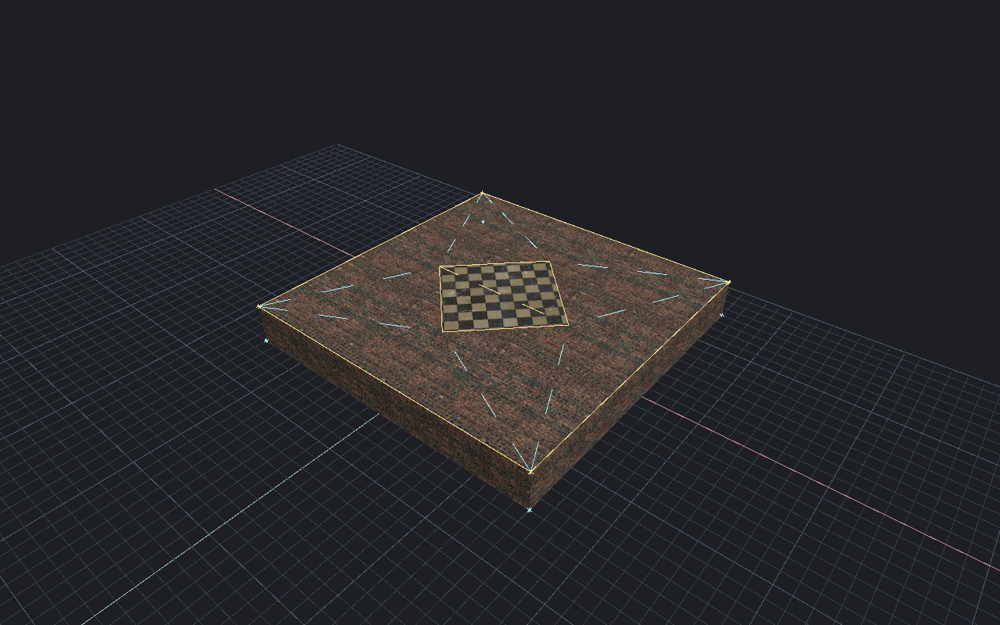
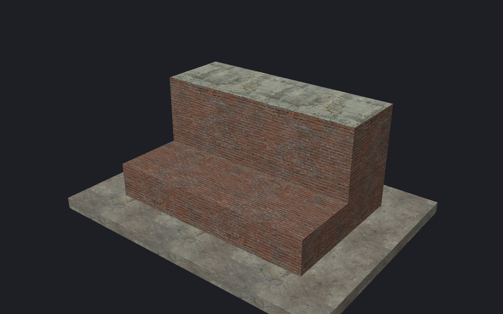

[← Manual](README.md)

# Flat partitions

Divide a brush face before raising, extruding or texturing its pieces.

## Divide a face

1. Open **Reshape brushes…**.
2. Choose **Faces**.
3. Select one convex face per brush.
4. Choose **Flat partition**.
5. Choose **Boundary cut**, then two connecting edges or **Trim corner**.
6. Click **Stage flat partition**.

The dividing line appears without changing the brush.
Use **Highlight pieces** or click pieces in the viewport to choose them.
<kbd>Ctrl</kbd>+click toggles a highlight.

## Move the dividing line

1. Enable **Adjust dividing edge**.
2. Set both endpoint percentages.
3. Click **Preview cut**.

The line must stay inside the face and produce valid pieces.

## Draw free face cuts

1. Open **Reshape brushes…**, choose **Faces**, and select one face.
2. Choose **Flat partition**, then **Free face cuts** from the cut method list.
3. Enter **Start** and **End** in world XYZ coordinates.
4. Click **Stage face cut**.
5. Enter another segment and click **Add cut segment**, if required.
6. Highlight triangle pieces and set their materials or texture placement.
7. Inspect **Output brushes** and **Added brushes**.
8. Click **Apply face cuts**, or **Keep flat pieces** to save the plan.

Endpoints can be inside the face or on its boundary. Crossings create shared
vertices. Solid lines show cuts and boundaries; dashed lines show generated
diagonals. Each triangle is a separate piece. Open segments stay open.

**Apply face cuts** replaces each source with convex brush pieces. Materials,
projections, supported cubemap bindings and retained instance order follow the
result. One Undo restores the source. **Keep flat pieces** leaves native geometry
unchanged; resume the saved plan before Apply.

Restore source materials and placement before adding segments to a textured
plan. Invalid changes retain the current plan.

## Raise a ridge

1. Set the ridge height.
2. Optionally enable **Keep roof texture at corners** or **Keep neighboring textures at corners**.
3. Click **Preview ridge** and inspect the shape and brush counts.
4. Click **Apply raised partition**.

Ridges require two four-corner pieces.
Neighbor attachment uses convex brush pieces with triangular exterior faces;
**Output brushes** and **Added brushes** show its cost before Apply. Roof and
neighbor attachment are independent. **Return to flat** keeps the draft choices.
Manual cubemap top-face bindings follow both slopes, including without neighbor
attachment. Fragmented bindings follow all replacement exterior triangles;
the preview shows changed sample and binding counts. Retained instance
ordering keeps world-brush fragments in their source compilation slots.
For a neighbor-attached preview, highlight with the piece list and use **Frame
highlighted pieces**. Return to flat before picking pieces in the viewport.
See [Roof ridge](components.md#roof-ridge).

## Extrude pieces

1. Highlight the required pieces.
2. Choose **Outward · add brushes** or **Inward · cut source**.
3. Enter **Extrusion depth**.
4. Enable **Choose wall material** if required.
5. Click **Preview extrusion**.
6. Click **Apply extrusion**.

**Keep top texture at corners** attaches outward top textures.
**Keep floor texture at corners** attaches inward floor textures.

## Plan materials and texture placement

1. Highlight the required pieces.
2. Choose their top material.
3. Enable **Top texture placement** to change offsets, scale or rotation.
4. Click **Preview placement**, **Fit each piece** or **Preview justification**.
5. Inspect the pieces.

**Use source placement** restores inherited texture placement.
**Keep flat pieces** saves the division without changing geometry.
Raising or extruding applies the stored top settings.

### Set explicit texture axes

1. Enable **Top texture placement**.
2. Enable **Explicit U/V axes**.
3. Enter world-space XYZ vectors in **U axis** and **V axis**.
4. Set the offsets and signed scales.
5. Click **Preview placement**.

Explicit vectors control projection direction and skew. **Rotation metadata ·
degrees** stores the native rotation value; it does not rotate those vectors.
Disable **Explicit U/V axes** to use source-derived directions.
Fit and justification retain explicit directions. Saved plans follow texture
locks through transforms, Duplicate, arrays and clipboard placement.

## Limits

- Source faces have 3–8 corners. Result pieces have 3–9 corners.
- One batch supports 16 sources and 32 extruded pieces.
- Extrusion depth is 0.125–4096 units. Inward cuts permit at most 256 fragments.
- A map can store boundary and free-cut plans on 64 faces in total, within 64 KiB.
- Free cuts permit 32 segments, 64 vertices and 120 triangle pieces per source;
  Apply permits 256 convex fragments in total.
- Free-cut sources require known solid/nodraw materials on world,
  `func_detail`, `func_brush` or `func_wall` brushes. Unsupported face bindings,
  measurements, brush notes, origin custody and unknown metadata reject Apply.
- Free-cut drafts do not raise ridges or extrude directly. Apply creates ordinary
  editable brush faces. Holes and nonmanifold topology are not supported.
- Distinct endpoints must be more than 0.002 units apart. Only bounded floating-point
  roundoff corrections are permitted; inspection reports requested and resolved
  endpoints and their maximum correction.
- Terrain, full-source removal, collapsed geometry and out-of-bounds results reject.

<!-- page-nav -->

---

[← Vertices, edges and faces](components.md) · [Manual](README.md) · [Surface placement →](placement.md)
