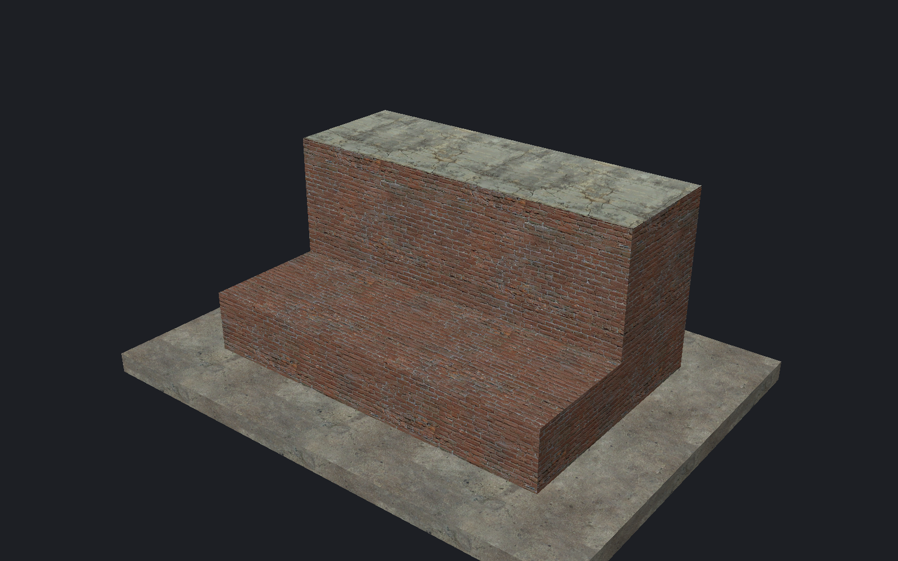

[← Manual](README.md)

# Flat partitions

Divide a brush face before raising, extruding or texturing its pieces.

## Divide a face

1. Open **Reshape brushes…**.
2. Choose **Faces**.
3. Select one convex face per brush.
4. Choose **Flat partition**.
5. Choose two connecting edges or **Trim corner**.
6. Click **Stage flat partition**.

The dividing line appears without changing the brush.
Use **Highlight pieces** or click pieces in the viewport to choose them.
Ctrl+click toggles a highlight.

## Move the dividing line

1. Enable **Adjust dividing edge**.
2. Set both endpoint percentages.
3. Click **Preview cut**.

The line must stay inside the face and produce valid pieces.

## Raise a ridge

1. Set the ridge height.
2. Preview the raised result.
3. Apply the ridge.

Ridges require two four-corner pieces.
See [Roof ridge](components.md#roof-ridge).

## Extrude pieces

1. Highlight the required pieces.
2. Choose **Outward · add brushes** or **Inward · cut source**.
3. Enter **Extrusion depth**.
4. Enable **Choose wall material** if required.
5. Click **Preview extrusion**.
6. Click **Apply extrusion**.

**Keep top texture at corners** attaches outward top textures.
**Keep floor texture at corners** attaches inward floor textures.

## Plan materials and texture placement

1. Highlight the required pieces.
2. Choose their top material.
3. Enable **Top texture placement** to change offsets, scale or rotation.
4. Click **Preview placement**, **Fit each piece** or **Preview justification**.
5. Inspect the pieces.

**Use source placement** restores inherited texture placement.
**Keep flat pieces** saves the division without changing geometry.
Raising or extruding applies the stored top settings.

## Limits

- Source faces have 3–8 corners. Result pieces have 3–9 corners.
- One batch supports 16 sources and 32 extruded pieces.
- Extrusion depth is 0.125–4096 units. Inward cuts permit at most 256 fragments.
- A map can store divisions on 64 faces, within 64 KiB.
- Terrain, full-source removal, collapsed geometry and out-of-bounds results reject.
- Free-form dividing lines and per-piece texture axes are unavailable.
