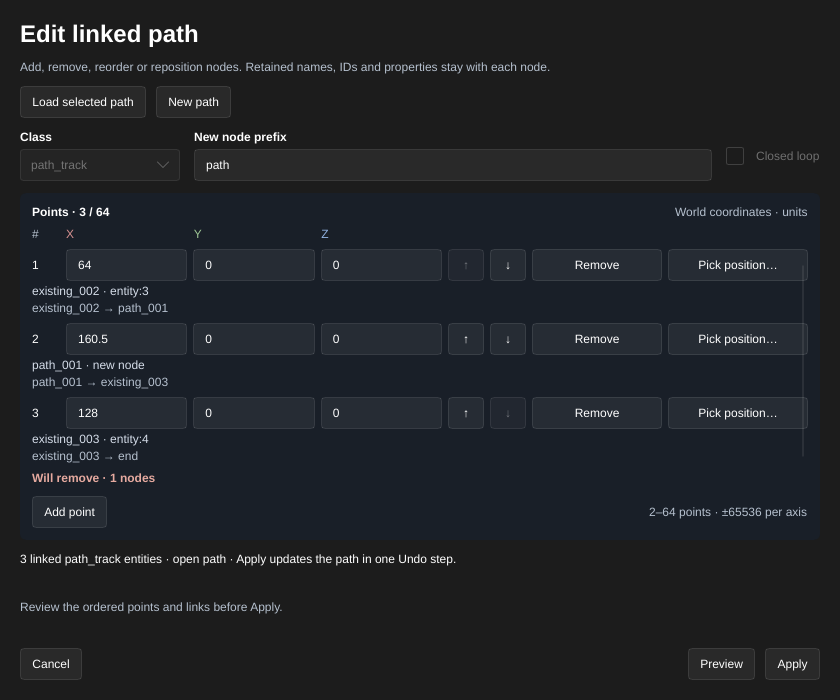

[← Manual](README.md)

# Linked paths

Create an ordered chain of `path_corner` or `path_track` entities, or insert,
remove, reorder and reposition nodes while retaining existing node identities.
Review the complete chain before applying changes to the map.

## Create a path

1. In the main side panel, click **Create linked path…**, below **Draw polygon…**.
2. Choose **Class**: **path_corner** or **path_track**. Enter a **Name prefix**;
   names follow `prefix_001`, `prefix_002` and so on.
3. Enter each point's world coordinates under **Points**, using **X**, **Y** and
   **Z**. **Add point** appends a node; **Remove** deletes a row. Use **Move up**
   and **Move down** to set the link order.
4. Enable **Closed loop** to link the last node to the first. Leave it off for
   an open chain whose last node has no next target.
5. Click **Preview** and inspect the proposed names, positions and links.
   Changing a field requires another **Preview** before **Apply**. If another
   actor owns the current draft, use **Review preview** to take ownership.
6. Click **Apply** to create and select the complete chain in one Undo step,
   or **Cancel** to discard the draft. **Undo** removes that creation; **Redo**
   restores the same node IDs and links.

Limits: 2–64 distinct points, with finite coordinates within ±65536 per axis.
Prefixes use 1–96 ASCII letters, digits, underscores or dashes and must start
with a letter or underscore. Occupied names, including hidden entities and
case variants, receive a numeric suffix. A name that would acquire an existing
reference is rejected; choose another prefix. Do not repeat the first point
to close the chain; use **Closed loop**.

Loaded FGD defaults apply, while generated names and next links determine the
chain. Reloading definitions, editing the map, changing selection or replacing
the geometry preview invalidates the draft. A replaced token cannot apply or
cancel another draft. Creation does not attach a train or other moving entity,
or validate path behavior in the game.

## Edit an existing path

Retained nodes keep their IDs, names, class, flags, custom values, I/O
connections and references from other entities. Only their edited positions
and next-node links change. Untouched raw values remain as authored; new FGD
defaults apply only to inserted nodes.

1. Select one existing `path_corner` or `path_track` node. Any node in the chain
   works; an open chain loads from its first node, while a closed loop starts
   at the selected node.
2. Open **Create linked path…** and click **Load selected path**. The point
   table shows the complete chain with each node's name and ID. **Class** and
   **Closed loop** stay locked. **New node prefix** determines names only for
   inserted nodes; existing names stay unchanged.
3. Use **Move up** and **Move down** to change node order. Edit **X**, **Y** and
   **Z** to move that named node. **Add point** appends a new row; move it into
   the desired position. **Remove** omits a node from the resulting chain.
   Keep at least one original node and 2–64 resulting points.
4. Click **Preview**. Inspect the names, positions and next links in the table
   and the viewport. New rows say **new node**; **Will remove** lists the names
   and IDs that will be deleted. Removal rejects nodes with authored I/O
   connections or references beyond this chain's ordinary next links; edit
   those connections/references explicitly first. Changed fields require
   another **Preview**. Use **Review preview** to load and take ownership of a
   shared agent draft.
5. Click **Apply** to update and select the resulting nodes in one Undo step,
   or **Cancel** to leave the map unchanged. **Undo** and **Redo** restore the
   same nodes and their links. Applying an unchanged path adds no history step.
6. Use **New path** to return the table to creation mode.

Limits: editing requires one complete, visible, unparented simple chain or
closed loop of 2–64 distinct points, all of the same point class. Every name
must be unique across the map, including hidden entities and case variants.
Missing targets, links to another class, duplicate IDs or structural keys,
wildcard or special path targets, alternate branches and several path nodes
targeting one node are rejected. Existing external entity references and I/O
remain unchanged; they do not become new links in the chain.

Changing the map or entity definitions after loading a chain requires
**Load selected path** again. Invalid requests retain the last valid preview.
Inserted names use the same occupied-name and reference-acquisition guards
as creation. Removed names are not recycled for new nodes. New nodes receive
fresh IDs; Undo/Redo restore the exact original/resulting node identities.
FGD defaults that add a parent or alternate path to a new node are rejected.
Renaming, open/closed conversion, branching, viewport point input, train setup
and runtime movement validation remain outside this workflow.
