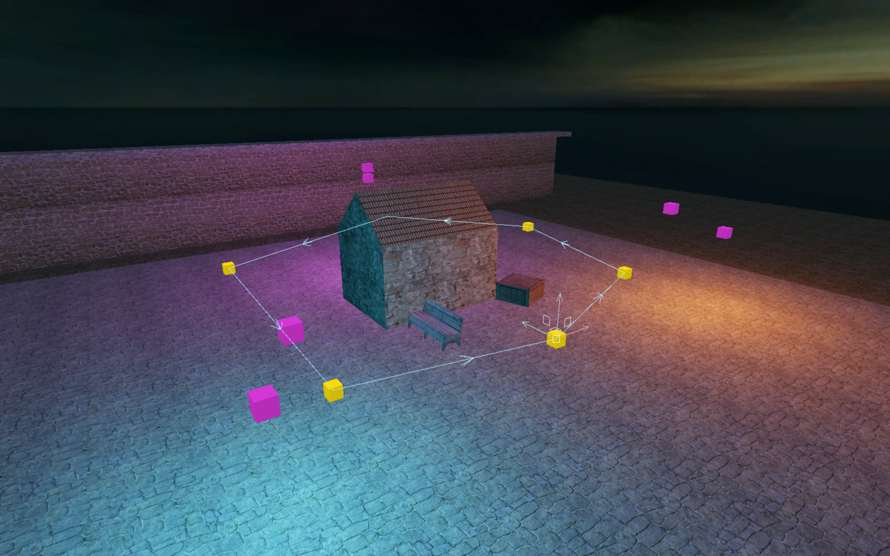

[← Manual](README.md)

# Linked paths

Create linked nodes and configure a brush train.

## Create or edit a path

1. Open **Brush → Linked paths…**.
2. Choose **Class** and **Name prefix**. To edit a path, select a node and click **Load selected path**.
3. Enter point coordinates. Use **Add point**, **Remove**, **Move up** and **Move down** to set the order.
4. Set **Closed loop**. Do not repeat the first point.
5. Click **Preview**. Cyan arrows show the link direction. Inspect the nodes, then click **Apply** or **Cancel**.

To convert an existing path, change **Class** or **Closed loop** under **Edit path**.
Class conversion requires neutral node behavior and no attached train.

## Move a node

1. Preview the path.
2. Click **Move handles…** beside a point.
3. Drag an axis or plane in the viewport. Grid snapping applies.
4. Click **Finish moving**, then **Apply**. Press Escape during a drag to restore that point.

Use **Pick position…** to place a point on a visible surface. **Cancel position pick** keeps its preceding position.

## Configure a train

1. Create the train brushes. Use **Tie to entity…** to make a `func_train` for `path_corner`, or a `func_tracktrain` for `path_track`.
2. Give the train a unique name.
3. Select a path node. Open **Linked paths… → Load selected path**.
4. Choose **Set up train** under **Operation**.
5. Enter **Train entity ID**, or select the train and click **Use selected train**.
6. Set **Speed** and **Start moving**.
7. Click **Preview**, inspect the train and any startup helper, then **Apply**.

A named `func_train` uses an explicit `logic_auto` helper for automatic startup. The preview lists helper creation and removal. Each Apply is one Undo step.

## Duplicate a path

1. Load the path. Choose **Duplicate path** under **Operation**.
2. Set **Offset X / Y / Z** and **Name suffix**.
3. Enable **Include train** if required and choose its **Train entity ID**.
4. Choose **Reject external references** or **Keep external references**.
5. Click **Preview**, inspect new names and links, then **Apply** or **Cancel**.

Internal links point to the copies. External incoming controls keep their original targets and appear in the preview report.

## Limits

- 2–64 distinct, visible, unparented nodes within ±65536; one simple chain or loop.
- No branches, alternate paths, ambiguous names or dynamic link scripts.
- Class conversion rejects behavior that the new class cannot preserve.
- Train setup requires visible, unparented, zero-angle convex brush entities. Speed: greater than zero, up to 4096.
- Duplication supports one complete path, one associated train and its managed startup helper.

<!-- page-nav -->

---

[← Point-entity gallery](entity-gallery.md) · [Manual](README.md) · [Overlays →](overlays.md)
