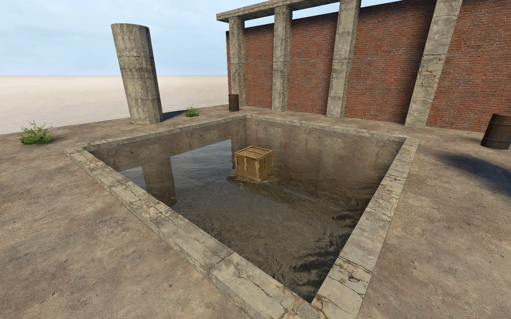

[← Manual](README.md)

# Physics

Build collision bodies with the installed CS:S physics library.

1. Assign materials to world geometry or brush-entity faces.
2. Open **Build settings…**.
3. Choose **Physics bodies → CS:S engine physics**.
4. Click **Close**, then **Compile**.
5. Read **Build details… → Diagnostics**.

Materials select contact properties through `$surfaceprop`.
A valid material without that field uses the defined `default` surface property.
Missing or malformed required definitions fail the build.
Changes to the consumed surface manifest or definition files require a new build.

## Brush-model mass

The material with the greatest emitted face area determines base mass.
Per-face contact materials remain separate. Solid materials use volume and density; shell materials use area, thickness and density.
Base mass is capped at 50,000 kg.

`func_physbox` **Mass Scale** and **Override Parameters** apply later in the game.
`phys_convert` **Mass Override** can replace mass after conversion.

## Terrain contact surfaces

Supported terrain uses the compiled surface and its material contact properties.
Blended terrain can select properties through its authored blend values.
Use [terrain collision controls](terrain.md#collision-and-triangle-classes) to change physics, player and ray collision separately.

## Water

Eligible water generates fluid behavior. See [water](water.md) for current, pressure damping and invisible fluid helpers.

## Limits

- Verified Linux64 CS:S physics library required.
- Missing, malformed, collapsed or unsupported hulls fail explicitly and preserve previous output.
- Failure diagnostics identify the construction stage, source object and checked bounds.
- Surface definitions follow mounted manifest order and checked native property limits.
- Preview model bounds do not establish native collision shapes.
- Custom density controls and broader moving-body behavior remain unfinished.
