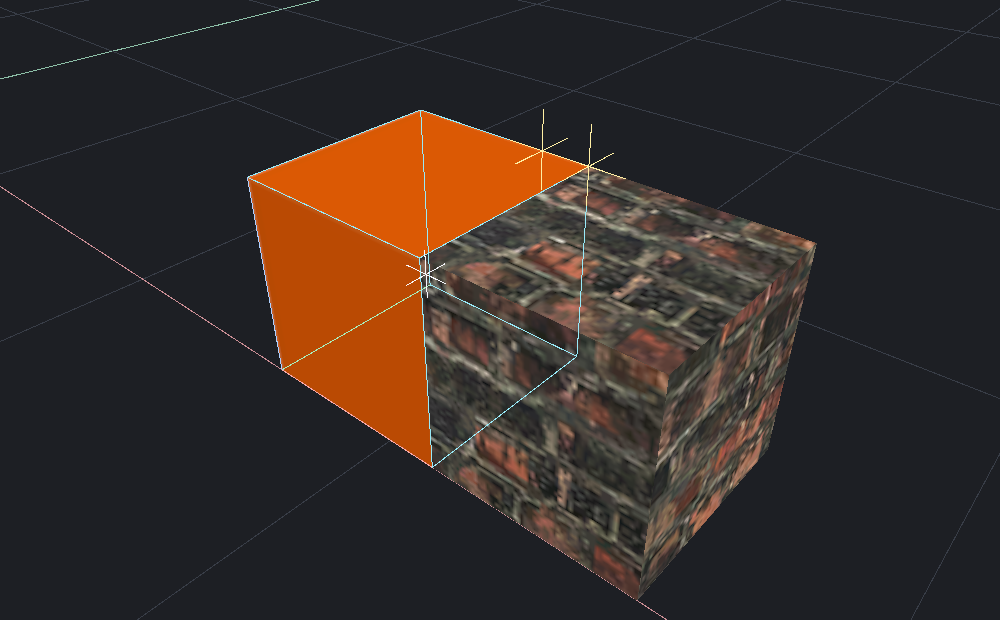

[← Manual](README.md)

# Surface placement

Align a selection with a floor, ceiling or picked surface.

1. Select the objects.
2. Click **Place on surface…**.
3. Choose **Floor**, **Ceiling** or **Pick surface** under **Target**.
4. Enter **Offset**.
5. Enable **Align local up to surface** if rotation is required.
6. Choose **Keep textures attached** for brushes.
7. For **Floor** or **Ceiling**, click **Preview placement**.
8. For **Pick surface**, click **Pick surface**, then click the target.
9. Inspect the yellow target mark and movement.
10. Click **Apply placement**.

Positive offsets leave space above the surface. Negative offsets embed the selection.
**Cancel** or Escape discards the preview.

## Snap a real corner

1. Select whole objects, including a flat brush.
2. Choose **Snap selected corner** under **Target**.
3. Choose **Source corner**.
4. Click **Pick target corner**.
5. Click a visible brush, terrain triangle or supported model mesh.
6. Inspect both corners and **Move**.
7. Click **Apply placement**.

The nearest vertex of the first hit face or triangle becomes the target.
The selection translates as one group, without grid rounding or rotation.

## Magnetic translation

1. Select the objects or individual brush-entity solids to move, including a flat brush.
2. Choose **Brush → Magnetic snapping…**.
3. Click **Refresh magnetic sources**, then choose a **Source corner**.
4. Enable **Magnetic snapping**, enter **Capture radius**, then click **Apply magnetic settings**.
5. Choose **Move** handles and drag an axis, plane or view handle over a visible target.
6. Review **Captured**, **Outside radius** or **No target surface** in the Inspector.
7. Release to apply the movement in one Undo step, or press Escape to cancel.

The radius is the distance in world units from the proposed source corner to
the target vertex, after ordinary grid and handle constraints. The nearest real
corner of the hovered brush face or hit terrain/model triangle captures only
inside that radius. Capture can move off the handle axis or plane to join the
corners exactly. Outside the radius, or with no target under the pointer, the
ordinary handle/grid movement remains active.

The source corner stays explicit; other selected objects move with it. Individual
entity brushes use the same authored coordinates as face/component editing and
keep their owning entity's properties. Settings are temporary. After replacing
the map, refresh the sources and choose a corner again. Numeric transforms and
ordinary surface placement retain their own controls.

## Limits

- Placement does not simulate physics or resolve other overlaps.
- Floor/Ceiling uses one vertical ray through the selection center.
- Hidden objects and selected sources cannot be targets.
- Magnetic snapping considers the first visible supported face or triangle under
  the pointer. It does not search behind walls or elsewhere in the scene.
- Magnetic sources require a visible flat-brush corner. Radius is 0.125–1024 world
  units; the initial value is 16. Source choices are bounded to 256 flat brushes
  and 4096 corners, and movement uses the shared finite geometry/support limits.
- Invalid magnetic source or target geometry rejects the update and retains the
  last valid preview. Changed geometry, visibility, settings or reloaded assets
  require a new preview before Apply.
- Finish other active drafts before magnetic movement. Source inspection and
  settings do not apply or discard those drafts.
- Corner snapping requires a real flat-brush source corner. Terrain and models can supply target vertices.
- Missing or unsupported meshes provide no vertex target.
- Geometry must remain finite and within ±65536 units.
- Changed sources or reloaded models require a new preview.
