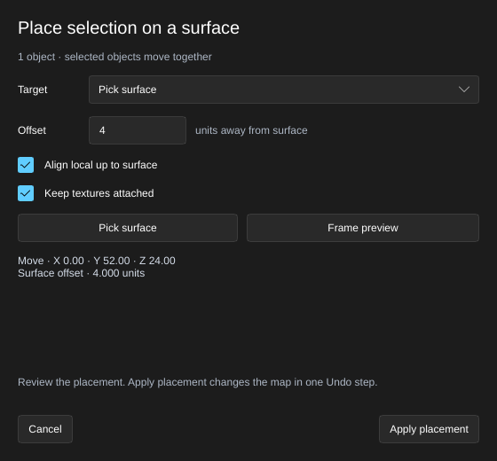
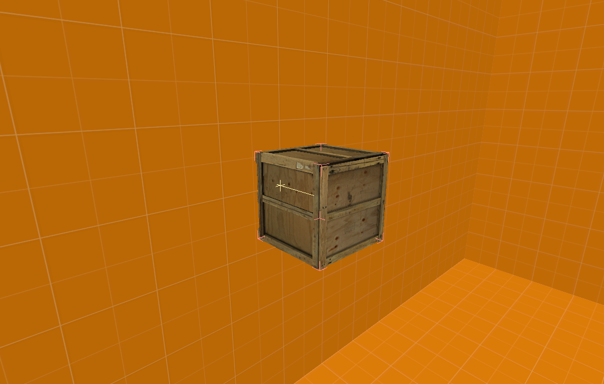
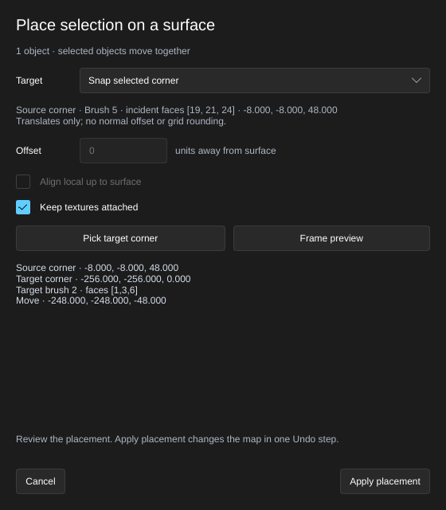
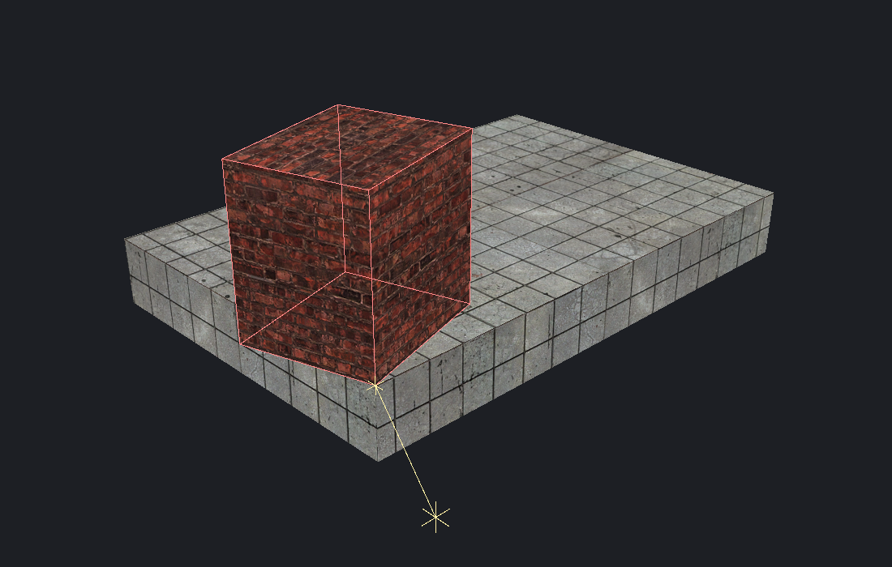

[← Manual](README.md)

# Surface placement

Place selected objects against a floor, ceiling, brush face, terrain triangle or supported model mesh, or snap one brush owner's chosen corner to another brush corner. Review the shared preview before changing the map.

1. Select one or more objects, then click **Place on surface…** in the selection controls.
2. Choose **Target**: **Floor** casts down from the selection; **Ceiling** casts up; **Pick surface** lets you choose a visible surface in the viewport.
3. Enter **Offset** in map units. Positive values leave space away from the surface; negative values embed the selection.
4. Enable **Align local up to surface** to rotate the selection so its first object's local up direction follows the hit surface normal. Leave it off to retain the current orientation.
5. Choose **Keep textures attached** for brushes, then click **Preview placement**. With **Pick surface**, click **Pick surface**, then click a target in the viewport. A miss keeps picking active; **Escape** or **Cancel picking** abandons it.
6. Review the preview and its movement/offset readout. The yellow mark shows the target and its normal. **Frame preview** moves the camera to the selected preview.
7. After changing settings, preview again. Click **Apply placement** to change the map in one Undo step. **Cancel**, **Escape** or closing the window discards this placement.

## Snap a real corner

1. Select one brush or brush entity. Open **Reshape brushes…**, choose **Vertices** and select exactly one corner through the existing list or viewport picker.
2. Open **Place on surface…** and choose **Snap selected corner** under **Target**. Check **Source corner**: its brush ID, incident face IDs and coordinates identify a real brush vertex. The whole selected owner moves together, including its other child brushes. This mode resets **Offset** to `0` and **Align local up to surface** to off, and disables both controls.
3. Click **Pick target corner**, then click a visible flat brush face. Its corner nearest to the hit point becomes the target; equal distances use incident face IDs for a stable choice. A miss or unsupported hit leaves picking active.
4. Review **Source corner**, **Target corner**, their guide marks and the **Move** delta. Use **Frame preview** to inspect the result. This operation translates without rotation, normal offset or grid rounding. **Keep textures attached** uses the same brush texture policy as ordinary placement.
5. Click **Apply placement** for one Undo step, or **Cancel** to discard it. Repeating a coincident snap adds no history. Source and target must be visible under the current owner, tool and working-region filters.

MCP uses the existing placement calls with `method: "brush_corner"` and an
explicit `source_corner: {solid, sides}` from `get_brush_components`. Opening the
dialog resumes that shared pick or preview, including its captured source
identity. See [MCP surface placement](mcp.md#surface-placement).

## Limits

- Selections move as one rigid group. This is a geometric placement operation; it does not settle each object separately, simulate physics or resolve overlaps with nearby surfaces.
- Floor and ceiling placement use one vertical ray through the selection's bounds center and retain its horizontal location. Picked placement centers the group over the hit point. A curved or small target can therefore intersect another part of the selection.
- Brush vertices, actual terrain samples and supported model-body mesh vertices determine contact. Unsupported or blank model choices and ordinary point entities use their editor helper bounds.
- Targets are visible brushes, actual terrain triangles and supported model meshes. Selected objects and their owned brushes are excluded. Hidden objects and point helper boxes are not targets.
- Alignment uses the first selected object's local up direction for the entire group. Terrain and model normals are the hit triangle's geometric normal, rather than an interpolated lighting normal.
- Finish another geometry preview before starting. Changing the source, selection or scene invalidates an existing placement; preview it again. An old window's Cancel preserves replacement previews.
- Placement supports at most one million finite support points and offsets within ±65536 units. Ordinary transform validation still applies.
- Corner snapping supports one moving world brush or brush entity and checked 4–64-side source/target brushes. Every translated child, including hidden brushes, must remain within ±65536 units. The source is an explicit real corner, rather than the selection's bounds minimum. Model/point sources, displacement source brushes, hit terrain/model vertices, multiple moving owners and arbitrary pixel-radius magnetic snapping are outside this mode. A first unsupported or ambiguous hit rejects instead of finding a corner behind it. Nonzero **Offset** and **Align local up to surface** requests reject; the controls reset to zero/off when selecting this mode.
