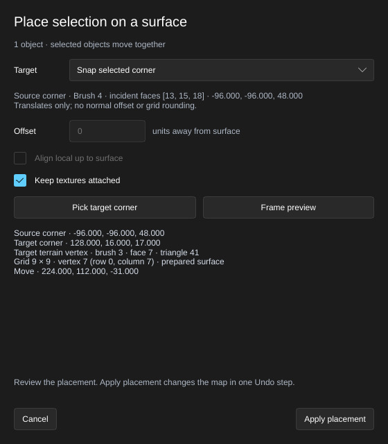

[← Manual](README.md)

# Surface placement

Place selected objects against a floor, ceiling, brush face, terrain triangle or supported model mesh, or move a selection from one chosen brush corner to a brush corner, terrain vertex or model mesh vertex. Review the shared preview before changing the map.

1. Select one or more objects, then click **Place on surface…** in the selection controls.
2. Choose **Target**: **Floor** casts down from the selection; **Ceiling** casts up; **Pick surface** lets you choose a visible surface in the viewport.
3. Enter **Offset** in map units. Positive values leave space away from the surface; negative values embed the selection.
4. Enable **Align local up to surface** to rotate the selection so its first object's local up direction follows the hit surface normal. Leave it off to retain the current orientation.
5. Choose **Keep textures attached** for brushes, then click **Preview placement**. With **Pick surface**, click **Pick surface**, then click a target in the viewport. A miss keeps picking active; **Escape** or **Cancel picking** abandons it.
6. Review the preview and its movement/offset readout. The yellow mark shows the target and its normal. **Frame preview** moves the camera to the selected preview.
7. After changing settings, preview again. Click **Apply placement** to change the map in one Undo step. **Cancel**, **Escape** or closing the window discards this placement.

## Snap a real corner

1. Select the whole objects to move, including at least one visible flat brush or brush entity. World brushes, whole brush entities and ordinary point/model entities can move together.
2. Open **Place on surface…** and choose **Snap selected corner** under **Target**. Choose **Source corner** by its object label and coordinates; brush and incident face IDs distinguish coincident choices. A corner already selected through **Reshape brushes… → Vertices** is retained. Otherwise choose explicitly. Every selected object moves by the same offset, including hidden children of selected brush entities. This mode resets **Offset** to `0` and **Align local up to surface** to off, and disables both controls.
3. Click **Pick target corner**, then click a visible flat brush face, terrain triangle or supported model mesh. The nearest corner of that face or first hit triangle becomes the target. Equal distances use incident face IDs for brushes, row-major vertex indices for terrain and decoded global vertex indices for models. A miss or unsupported hit leaves picking active.
4. Review **Source corner**, **Target corner**, their guide marks and the **Move** delta. **Target terrain vertex** identifies the brush, face, triangle, grid size and vertex index, with zero-based row and column. Its coordinates use the prepared displayed surface, including sewn borders between different terrain powers; the authored terrain rows stay unchanged. Use **Frame preview** to inspect the result. This operation translates without rotation, normal offset or grid rounding. **Keep textures attached** uses the same brush texture policy as ordinary placement.
5. Click **Apply placement** for one Undo step, or **Cancel** to discard it. Repeating a coincident snap adds no history. Source and target must be visible under the current owner, tool and working-region filters.

**Target model vertex** leads with its world coordinates and identifies its
zero-based mesh part, triangle and global vertex index. The target follows the
currently displayed selected body mesh, entity position, Source angles and
positive uniform model scale. Skin does not change its geometry. The model and
its entity stay unchanged; the whole selection moves to that fixed point.
MCP reports the cached asset path/checksum and captured body, skin, scale,
origin and rotation with `provenance: "cached_decoded_model_mesh"`.

MCP reads the same bounded visible choices through `get_surface_placement_sources`,
then uses the existing placement calls with `method: "brush_corner"` and an
explicit `source_corner: {solid, sides}`. Opening the
dialog resumes that shared pick or preview, including its captured source
identity. Pass every moving root in `ids`; the source corner must belong to one
of them. See [MCP surface placement](mcp.md#surface-placement).

## Limits

- Selections move as one rigid group. This is a geometric placement operation; it does not settle each object separately, simulate physics or resolve overlaps with nearby surfaces.
- Floor and ceiling placement use one vertical ray through the selection's bounds center and retain its horizontal location. Picked placement centers the group over the hit point. A curved or small target can therefore intersect another part of the selection.
- Brush vertices, actual terrain samples and supported model-body mesh vertices determine contact. Unsupported or blank model choices and ordinary point entities use their editor helper bounds.
- Targets are visible brushes, actual terrain triangles and supported model meshes. Selected objects and their owned brushes are excluded. Hidden objects and point helper boxes are not targets.
- Alignment uses the first selected object's local up direction for the entire group. Terrain and model normals are the hit triangle's geometric normal, rather than an interpolated lighting normal.
- Finish another geometry preview before starting. Changing the source, selection or scene invalidates an existing placement; preview it again. An old window's Cancel preserves replacement previews.
- Reloading model assets also invalidates a corner preview because the first visible surface may change. Cancel remains available for stale cleanup.
- Placement supports at most one million finite support points and offsets within ±65536 units. Ordinary transform validation still applies.
- The chosen source corner needs checked 4–64-side flat brush topology. Select whole brush entities, rather than individual owned child brushes or parent/child mixtures. Point/model companions retain their ordinary rigid-placement geometry or helper bounds; they cannot supply a source corner. Every translated root, child brush, terrain sample, model vertex and point helper must remain within ±65536 units, with finite entity origins. Invalid batches preserve the reviewed draft or pending pick.
- **Source corner** lists up to 256 visible flat brushes and 4096 checked corners. Larger selections can use an explicit MCP source corner and resume that shared pick or preview in the dialog. The whole selection still moves together.
- Flat brush targets need checked 4–64-side topology. Terrain and model targets use only the three actual vertices of the first hit triangle, without searching other triangles or using parent/helper bounds. Missing, malformed, unsupported or blank model meshes supply no vertex target. Decoded reference-pose geometry is used; animation, runtime deformation, collision hulls and live file watching are unavailable. Reload models to adopt changed assets and preview again. Displacement source corners and arbitrary pixel-radius magnetic snapping remain unavailable. A first ambiguous hit rejects instead of finding a corner behind it. Nonzero **Offset** and **Align local up to surface** requests reject; the controls reset to zero/off when selecting this mode.
