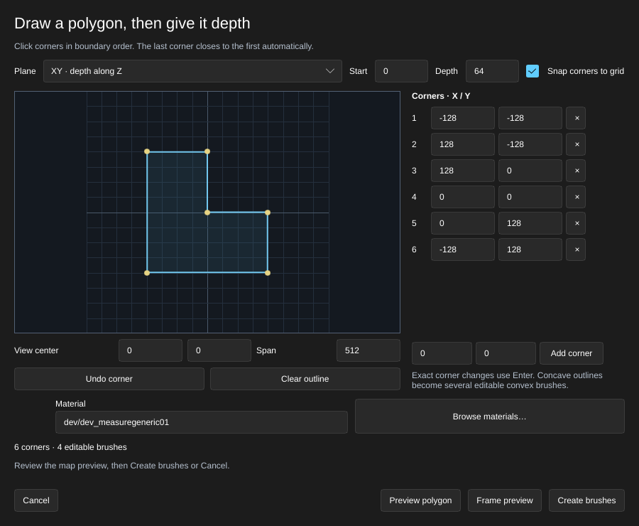

[← Manual](README.md)

# Polygon brushes

Draw an outline and extrude it into ordinary editable map brushes. Convex outlines create one brush; simple concave outlines create several convex pieces that retain the drawn boundary.

1. Click **Draw polygon…** in the sidebar.
2. Choose **Plane**: **XY · depth along Z**, **XZ · depth along Y**, or **YZ · depth along X**. Set **Start** and positive **Depth** along that axis.
3. Click corners in boundary order in the drawing pad. The outline closes automatically from its last corner to its first; do not repeat the first corner.
4. Use **Snap corners to grid** to follow the editor's current grid spacing. Disable it for fractional exact coordinates. **Undo corner** removes the last point; **Clear outline** removes all points.
5. Correct a corner in the numbered coordinate list and press **Enter**. **×** removes that corner. The inputs beside **Add corner** add an exact new point.
6. Adjust **View center** and **Span** to inspect another part of the drawing plane. These controls change only the pad view.
7. Enter **Material**, or click **Browse materials…** to use the grouped browser and preview.
8. Click **Preview polygon** to check the outline and see its extrusion in the map. The summary gives the corner and resulting brush counts. **Frame preview** moves the camera to it.
9. After editing corners or settings, preview again. Click **Create brushes** to keep the result in one Undo step, or **Cancel** to discard it. **Escape** and closing the window also cancel this draft.

## Limits

- Draw 3–64 distinct corners. Crossings, touching nonadjacent edges, repeated points and collinear corners are rejected. Remove unnecessary points instead of repeating an edge.
- Depth must be at least 0.125 units. Coordinates and the complete extrusion must stay within ±65536 units. Collapsed or numerically ambiguous geometry is rejected before changing the map.
- The drawing plane is axis-aligned. Holes, curved edges and arbitrary oblique planes are not supported. Completed brushes can use the ordinary transform tools.
- Concave outlines decompose into triangular prisms. Their individual faces and materials remain editable; they are not a persistent linked polygon object.
- The preview shares the **Brush shapes…** preview slot. Finish another shape before opening polygon drawing. Reopening a polygon preview resumes its exact corners; changed or replaced drafts require reopening for review. An old Cancel preserves the replacement.
