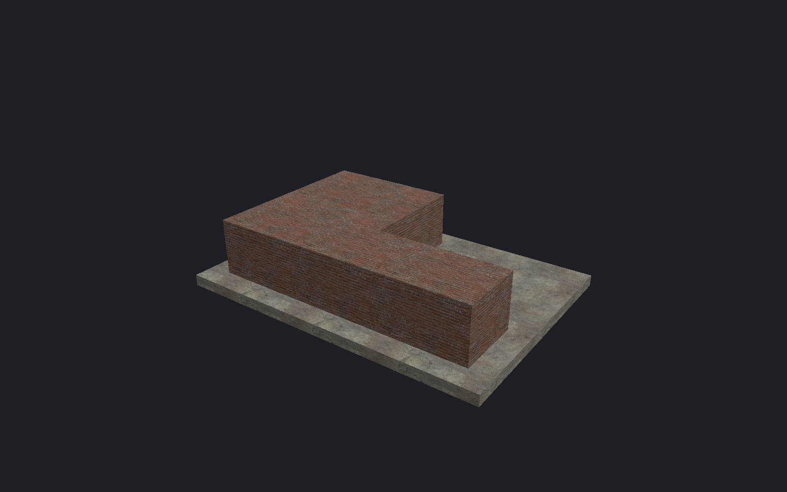

[← Manual](README.md)

# Polygon brushes

Extrude a custom outline into ordinary editable brushes.

1. Click **Draw polygon…**.
2. Choose **Plane**.
3. Set **Start** and positive **Depth**.
4. Click the corners in boundary order.
5. Set **Snap corners to grid** as required.
6. Choose **Material**.
7. Click **Preview polygon**.
8. Inspect the result with **Frame preview**.
9. Click **Create brushes**.

The last corner connects to the first automatically. Do not repeat the first corner.
Use **Undo corner**, **Clear outline** or the coordinate list to correct the outline.
**Cancel** discards the preview.

## Limits

- 3–64 distinct corners; depth at least 0.125 units.
- Geometry must stay within ±65536 units.
- Crossing edges, touching nonadjacent edges and collinear corners reject.
- Concave outlines become separate convex brushes.
- Holes, curves and oblique drawing planes are unavailable.
