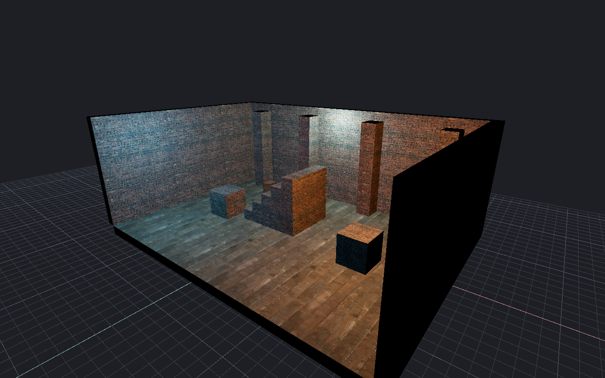

[← Manual](README.md)

# Portable VMFs

Keep a map and its custom assets in one `.vmf`. Open mounts the assets before
configured content. The recipient still needs the required base game.

## Attach assets

1. Open a map. Select **File → Portable map…**.
2. Leave **Operation** at **Attach assets to current map**.
3. If needed, enter an explicit **Companion BSP**. Its complete PAK is imported.
   HammeRR never chooses a BSP from the VMF name.
4. Under **Content folders**, enter asset roots, one full path per line.
   Each root contains folders such as `materials` and `models`. The first root wins.
5. Select **Attach assets**, then use **File → Save**.

HammeRR follows material includes, textures, sky faces, model companions and
model materials, rope materials, sound cues and files, color lookup tables and
the declared material-emission file. Surface registries and their selected sound
cues are retained; custom preloaded sound scripts include all declared waves. Required custom resources from configured mounts are included.
Assets that match official installed game VPKs stay base-game dependencies.
Explicitly imported BSP assets are retained, including unused files.

Source order on refresh is: chosen folders, chosen BSP, retained package,
configured content. Save and Compile refresh these dependencies. Unchanged
compressed data is reused. A failed refresh leaves the previous file intact.

Attach changes the content attachment. Geometry Undo retains attached assets.
Selected import paths belong to the current session. The VMF carries asset bytes,
not paths to the sender's computer. Reopen uses the retained package.

## Send a copy

1. Select **File → Portable map…**.
2. Set **Operation** to **Save portable VMF copy**.
3. Leave **Source VMF** blank to use the open map, or enter a source VMF path.
4. Enter a different `.vmf` path in **Destination**.
5. Choose import sources if needed. Select **Save portable copy**.

The source and open document stay unchanged. Normal **Open** and **Save** need
no package switches. A package error refuses the operation.

## Use Hammer or an external compiler

1. Set **Operation** to **Export plain VMF**. Enter a different `.vmf`
   **Destination**, then select **Export**.
2. Set **Operation** to **Export assets ZIP**. Enter a `.zip` **Destination**,
   then select **Export**.
3. Extract the ZIP into a content root used by the external tool.
4. Open or compile the plain VMF with that root mounted.

The portable file is VMF text with a versioned `hammerr_assets` root block.
Hammer and external compilers do not mount this block. Some readers skip unknown
blocks; others can reject them or discard them on save. Payload retention through
Hammer is not supported. Use the plain export for external editing or builds.

## Limits

- Version 1 uses a SHA-256 checked, DEFLATE-compressed ZIP with base64 chunks.
  Open validates paths, ZIP checksums, counts and sizes before extraction.
- At most 4096 custom files, 16 MiB per file, 64 MiB decoded data and 64 MiB ZIP
  data. A VMF is limited to 160 MiB. Up to 32 import folders are accepted.
- Portable paths use lowercase printable ASCII, including spaces. Windows
  forbidden characters, trailing dots/spaces, reserved names, unsafe paths and
  case collisions refuse the package. Content lives under `materials`, `models`,
  `sound`, `scripts`, `particles`, `resource` or `maps`; root `.vbsp`/`.rad` files
  are also accepted.
- External VMF instances, external model animation/includes, custom particle
  files, choreography, resource files, dynamic scripts, ambiguous sound cues
  and sound-script include/base directives, dynamic `$gender` sound paths,
  VTX LOD material replacements and unsupported dynamic material dependencies
  refuse sharing explicitly.
- Collection requires loaded definitions for each entity class.
- Opening a portable VMF does not repair invalid map geometry or model data.
  Included bytes do not guarantee that the editor supports every rendering effect.
- Assets use a private local cache. Installed game files are never changed.
  No base-game redistribution rights are implied.

<!-- page-nav -->

---

[← Open documents](open-documents.md) · [Manual](README.md) · [History →](history.md)
