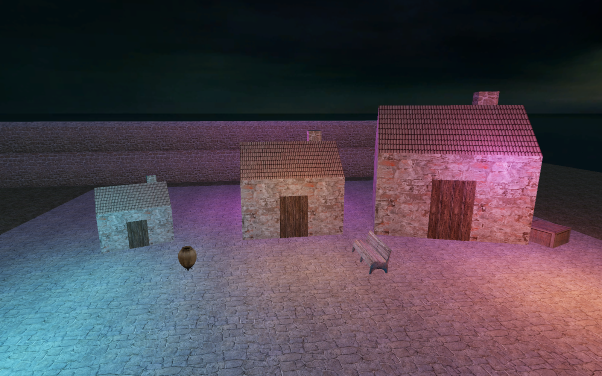

[← Manual](README.md)

# Prefab library

Save and reuse brush/entity assemblies as VMF files.

## Save an assembly

1. Select whole objects.
2. Open **Prefabs…**.
3. Click **Save selection…**.
4. Enter **Prefab name**.
5. Click **Save prefab**.

## Browse previews

1. Type in **Search names, categories and tags**.
2. Choose **Flat** or **Textured**.
3. Click **Render page**.
4. Select a card.

Use **Previous** and **Next** for other pages.
**Refresh thumbnail** rereads the current preview.
Unavailable materials remain reported.

Use **All categories**, **Uncategorized** or **Exact category** to filter the library.
Enter required tags under **Required tags · one per line**. Each tag must match.
Search also matches categories and tags.

## Organize an assembly

1. Select a prefab.
2. Click **Category and tags…**.
3. Enter **Category** and **Tags · one per line**. Leave Category blank for Uncategorized.
4. Click **Save category and tags**.

Categories and tags stay with the library VMF. Rename keeps them.
**Cancel** leaves the file unchanged.

## Replace saved content

1. Select the new assembly objects in the map.
2. Open **Prefabs…** and choose the saved entry.
3. Click **Replace selected…**.
4. Review the entry name, then click **Replace prefab**.

Replacement keeps the name, category and tags. Placed copies stay unchanged.
Library edits are separate from map Undo. **Cancel** preserves the saved assembly.
If the source file changes, refresh the library and review it again before editing.

## Place an assembly

1. Select the prefab.
2. Set **Placement position · world units**.
3. Set **Rotation · world XYZ degrees**.
4. Set **Scale · positive XYZ factors**.
5. Choose **Source origin** when the VMF origin must align with the destination.
6. Review external links.
7. Click **Preview placement…**.
8. Inspect the shared paste preview.
9. Click **Apply paste**.

Cancel discards only the pending placement.
Use **Rename…** or **Delete prefab…** to manage the library.

> [!WARNING]
> **Delete prefab…** removes the VMF from the library and is not part of map Undo. Review the selected name before confirming. Placed copies stay in the map.

## Limits

- 128 VMFs, 8 MiB per file and 64 MiB total.
- Plain point origins follow XYZ factors. Authored MDL models require uniform factors and supported native `modelscale` from 1/64 to 64.
- Static/detail model resizing, nonuniform model deformation and non-MDL model scaling are unsupported.
- One category: 48 UTF-8 bytes. Up to eight unique tags: 32 bytes each.
- Bad metadata remains visible and deletable. Filters report incomplete matches when metadata is unavailable.
- Unsupported references follow the [clipboard rules](clipboard.md#references).
- Thumbnails show supported editor geometry, not compiled game lighting.
- A changed file requires a new preview before Apply.

<!-- page-nav -->

---

[← Overlays](overlays.md) · [Manual](README.md) · [Cut, copy and paste →](clipboard.md)
