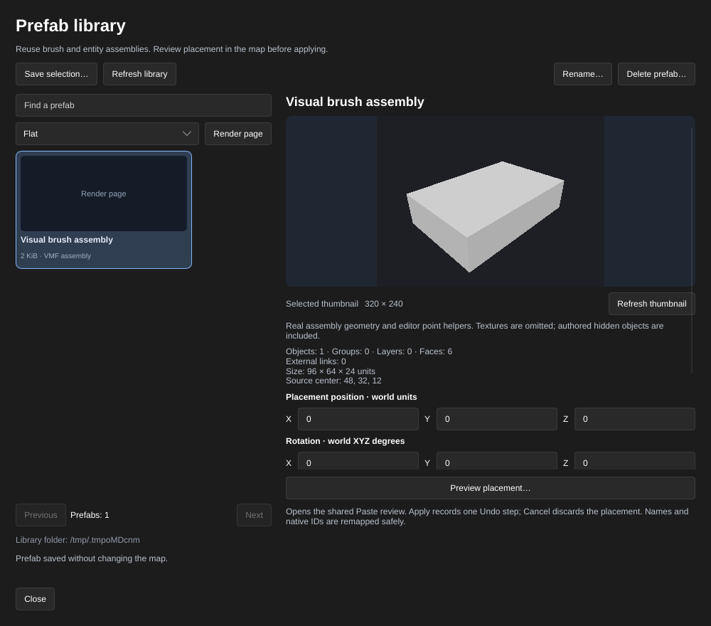
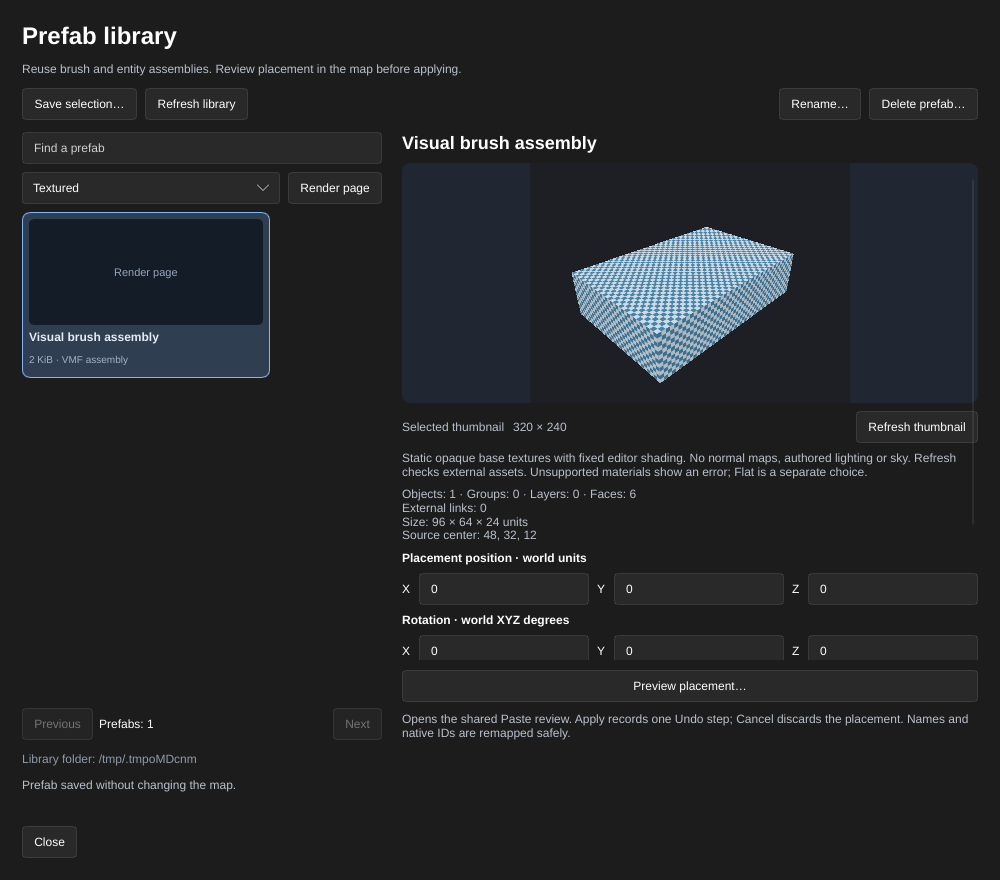
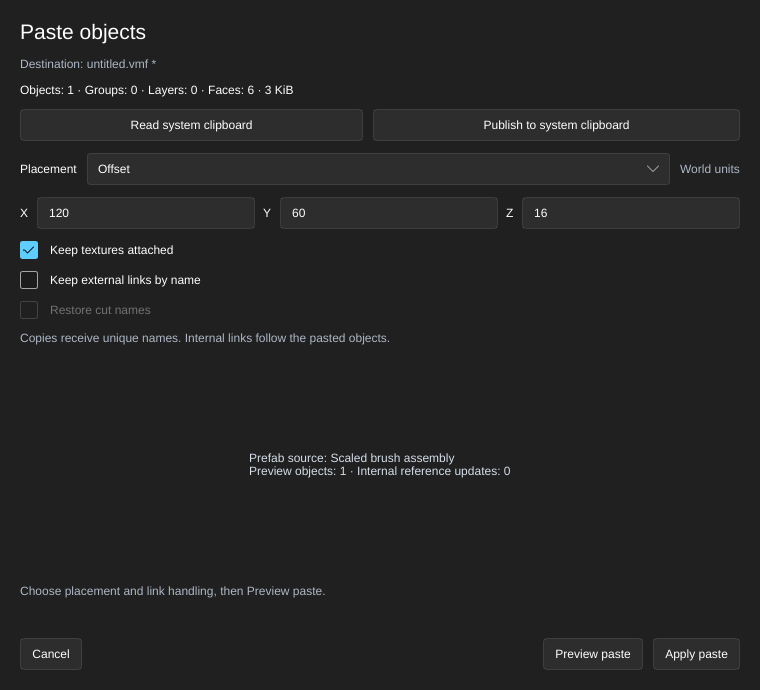
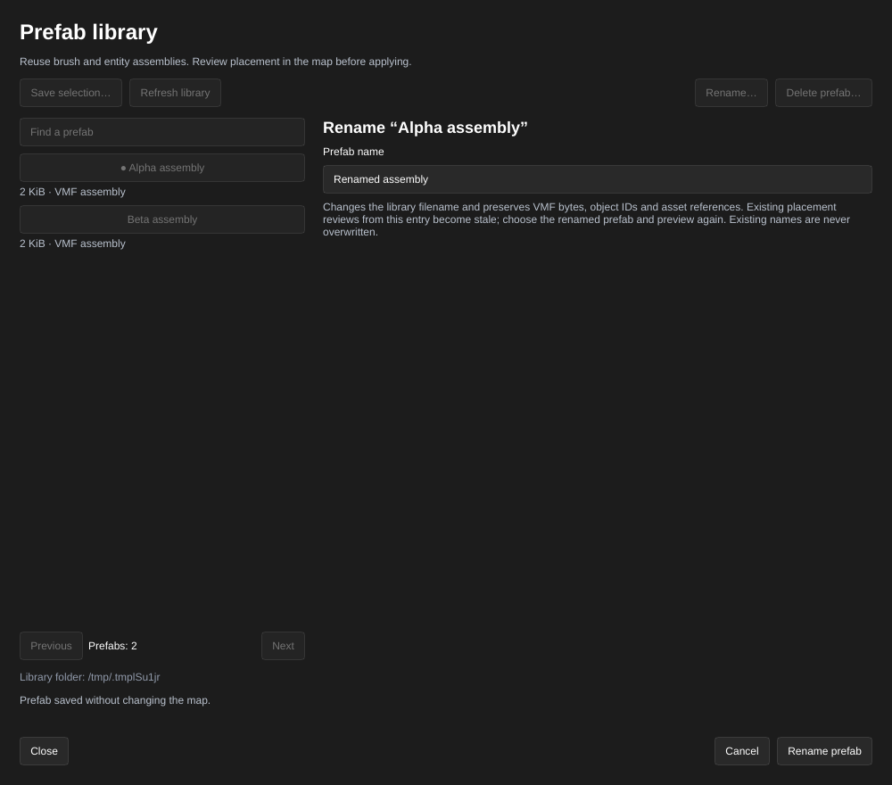

[← Manual](README.md)

# Prefab library

Save brush and entity assemblies for reuse across maps. Prefabs are portable VMF
files; placement uses the same checked preview, naming and Undo behavior as Paste.

## Save an assembly

1. Set **Selection** to **Objects**, then select the brushes and entities to keep.
2. Open **Prefabs…** in the inspector and choose **Save selection…**.
3. Enter a **Prefab name** and click **Save prefab**. The library creates a new
   VMF file without changing the map, selection, clipboard or map Undo. Existing
   names are never overwritten. **Cancel** or Escape discards the form.
4. Use **Find a prefab** to search names. **Previous** and **Next** page results;
   **Refresh library** reads changes made outside the editor. Sessions attached
   to one application share the catalog; each keeps its own selected entry,
   placement review and thumbnails. Library changes do not edit the map.

## Browse assembly previews

1. Open **Prefabs…** and use **Find a prefab** to filter the cards.
2. Choose **Flat** or **Textured** in the style menu above the cards, then click
   **Render page**. Up to eight assemblies render on the current page. An entry
   that cannot render shows its error; other entries can still have images.
3. Use **Previous** or **Next** to change pages, then **Render page** again.
   Changing the filter or style also clears the previous page's images.
4. Choose a card to inspect its details and placement settings. Cards also
   support keyboard focus and Enter or Space. **Render thumbnail** switches to
   the selected assembly's larger preview.

## Inspect an assembly's shape

1. Choose an entry in **Prefab library**. Counts and source diagnostics are
   available immediately, including when graphics are unavailable.
2. Leave the style menu above the cards set to **Flat**, then click **Render
   thumbnail**. The 320 × 240 image shows actual brush, terrain and model geometry with editor
   point helpers. Flat includes authored hidden objects and omits textures and
   sky. Inspection and rendering preserve the map, selection, clipboard, camera,
   active placement review and Undo.
3. Choose **Textured** to inspect supported base textures. The image clears when
   the mode changes; click **Render thumbnail** to request that mode's pixels.
   Textured uses fixed editor shading and includes hidden geometry. It excludes
   normal maps, authored lighting, sky and material effects. Missing or unsupported
   assets show a diagnostic and no image. Repair the assets and retry **Render
   thumbnail**, or choose **Flat** explicitly to inspect geometry without them.
4. Click **Refresh thumbnail** to regenerate the current mode's pixels from
   current assets. Cached Flat and Textured images are separate. **Refresh library**
   checks external VMF edits; changed, removed or invalid sources clear the old
   image and show a diagnostic. Missing models and referenced instances produce an
   explicit error without a substitute image.

## Place an assembly

1. Choose a prefab to inspect its object, group, layer and face counts, size,
   source center and outgoing-link count.
2. Enter X, Y and Z under **Placement position · world units**. With the default
   **Source pivot** of **Bounds center**, this moves the original authored bounds
   center to that position.
3. Enter **Rotation · world XYZ degrees** and **Scale · positive XYZ factors**.
   Scale applies first, then rotation about the source pivot. Defaults of zero
   degrees and factors of one retain centered placement. Nonidentity scale
   requires an assembly containing only brushes or brush entities.
4. Choose **Source origin** to place the source VMF's origin at the destination,
   or **Custom** and enter source-world X, Y and Z. The chosen source pivot moves
   to **Placement position**; it remains fixed while scaling and rotating.
5. Enable **Keep external links by name** if outgoing links should connect to
   named objects in the destination map. Otherwise those links prevent preview.
6. Click **Preview placement…**. The shared **Paste objects** window shows the
   placement, generated names and exact external targets/matches. Review the map
   and this information before choosing **Apply paste**.
7. **Cancel**, Escape or closing Paste discards that owned placement. **Apply
   paste** records one Undo step and selects the pasted objects.

Textures remain attached through scale, rotation and placement. Point-entity
origins and supported Source orientation fields rotate together; models retain
their existing authored scale. The detached clipboard contains the transformed
assembly. Paste's **Offset** adds a world translation to that prepared geometry;
return to **Prefabs…** to change its rotation, scale or source pivot.

Required native groups and layers receive fresh IDs, supported internal links
follow new unique names, and object notes remain attached. The prefab file and
source map are unchanged. An already loaded preview remains usable if its library
file is subsequently deleted. Renaming or replacing its source file marks the
review stale: choose the current library entry and preview again before applying.

## Rename a library entry

1. Choose an entry and click **Rename…**.
2. Edit **Prefab name**. The existing name is prefilled; letters, numbers, spaces,
   dashes and underscores use the same limits as Save. Case-only changes are
   allowed. An existing name, including a case variant, cannot be overwritten.
3. Click **Rename prefab**. **Cancel**, Escape or closing the window keeps the
   original filename. Refreshing the library cannot renew an already open form;
   after a stale-state error, cancel and start **Rename…** again.
4. Choose the renamed entry and use **Preview placement…** to replace any older
   Paste review from that entry.

Rename changes only the library filename. VMF bytes, object/face/group/layer IDs
and external asset references stay intact. Map geometry, selection, clipboard
payload and Undo remain unchanged. Library changes are separate from map Undo.

## Delete a library entry

1. Choose an entry and click **Delete prefab…**.
2. Review its name, then click **Delete prefab**. **Cancel** keeps the file.

Deletion removes only that library VMF. Placed map copies remain. Library file
operations are separate from map Undo.

## Limits

- Up to 128 VMFs, 8 MiB per file and 64 MiB total; directory scans stop at 512
  entries. Names use 1–80 UTF-8 bytes of letters, numbers, spaces, dashes or
  underscores, without surrounding whitespace. Symlink roots/entries are refused.
- Storage defaults to `prefabs/` within the editor's recovery/state folder,
  normally `~/.local/state/hammerr/recovery/prefabs`. `HAMMERR_PREFABS_DIR` selects
  another absolute folder. The window reports the active folder. Independent
  editor instances and external writers are not coordinated; changed file
  metadata invalidates older actions. Refresh after edits made outside the editor.
- Reviews bind the physical library directory, including the existing ancestor
  when the folder is initially absent. Replacing the directory or retargeting a
  parent alias requires **Refresh library** and a new action review. Operations
  retain their directory handle through publication. If verification fails after
  a write commits, the library reports that committed write; inspect the files
  before repeating the action. Independent writers remain uncoordinated.
- Bound library file operations require Linux.
- Capture and placement retain [clipboard limits](clipboard.md#limits), including
  16 top-level sources, checked references, metadata budgets and coordinate bounds.
  Component-only copies, saved partition intents and private Hammer formats remain
  unsupported. Source world settings, map/region notes and cameras are excluded.
- Rotation and source-pivot values must be finite and within ±65536. Scale factors
  must be finite and strictly positive. Prepared geometry, final geometry and the
  world placement offset must fit the editor's ±65536 coordinate bounds.
- Nonidentity scale rejects point/model entities. Rotation/scale reject opaque
  entity blocks and unknown brush, face or displacement fields/blocks, plus
  unsupported spatial entity properties such as `movedir`, FGD vectors/axes and
  ambiguous vector-like custom values. Brush-entity orientation fields are also
  refused. Ordinary centered translation preserves the existing clipboard
  metadata policy. Invalid placement retains the previous clipboard and preview.
- Assets remain external references. Mount the required game/custom content;
  the library does not package textures or models.
- Thumbnails render one selected entry on request and cache at most eight
  320 × 240 images across both modes. Every retrieval rechecks exact source bytes,
  file identity and content/FGD settings. Limits are 2 MiB source text, 128 brushes, 1024 sides,
  64 sides per brush, 65536 displacement vertices, eight model paths, sixteen
  model instances, 64 material bindings, 200000 vertices and 600000 indices.
  Larger valid assemblies can still use ordinary placement. Use **Model details…**
  → **Reload models** after repairing external model files. Graphics
  failures retain CPU inspection and can be retried with **Render thumbnail**.
- Textured supports opaque single-base LightmappedGeneric, UnlitGeneric and
  VertexLitGeneric materials with an identity base transform. Proxies/fallback
  blocks, detail/second layers, tint, tool/sky and translucent/alpha-test materials,
  and substituted editor images are unsupported. Textures must have one 2D LDR
  frame, opaque pixels and axes no larger than 2048. Supported formats are RGB,
  BGR, RGBA, BGRA8888 and DXT1/3/5. Point/clamp/border, normal/SSBump, procedural
  and render-target textures are refused. Normal/specular and other material
  effects are not evaluated; the image does not claim native game pixel parity.
- Textured reads at most 1 MiB per VMT/Patch and 16 MiB per VTF, with a 64 MiB
  admission/revalidation read budget per pass, 64 MiB of decoded mip data,
  256 asset sources and 1024 physical source paths. Initial source-identity
  verification has a separate 80 MiB read bound. Cached images check SHA-256,
  winning mounted sources and backing-file identities, including Patch includes.
  External source changes clear the affected Textured image and require a new
  render. Flat remains independent. Model geometry retains the existing explicit
  **Reload models** policy.
- Rename requires Linux and a filesystem supporting atomic no-replace rename;
  unsupported operations fail without a copy/delete fallback. Independent writers
  can still race source-file changes after snapshot validation; existing targets
  are never overwritten. Preview source identity/size/mtime changes are checked
  before Apply, including changes made by another Session.
- The gallery renders only the requested page, with at most eight images.
  Graphics start on an explicit render. **Refresh library** checks external
  source changes; stale page images clear before another render. Rendering a
  selected thumbnail clears the page images, retaining the same eight-image cap.
- Direct replacement from selection,
  local-frame placement, referenced instances and linked editing are unavailable.
  Applied copies can be transformed independently through the normal controls.
