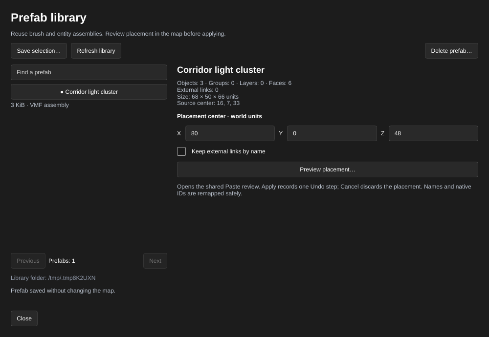

[← Manual](README.md)

# Prefab library

Save brush and entity assemblies for reuse across maps. Prefabs are portable VMF
files; placement uses the same checked preview, naming and Undo behavior as Paste.

## Save an assembly

1. Set **Selection** to **Objects**, then select the brushes and entities to keep.
2. Open **Prefabs…** in the inspector and choose **Save selection…**.
3. Enter a **Prefab name** and click **Save prefab**. The library creates a new
   VMF file without changing the map, selection, clipboard or map Undo. Existing
   names are never overwritten. **Cancel** or Escape discards the form.
4. Use **Find a prefab** to search names. **Previous** and **Next** page results;
   **Refresh library** reads changes made outside the editor.

## Place an assembly

1. Choose a prefab to inspect its object, group, layer and face counts, size,
   source center and outgoing-link count.
2. Enter X, Y and Z under **Placement center · world units**. This positions the
   center of the assembly's authored bounds at that point.
3. Enable **Keep external links by name** if outgoing links should connect to
   named objects in the destination map. Otherwise those links prevent preview.
4. Click **Preview placement…**. The shared **Paste objects** window shows the
   placement, generated names and exact external targets/matches. Review the map
   and this information before choosing **Apply paste**.
5. **Cancel**, Escape or closing Paste discards that owned placement. **Apply
   paste** records one Undo step and selects the pasted objects. Later transforms
   use the ordinary editor controls.

Required native groups and layers receive fresh IDs, supported internal links
follow new unique names, and object notes remain attached. The prefab file and
source map are unchanged. An already loaded preview remains usable if its library
file is subsequently deleted.

## Delete a library entry

1. Choose an entry and click **Delete prefab…**.
2. Review its name, then click **Delete prefab**. **Cancel** keeps the file.

Deletion removes only that library VMF. Placed map copies remain. Library file
operations are separate from map Undo.

## Limits

- Up to 128 VMFs, 8 MiB per file and 64 MiB total; directory scans stop at 512
  entries. Names use 1–80 UTF-8 bytes of letters, numbers, spaces, dashes or
  underscores, without surrounding whitespace. Symlink roots/entries are refused.
- Storage defaults to `prefabs/` within the editor's recovery/state folder,
  normally `~/.local/state/hammerr/recovery/prefabs`. `HAMMERR_PREFABS_DIR` selects
  another absolute folder. The window reports the active folder. Independent
  editor instances and external writers are not coordinated; changed file
  metadata invalidates older actions. Refresh after edits made outside the editor.
- Capture and placement retain [clipboard limits](clipboard.md#limits), including
  16 top-level sources, checked references, metadata budgets and coordinate bounds.
  Component-only copies, saved partition intents and private Hammer formats remain
  unsupported. Source world settings, map/region notes and cameras are excluded.
- Assets remain external references. Mount the required game/custom content;
  the library does not package textures or models.
- Isolated thumbnails, direct replacement/renaming, local/rotated/scaled placement,
  referenced instances and linked editing are unavailable. Applied copies can be
  transformed independently through the normal controls.
