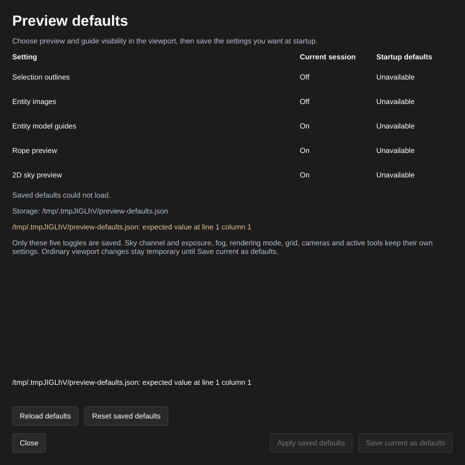

[← Manual](README.md)

# Preview defaults

Save the viewport images and guides you want at startup, while keeping ordinary
viewport changes temporary.

1. In the inspector's **Viewport** section, choose **Selection outlines**,
   **Entity images**, **Entity model guides**, **Rope preview** and **2D sky
   preview** as desired.
2. Open **Preview defaults…**. Compare **Current session** with **Startup
   defaults** for the five settings.
3. Click **Save current as defaults** to use the current values at future
   startups. This does not change the map or Undo history.
4. Click **Apply saved defaults** to use the saved values now. Finish active
   previews, viewport tools, builds and game launches first.
5. After editing the preferences file outside the editor, click **Reload
   defaults**. Reload reads the file without applying it.
6. **Reset saved defaults** writes factory values: selection outlines, entity
   images and entity model guides on; rope and sky previews off. Click **Apply
   saved defaults** to use them now. **Close** or Escape closes the window.

Limits:

- Only these five switches are saved. Sky channel and exposure, fog, viewport
  mode, tool filters, cameras, navigation and active tools are independent.
  [Grid defaults](basics.md#grid-and-snapping) have their own controls.
- Ordinary viewport changes and temporary MCP renders never save automatically.
  Apply preserves unrelated view settings, selection, camera and map data.
- Unreadable or malformed storage shows **Preview defaults… · needs attention**.
  The window shows its path and error. Save and Apply remain unavailable until
  Reload succeeds or you explicitly Reset the saved defaults.
- Files are limited to 4096 bytes. Symlinked and nonregular targets reject,
  including on Reset. Outside replacement or deletion rejects stale actions;
  reload and inspect before trying again. Independent writers do not lock the
  file, so a write can still race after the final check.

