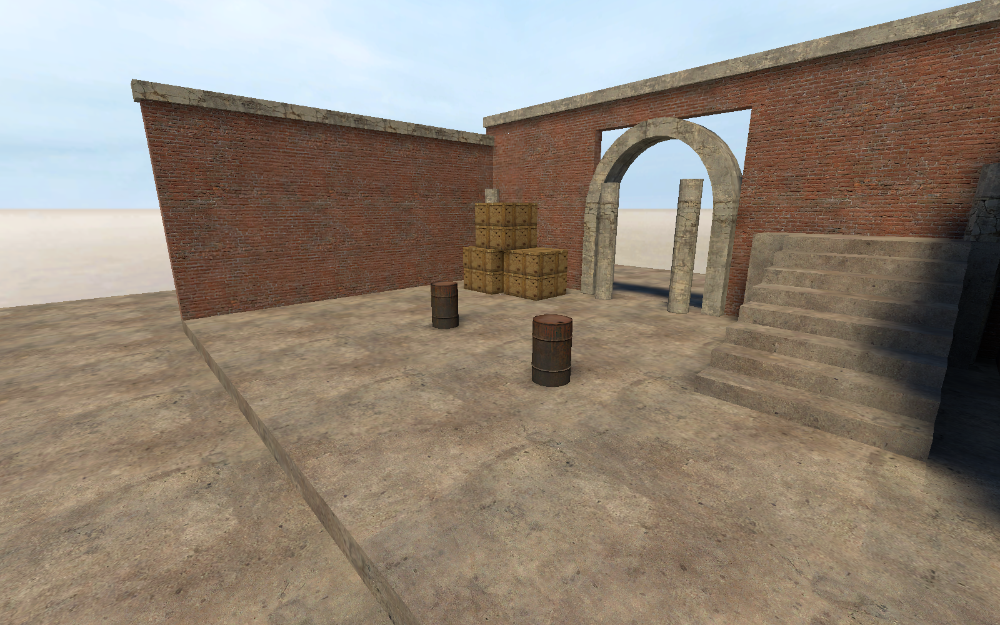

[← Manual](README.md)

# Static-prop mesh shadows

Use static model triangles to block baked light.

1. Place a compatible `prop_static` with **Entity…**.
2. Choose its model through **World Model → Browse…**.
3. Open **Build settings…**.
4. Choose **Direct LDR** or **Direct LDR + HDR**.
5. Compile, then inspect **Prop mesh shadows** and **Diagnostics**.

Texture shadows require a model compiled with `$casttextureshadows`.
Flagged models can use supported alpha-tested or translucent texture shadows.
For RGB transport through admitted fractional prop textures, enable **Brush texture shadows**
and [**Colored texture shadows**](brush-texture-shadows.md#colored-texture-shadows) in a lit build.
Unsupported requested texture-shadow effects fail the build.
Unflagged models cast opaque triangle shadows and report approximation warnings for unevaluated transparency.

The build records the model, mesh files, materials and alpha textures read for
these shadows. If a source or its lookup changes, the old build cannot replace
the BSP or start through **Play built map**. This check also applies when vertex
lighting and asset packing are off. It covers the sources used by the build.

For finite-area material emission, enable [**Exact emission visibility**](material-emission.md#exact-brush-shadows)
to resolve supported cutout, scalar and RGB fractional coverage on the actual
two-sided mesh triangles. Each independent primitive crossing adds coverage with
saturation per channel. The original model texture-shadow request remains required.
The shared prepared sampler, gamma 2.2 RGB conversion, nearest mip0 clamp/repeat
and strict endpoints remain unchanged.

The original emitting triangle plane automatically selects native analytic
integration for axial planes or bounded rational-domain edge integrals for
oblique planes. Source geometry and shadow points stay unchanged; no extra
control is required. **Build details…** shows the native conversion bound, per-channel
rational numerical bounds, cells and raw work. See the [integration limits](material-emission.md#exact-brush-shadows).

## Limits

- Static LOD0 geometry only; runtime animation is not baked.
- Material, texture format and transform support is bounded.
- **Disable Shadows** excludes the prop from this shadow path.
- Shadow support does not imply vertex-lighting or asset-packing support.
- Exact emission refuses uncertified positive-area nonbinary coplanar mask overlaps. Existing source, geometry, work, memory and error limits remain; failures do not switch to sampled tracing.
- This page describes compiled shadows. The editor's authored-lighting preview is unshadowed.

<!-- page-nav -->

---

[← Static props](static-props.md) · [Manual](README.md) · [Brush texture shadows →](brush-texture-shadows.md)
