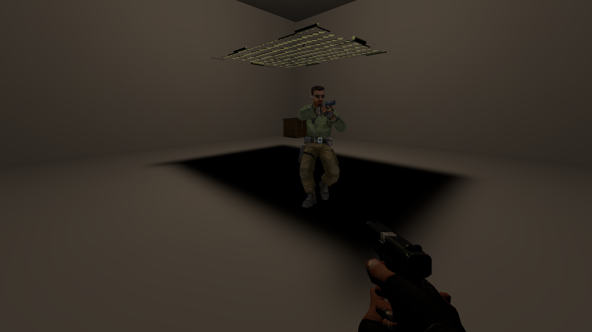

[← Manual](README.md)

# Static-prop mesh shadows

Direct LDR and Direct LDR + HDR trace a static prop's actual model triangles. Open space in a model stays open to light even when it lies inside the model's render or collision bounds. Models authored with `$casttextureshadows` also support binary alpha-test cutouts and fractional translucent texture shadows. Shadow casting is independent of the prop's collision choice.

The separate default-off [Brush texture shadows](compile-and-play.md#brush-texture-shadows)
setting controls supported world/detail brush cutouts and admitted initial-pose
brush-model self shadows. It does not change a model's `$casttextureshadows`
request or prop shadow behavior.

1. Click **Entity…**, choose `prop_static`, then **Place entity**. Use **Browse…** beside **World Model** to choose its model and skin. Keep `disableshadows` at `0` to let it cast shadows.
2. Click **Build settings…**, set **Build lighting** to **Direct LDR** or **Direct LDR + HDR**, and choose **Direct only** or the desired number of diffuse bounces under **Indirect light**.
3. Click **Close**, then **Compile**.
4. Open **Build details…**. **Prop mesh shadows** reports the contributing props, triangle count, disabled props, alpha-texture triangles and alpha textures. Read **Diagnostics** for unsupported material behavior or missing assets.

Point lights, spotlights, sun, sky ambient, diffuse bounce rays and model ambient probes share the same opaque, alpha-test or fractional mesh visibility. Brush, terrain, brush-entity, detail, model-ambient and supported baked-prop receivers use the same transfer. The native `disableshadows` property disables them; hidden props are omitted. The selected skin determines the shadow material. Fullbright does not load shadow meshes or alpha textures.

Texture shadows require the model's native `CAST_TEXTURE_SHADOWS` flag, set when the model is compiled with `$casttextureshadows`; there is no separate editor toggle. For flagged models, selected-skin **VertexLitGeneric** and **UnlitGeneric** materials with `$alphatest` enabled use `$basetexture` alpha. Supported ordinary opaque materials keep opaque shadows. Requested unsupported texture-shadow behavior fails the build with an entity-specific diagnostic and preserves the previous BSP.

## Translucent texture shadows

1. Choose a model compiled with `$casttextureshadows` whose selected **VertexLitGeneric** or **UnlitGeneric** material has `$translucent 1` and a supported `$basetexture` alpha channel. Leave `$alphatest` off and `$alpha` absent or exactly `1`.
2. Keep the prop's `disableshadows` at `0`, then compile with either lit mode. No extra build switch is needed; the model resource requests texture evaluation.
3. Read **Prop mesh shadows** and **Diagnostics** in **Build details…**. The existing alpha counters include both cutout and translucent texture triangles. Unsupported requested materials fail the build rather than casting a substituted shadow.

Each intersected triangle contributes its sampled alpha byte to a saturating coverage sum. Light visibility is `(255 − min(255, sum))/255`: one alpha-64 hit leaves 191/255 of the light, alpha-64 plus alpha-128 leaves 63/255, and two alpha-128 hits block it. This is a two-sided triangle-coverage policy, not multiplication of independent glass sheets. Direct light, directional maps, sun/sky samples, reflected styles and ambient gathers apply that visibility before encoding.

The images below illustrate the existing binary cutout mode:

| Opaque mesh shadows | Alpha-test cutouts |
| --- | --- |
|  |  |

Agents use `set_compile_settings` with `lighting: "direct_ldr"`, then `compile_map` or `start_compile`. Build results expose `prop_shadow_props`, `prop_shadow_models`, `prop_shadow_triangles`, `prop_shadow_disabled` and `prop_shadow_work`; the last is preparation work, included in total `lighting_work`. Texture-shadow results add `prop_shadow_alpha_triangles`, `prop_shadow_alpha_materials`, `prop_shadow_alpha_textures` and `prop_shadow_alpha_bytes`. These count transformed alpha-texture triangles, selected material slots per model, unique VTF masks and their decoded alpha bytes. The CLI uses the same compiler behavior.

## Limits

- MDL versions 44/48, VVD version 4 and DX90 VTX version 7 use the shared bounded model decoder. Shadows use LOD0, body 0 and the native translation/rotation. Static-prop scaling and nonzero bodygroups are unsupported.
- All shadow triangles are two-sided. Models without `CAST_TEXTURE_SHADOWS` retain opaque shadows and existing approximation warnings for alpha/translucent/additive materials, unsupported shaders, material animation/conditional blocks and missing materials. Missing or malformed mesh files fail the build instead of substituting a bounding box.
- Cutout rays interpolate triangle UVs, then sample mip 0 with nearest texels. VTF clamp S/T flags clamp each axis; other axes repeat. `$alphatestreference` accepts 0–1. An absent reference uses 0.5 for VertexLitGeneric and 0.7 for UnlitGeneric; explicit zero uses 0.5. Alpha equal to or above the reference blocks light. Binary cutouts retain their threshold behavior; translucent materials use the separate coverage rule above. Filtered edges and bitwise native VRAD ray/sampling parity are not provided.
- Cutout and translucent `$basetexturetransform` support finite **center**, **scale**, **rotate** in degrees and **translate**, with each authored value within ±1024. Scale applies about the center before rotation, followed by translation; negative scale mirrors an axis. Sampling follows the existing nearest-texel clamp/repeat rules. Matrix calculations use compiler precision, so native floating-point agreement exactly on texel edges is not promised. Nonzero `$frame`, animated/cubemap/volume textures, missing or corrupt requested assets and unsupported opacity parameters fail explicitly. Additive effects, vertex/distance alpha, scalar alpha modulation and material animation/conditional blocks are unsupported for requested texture shadows. Translucent mode requires `$translucent 1`; combining it with alpha test or declaring `$alphatestreference` is refused. Its bounded plain-material allowlist also excludes additional shader effects. Self-illumination, base-alpha environment masks, seamless projection and additional material effects are unsupported for cutouts.
- Distinct intersected triangles count separately, including entry/exit surfaces, overlapping owners and shared-edge hits admitted by the triangle intersection rules. No per-sheet deduplication, tinted transmission, refraction or brush/terrain translucency is provided.
- Props attenuate bounced and ambient rays but do not reflect light as sources. [Baked prop vertices](compile-and-play.md#static-prop-vertex-lighting) support a separate opaque-receiver scope. A translucent caster must opt out with `disablevertexlighting: 1` if that build option is enabled. Per-texel baking and animated-prop shadows remain unavailable.
- Ambient probe positions avoid each shadow-casting prop's mesh bounds. This conservative placement can exclude open space inside large or concave bounds; leaves without a safe candidate produce a diagnostic.
- At most 262,144 transformed prop triangles and 256 MiB of model/texture input are accepted per build. Individual asset files are limited to 64 MiB; material files to 64 KiB, with at most eight patch includes and 65,536 material lookups. Alpha textures are limited to 4096 pixels per axis and 64 MiB of decoded alpha across the build. Mesh preparation, alpha decoding and ray traversal share the configurable [lighting work allowance](compile-and-play.md#build-settings).
- A failed or cancelled build preserves the previous BSP. Disable shadows on decoration that does not need them to reduce work.
