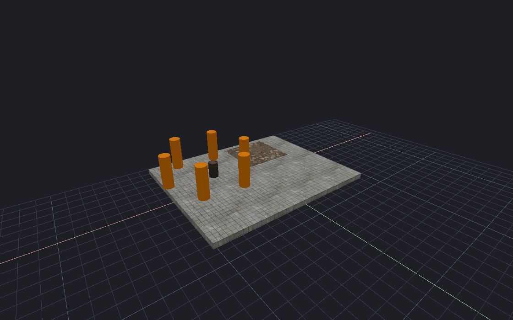

[← Manual](README.md)

# Recent maps

Reopen a map with its remembered content, entity definitions, build settings and game paths.

1. Choose **File → Recent maps…**.
2. Select a map. Review its full path and **Remembered context**.
3. If needed, select **Discard current unsaved edits and drafts when opening**.
4. Click **Open selected map**. Use **Cancel operation** to stop background validation.

The map and saved context load together. A failure keeps the current map,
content and drafts. Later changes to a named profile do not change this saved context.
New edits or drafts invalidate an earlier discard acknowledgement.

## Locate a moved map

1. Select its old entry.
2. Click **Locate moved map…** and choose the existing `.vmf` file.
3. Review the new path, then click **Open selected map**.

Locate keeps the saved context. It does not move files or open the map.
Copy relative instance files and assets yourself. The selected source path
remains the base for relative references, including when it is a symbolic link.
A destination already listed under another path requires resolving that duplicate first.

## Manage the list

- **Reload saved list** reads outside changes and checks availability.
- **Remove from list** forgets the chosen entry.
- **Confirm clear list → Clear list** forgets all entries.
- **Close** closes the dialog and cancels its pending work.

These actions do not delete map files. Successful Open/Save moves the path to the front.
Changes to current content, definitions, game paths and build settings update the current map's context.

## Limits

- The list holds twenty maps. Missing maps remain listed until relocated or removed.
- Full context restoration requires an installed CS:S client. Wait for builds, managed games and content workers before restoring it.
- Old entries without content metadata keep current mounts and FGD. They restore compatible build settings only while no build is active.
- A missing or retargeted alias needs **Locate moved map…** or an explicit **Open…**.
- A storage conflict requires **Reload saved list** before another change.
- A map can save successfully even when updating its recent-list entry fails.

MCP: `get_recent_maps`, `open_recent_map`, `relocate_recent_map` and `cancel_recent_map`.

<!-- page-nav -->

---

[← Measurements](measurements.md) · [Manual](README.md) · [Content profiles →](content-profiles.md)
