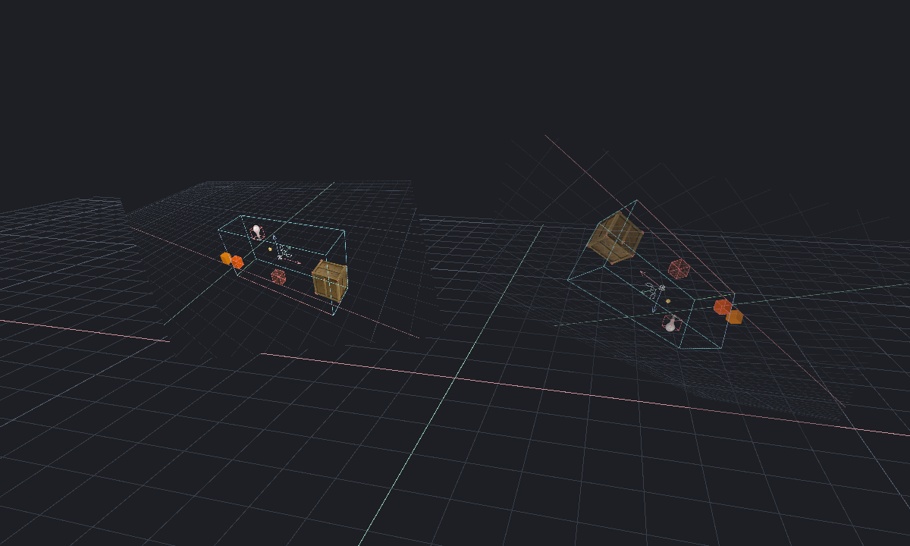

[← Manual](README.md)

# Reference images

Place external PNG images as editor-only tracing planes.

1. Open **View → Reference images…**.
2. Enter **Name** and **PNG path**, then click **Add image**.
3. Select the entry under **Reference image**. Set **Position XYZ**,
   **Rotation XYZ**, **Width / height** and **Opacity 0–1**. Separate vector values with spaces.
4. Use **Top plane**, **Front plane** or **Side plane** for standard rotations.
   Set **Flip horizontally**, **Flip vertically** and the **Show in** projections.
5. Click **Apply settings**, then save the map. **Undo** and **Redo** restore metadata.
6. Use **Frame image** to inspect the saved pose.

New images start on XY at world origin, with their original aspect, a 256-unit
longest edge and opacity 0.5. Rotation uses XYZ Euler degrees; image right is +X
and image up is +Y before rotation. Edge-on planes have no visible area.

## Update or remove an image

1. After editing a source file, choose its entry and click **Reload image**.
2. To relink it, enter the new **PNG path**, then click **Reload image**.
3. Use **Delete image** to remove the reference without deleting its source file.

Missing or changed sources show **(unavailable)** until explicit reload.
Reload preserves pose and display settings. Undo restores metadata, not external
file bytes. **Refresh list** replaces unsaved form fields; **Close** discards
unfinished form changes. Applied actions remain undoable.

## Limits

- Static PNG only, decoded to RGBA8. No animation, image editing or color-profile conversion.
- At most 8 images, 4096 pixels per axis, 4 megapixels per image, 16 megapixels total and 16 MiB per encoded file.
- Planes are two-sided, unlit, depth-tested alpha images. They are not pickable geometry or snapping targets.
- Saved absolute paths and SHA256 identities refer to external files. Copy those files separately when moving a project.
- Images never enter game geometry or automatic asset packing. Only root-document references are displayed.
- Sources are checked once per second. MCP rendering refuses unavailable images requested in its projection.
- Finish other drafts before editing references. Invalid metadata stays preserved and unavailable.
