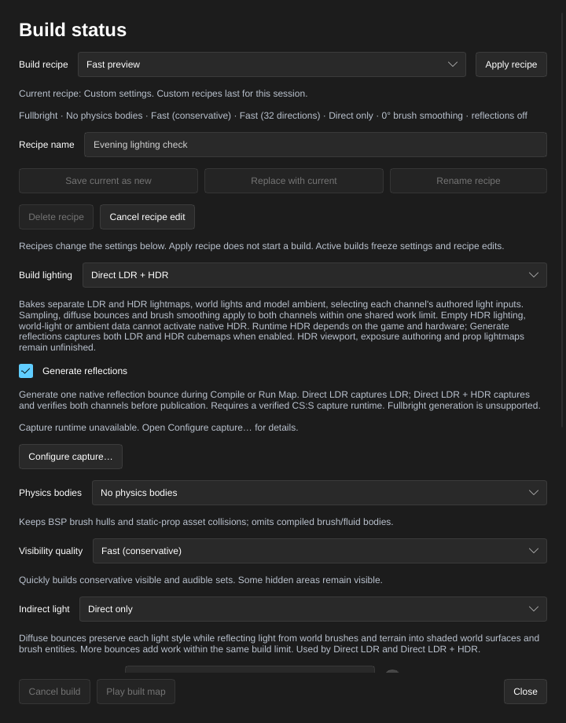
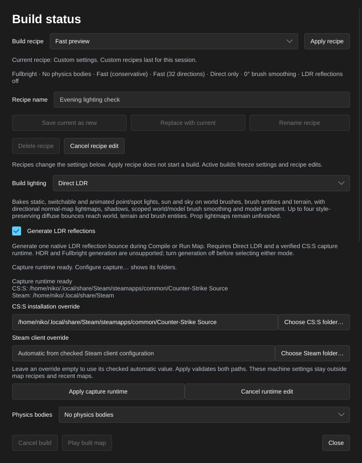

[← Manual](README.md)

# Generated reflections

Generate reflections for the map's `env_cubemap` samples as part of **Compile** or **Run Map**. One build compiles the scene, captures one reflection bounce for each requested lighting channel in private CS:S clients, verifies the packed textures, then publishes the BSP once. **Direct LDR** captures LDR; **Direct LDR + HDR** captures LDR followed by HDR. Generation starts disabled.

## Choose reflection generation

1. Place the map's `env_cubemap` entities using the entity tools and save the map. Use [Cubemap faces](cubemap-faces.md) to inspect or author face bindings.
2. Click **Build settings…**, or **Build details…** after a build.
3. Set **Build lighting** to **Direct LDR** for LDR reflections or **Direct LDR + HDR** for both channels.
4. Enable **Generate reflections**. Read the capture runtime status below it. Enabling the setting does not launch CS:S.
5. Close the window, then click **Compile** or **Run Map**. Open **Build details…** to inspect capture and verification progress. **Run Map** plays the published result after the build succeeds.
6. To stop a build, click **Cancel build** and wait for cancellation and private-client cleanup to finish.



**Fullbright** cannot generate reflections. Turn off **Generate reflections** before choosing it. Switching between **Direct LDR** and **Direct LDR + HDR** retains the generation setting. An incompatible update preserves both current values.

## Configure the capture runtime

1. In the same window, click **Configure capture…**.
2. Under **CS:S installation override**, enter an installation folder or click **Choose CS:S folder…**. Leave it empty to use the mounted game's base directory when that directory verifies as a supported CS:S installation. A custom source-content folder needs an explicit supported installation when it cannot supply this default.
3. Under **Steam client override**, enter the existing Steam client root or click **Choose Steam folder…**. Leave it empty to use the root of the unique running Steam main client. Capture validates that root's client configuration and CS:S library relationship; an override must match the running client.
4. Click **Apply capture runtime** to validate and replace both overrides together. A rejected pair leaves the current configuration and your pending text intact. **Cancel runtime edit** discards the pending text.
5. Review the resolved installation and readiness message before starting the build. If another actor changes the runtime while the form is open, cancel and reopen the form to review the new pair.

**Close**, Escape and the window close button discard pending runtime edits. A folder chooser opened by a discarded edit cannot update a later edit.

Runtime paths apply to this machine. They are separate from the source-content mounts and stay outside build recipes and recent-map settings. Configuration does not launch a game. Capture uses a private client with `-insecure` and `sv_lan 1`.



## Recipes, recent maps and agents

**Save current as new** and **Replace with current** store the generation setting with the other build values. **Fast preview** and **Final lighting** keep generation disabled. Older recipes and recent-map files load with generation disabled. Opening a compatible recent map restores its saved generation setting.

Agents use `set_compile_settings` with `lighting:"direct_ldr"` or `lighting:"direct_ldr_hdr"` and `generate_reflections:true`; both fields validate in the same update. `get_compile_settings` reports the current setting. `get_native_capture_runtime` inspects readiness, and `set_native_capture_runtime` replaces both machine overrides; omitted or null roots clear their overrides to automatic values. Existing `compile_map`, `start_compile`, `run_map`, `get_compile_status` and `cancel_compile` use the shared build job.

The command-line compiler uses the same capture and publication checks:

```sh
hammerr-compile map.vmf --game /path/to/cstrike/gameinfo.txt \
  --lighting direct_ldr_hdr --generate-reflections \
  --reflection-engine-root /path/to/Counter-Strike\ Source
```

Use `--reflection-steam-root` to provide the Steam client override. The editor and headless service accept the same machine context through `--engine-root` and `--steam-root` at startup. These paths do not change source-content mounts.

## Captured channels and publication

**Build details…** shows **LDR reflection capture** or **LDR + HDR reflection
capture**. Progress counts every channel's samples: a dual build with two
positions captures four samples. Both passes use the same helper positions,
resolutions and face assignments. The client selects LDR with `mat_hdr_level 0`
and HDR with `mat_hdr_level 2`; capture checks those controls after loading the
map. A known HDR-to-LDR fallback warning rejects the build.

HDR capture requires complete native HDR light samples, world lights and ambient
arrays. The published BSP retains both baked channels. No result is published
until all required samples, source guards and preservation checks pass; a failed
HDR pass keeps the previous output even when its LDR pass completed.

LDR textures keep their ordinary `.vtf` names; matching HDR textures use
`.hdr.vtf`. Material aliases retain their unsuffixed reflection names so the game
can select the channel. HDR packing retains the six image faces' finite,
nonnegative RGB half-float values at every mip and normalizes unused native
alpha, sphere and header data. Malformed or incomplete captures return explicit
errors. **Run Map** rebases registered names for both channels while retaining
their texture data.

The editor reserves one native activity when a reflective build leaves the
compiler queue. A queued build holds no native capacity. An occupied activity
fails that exact build before compiler work; there is no native waiting queue.
Both capture channels, verification and publication retain the same owner.
**Run Map** transfers that owner directly to its captured Play target after
capture cleanup, even when the capture and Play installations differ.

## Limits

- Generation supports one capture bounce per channel: LDR alone or paired LDR/HDR. Additional capture bounces, moving-scene reassignment and reflection preview inside the editor are unavailable. HDR playback still depends on the game setting and hardware; **HDR data ready** describes baked map data.
- A build supports 1–32 samples at distinct integer positions. Sample size `0` uses the declared 128-pixel default. Explicit cube edges up to 128 pixels are supported; 256 pixels is rejected before launch. The private capture viewport must verify as 1280×720.
- A supported CS:S installation, running Steam client, native runtime helper, Cage, grim and Bubblewrap must pass preflight. Bubblewrap needs usable Linux user namespaces. Unsupported materials, sample sizes, missing assets or unverified captures fail the build with diagnostics.
- The capture client reads external files through a read-only filesystem view. Only its owned capture directory is writable; source mounts keep their files and caches. Graphics devices and Steam IPC remain available.
- Capture rejects authored scripts, script thinkers, script entities and command-executing entity inputs. This is a conservative capture restriction; the saved VMF and published entity lump keep their authored contents. A managed game in this editor process blocks capture. The existing UID-wide capture lock still rejects captures in another process, and capture preflight retains its same-installation running-client check. Those clients are never stopped.
- Native capture keeps each private channel job within a 256 MiB file budget, including two BSP copies and 64 MiB of scratch admission. BSP staging larger than 96 MiB is rejected. Captured assets and retained diagnostics have additional limits.
- Packed generation shares a 64 MiB asset budget across both channels, with at most 1,024 material aliases and 4 MiB per captured VTF. HDR samples require VTF 7.4 RGBA16F, seven native faces and a full mip chain. A captured HDR default is optional; any extra LDR default emitted by the HDR pass is validated and reported, while the published LDR default comes from the LDR pass.
- Active builds freeze compiler settings and runtime configuration. Changing generation afterward makes a previous build stale while its saved settings differ.
- Failed, cancelled or stale generation preserves the previously published BSP. Capture does not add map Undo entries. **Cancel build** remains pending until owned processes stop and the preservation audit finishes.
- Saving the map under another filename during capture rejects publication. Compile again from its new path.
- Sample records and temporary bootstrap textures alone do not count as generated reflections. A BSP becomes available only after capture, packed-asset verification and publication succeed.
