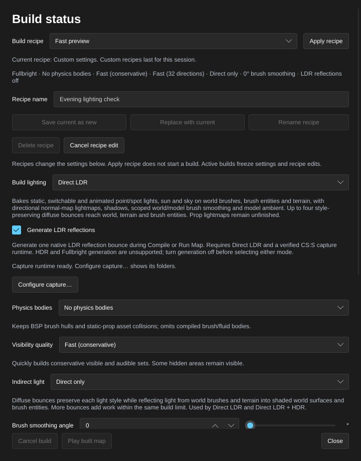

[← Manual](README.md)

# Generated LDR reflections

Generate reflections for the map's `env_cubemap` samples as part of **Compile** or **Run Map**. One build compiles the scene, captures one LDR reflection bounce in a private CS:S client, verifies the packed textures, then publishes the BSP. Generation starts disabled.

## Choose reflection generation

1. Place the map's `env_cubemap` entities using the entity tools and save the map.
2. Click **Build settings…**, or **Build details…** after a build.
3. Set **Build lighting** to **Direct LDR**.
4. Enable **Generate LDR reflections**. Read the capture runtime status below it. Enabling the setting does not launch CS:S.
5. Close the window, then click **Compile** or **Run Map**. Open **Build details…** to inspect capture and verification progress. **Run Map** plays the published result after the build succeeds.
6. To stop a build, click **Cancel build** and wait for cancellation and private-client cleanup to finish.

**Fullbright** and **Direct LDR + HDR** cannot generate reflections. Turn off **Generate LDR reflections** before choosing either mode. An incompatible update preserves the current lighting and generation settings.

## Configure the capture runtime

1. In the same window, click **Configure capture…**.
2. Under **CS:S installation override**, enter an installation folder or click **Choose CS:S folder…**. Leave it empty to use the mounted game's base directory when that directory verifies as a supported CS:S installation. A custom source-content folder needs an explicit supported installation when it cannot supply this default.
3. Under **Steam client override**, enter the existing Steam client root or click **Choose Steam folder…**. Leave it empty to resolve the root from the running Steam client when capture starts.
4. Click **Apply capture runtime** to validate and replace both overrides together. A rejected pair leaves the current configuration and your pending text intact. **Cancel runtime edit** discards the pending text.
5. Review the resolved installation and readiness message before starting the build. If another actor changes the runtime while the form is open, cancel and reopen the form to review the new pair.

Runtime paths apply to this machine. They are separate from the source-content mounts and stay outside build recipes and recent-map settings. Configuration does not launch a game. Capture uses a private client with `-insecure` and `sv_lan 1`.

## Recipes, recent maps and agents

**Save current as new** and **Replace with current** store the generation setting with the other build values. **Fast preview** and **Final lighting** keep generation disabled. Older recipes and recent-map files load with generation disabled. Opening a compatible recent map restores its saved generation setting.

Agents use `set_compile_settings` with `lighting:"direct_ldr"` and `generate_reflections:true`; both fields validate in the same update. `get_compile_settings` reports the current setting. `get_native_capture_runtime` inspects readiness, and `set_native_capture_runtime` replaces both machine overrides; omitted or null roots clear their overrides to automatic values. Existing `compile_map`, `start_compile`, `run_map`, `get_compile_status` and `cancel_compile` use the shared build job.

## Limits

- Generation supports Direct LDR and one capture bounce. HDR reflection capture, moving-scene reassignment and reflection preview inside the editor are unavailable.
- A supported CS:S installation, running Steam client, native runtime helper and private compositor dependencies must pass preflight. Unsupported materials, sample sizes, missing assets or unverified captures fail the build with diagnostics.
- Active builds freeze compiler settings and runtime configuration. Changing generation afterward makes a previous build stale while its saved settings differ.
- Failed, cancelled or stale generation preserves the previously published BSP. Capture does not add map Undo entries. **Cancel build** remains pending until owned processes stop and the preservation audit finishes.
- Sample records and temporary bootstrap textures alone do not count as generated reflections. A BSP becomes available only after capture, packed-asset verification and publication succeed.
