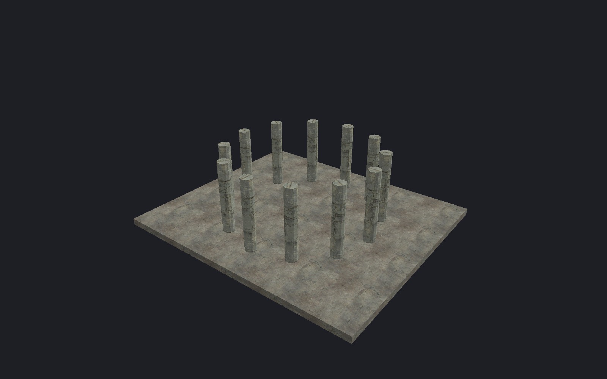
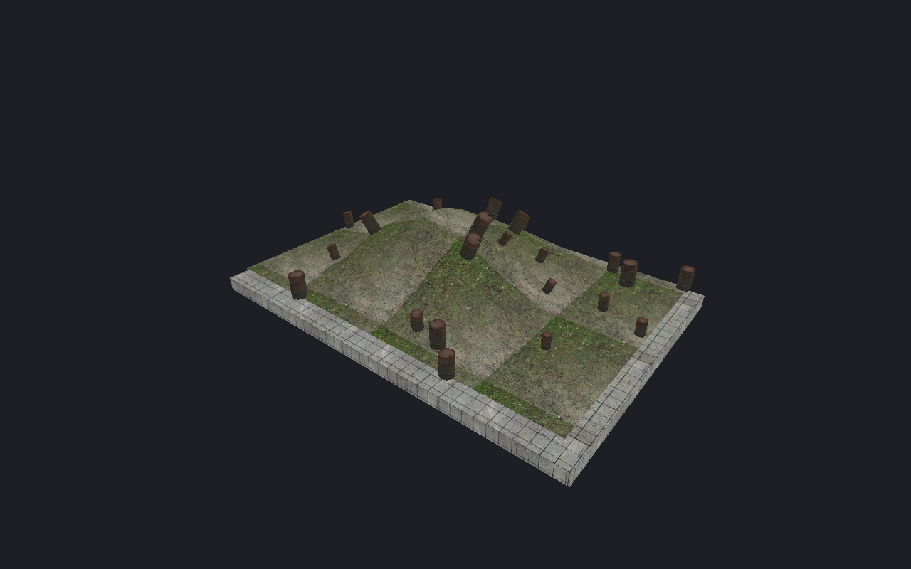

[← Manual](README.md)

# Repeated placement

Create regular arrays or scatter copies across selected brush and terrain surfaces.

## Create an array

1. Select 1–16 objects.
2. Open **Repeat array…**.
3. Set **Additional copies**.
4. Choose **World** or **Source local** under **Step space**.
5. Set **Move step · units** and **Rotate step · °**.
6. Set **Scale factor per copy**.
7. Choose **Selection center**, **Current transform pivot** or **Custom world point** under **Pivot source**. Enter coordinates for **Custom world point**.
8. Choose **Keep textures attached** as required.
9. Review **Naming and references** as described below.
10. Click **Preview array**.
11. Inspect the geometry and generated names.
12. Click **Apply placement**.

For a ring, use zero movement and a Z rotation step.
A scale factor of 1 keeps size; 1.1 gives 10% growth per copy.
Every copy starts from the originals. Scale applies before rotation and movement.
One Undo removes the entire array. **Cancel** discards only the preview.

**Current transform pivot** uses the [pivot configured in the Inspector](brushes.md#attach-the-pivot-to-a-vertex), including
point-entity, brush-corner, terrain-vertex and supported model-vertex attachments.
An unavailable anchor reports an error; it does not switch to the selection
center. Each preview captures one world point and
one source frame for all copies.
Vertex attachments retain their source topology/grid or cached model identity
requirements. Reusing array settings resolves the current binding again;
model reloads or unavailable sources report an error before a new preview.

## Reuse the last applied array

1. Select the objects for the new array.
2. Open **Repeat array…** and click **Use last array settings**.
3. Review the loaded steps and **Pivot source**.
4. Click **Preview array**, inspect the result, then click **Apply placement**.

The selection center, current transform pivot and source-local axes resolve
again for the new selection. A custom world point stays fixed. Only a successful
**Apply placement** of an array updates the remembered settings; previewing,
cancelling or applying scatter does not. The settings include naming and link
policies, with no old object IDs or captured source frame.

## Set names and links

1. Under **Naming and references**, choose **Name format**.
2. Set **Name prefix**, **Name suffix** and **Start index**.
3. Choose **Internal links** and **External links**.
4. Preview and inspect the generated names and links before **Apply placement**.

| Control | Result |
| --- | --- |
| **Source name + index** | Prefix + original name + suffix + index. |
| **Index before source name** | Prefix + index + `_` + original name + suffix. |
| **Follow each copy** | Exact internal links target entities in the same copy. |
| **Keep original targets** | Internal links retain their targets in the original assembly. |
| **Keep external links** | Declared named links outside the assembly retain their targets. |
| **Reject external links** | Refuse a source assembly with those outside links. |

The default names use the original name, `_copy` and an index starting at 1.
Name collisions receive a checked suffix. Ambiguous links and names that would
acquire existing references refuse. Procedural `!` targets keep their intrinsic
behavior.

## Scatter over surfaces

1. Select the whole objects to copy.
2. Open **Brush → Surface scatter…** and click **Use selected objects**.
3. Choose **Select → Faces** and select the target brush or terrain faces.
4. Return to **Surface scatter** and click **Use selected faces**. Check the captured IDs.
5. Set **Additional copies** and **Seed**.
6. Choose **Align to surface** as required.
7. Set **Heading range · °**, **Uniform scale range** and **Normal offset · units**.
8. Keep **Automatic placement anchor**, or clear it and choose **Pivot source**. Enter coordinates for **Custom world point**.
9. Review **Keep textures attached** and **Naming and references**.
10. Click **Preview scatter** and inspect the placements.
11. Click **Apply placement** or **Cancel**.

Each copy repeats the entire captured source assembly. The seed and the same
admitted sources, faces and settings reproduce the placements. Larger triangles
receive proportionally more samples. Terrain uses its prepared triangles.

**Align to surface** maps source-local +Z to the sampled normal. The first source
in stable object-ID order supplies the captured axis. Heading rotates around
the normal when aligned, or world Z otherwise. **Normal offset · units** moves
the source pivot along the sampled normal. **Automatic placement anchor** uses
a single point source's origin, or the bounds center for other assemblies.

Each copy receives one uniform factor from **Uniform scale range**. Copies can
overlap or enter geometry. Scatter does not settle objects with physics or keep
them attached to their target surfaces. One Undo removes the whole placement.

## Limits

- 64 additional copies, 256 new objects including owned brushes, and 8192 new sides.
- 1–16 source objects and 1–32 authored target faces for scatter.
- Geometry must stay within ±65536 units.
- Plain point origins follow XYZ array factors. Authored MDL models require equal XYZ factors and resulting native `modelscale` within 1/64–64.
- Static/detail model resizing, nonuniform MDL deformation and non-MDL model scaling are unsupported.
- Prefix and suffix each fit 32 UTF-8 bytes; generated names fit 128 bytes. Indices stay within 1–1,000,000.
- Scatter heading ranges stay within ±360°; scale factors must be positive. Normal offset stays within ±65536 units.
- Scatter targets are authored brush faces and terrain. Model, instance and animated surfaces are unsupported.
- Complex targets can exceed the surface work limits and refuse before preview.
- Ambiguous names, scripted internal links and unsupported numeric references reject.
- Rotation or scaling rejects unsupported opaque or spatial metadata.
- Changed maps, definitions or captured sources require a fresh preview. Failed requests preserve the previous preview.
- Apply before saving or compiling. Those operations use committed geometry.
