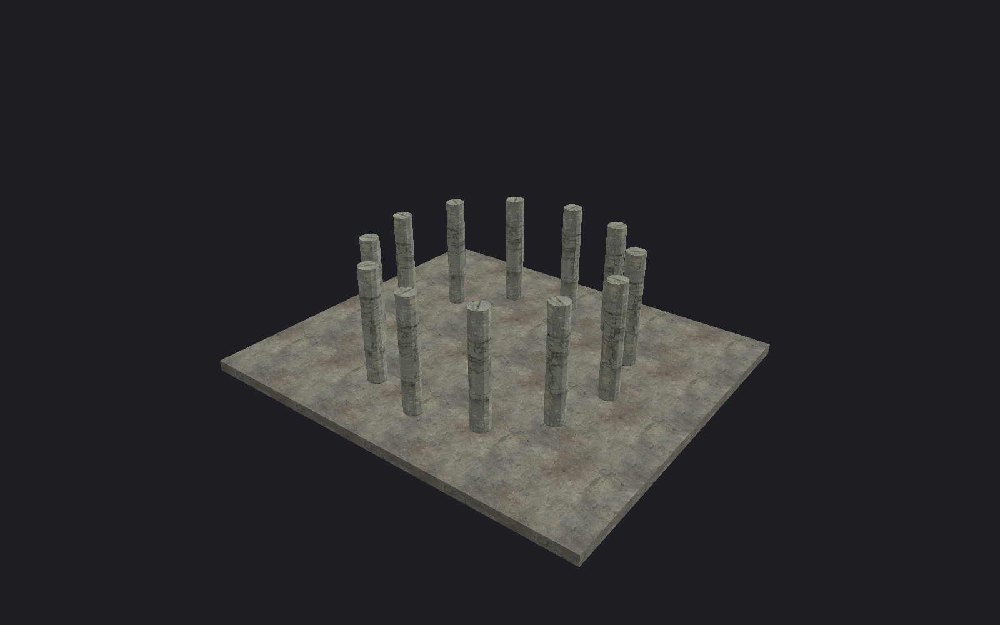

[← Manual](README.md)

# Repeated placement

Create a line, ring or scaled array from existing objects.

1. Select 1–16 objects.
2. Open **Repeat array…**.
3. Set **Additional copies**.
4. Choose **World** or **Source local** under **Step space**.
5. Set **Move step · units** and **Rotate step · °**.
6. Set **Scale factor per copy**.
7. Set **Fixed world pivot**.
8. Choose **Keep textures attached** as required.
9. Click **Preview array**.
10. Inspect the geometry and generated names.
11. Click **Apply array**.

For a ring, use zero movement and a Z rotation step.
A scale factor of 1 keeps size; 1.1 gives 10% growth per copy.
Every copy starts from the originals. Scale applies before rotation and movement.
One Undo removes the entire array. Cancel discards only the preview.

## Limits

- 64 additional copies, 256 new objects including owned brushes, and 8192 new sides.
- Geometry must stay within ±65536 units.
- Scaling requires brushes or brush entities. Point/model size scaling is separate.
- Supported internal references follow each copy's unique names. External links remain unchanged.
- Ambiguous names, scripted internal links and unsupported numeric references reject.
- Apply before saving or compiling. Those operations use committed geometry.
