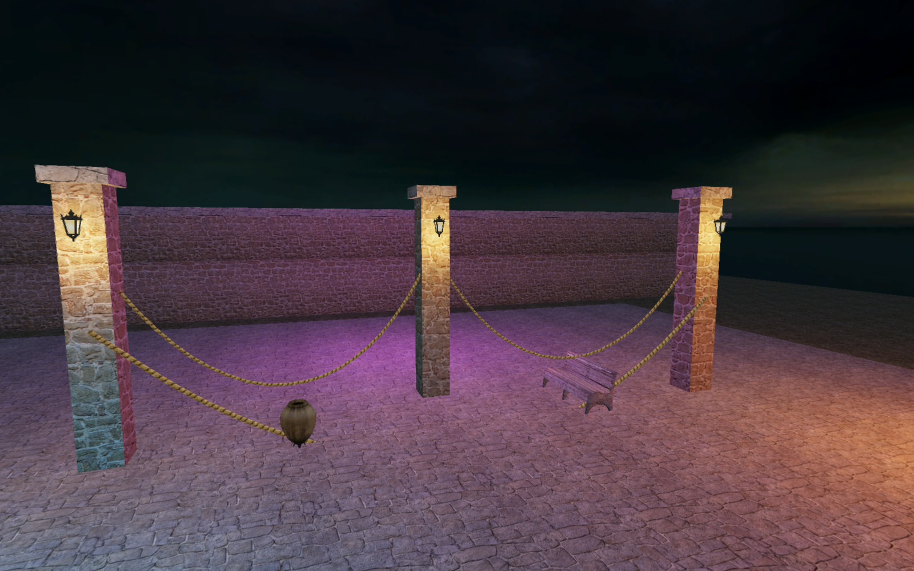
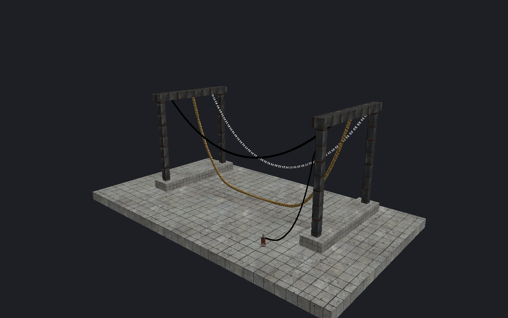

[← Manual](README.md)

# Ropes

Place a rope between surfaces. Preview its material, motion and supported
contact with the world.

## Place a rope between surfaces

1. Choose **Textured**, then open **Entity → Place rope…**.
2. Set **Material**, or click **Browse…** to choose a mounted material.
   Set **Slack** and **Width**.
3. Click **Pick start**, then click a visible world surface in a 3D viewport.
4. Click **Pick end**, then click the second surface.
5. Review both positions and the displayed span, then click **Apply rope**.

The operation creates a named `move_rope` and `keyframe_rope` with their
**Next KeyFrame** link. One Undo removes the pair.
To display the placed span, [prepare its preview](#preview-a-rope).

Surface picks capture fixed world positions. They do not parent the endpoints
to the picked objects. Use **Cancel** to discard the placement. Apply or cancel
before saving, compiling or playing.

The form starts with `cable/rope`, Slack 150 and Width 2. Use `cable/cable` or
`cable/chain` when supplied by the mounted game. A shared placement keeps its
reviewed settings; click **Review shared placement** when prompted. **Close**
leaves that shared draft unchanged.

**Slack** is the native length setting. Its nominal extra length is
`Slack − 100` units. A value of 100 adds no nominal length; larger values allow
more sag. The spring length also rounds to whole units per segment. Slack is
not a force or a tension measurement.

## Build a chain

1. Use **Entity…** to place `move_rope` and `keyframe_rope` entities.
2. Give each endpoint a unique **Name**.
3. Set **Next KeyFrame** to the next endpoint's name. Leave this field empty
   on the final `keyframe_rope`.
4. In **Inspector**, set **Slack**, **Width (1-64)**, **Type**,
   **Subdivision**, **Rope Material** and **Texture Scale**.
   Set **Collide with world**, **Start Dangling** or **Disable Wind** to
   **Yes** when needed.

## Preview a rope

1. Choose **Textured**, then open **View → Rope preview…** and enable
   **Enable rope preview**.
2. Click **Prepare preview**. Read **Spans**, **Material**, **Attachments**,
   **Physics** and any **Needs attention** messages.

Edit rope fields in **Inspector**, then prepare again. An unavailable source
or asset makes the requested preview unavailable. Each outgoing span simulates
independently, including self links and cycles.

An `info_target` can also be an endpoint. With `Dangling` set to `1`, an absent
or empty `NextKey` uses an initial end seed at world origin `0 0 0`, with derived
rope length 0 and no target. The list shows **World-origin end seed**. A nonempty
unresolved `NextKey` still reports an error.

## Play or inspect a time

1. Click **Play**. Click **Pause** to stop automatic playback; current work
   finishes before the timeline stops.
2. Release the **Time** slider at a new time, or enter seconds and click
   **Seek**. Seeking pauses playback.
3. Click **Reset** to pause and return to the initial pose.
4. Use **Cancel work** to stop pending work and clear the prepared
   pose. Prepare again to resume.
5. Use **Refresh** to read shared state after another interface changes it.

The initial pose includes five seconds of gravity settling before time 0.
The window shows the published pose time separately from a pending requested
time. Playback suspends while its document tab is inactive.
**Close** and <kbd>Escape</kbd> pause playback before closing the window.

To change the editor acceleration, expand **Environment**, set **Gravity**
and **Wind** X/Y/Z, then click **Apply environment**. Changing these values
pauses playback and invalidates the prepared pose; prepare again. These
settings do not change entity fields or saved startup defaults.
Map `env_wind` is not evaluated.

## Parent an endpoint

1. Give an unparented `info_target`, `prop_dynamic` or
   `prop_dynamic_override` a unique **Name**.
2. Place the rope endpoint at its desired world position.
3. Set **Parent** to the parent's name. For a supported fixed model
   attachment, use `parentName,attachmentName`.
4. Prepare again and read **Attachments**.

The binding preserves the authored world offset; it does not snap the rope to
the attachment. Attachment tokens are names, including numeric names.
Model parents require a supported fixed model at scale 1. Parent chains and
animated models are unavailable.

## Frame and select a span

1. Enable **Rope preview** and prepare a pose.
2. Click a span to select its source entity.
3. Press <kbd>F</kbd> to frame that source's helper and complete outgoing span,
   including its width.
4. Use a marquee or **Select a volume…** around the curve to select its source.
   Choose **Fully inside the box** to require the complete helper and span,
   or **Intersects the box** to accept overlap. Marquee uses **Fully inside**
   and **Intersects**.

Rendering, picking and presentation bounds use the same prepared pose.
Framing, object inspection and area/volume selection use conservative
axis-aligned boxes around that pose and half its **Width**. These boxes can
include empty space; they do not test exact tube intersection.

Incoming spans do not enlarge their target. Disabled, unavailable, hidden or
working-region-excluded spans keep ordinary endpoint behavior. Changing the
displayed rope state retires pending marquee and volume reviews.
Transform pivots, snap anchors, placement, paint and raw map statistics keep
ordinary endpoint-helper bounds.

## Limits

- Surface placement accepts visible world and `func_detail` brushes and
  terrain. Model props, brush-model entities, instance contents and moving
  attachments are unavailable. **Apply rope** checks the map, surfaces and
  material again and refuses stale placement. Cancel and start again when a
  placement becomes stale; **Review shared placement** does not refresh it.
- The placement span uses five seconds of settling with gravity 1500 units/s²,
  zero wind and no collision. Set **Collide with world** to **Yes** in
  **Inspector**, then prepare the placed rope when world contact is needed.
- At most 512 source spans and 72 visual segments per span; coordinates within
  ±65536. Slack: −2048–2047. Width: 1–64. TextureScale: 0.1–10. Derived rope
  length: 0–16383.
- Time: 0–60 seconds; physics uses 0.02-second steps with interpolated poses.
  Gravity: 0–3000 units/s².
  Each wind component: −1000–1000 units/s². Wind applies after initial settling;
  native gust randomness and view-distance behavior are unavailable.
- `Type` uses 10 nodes for Rope, 4 for Semi-rigid and 2 for other values;
  omitted `Type` uses 5. `Subdiv` accepts 0–15 and clamps values above 7 to 7.
  Omitted values use Slack 0, Width 2, Subdiv 2 and TextureScale 4.
- World contact uses a fixed ±2 node box against supported static world and
  `func_detail` brushes and terrain. Width does not change this box. Brush-model
  entities and model props are excluded. Temporary editor visibility and
  working regions do not remove world collision sources. Only nodes collide;
  the drawn tube can cross a surface between nodes.
- Mounted static `Cable` and `UnlitGeneric` base textures support cutout and
  translucent alpha on an editor tube. Cable bump mapping, native lighting,
  billboard antialiasing and optional `_back` materials are not rendered.
  Cutout tube display requires a 0.5 reference; other cutoffs report unavailable.
  Unsupported or animated materials report unavailable.
- No runtime inputs, breakage, animated parents, player interaction or native
  frame/lighting/pixel match. Preview controls preserve map bytes, selection,
  camera and Undo history.

<!-- page-nav -->

---

[← Sky previews and assets](sky.md) · [Manual](README.md) · [Models →](models.md)
