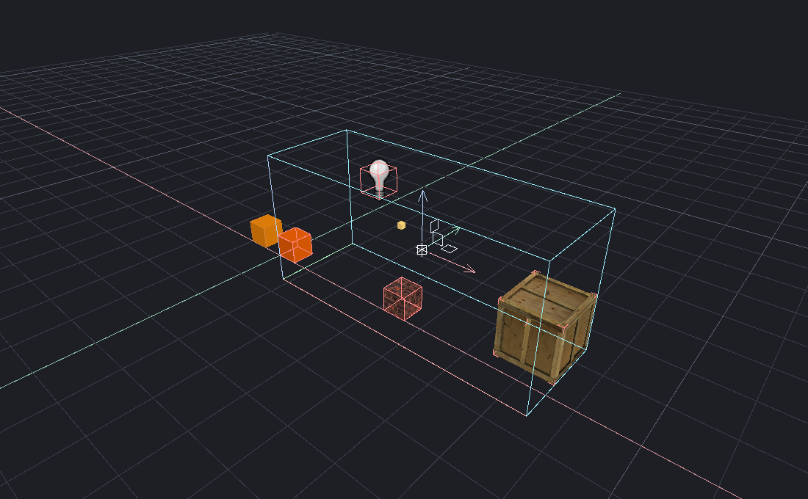

[← Manual](README.md)

# Helpers and selection

Control resource display and inspect the complete selection without changing map data or picking.

## Choose display categories

1. Open **Overlays** in the viewport header.
2. Use **Authored models** for MDL meshes. Hidden meshes retain wire bounds.
3. Use **Sprite resources** for static sprites, **Entity images** for FGD icons,
   and **Entity model guides** for FGD studio resources.
4. Use **Entity helpers** for ordinary point/light markers and FGD geometric guides.
5. Keep **Selection tint** and **Selection outlines** on or off independently.

Known resource errors retain amber bounds and inspection messages. Measurements,
clipping and other task guides have separate controls.

## Inspect a selection

1. Select objects, groups, individual child brushes or faces.
2. Read the Inspector's category counts and **Size · X / Y / Z**.
3. Enable **Overlays → Selection bounds** for the aggregate box, center and XYZ extents.
4. Use area, volume or paint selection. Counts and bounds follow the highlighted candidates.

**In region** and **hidden/outside** describe authored/editor visibility and the
working region. They do not count display-category switches or tool-material hiding.

## Save defaults

1. Set the switches under **Overlays**.
2. Open **Edit → Preferences → Preview defaults…**.
3. Choose **Save current as defaults**. Use **Apply saved defaults** to restore them.

## MCP

Use `get_view` and `set_view` with `authored_models`, `sprite_resources`,
`entity_helpers` and `selection_bounds`. `render_view` accepts temporary overrides.
`get_selection_presentation` returns complete counts and dimensions;
`get_helper_presentation` returns category settings and relevant cached errors.
Set `sprite_resources` explicitly when changing `entity_images` independently.

## Limits

- These are display controls. Hidden helpers remain selectable through their source bounds.
- Models and sprites retain existing pose, material and static-resource limits; runtime effects are not simulated.
- Bounds are axis-aligned, not collision hulls. Unknown identities or incomplete bounds are explicitly unavailable; no partial box is shown.
- Ordinary switches do not edit source, Undo history or saved defaults.
