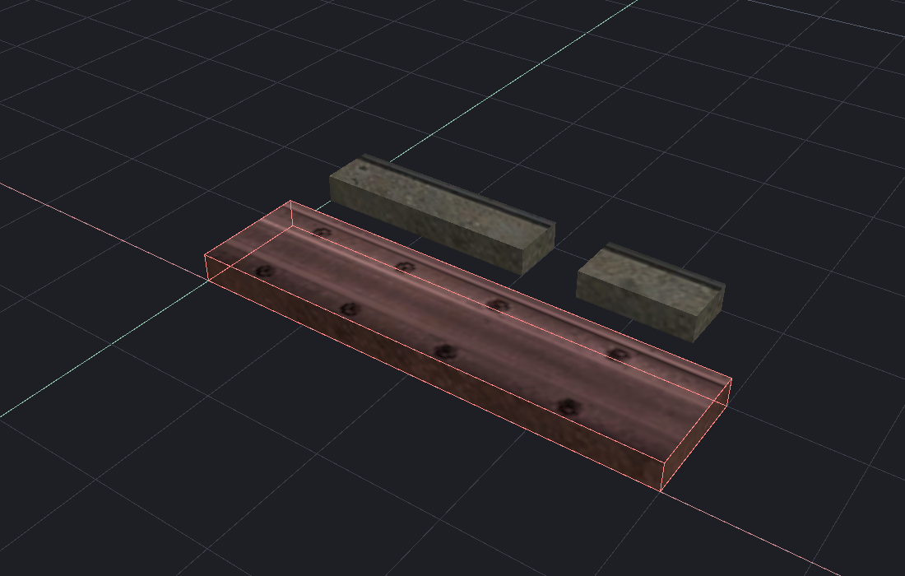

[← Manual](README.md)

# Selection

Choose objects, faces or bounded groups of visible geometry.

## Pick objects or faces

1. Choose **Objects** or **Faces** in the toolbar.
2. Click the target.
3. Use Ctrl+click to toggle membership.

Use **Select → Pick world brushes**, **Pick brush entities** and **Pick point entities and models** to choose which types clicks can select.
Alt+click cycles overlapping object hits. **Bypass groups** selects individual members.

## Choose the object selection unit

1. Choose **Objects** in the toolbar.
2. Open **Select → Object selection**.
3. Choose **Groups**, **Objects** or **Solids**.
4. Click, Alt+click, drag an area, select a volume or paint to select those units.

**Groups** selects the outermost native group, including nested groups and visible
members. **Objects** ignores groups and selects a complete world brush or entity.
**Solids** selects one world brush or one brush inside a brush entity. Point
entities, models, helpers, ropes and instance references remain individual entities.
**Bypass groups** in **Object groups…** switches between **Objects** and **Groups**.

Selected child brushes show their owning entity in the Inspector. Move, transform,
material editing and component tools act on those brushes; duplicating a child
keeps its copy in the same entity. Undo restores the entity and its brushes together.
Deleting the last brush keeps the empty entity; ordinary map checks and compilation
still determine whether that entity class is valid without geometry.
Use **Objects** or **Groups** for commands that require complete objects, including
Copy, Cut, repeat arrays, surface placement, instance extraction and editor hiding.

Changing the mode retains the selection. The next area, paint or additive click
interprets selected brush entities as visible individual brushes in **Solids**,
and selected children as their complete owners in **Objects** or **Groups**.

## Show selection

1. Open **Overlays** in the viewport header.
2. Use **Selection outlines** to show or hide selected edges.
3. Use **Selection tint** to show or hide the surface highlight.

These switches keep selection and picking active.

## Save selection defaults

1. Choose **Select → Object selection** and the types in the **Select** menu.
2. Choose **Edit → Preferences → Selection defaults…**, then **Startup defaults**.
3. Compare **Current session** with **Startup defaults**.
4. Click **Save current as defaults** to use these rules for future documents.
5. Click **Apply saved defaults** to restore the saved rules in this document.

**Reload defaults** reads changes from disk without applying them.
**Reset saved defaults** saves **Groups** with all three types enabled; click **Apply saved defaults** to use them now.
If the dialog reports a storage error, repair the file and click **Reload defaults**,
or explicitly replace it with **Reset saved defaults**.

## Named selection profiles

1. Choose **Select → Object selection** and the types in the **Select** menu.
2. Choose **Edit → Preferences → Selection defaults…**, then **Named profiles**.
3. Enter **Profile name**, then click **Save current as profile**.
4. Click a saved name in the list, then **Apply selected profile**.

**Replace selected profile** saves the current mode and filters under the selected name.
To rename it, edit **Profile name**, then click **Rename profile**.
**Delete profile** removes the selected saved profile.

Profiles and startup defaults are separate. Saving or editing profiles never
changes current rules or startup defaults. Apply affects only this document.
**Reload defaults** refreshes both lists without applying them.

## Area selection

1. Choose **Intersects** or **Fully inside** under **Area**.
2. Choose **Replace**, **Add**, **Remove** or **Toggle**.
3. Drag a selection rectangle from empty viewport space.
4. Review the highlighted result while dragging.
5. Release to select the matches.

Escape cancels the drag. Changing the area controls discards any pending preview.

## Volume selection

1. Open **Select a volume…**.
2. Set **Minimum**, **Maximum**, **Match** and **Combine**.
3. Click **Preview matches**, then **Frame box**.
4. Inspect the geometry inside the box.
5. Click **Select matches**, or **Cancel**.

For terrain samples, retain the volume and use **Terrain triangles… → Select in volume**.

## Paint selection

1. Enable **Paint selection**.
2. Set **Radius**.
3. Paint over visible targets.
4. Release to apply the selection.

Escape cancels an active stroke.

## Temporary editor visibility

Use **Hide selected in editor** to remove targets from editor picking and display.
Use **Show all editor-hidden** to restore them.
This is separate from saved map visibility and [working regions](working-region.md).
Assign either action under [Keyboard shortcuts…](keyboard-shortcuts.md). Both start unbound.

## Limits

- Hidden targets are excluded. Type filters limit seeds by their owning type: brush-entity children use **Pick brush entities**. **Groups** expands enabled hits to complete visible groups. **Fully inside** requires the entire visible unit inside: group, entity or individual brush according to the mode.
- Faces, components, geometric queries and explicit ID operations bypass type filters. The MCP `select` tool keeps its world-brush/entity contract; `select_solids` selects exact numeric brush IDs, including entity children. Inspect `get_objects` or `get_selection` for owner IDs and bounds.
- Changing modes or filters retains existing selection and ends pending object-selection gestures. It does not end face or texture strokes.
- Profiles and startup defaults store the mode and three type switches. Saving, reloading or resetting defaults leaves current rules unchanged; applying affects only this document. **New** and **Open** retain current rules in the same document session. Older saved filter-only files load with **Groups**.
- Other running editors may require **Reload defaults** after saved defaults change. Storage errors disable Save and Apply until Reload or an explicit Reset succeeds.
- Keep at most 32 profiles with case-insensitively unique names of 1–80 UTF-8 bytes. **Reset saved defaults** retains valid profiles; unreadable profiles without a valid retained copy require file repair before Reload.
- Loaded models use transformed bounds for area and volume matching; point picking uses mesh triangles.
- Terrain selection follows the displaced sheet, not its former parent volume.
- Overlap cycling retains up to 64 ordered hits.
- Asset reload or source changes can end active selection gestures; start a fresh review.
