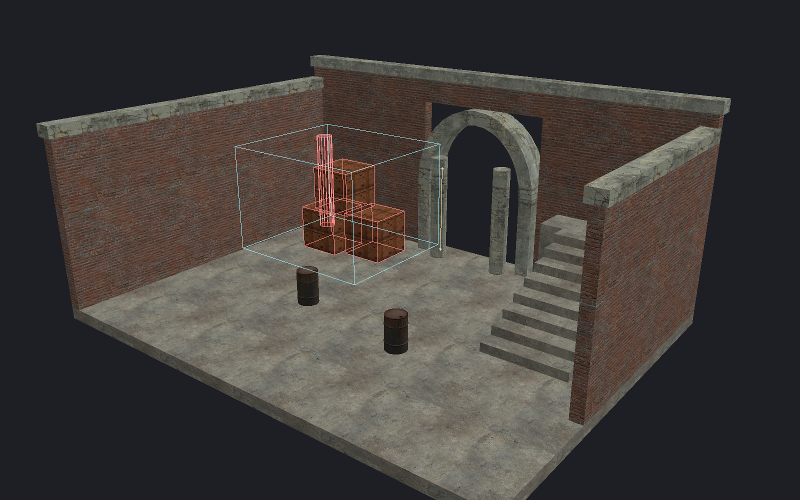

[← Manual](README.md)

# Selection

Choose objects, faces or bounded groups of visible geometry.

## Pick objects or faces

1. Choose **Selection → Objects** or **Faces · materials & textures**.
2. Click the target.
3. Use Ctrl+click to toggle membership.

Use **Pick object types** to allow **World brushes**, **Brush entities** and **Point entities & models**.
Alt+click cycles overlapping object hits. **Bypass groups** selects individual members.

## Show selection

1. Open **Viewport**.
2. Use **Selection outlines** to show or hide selected edges.
3. Use **Selection tint** to show or hide the surface highlight.

These switches keep selection and picking active.

## Save selection defaults

1. Choose the types under **Pick object types**.
2. Open **Selection defaults…** and choose **Startup defaults**.
3. Compare **Current session** with **Startup defaults**.
4. Click **Save current as defaults** to use these filters for future documents.
5. Click **Apply saved defaults** to restore the saved filters in this document.

**Reload defaults** reads changes from disk without applying them.
**Reset saved defaults** saves all three types enabled; click **Apply saved defaults** to use them now.
If the dialog reports a storage error, repair the file and click **Reload defaults**,
or explicitly replace it with **Reset saved defaults**.

## Named filter profiles

1. Choose the types under **Pick object types**.
2. Open **Selection defaults…** and choose **Named profiles**.
3. Enter **Profile name**, then click **Save current as profile**.
4. Click a saved name in the list, then **Apply selected profile**.

**Replace selected profile** saves current filters under the selected name.
To rename it, edit **Profile name**, then click **Rename profile**.
**Delete profile** removes the selected saved profile.

Profiles and startup defaults are separate. Saving or editing profiles never
changes current filters or startup defaults. Apply affects only this document.
**Reload defaults** refreshes both lists without applying them.

## Area selection

1. Choose **Intersects** or **Fully inside** under **Area**.
2. Choose **Replace**, **Add**, **Remove** or **Toggle**.
3. Drag a selection rectangle from empty viewport space.
4. Review the highlighted result while dragging.
5. Release to select the matches.

Escape cancels the drag. Changing the area controls discards any pending preview.

## Volume selection

1. Open **Select a volume…**.
2. Set **Minimum**, **Maximum**, **Match** and **Combine**.
3. Click **Preview matches**, then **Frame box**.
4. Inspect the geometry inside the box.
5. Click **Select matches**, or **Cancel**.

For terrain samples, retain the volume and use **Terrain triangles… → Select in volume**.

## Paint selection

1. Enable **Paint selection**.
2. Set **Radius**.
3. Paint over visible targets.
4. Release to apply the selection.

Escape cancels an active stroke.

## Temporary editor visibility

Use **Hide selected in editor** to remove targets from editor picking and display.
Use **Show all editor-hidden** to restore them.
This is separate from saved map visibility and [working regions](working-region.md).
Assign either action under [Keyboard shortcuts…](keyboard-shortcuts.md). Both start unbound.

## Limits

- Hidden targets are excluded. Type filters limit object-selection seeds; eligible hits still select complete visible groups. **Fully inside** requires every visible group member inside.
- Faces, components, geometric queries and explicit object-ID selection bypass type filters. Changing filters retains existing selection and ends pending object-selection gestures.
- Profiles and startup defaults store the three type switches. Saving, reloading or resetting defaults leaves current filters unchanged; applying affects only this document. **New** and **Open** retain current filters in the same document session.
- Other running editors may require **Reload defaults** after saved defaults change. Storage errors disable Save and Apply until Reload or an explicit Reset succeeds.
- Keep at most 32 profiles with case-insensitively unique names of 1–80 UTF-8 bytes. **Reset saved defaults** retains valid profiles; unreadable profiles without a valid retained copy require file repair before Reload.
- Loaded models use transformed bounds for area and volume matching; point picking uses mesh triangles.
- Terrain selection follows the displaced sheet, not its former parent volume.
- Overlap cycling retains up to 64 ordered hits.
- Asset reload or source changes can end active selection gestures; start a fresh review.
