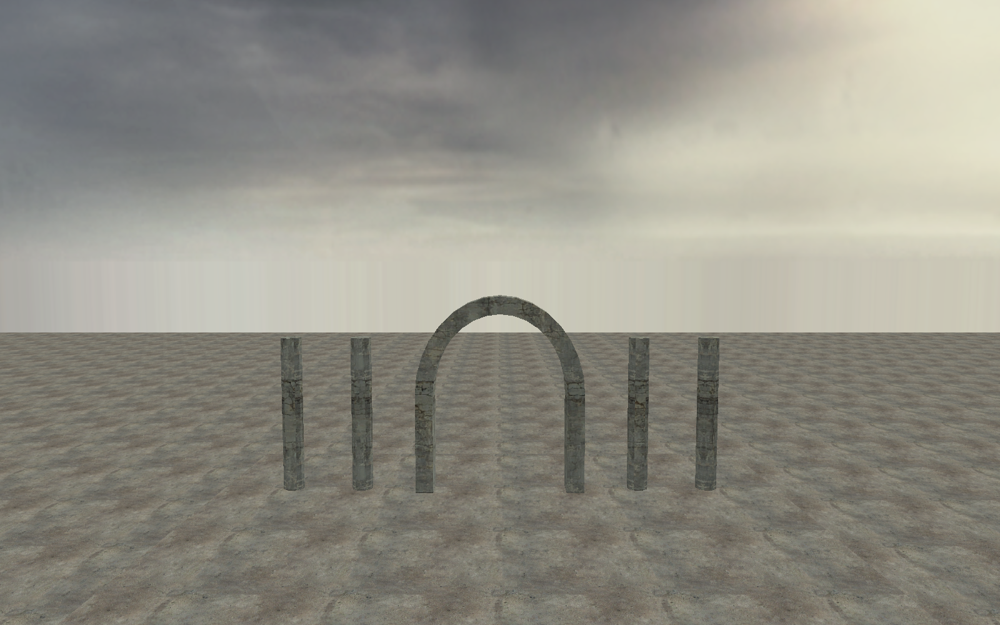
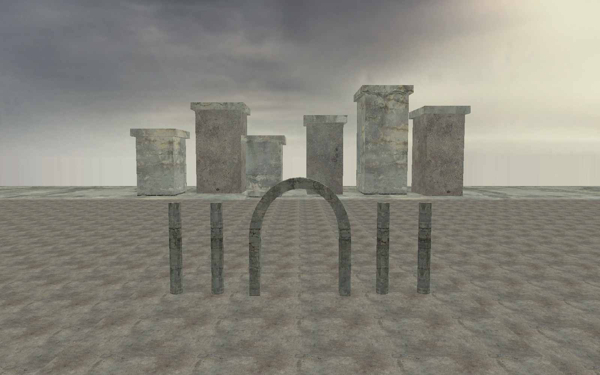
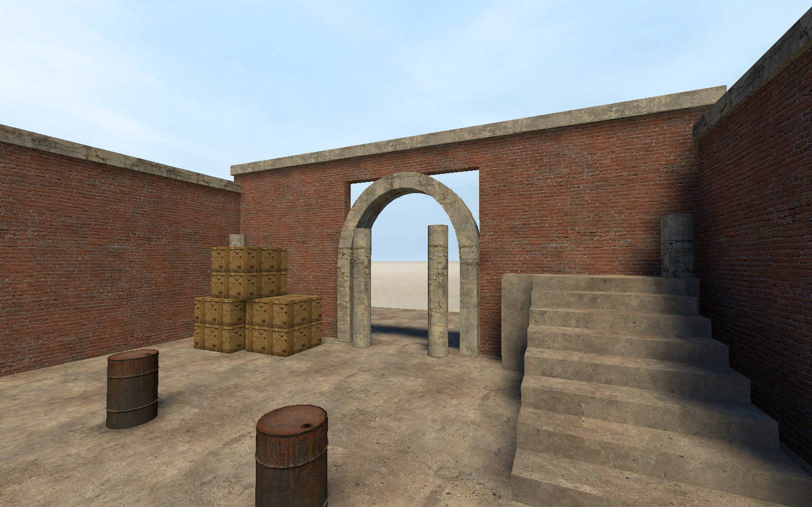

[← Manual](README.md)

# Sky previews and assets

Preview the map sky and inspect its mounted LDR and HDR assets.

## Set and preview the sky

1. Open **World settings…**.
2. Set **SkyBox Texture Name**, then click **Apply properties**.
3. Apply `tools/toolsskybox` to the intended sky surfaces.
4. Choose **Perspective** and **Textured**.
5. Enable **Tool textures** and **2D sky preview**.
6. Select **Sky channel → LDR**.

Sky previews fill eligible sky surfaces. They do not add compiled sunlight.
Use a `light_environment` for [sun and sky lighting](compile-and-play.md#lighting).

## Preview linear HDR sky images

1. Select **Sky channel → HDR · editor preview**.
2. Check that all six HDR faces are ready.
3. Adjust **HDR sky exposure (EV)**.

This exposure affects the editor sky only, not game tone mapping or baked lighting.

## Preview a 3D sky region

1. Build a separate, sealed miniature region from flat world brushes.
2. Use `func_detail` for decorative curves and structures.
3. Place `sky_camera` inside its open space.
4. Set **3D Skybox scale**; the default is 16.
5. Choose **Perspective** and **Textured**, then enable **Tool textures**.
6. Open **3D sky preview…**.
7. Choose **Sky camera**, or enter **Camera entity ID** and click **Use camera**.
8. Click **Prepare 3D sky**.
9. Check readiness, then enable **Enable 3D sky preview**.

Use **Cancel preparation** to stop the owned preparation.
Use **Refresh status** after source changes. Preparation errors remain explicit.
Use **2D sky preview** to fill space behind the miniature.

| 2D sky only | 3D sky preview enabled |
| --- | --- |
|  |  |

## Inspect mounted sky assets

1. Open **Inspect applied sky…**.
2. Inspect **LDR assets** and **HDR assets**.
3. Check Right, Back, Left, Front, Up and Down.
4. Use **Refresh sky assets** after asset changes.

Use **Reload material assets** to refresh cached sky display images.

## Compiled HDR skies

Choose **Direct LDR + HDR** for native HDR map data.
Enable **Pack sky assets** to embed the supported original sky files.
The game must enable full HDR to display its HDR channel.

## Limits

- Supported static six-face families only. Missing or malformed required faces report errors.
- 3D sky preparation is explicit; enabling the switch does not silently load or repair sources.
- 3D sky uses opaque materials with one base texture. Cutouts, transparency, normal maps and detail layers are unsupported.
- Miniature scale is an integer from 1 to 128. Camera angles do not rotate the miniature preview.
- The miniature uses unlit textures. It does not preview fog, authored lighting, models, terrain or water.
- Native capture and packing can impose stricter limits than viewport display.
